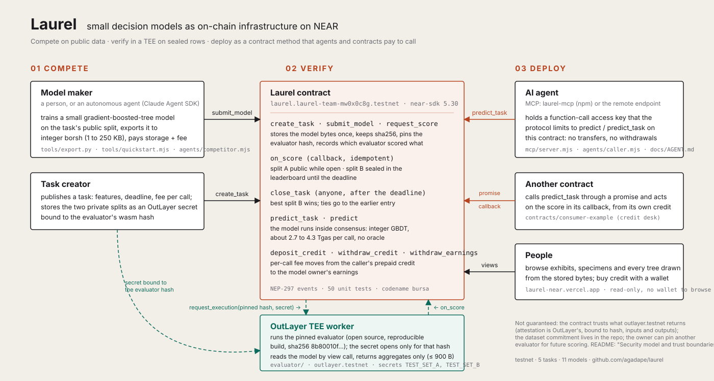
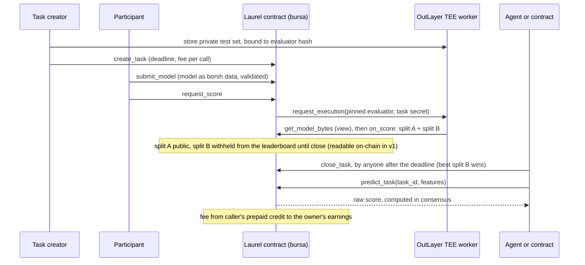

# Laurel — a model competition on NEAR where nobody grades their own test

[](https://github.com/agadape/laurel/actions/workflows/test.yml)

**Try it in 10 seconds, no wallet, nothing to install.** Open https://laurel-near.vercel.app and press **Ask the champion** → see the winning model answer a real case, the NEAR testnet transaction in which the contract computed that answer, the 0.001 NEAR fee credited to the model's owner, and what actually happened in that case (right or wrong, shown either way). The site's guest account pays, with a key that can call the prediction methods and nothing else.

**The problem.** Between 8 June and 2 August 2026, 4,407 new `.near` accounts did something in their first week on NEAR mainnet. Only 12.4 % of them acted again between day 30 and day 90 ([our query of NEAR's public BigQuery dataset](tasks/near-retention/README.md)). Wallets, relayers and quest programs pay to bring every one of those accounts in, so a model that says after week one *which* accounts will stay is worth money to them. Today whoever sells such a model also reports its accuracy, on a test set they chose and may have tuned on; the buyer cannot check it, and a smart contract cannot use the model at all without trusting someone's server and API key.

**What Laurel does.** An open competition contract on NEAR. Anyone posts a task with a private test set; anyone enters a small model **as data**. OutLayer scores each model inside a TEE, on rows that only the evaluator whose hash the contract pins can read. A sealed split that no entrant sees until the deadline alone picks the winner. The winner then lives in the contract: any agent or contract calls `predict_task(task_id, features)`, the contract runs the model inside NEAR consensus, and every call pays the model's owner.

| Who | Pays | Gets |
|---|---|---|
| An AI agent or a contract that needs a decision | the task's fee per prediction (0.001 NEAR), from prepaid credit | an answer computed in consensus by a model with a public, sealed-split record; no API key, no server to trust |
| A model maker | the model's storage and the task's submission fee (0.1 NEAR) | every prediction fee its model earns, withdrawable on-chain with `withdraw_earnings` |
| A task creator (for example a wallet or quest program) | the task's storage | the best model for its question, chosen on rows nobody could tune on, plus the submission fees |

**What stops cheating.**
- **The sealed split decides.** On exhibit 03 the model that led the public leaderboard (#5, 75.50 %) lost on the sealed rows to #4 (66.50 %): tuning to the public board does not win.
- **Entries cost.** At most 3 per account per task, each paying storage and the 0.1 NEAR submission fee; scores are rounded to 50 bps, so each entry leaks little about the private rows.
- **Nobody can swap the scorer.** The test set opens only for the evaluator wasm whose sha256 the contract pins; every score records which evaluator wrote it.
- **A fooled agent cannot drain its owner.** The agent's key can call `predict_task` on this contract and nothing else: the protocol rejects transfers, other methods and other contracts before any code runs.

| | |
|---|---|
| **Live site** | https://laurel-near.vercel.app (public landing page; the explorer opens after connecting a NEAR testnet wallet, which creates no transaction. Without a wallet, the same data is one RPC call away: [Try it, A.4](#a-in-the-browser-2-minutes-a-near-testnet-wallet)) |
| **Contract** | [`laurel.laurel-team-mw0x0c8g.testnet`](https://testnet.nearblocks.io/address/laurel.laurel-team-mw0x0c8g.testnet) (NEAR testnet, codename `bursa`) · code hash `BVNELFchTXxedNghd8vDWFncVWxstXjmjo3R6WeeoB65` (v1.1, 6 Nov 2026) |
| **Proof: one model, three transactions** | **1. Scored in a TEE.** [`pU1FFm5k…`](https://testnet.nearblocks.io/txns/pU1FFm5kwhPsYg99kThw5oEubKEPmkaoCmoynftjnfD): `request_score` for model #4; OutLayer runs the pinned evaluator on the private rows and the score (71.00 % on the public split) comes back in the same transaction.<br>**2. The sealed split picks the winner.** [`Fx7k6sDC…`](https://testnet.nearblocks.io/txns/Fx7k6sDCUgVoVdVpjWLqGHoxcNE3tppEs2m8YYHD5EbB): `close_task` reveals split B and #4 wins with 66.50 %, ahead of #5, which led the public split.<br>**3. An agent pays for an answer.** [`B9cHP7YV…`](https://testnet.nearblocks.io/txns/B9cHP7YV9qBbBKNjnZSn5ZfB8szyU4rj7TVJdrhSkDN2): `predict_task` signed by a key that can only call the prediction methods; the contract runs the model and credits the 0.001 NEAR fee to the model's owner. |
| **Verify it yourself** | `node tools/verify_claims.mjs` from a clone (Node 18+; no install, no wallet, no key, read-only, about a minute). 21 checks against NEAR testnet: the deployed code hash is the wasm in this repo, the pinned evaluator is the evaluator in this repo, every scored model was scored by it, each champion is the best sealed score, on-chain predictions equal the same bytes scored locally, and every transaction cited in CLAIMS.md exists. Exit code 1 on any mismatch. Last run: [docs/VERIFY.md](docs/VERIFY.md) |
| **For AI agents** | remote MCP endpoint `https://laurel-near.vercel.app/api/mcp` (no install, no wallet) · npm package [`laurel-mcp`](https://www.npmjs.com/package/laurel-mcp) |
| **Evidence** | [CLAIMS.md](CLAIMS.md) maps every statement below to code, tests and transaction hashes |
| **Hackathon** | NEAR HACKATHON 2026 · tracks `agents`, `privacy`, `open` · sister project by the same team: [Undo](https://github.com/agadape/undo) (rule Q-015) |

[](https://laurel-near.vercel.app)

*The site as it is today, recorded from https://laurel-near.vercel.app and the explorer behind the wallet sign-in; every number on it is read live from the contract.*

## In one minute

| | |
|---|---|
| **How a model is judged** | A registry contract where anyone publishes a *task* with a private test set and anyone submits a small gradient-boosted-tree model **as data**. An OutLayer TEE worker scores each model on two private splits that only the contract's pinned evaluator can read. Split A is public while the task is open; split B stays sealed until close and alone picks the champion. The champion is then served by the contract itself: `predict_task(task_id, features)` runs the model inside NEAR consensus and pays a fee to the model's owner. |
| **Who uses it** | **Model makers** compete and earn per call. **AI agents** call the champion with a function-call key that the protocol limits to prediction. **Contracts** call it through a promise, like any other contract method. |
| **Tasks** | Two datasets. **NEAR account retention** ([tasks/near-retention](tasks/near-retention/README.md)): real mainnet data, 22 integer features from a fresh `.near` account's first 7 days, label `1 = still acting between day 30 and day 90`; the private rows are accounts nobody can look up. **Credit risk** on UCI German Credit (**simulation only**, see Limits): 18 features, label `1 = bad`. Both: balanced accuracy, 150 private rows per split. |
| **What is live (11 Nov 2026)** | 5 tasks and 15 submitted models on the final contract. Task 3 (credit risk) is closed: #5 led the public split (75.50 %), #4 won the sealed split (66.50 %) and became champion; #4 has served paid predictions ever since: 20 by our agents and scripts by 10 Nov, and one more for every press of **Ask the champion** on the site since 12 Nov (live count on the site and in `get_submission {"submission_id":4}`, field `calls`). Task 5 (NEAR account retention, mainnet data) is open until 2026-11-12 11:59 UTC with eight TEE-scored entries (83.50 / 83.50 / 83.50 / 83.50 / 83.00 / 83.00 / 82.50 / 82.00 % on split A). Four share the lead: the 1.6 KB baseline #7, the autonomous agent's 3 KB entry #10, and #14 and #15, entered from two more testnet accounts (`dexseu0.testnet`, `stevbeq.testnet`) with the one-command quickstart; #11 also came from the quickstart, #12 from the agent re-run after audit 2. Split B, which picks the champion, stays withheld until close. task 4 (credit risk, simulation) is open until 2026-11-25 with two entries, and the autonomous agent leads it too: on 9 Nov it entered #13 (12.5 KB, 80 × depth-2) and got 74.50 % on split A against the 71.00 % baseline. Anyone can enter either. |
| **Cost of one prediction** | 4.3 Tgas for a 33 KB, 50-tree model (≈ 0.0005 NEAR of gas) plus the task's 0.001 NEAR fee. |

## Why on NEAR

- **The model runs inside the contract.** Integer GBDT, no oracle round-trip: one prediction with a 33 KB / 50-tree model costs **4.3 Tgas** ([docs/GAS.md](docs/GAS.md)), so other contracts can compose it synchronously in a promise.
- **OutLayer**, a NEAR partner, runs the evaluator in a TEE. The test set is stored as a secret **bound to the evaluator's wasm hash**, and the contract pins that hash, so neither participants nor the operator can swap the scorer ([docs/EVALUATOR.md](docs/EVALUATOR.md)).
- **Function-call access keys** give capability-based authorization at the protocol level. An AI agent holds a key that can only call `predict_task` on this contract: the protocol itself rejects `withdraw_credit`, deposits, other contracts and transfers from that key ([docs/AGENT.md](docs/AGENT.md)).
- **Precise storage accounting** makes a 33 KB model affordable to keep on-chain; NEP-297 events make every score, close and prediction indexable.

NEAR features used: own contract (near-sdk 5.30), cross-contract promises and callbacks, function-call access keys with method restriction, OutLayer (TEE compute with hash-bound secrets, result returned into the calling transaction), NEP-297 events, precise storage accounting.

### Track fit

| Track | What Laurel contributes | Where to look |
|---|---|---|
| `agents` (Agent Economy) | Agents **pay for verified predictions** per call from prepaid credit, with a key the protocol restricts to `predict_task`; an MCP server gives any agent the exhibits, the model bytes, local inference and paid on-chain calls | [docs/AGENT.md](docs/AGENT.md), [docs/MCP.md](docs/MCP.md), `mcp/` |
| `privacy` (Private AI, TEE) | The benchmark's test set never leaves the enclave and opens only for the pinned evaluator hash; the deciding split's *rows* stay inside the enclave; its *score* is withheld from the leaderboard, the site and the MCP tools until close, but is readable on-chain in v1 (see Security model) | [docs/EVALUATOR.md](docs/EVALUATOR.md), SPIKE_LOG S30, `evaluator/` |
| `open` (Open Innovation) | A model competition whose winner becomes **permissionless, composable infrastructure**: an address other contracts call in consensus | [docs/CONSUMER.md](docs/CONSUMER.md), `contracts/consumer-example` |

## How it works





1. **Publish a task.** The creator stores the private test set at OutLayer as a secret bound to the evaluator's wasm hash, then calls `create_task` with a deadline, a submission fee and a fee per prediction.
2. **Submit a model as data.** `tools/export.py` turns a scikit-learn model into an integer GBDT (borsh, a few KB to 250 KB). `submit_model` validates its structure and stores the bytes once; `model_hash` (sha256) is kept.
3. **Score in the TEE.** `request_score` asks OutLayer to run the **pinned** evaluator, which reads the model through a `view` call, scores both private splits and returns at most 900 bytes of aggregates (balanced accuracy, F1, confusion counts). `on_score` writes the result on-chain.
4. **Close.** After the deadline anyone calls `close_task`; the best split-B score wins, ties go to the earlier submission.
5. **Serve and pay.** `predict_task(task_id, features)` runs the champion inside the contract. The caller's prepaid credit (`deposit_credit`) pays the task's fee to the model owner, who withdraws with `withdraw_earnings`.

## What is proven on testnet

| Claim | Evidence |
|---|---|
| Full journey from fresh accounts: task → 2 submissions → 2 OutLayer scores → leaderboard → close → agent `predict_task` → owner withdraws earnings; 17/17 negative paths rejected | [docs/E2E.md](docs/E2E.md) (every tx hash), `tools/e2e.mjs` |
| Scores computed in the TEE equal the local evaluator and the Python reference, bit for bit | `docs/E2E.md` ("matches local/Python"), `tools/eval_local.sh`, `crates/gbdt-core` tests |
| A different evaluator build cannot read the task secret | SPIKE_LOG S30, [docs/NEGATIVE_TESTS.md](docs/NEGATIVE_TESTS.md) §3 |
| Agent with a restricted key: 10 applicants screened, 4.31 Tgas/call, 4 forbidden actions rejected by the protocol | [docs/AGENT.md](docs/AGENT.md) |
| Another contract uses the model through a promise and pays from its own prepaid credit | [docs/CONSUMER.md](docs/CONSUMER.md), `contracts/consumer-example` |
| An MCP agent runs the champion locally and on-chain with the same raw score (811014 for holdout row 0 of task 3) | [docs/MCP.md](docs/MCP.md), tx `ZockCH1M…` |
| A second task on **real NEAR mainnet data** (account retention, 4,407 activated accounts from 43,927 registrar creations, BigQuery public dataset): 3 models scored in the TEE on 5 Nov, split-A readings 8350 / 8250 / 8200 bps equal to the local evaluator's | [tasks/near-retention/README.md](tasks/near-retention/README.md), CLAIMS rows 23–24 |
| Two more testnet accounts entered task 5 with the one-command quickstart: #14 (`dexseu0.testnet`, 20 trees, 3,191 B) and #15 (`stevbeq.testnet`, 60 × depth 2, 9,511 B), both scored 8350 bps on split A by the pinned evaluator | CLAIMS row 30, tx [`DhsKFATB…`](https://testnet.nearblocks.io/txns/DhsKFATB6T76gUKHFY3g4hdU5VqdEXFT8mfih4ZnjgZ9) / [`Soe2FVHy…`](https://testnet.nearblocks.io/txns/Soe2FVHyRv6ZpneFRcVVSuwvUhgepmx2y4aCQ4BehZR) (#15 submit / score) |
| An autonomous agent (Claude Agent SDK) trained, exported and entered a model in task 5 and the TEE scored it 8350 bps on split A; a second agent with a function-call key bought predictions from it on-chain, identical to the local scores | [docs/AGENTS.md](docs/AGENTS.md), transcripts in `agents/out/`, CLAIMS row 25 |
| A browser wallet buys prediction credit on the contract | tx [`4YHqm8GP…`](https://testnet.nearblocks.io/txns/4YHqm8GPUpv6kvMSiBzUP3UwTnhLoWp6tK3BoKrj8rfd) (0.05 NEAR via Meteor Wallet, 5 Nov) |
| Gas and storage costs | [docs/GAS.md](docs/GAS.md); 10 agent calls on the final contract (4 Nov): function receipt **4.340 to 4.341 Tgas**, whole transaction **4.652 to 4.653 Tgas** burnt (`tools/out/agent.json`), i.e. about 0.00047 NEAR of gas plus the 0.001 NEAR fee per prediction at the base gas price |

Unit tests: 52 in `contracts/bursa`, 3 in `contracts/consumer-example`, 4 in `crates/gbdt-core`, 1 in `evaluator` (`bash build.sh test`). The same tests run on every push, together with wasm compile checks, a syntax check of every Node script and the web build: [`.github/workflows/test.yml`](.github/workflows/test.yml).

## Try it

Each step is "do X → see Y". A needs only a browser; B to F need the tools listed in each step.

**Fastest check, nothing to install:** `node tools/verify_claims.mjs` → a table of 21 PASS lines and exit code 0. The script only reads: it compares the contract's code hash, pinned evaluator, tasks, scores, model bytes and the transactions cited in CLAIMS.md with what this repository says, and recomputes the paid predictions locally from the bytes it downloads. Public RPC nodes limit the request rate; if a line says UNREACHABLE, wait a minute and run it again ([last full run](docs/VERIFY.md)).

### A. In the browser (2 minutes, a NEAR testnet wallet)
0. No wallet yet: on https://laurel-near.vercel.app press **Ask the champion** → **see** one real `predict_task` on testnet, paid by the site's guest account (`guest.laurel-team-mw0x0c8g.testnet`, whose site key is a function-call key limited to `predict_task`/`predict`): the answer, the transaction link, the gas, the fee credited to the owner and the case's true label. `GET https://laurel-near.vercel.app/api/ask` shows the guest's remaining credit; if it runs out, the page runs the same on-chain bytes in the browser and says no transaction was sent. Source: `web/api/ask.mjs`, `web/src/landing/ask.js`.
1. Open https://laurel-near.vercel.app → **see** the landing page, read live from `laurel.laurel-team-mw0x0c8g.testnet`: a glass LAUREL sign lights up, then a scroll-driven observatory of glass panes, each one decision tree decoded from the model bytes stored on-chain; exhibit 05 (NEAR mainnet account retention) with every entry's split-A score and its split B still sealed; and exhibit 03, where the public leader loses on the sealed split. Click **Connect wallet to enter** (Meteor, Intear or Nightly on testnet; a free Meteor testnet account takes a minute; signing in creates no transaction) → **see** the exhibits (tasks). A deep link such as https://laurel-near.vercel.app/#/task/3 shows the landing page first and opens that exhibit right after the wallet connects. No wallet at hand: step 4 below reads the same contract state with `curl`, and the remote MCP endpoint needs no wallet either.
2. Click exhibit **03 Credit risk** → **see** the readings as a race: on split A #5 is ahead (75.50 %), the seal passes, and on split B, revealed because the task is closed, #4 takes the laurel (66.50 %); then #4's paid calls and earnings, and one card per model (one dot per private test row, orange = wrong). Exhibits **04** and **05** are still open, so their final score shows *Final at close* with a countdown instead.
3. Click **Specimen #4** → **see** its split-A and split-B readings, then walk through the model: pick any of its 50 trees, decoded from the on-chain bytes, and point at a leaf to read its rule (for example `checking_status > 1, then … → adds +0.111`); below, both private-row plates; *For developers* holds the pinned evaluator hash, the model sha256, the raw evaluator output and the owner's earnings.
4. Same data straight from RPC (needs `curl` and Python 3 for the decoding one-liner):
   ```bash
   curl -s https://rpc.testnet.fastnear.com -H 'content-type: application/json' -d '{"jsonrpc":"2.0","id":1,"method":"query","params":{"request_type":"call_function","finality":"final","account_id":"laurel.laurel-team-mw0x0c8g.testnet","method_name":"leaderboard","args_base64":"eyJ0YXNrX2lkIjozfQ=="}}' | python -c "import sys,json;print(bytes(json.load(sys.stdin)['result']['result']).decode())"
   ```
   → **see** JSON rows with `score_a_bps`, `score_b_bps`, `calls`.

### B. The whole journey from zero, on your own testnet account (≈ 6 minutes, ≈ 6 NEAR, 3.2 of them stay locked as contract storage)
Prerequisites: Node ≥ 20, a NEAR **testnet** account with **≥ 7 NEAR** (browser faucet: https://near-faucet.io, or `near account create-account sponsor-by-faucet-service …` which funds 10 NEAR) and its ed25519 private key.
```bash
cd tools && npm install && cd ..
cp .env.example .env            # then fill TEAM_ACCOUNT_ID and TEAM_PRIVATE_KEY
node tools/e2e.mjs --funder TEAM --minutes 3 --cleanup
```
→ **see** in the terminal: 5 fresh accounts, `deploy + new`, `create_task`, two `submit_model`, two `request_score` lines ending in `matches local/Python`, `[rejected] …` for every negative path, `waiting …s for the deadline`, `close_task`, three `predict_task` lines with labels, a `SUMMARY` with `scores_match_local: true`, then cleanup. The report with all hashes lands in `docs/E2E.md` and `tools/out/e2e.json`.
The private test set is the one we stored at OutLayer (owner `nh-spike-mvp62mw4.testnet`, profile `german-credit`, access `allow-all`, bound to evaluator hash `8b80010f…`); your fresh contract references it by `secrets_account/secrets_profile`, so you do not need our keys. To host your **own** secret and evaluator see [docs/EVALUATOR.md](docs/EVALUATOR.md).

Then open `https://laurel-near.vercel.app/?contract=<your bursa-… account>` → **see** your run in the explorer.

### C. Rebuild and test (Linux/WSL with Rust 1.8x, `cargo-near`, target `wasm32-wasip2`)
```bash
bash build.sh test        # 52 bursa + 3 credit-desk + 4 gbdt-core + 1 evaluator unit tests
bash build.sh contract    # wasm/bursa.wasm, wasm/credit_desk.wasm (+ ABI)
bash build.sh evaluator   # wasm/evaluator.wasm + its sha256
```
→ **see** `test result: ok` four times and the three wasm files with sizes. The printed evaluator sha256 is what you would pin with `set_evaluator` for your own deployment; it only equals our pinned `8b80010f…` if your Rust toolchain matches ours (Rust 1.99, see `docs/EVALUATOR.md`). Prebuilt wasm is committed in `wasm/`, so step B works without Rust.

### D. Train and submit your own model (Python 3.10+, `pip install scikit-learn pandas numpy`)
**One command** does all of the below for an open task, from a funded testnet account in `.env` to a TEE-scored entry with its rank: `node tools/quickstart.mjs --task 5` (add `--dry` to stop at the cost quote, `--model my.pkl` for your own pickle). For someone who has never used a terminal: `quickstart.ps1` (Windows) / `quickstart.sh` (mac, Linux) install the dependencies, ask for the testnet account once, rehearse, and enter only after a typed `yes`. Illustrated participant guide with account setup and an invitation text: [docs/QUICKSTART.md](docs/QUICKSTART.md) (Indonesian: [docs/QUICKSTART.id.md](docs/QUICKSTART.id.md)). Proven 5 Nov: submission #11, 5,041 B, 8300 bps on split A (CLAIMS row 26); then two more accounts entered task 5 the same way, #14 and #15, 8350 bps each (CLAIMS row 30). The script hides the private key while it is pasted.

Submit to an **open** task: on our final contract `laurel.laurel-team-mw0x0c8g.testnet` that is **task 5** (slug `near-retention`, real mainnet data, open until 2026-11-12 11:59 UTC; `tasks/near-retention/train.py`, `--task near-retention`) or **task 4** (slug `credit-risk-open`, open until 2026-11-25 23:59 UTC → use `4` as `<open_task_id>` with the commands below; the demo task `german-credit` is closed so that `predict_task` works). On your own contract from step B, create one first — the `--secrets-account/--profile` pair points it at the private test set we host at OutLayer:
```bash
node tools/create_task.mjs german-credit --as TEAM --minutes 1440 --secrets-account nh-spike-mvp62mw4.testnet --profile german-credit
python tasks/german-credit/split.py                      # downloads UCI data, writes public/private splits + manifest
python tasks/german-credit/train.py --trees 40 --depth 3  # trains on public_train.csv only
python tools/export.py --task german-credit --model tasks/german-credit/model_baseline.pkl --out tasks/german-credit/out/mine
node tools/submit.mjs <open_task_id> tasks/german-credit/out/mine/model.bin --as TEAM
```
→ **see** `validate_model -> {"ok":true,…}`, `submission_id = N`, then `scored in ~10000 ms -> {"status":"Scored","bal_acc_a_bps":…}` and the updated leaderboard. Models must be ≤ 250 KB / 500 trees with strictly increasing child indices and |values| ≤ 2^40 (`crates/gbdt-core::validate`).

### E. Call the winner from an agent or from a contract
On our final contract the closed demo task is **task 3** (`<task_id>` = `3`); `predict_task` works only on a closed task.
```bash
node tools/predict.mjs <task_id> --row 0 --as TEAM --deposit 0.02   # prepay once, then predict_task
node tools/agent.mjs <task_id> --rows 10                             # restricted key + 4 protocol rejections → docs/AGENT.md
node tools/consumer.mjs <task_id> --funder TEAM                      # deploys credit-desk, screens 3 applicants → docs/CONSUMER.md
```

### F. Give the model to an AI agent as an MCP server (`mcp/`, `web/api/mcp.mjs`)
Two ways, for every OS and client; the picker with ready-to-paste snippets is at https://laurel-near.vercel.app/#/connect.
- **Remote, nothing to install, no wallet** (Claude.ai / Claude Desktop connectors, Claude Code `--transport http`, Cursor, VS Code): `https://laurel-near.vercel.app/api/mcp` — exhibits, leaderboards, specimens, model bytes, local prediction, and since 12 Nov **`laurel_ask_champion`: one real paid `predict_task` on testnet with no wallet**, paid from the site's guest account (the same function-call key as the landing page's Ask button, limited to the prediction methods, rate-limited) and returning the transaction hash. Served by a stateless Streamable-HTTP function on Vercel. Try it: add the URL as a connector, then ask *"Ask Laurel's champion of exhibit 3 about holdout row 0"* → see raw score 811014 and a testnet tx.
- **Local, with on-chain calls** (Node 18+, macOS/Windows/Linux):
```json
{ "mcpServers": { "laurel": { "command": "npx", "args": ["-y", "laurel-mcp"] } } }
```
Published on npm as [`laurel-mcp`](https://www.npmjs.com/package/laurel-mcp) (0.1.0 on 5 Nov 2026, 0.2.0 on 6 Nov); Claude Code: `claude mcp add laurel -- npx -y laurel-mcp`; from this clone: `node mcp/server.mjs`. Ten tools: list exhibits, exhibit + leaderboard, specimen, **download the model's bytes from the contract**, **run it locally with the contract's integer arithmetic**, credit, **`predict_task` on-chain** (needs `LAUREL_ACCOUNT_ID` / `LAUREL_PRIVATE_KEY`, a function-call key is enough), and since 0.2.0 the three the autonomous agents use: **enter a model** in an open task, wait for its TEE score, and `predict` against one entry. → **see** `laurel_predict_local` and `laurel_predict` return the same raw score for the same row (811014 for holdout row 0 of task 3, tx `ZockCH1M…`). The sealed rule holds in the tools too: split B of an open task is masked. Details and the verified run: [docs/MCP.md](docs/MCP.md).

### G. Let an agent compete, and another agent buy (Claude Agent SDK, `agents/`)
Two programs, no human between start and report ([docs/AGENTS.md](docs/AGENTS.md), transcripts in `agents/out/`). The **competitor** gets a shell limited to training and exporting, a scratch folder and the Laurel MCP tools; it read exhibit 05, cross-validated 72 small models on the public rows, entered a 3 KB one and got 8350 bps on split A from the TEE (submission #10, level with the leader), then refused to spend its remaining entries on noise; pointed at task 4 on 9 Nov it did the same from scratch on a different dataset and took the lead (#13, 7450 bps, $0.30). The **caller** holds a function-call key and scored holdout rows with that model locally and on-chain, identical raw scores, 2.7 Tgas and 0.001 NEAR per call. Both run in the SDK's default permission mode under a `canUseTool` policy, never in bypass mode.
```bash
cd agents && npm install && cd ..
node tools/make_account.mjs maker 1.3 MAKER        # a funded sub-account for the competitor; key saved to .env
node agents/competitor.mjs --task 5                # ANTHROPIC_API_KEY in .env; about $0.2 per run
node agents/caller.mjs --task 5 --submission 10 --rows 3
```

## Business model (what is built, and what is not)

A model that wins a task is **paid per prediction, in NEAR, on-chain**: the task creator sets `fee_per_call`; every `predict_task` / `predict` debits the caller's prepaid credit (`deposit_credit`) and credits the model owner, who withdraws with `withdraw_earnings`. This has run since the first deployment (docs/AGENT.md: 10 calls, 0.01 NEAR to the owner; the champion of task 3 earned 0.020 NEAR from 20 calls by 10 Nov, and since 12 Nov every press of the site's **Ask the champion** adds one paid call).

The website is the surface for it: the landing page shows the live economics (calls served, earnings, gas per prediction); with a **NEAR wallet sign-in** (Meteor, Intear, Nightly; testnet) the site can *buy prediction credit* and withdraw credit or earnings; and the **Connect** page turns it into three steps: buy credit → give your agent a function-call key limited to `predict_task` (the "licence key": the protocol rejects everything else from it) → plug Laurel into the agent through MCP. Browsing the landing page, the explorer and the remote MCP endpoint is free and needs no wallet; only predictions are paid. First browser purchase: tx [`4YHqm8GP…`](https://testnet.nearblocks.io/txns/4YHqm8GPUpv6kvMSiBzUP3UwTnhLoWp6tK3BoKrj8rfd) (0.05 NEAR of credit via Meteor Wallet, 5 Nov).

**Not built, on purpose (phase 2 after the hackathon):** a price per model set by its owner (today the fee is per task), delegated spending so a hosted service can bill a user's credit, and on-chain licences. Model bytes are public by design (`get_model_bytes`): what is sold is a prediction computed in consensus with a public record, not the file: an off-chain agent can and should run the bytes locally for free (`laurel_predict_local`) and pays only when it needs an on-chain receipt, while another contract has no choice, because it cannot trust a score a caller computed off-chain.

## Security model and trust boundaries

What an attacker would try, and what stops it today. "Protocol" means NEAR itself, "contract" means `contracts/bursa`, "OutLayer" means the TEE worker network we do not run.

| Attack | What stops it | Where |
|---|---|---|
| Swap the model after it was scored | Bytes are stored once at `submit_model` and never updated; a new upload is a new submission id; `model_hash` (sha256) is stored and shown | `submit_model`, `Submission.model_hash` |
| Have a lenient evaluator score my model | The evaluator is not chosen by participants: `request_score` only uses the hash the contract pins, and the OutLayer secret opens only for that hash (`TEST_SET_A missing` for any other build) | `request_score`, `set_evaluator` (owner), SPIKE_LOG S30 |
| Operator swaps the evaluator later | Possible for *future* scores only: `set_evaluator` is owner-only and emits an event, and every submission records `scored_by` (the hash that produced its score), so a judge can see which evaluator scored what | `scored_by`, `docs/ABI.md` |
| Learn the sealed split from the evaluator output | The evaluator returns aggregates only (tp/tn/fp/fn per split, at most 900 bytes), never per-row predictions; scores are rounded to 50 bps; split B stays hidden in the leaderboard until close | `evaluator/src/main.rs`, `leaderboard` |
| Tune a model against split B by resubmitting | 3 submissions per account per task, a deadline, split B revealed once at close; the public dataset makes this a *leaderboard-feedback* defence, not data secrecy (see Limits) | `max_per_account`, `close_task` |
| Replay an old score onto another submission | The OutLayer callback is bound to the submission id and is idempotent: a second or stale callback changes nothing | `on_score`, unit test `on_score_ignores_duplicate_callback` |
| Change the winner after the fact | `close_task` is permissionless and deterministic: best split-B score, ties to the earlier submission; it runs once | `close_task`, unit tests |
| Spend from the agent's account | The agent's key is a function-call key limited to `predict_task`/`predict` on this contract with a gas allowance: the protocol rejects transfers, deposits, other methods and other contracts before any contract code runs (capability-based authorization at the protocol level) | docs/AGENT.md |
| Drain prediction credit | Credit is per account, debited only by that account's own calls, withdrawable only by its owner | `deposit_credit`, `withdraw_credit` |
| Read split B of an open task | **Partly, since contract v1.1 (6 Nov).** `leaderboard`, `get_submission` and `list_submissions` all withhold `score_b_bps`, `f1_b_bps` and the `b` object of `last_outlayer_raw` while the task is open (v1.0 returned them from the two submission views; fixed by a code-only upgrade, no state change, deploy tx [`GU37HBpW…`](https://testnet.nearblocks.io/txns/GU37HBpW6aXVZ57dkDacTspfPLHdsjnCnByhgbBw6uFF)). **Still open:** the evaluator's whole output (both splits, confusion counts) is the **result value of OutLayer's receipt** in every `request_score` transaction, visible in any explorer (checked 6 Nov on submission #12). What is sealed is the *rows*; the score is withheld by the contract's views, not hidden from the chain. The real fix is a second TEE run at close or an encrypted split B (phase 2). Sealing is a view-layer rule today; the fix (score B in a second TEE run, or return it encrypted to a key revealed at close) needs a contract change we did not make before the freeze | `get_submission`, `on_score`, OutLayer receipt result |
| Drain an agent's credit with a hostile task | **Partly open.** `create_task` is permissionless and puts no ceiling on `fee_per_call`; credit is one balance per account across all tasks; a function-call key limits the *method*, not its arguments. An agent that can be talked into calling `predict`/`predict_task` on a stranger's submission pays that task's fee. Mitigations today: keep little credit on an agent account, or route calls through your own contract that hard-codes the task (as `credit-desk` does) | `create_task`, `predict`, docs/CONSUMER.md |
| Close a task while a rival's score is in flight | **Edge case, documented.** `close_task` is callable the moment the deadline passes and does not wait for `Pending` submissions; `request_score` is allowed until the task is closed and `on_score` still records a late result. A score requested seconds before the deadline can settle after the winner is fixed and show a higher split B than the champion. Entries should be scored well before the deadline | `close_task`, `on_score` |

What is **not** guaranteed, stated plainly: the contract trusts what `outlayer.testnet` returns (it verifies no TDX attestation itself; attestation is OutLayer's, bound to the wasm hash, inputs and outputs of each run); the dataset commitment (`tasks/german-credit/private_manifest.json`, sha256 of both private splits) lives in the repo, not on-chain; the owner can pin a different evaluator for future scoring; a public dataset can be trained on in full; no Sybil resistance beyond quota and cost.

## Questions a judge will ask

- **Why a blockchain at all?** Because the winner becomes an *address*: `predict_task(id, features)` is callable by any account and any contract, metered and paid in consensus, without an API key or a server anyone has to keep alive. A leaderboard site cannot be composed into another contract.
- **Why a TEE?** The private test set must be read by the evaluator and by nobody else. OutLayer binds the secret to the evaluator's wasm hash, so the only way to read it is to *be* the pinned evaluator, inside the enclave.
- **If the TEE only proves what ran, how do we know the evaluator is correct?** That does not come from the TEE. The evaluator is open source (`evaluator/`), builds reproducibly to the pinned sha256, shares its scoring code with the contract's `gbdt-core`, and its outputs are checked against the local evaluator and a Python reference vector by vector (`docs/EVALUATOR.md`, `crates/gbdt-core` tests).
- **Is the prediction really computed on-chain?** Yes: integer GBDT inside the contract, no oracle. The same bytes give the same raw score on-chain, in the TEE, in Python and in `laurel-mcp`'s local runner (811014 for holdout row 0 of task 3 on all four).
- **Can participants overfit?** To split A, partly: that is why split B exists and is revealed only at close. With 150 rows per split a 5-point gap is 7 to 8 rows, so the demo's lesson is "the public leaderboard does not predict generalization", not "deep trees beat shallow ones".
- **Why NEAR?** Function-call access keys (an agent key that can only call one method), cheap deterministic wasm execution (about 4.3 Tgas per prediction), precise storage accounting that makes a 33 KB model affordable to keep on-chain, and OutLayer as a NEAR-native TEE service with yield/resume.
- **Why would anyone use a Laurel model instead of hosting their own?** Because it comes with a public, verifiable record (hash, evaluator, sealed-split score, every call) and is callable by other contracts: "models with publicly verifiable competition records, available through permissionless on-chain interfaces", not "the best model for everyone".
- **What still depends on the operator?** Pinning the evaluator for new tasks, the Vercel hosting of the evaluator wasm (integrity still rests on the pinned hash), and OutLayer's availability. Closing a task and calling a winner are permissionless.
- **What if the winning model is malicious or useless?** It can only return an integer score for the features it is given; it cannot touch funds or state. Consumers decide what to do with the score (`contracts/consumer-example` turns it into an approve / require-deposit decision), and the split-B record is public.
- **Production-ready?** No: testnet, one model class, no audit. The mechanisms are real and one task runs on real mainnet data; the deployment is a hackathon demo.

## Architecture and repository map

| Path | What it is |
|---|---|
| `contracts/bursa` | The registry contract: tasks, submissions, pinned evaluator, score state machine (`Uploaded → Pending → Scored \| Failed`, idempotent callback), leaderboard (split B hidden until close), prepaid credit, metered `predict`/`predict_task`, pull-payment earnings. ABI: [docs/ABI.md](docs/ABI.md) |
| `crates/gbdt-core` | Integer-only GBDT shared by the contract and the evaluator; `validate()` rejects cycles, bad indices and feature ranges |
| `evaluator/` | `wasm32-wasip2` program for OutLayer: reads the model through the `view` host function, the secrets from env, prints ≤ 900 B JSON with balanced accuracy and F1 for both splits |
| `contracts/consumer-example` | `credit-desk`, a contract that calls `predict_task` through a promise and pays from its own credit ([docs/CONSUMER.md](docs/CONSUMER.md)) |
| `mcp/` | MCP server for agents, published as `laurel-mcp` ([docs/MCP.md](docs/MCP.md)) |
| `web/` | Vite/React explorer over RPC view calls: a public landing page (`web/src/Landing.jsx` loads `web/src/landing/`: WebGL stage, scroll timeline, sections, with a labelled snapshot fallback when RPC is slow), the explorer behind a NEAR wallet sign-in (connect only, no transaction), where the same wallet buys credit and withdraws; `web/api/mcp.mjs` is the remote MCP endpoint |
| `tools/` | Node scripts for every write action (the browser wallet only buys credit and withdraws); `tools/export.py` converts sklearn models |
| `agents/` | Claude Agent SDK agents: `competitor.mjs` (enters a model under a strict tool policy), `caller.mjs` (buys predictions with a function-call key); transcripts in `agents/out/` |
| `tasks/near-retention/` | NEAR mainnet task: BigQuery SQL, fetch/build/train scripts, feature spec, population stats, commitment manifest |
| `tasks/german-credit/` | Credit-risk simulation: dataset spec, split and training scripts, commitment manifest of the private splits |
| `wasm/` | Prebuilt contract and evaluator wasm |
| `docs/` | ABI, GAS, AGENT, CONSUMER, E2E, EVALUATOR, MCP, NEGATIVE_TESTS, TESTNET, UI_DIRECTION, audit, research |
| `spikes/` | The original testnet spikes S0–S31 this design rests on, with [SPIKE_LOG.md](SPIKE_LOG.md) |

Planning history, in Indonesian: [PLAN.md](PLAN.md), [IDEAS.md](IDEAS.md), [ARCH_STRESS_TEST.md](ARCH_STRESS_TEST.md) (how the idea was chosen and stress-tested).

## Limits (please read before judging the numbers)

- **Simulation (credit risk).** German Credit is a 1973–75 German dataset with known biases; two sensitive attributes are dropped, `age` is kept. The decisions ("approve / require deposit") are illustrations, not a credit tool. [tasks/german-credit/README.md](tasks/german-credit/README.md).
- **Mainnet data (retention).** Labels are observable on-chain, so the population is reconstructible from the published SQL; the private rows are 300 accounts out of 4,407 whose ids are never published, and a 250 KB model cannot memorise the population. The sample is enriched to 40 % retained; `creator_class` encodes which wallet created the account. [tasks/near-retention/README.md](tasks/near-retention/README.md).
- **Private ≠ secret from everyone.** The credit-risk dataset is public, so a participant could train on all 1,000 rows. The private split protects against leaderboard-feedback overfitting (3 submissions per account, scores rounded to 50 bps, split B only used at close), not against downloading UCI. Split-B scores are visible in the OutLayer receipt's result on-chain even though the leaderboard, the contract's submission views (since v1.1) and the site withhold them until close.
- **No real Sybil resistance** beyond per-account quota and submission cost.
- **Model class.** Binary GBDT with integer thresholds only; a 197 KB / 100-tree model costs 13 Tgas per call and 2 NEAR of storage.
- **Trust assumptions.** The contract trusts what `outlayer.testnet` returns: it verifies no TEE attestation itself, so the "only the pinned evaluator can read the secret" guarantee is OutLayer's, not ours. The contract `owner` can call `set_evaluator` at any time (an `evaluator_set` event is emitted and every scored submission records `scored_by`), so participants trust the owner not to swap the scorer mid-task. The private test set for the demo task is an OutLayer secret owned by a team account.
- **Hosting.** The FastFS testnet gateway was down during the hackathon, so the evaluator wasm is served from Vercel; integrity still rests on the sha256 pinned in the contract, not on the host. Storing a 15 KB secret needed a one-line local patch of the OutLayer CLI deposit constant (`tools/patch_outlayer_cli.sh`).
- **Score requests.** If OutLayer's own call fails (promise error), the deposit is returned to the requester by the callback; a request whose timeout callback lands after a re-request may need one more `request_score`.
- **Testnet only, mainnet-ready.** Nothing in the code is testnet-specific: `outlayer.near` runs the same contract code as `outlayer.testnet` (identical code hash `5waWVnt6…`, checked 4 Nov 2026), the evaluator is pinned by sha256 and hosted off-chain, and the tools take the network from `.env`. A minimal mainnet deployment (contract + one task + one TEE-scored model) costs ≈ 3.5 NEAR, of which ≈ 2.9 NEAR is refundable code storage (289 KB at 1 NEAR / 100 KB) and ≈ 0.5 NEAR is spent (secret storage, score deposit, gas). We chose to keep the hackathon budget on testnet. Not audited.

## Team, sister project and disclosures

- **Sister project** by the same team, disclosed per rule Q-015: [**Undo**](https://github.com/agadape/undo), reversible wrapped-USDC payments with a TEE-verified AI court. The two projects are independent products; what they share is the research notes in `docs/research/` and the testnet spike log: `spikes/contracts-undo/` and `spikes/s20*–s22*` are Undo's own spikes kept here as history and are not used by Laurel.
- **Naming.** The product is Laurel; the contract codename `bursa` (Indonesian for *exchange*) is kept in code, file and account names ([docs/NAMING.md](docs/NAMING.md)).
- **Design.** Landing page and visual design by Dex Bennett (`docs/design/`).
- **AI-generated code.** Most code and documentation in this repository were written with Claude (Anthropic) under the team's direction; all behaviour described above was executed by the team on NEAR testnet and the transaction hashes in `docs/` are the record. Libraries: near-sdk, near-api-js, scikit-learn, Vite/React, wit-bindgen, base64, serde.
- **License.** MIT — see [LICENSE](LICENSE). Datasets: UCI Statlog (German Credit Data), CC BY 4.0, Hofmann 1994; NEAR mainnet history from the NEAR Public Lakehouse (`bigquery-public-data.crypto_near_mainnet_us`), public blockchain data. Fonts in `web/public/aset/`: Zodiak and Satoshi by the Indian Type Foundry via Fontshare (ITF Free Font License), not covered by the MIT license.
