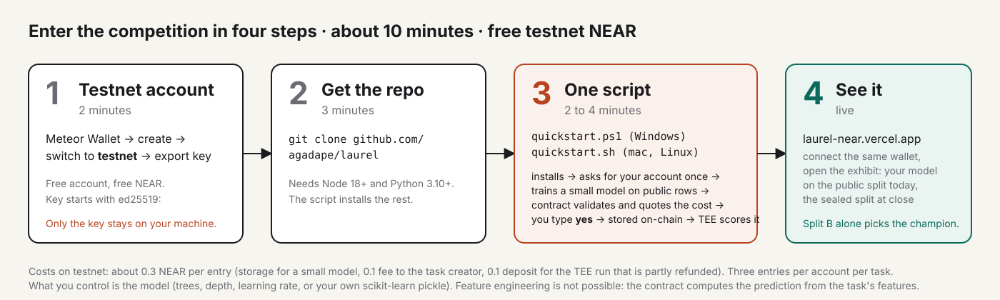
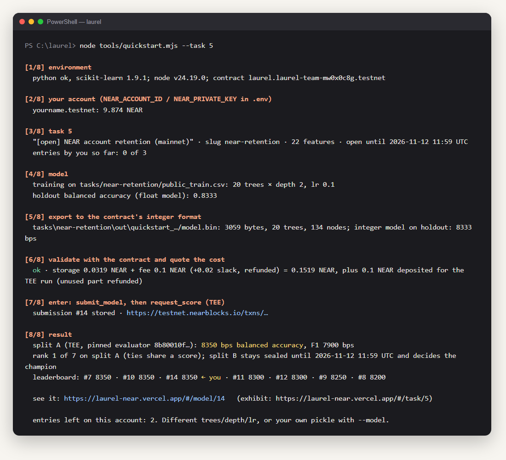

# Ikut kompetisi dalam sekitar 10 menit

*English: [QUICKSTART.md](QUICKSTART.md)*

Laurel menjalankan kompetisi model terbuka di kontrak NEAR **testnet**. Kamu melatih model kecil di data publik, kontrak
menyimpannya, evaluator di dalam TEE menilainya pada baris yang tidak bisa dilihat siapa pun, dan papan peringkat
diperbarui. Kalau modelmu menang, ia menjadi layanan prediksi berbayar. **Tidak ada yang memakai uang sungguhan.** Kamu
tidak perlu paham machine learning atau blockchain: skrip yang bekerja, kamu cukup mengetik `yes` sekali.



**Yang kamu butuhkan:** komputer Windows, macOS, atau Linux; sekitar 10 menit; akun NEAR testnet gratis (langkah 1).
**Yang kamu dapat:** model buatanmu tersimpan di kontrak NEAR, dinilai TEE, tampil di papan peringkat publik atas namamu.

**Tugas yang sedang terbuka** (daftar live: https://laurel-near.vercel.app):

| Tugas | Apa | Tutup (UTC) |
|---|---|---|
| **5** `near-retention` | data NEAR mainnet asli: apakah akun `.near` baru yang aktif di minggu pertamanya masih aktif setelah hari ke-30? [rincian](../tasks/near-retention/README.md) | 12 Nov 2026 11:59 (18:59 WIB) |
| 4 `credit-risk-open` | benchmark risiko kredit klasik (UCI German Credit, simulasi) [rincian](../tasks/german-credit/README.md) | 25 Nov 2026 23:59 |

Tiga entri per akun per tugas.

---

## Langkah 1 · Akun NEAR testnet gratis (2 menit)

Testnet adalah jaringan latihan NEAR: akun dan NEAR di dalamnya gratis dan tidak bernilai. Kamu perlu id akun (seperti
`namamu.testnet`) dan **private key**-nya (teks panjang yang diawali `ed25519:`).

**Dengan Meteor Wallet (disarankan, di browser):**

1. Buka https://wallet.meteorwallet.app, pilih **Create new wallet**. Catat recovery phrase-nya; buat password.
2. Ganti jaringan ke **Testnet** (tombol pengganti jaringan ada di bagian atas wallet; default-nya *Mainnet*).
3. Buat akun testnet saat wallet menawarkannya; nama bebas. Akun testnet baru datang dengan NEAR gratis.
   Kalau saldonya 0, minta di faucet seperti https://near-faucet.io (tempel id akunmu).
4. Buka **Settings → Security → Export private key** (nama menunya sedikit berbeda antar versi), konfirmasi password,
   lalu salin kuncinya. Diawali `ed25519:` dan panjangnya sekitar 90 karakter.

Simpan kuncinya untuk ditempel di langkah 3. Jangan pernah tempel di tempat lain, dan jangan pernah commit ke git.

**Alternatif:** [MyNearWallet testnet](https://testnet.mynearwallet.com) caranya sama; atau, kalau sudah punya
[near-cli-rs](https://github.com/near/near-cli-rs):

```bash
near account create-account sponsor-by-faucet-service namamu.testnet autogenerate-new-keypair print-to-terminal network-config testnet create
```

mencetak pasangan kunci akunnya; simpan private key-nya.

Satu entri butuh sekitar **0,3 NEAR** (storage model kecil, fee 0,1, deposit 0,1 untuk TEE yang sebagian dikembalikan, gas).
Akun testnet baru punya jauh lebih dari itu.

## Langkah 2 · Ambil repositorinya (3 menit)

1. Pasang **Node.js 18 atau lebih baru** dari https://nodejs.org (tombol LTS) dan **Python 3.10 atau lebih baru** dari
   https://www.python.org/downloads/. Di Windows, centang **Add python.exe to PATH** di installer Python. Kalau keduanya
   sudah ada, lewati.
2. Ambil kodenya. Di https://github.com/agadape/laurel klik **Code → Download ZIP** lalu ekstrak, atau:
   ```bash
   git clone https://github.com/agadape/laurel
   ```
3. Buka terminal **di dalam folder `laurel`**:
   - **Windows:** buka foldernya di Explorer, klik address bar, ketik `powershell`, Enter.
   - **macOS:** klik kanan folder → *New Terminal at Folder* (atau buka Terminal, ketik `cd ` lalu seret foldernya ke sana).
   - **Linux:** klik kanan → *Open in Terminal*.

## Langkah 3 · Satu skrip (2 sampai 4 menit, sebagian besar menunggu TEE)

**Windows (PowerShell):**

```powershell
powershell -ExecutionPolicy Bypass -File .\quickstart.ps1
```

**macOS / Linux:**

```bash
bash quickstart.sh
```

Skrip ini melakukan lima hal dan melaporkan tiap langkahnya: memeriksa Node dan Python; memasang paket; menanyakan id akun
dan private key **sekali** (kuncinya tetap tersembunyi saat ditempel) lalu menyimpannya di file `.env` yang diabaikan git; menjalankan **gladi resik** yang melatih
model, mengubahnya ke format integer kontrak, dan meminta kontrak memvalidasi serta mengutip biayanya (belum ada yang
dikirim); lalu meminta kamu mengetik **`yes`**. Baru setelah itu model disimpan di kontrak dan TEE diminta menilainya.
Beginilah tampilan run sungguhan:



*(Ilustrasi yang disusun dari run sungguhan; nama akunnya placeholder.)*

Blok terakhir yang penting: **skor TEE di split A**, **peringkatmu**, dan tautan ke modelmu di situs. Dua baris `txs:`
adalah transaksinya di testnet, bisa dicek siapa pun.

Mau coba lagi dengan model lain? Skripnya menerima opsi yang sama dengan perintah di baliknya:

```powershell
powershell -ExecutionPolicy Bypass -File .\quickstart.ps1 -Trees 40 -Depth 3     # model lebih besar, trainer sama
powershell -ExecutionPolicy Bypass -File .\quickstart.ps1 -Task 4                # tugas terbuka yang satunya
powershell -ExecutionPolicy Bypass -File .\quickstart.ps1 -Model model_saya.pkl  # GradientBoostingClassifier scikit-learn milikmu
```

```bash
bash quickstart.sh --trees 40 --depth 3
bash quickstart.sh --task 4
bash quickstart.sh --model model_saya.pkl
```

Pickle-mu harus `GradientBoostingClassifier` yang dilatih pada fitur tugas itu dengan urutan seperti di
`tasks/<slug>/features.json` (22 fitur integer untuk tugas 5). Feature engineering tidak mungkin: kontrak menghitung
prediksi persis dari fitur-fitur itu. Yang kamu kendalikan adalah modelnya.

**Lebih suka manual?** Setelah `cd tools && npm install && cd ..` dan `pip install scikit-learn pandas numpy`, isi
`NEAR_ACCOUNT_ID=…` dan `NEAR_PRIVATE_KEY=ed25519:…` di `.env` di root repositori, lalu jalankan
`node tools/quickstart.mjs --task 5` (tambahkan `--dry` untuk berhenti di kutipan biaya, `--trees/--depth/--lr` atau
`--model` seperti di atas). Skrip di atas hanya pembungkus perintah ini.

## Langkah 4 · Lihat hasilnya

1. Buka https://laurel-near.vercel.app, klik **Connect**, pilih wallet testnet yang sama. Menghubungkan wallet tidak membuat
   transaksi; hanya membuka explorer-nya.
2. **Exhibit 5** (`#/task/5`): papan peringkat dengan modelmu di split publik. Split tersegel tampil *Withheld* sampai tugas
   ditutup, lalu dibuka dan kontrak menetapkan juaranya.
3. **Modelmu** (`#/model/<id-mu>`, id yang dicetak skrip): setiap pohon digambar dari byte yang disimpan kontrak.
4. Tautan transaksi yang dicetak skrip terbuka di testnet.nearblocks.io.

## Kalau ada yang salah

| Yang tampil | Artinya | Lakukan |
|---|---|---|
| `node is not recognized` / `command not found: node` | Node.js belum terpasang, atau terminal dibuka sebelum memasangnya | pasang dari https://nodejs.org, lalu **tutup dan buka lagi** terminalnya |
| `python is not recognized` / `No module named sklearn` | Python tidak ada di PATH, atau paketnya gagal terpasang | pasang ulang Python dengan *Add python.exe to PATH* dicentang; atau jalankan `python -m pip install scikit-learn pandas numpy` |
| `running scripts is disabled on this system` | Windows memblokir skrip tak bertanda tangan | pakai perintah persis seperti di atas, dengan `-ExecutionPolicy Bypass` |
| `that does not look like a NEAR private key` | kuncinya tertempel tidak lengkap | salin lagi; diawali `ed25519:` dan panjangnya sekitar 90 karakter |
| `keep at least 0.4 NEAR free` | akun testnet-mu hampir kosong | minta NEAR gratis di https://near-faucet.io, lalu jalankan lagi |
| `no entries left on this account for this task` | kamu sudah membuat tiga entri | pakai tugas terbuka yang lain (`--task 4`) atau akun testnet lain |
| `this task is closed` | tenggatnya lewat | pilih tugas terbuka dari tabel di atas |
| `not scored yet` setelah 4 menit | worker TEE lambat atau testnet padat | tunggu beberapa menit lalu buka tautan `#/model/<id>`; entrimu sudah tersimpan dan akan dinilai |
| `429` atau `timeout` dari RPC | RPC publik membatasi laju | jalankan lagi; atau isi `WRITE_RPC=https://near-testnet.drpc.org` di `.env` |

Masih buntu? Buka issue di https://github.com/agadape/laurel dengan baris-baris terakhir yang dicetak terminal (jangan
pernah sertakan kuncimu).

## Yang menentukan pemenang

Split A adalah 150 baris tersegel yang skornya kamu lihat selama tugas terbuka. Split B adalah 150 baris tersegel lain yang
skornya ditahan oleh papan peringkat, situs, dan tool MCP sampai `close_task` dijalankan setelah tenggat; **split B
sendirilah yang memilih juara**. (Angka mentah split B masih bisa digali dari receipt transaksi penilaian di chain;
barisnya tidak. Menyetel model terhadapnya pun sia-sia: kamu tidak bisa melihat baris mana yang salah.) Jadi model yang
disetel mengejar papan split A tidak mendapat apa-apa di B. Satu baris bernilai sekitar 0,7 sampai 1,3 poin balanced
accuracy, jadi selisih satu poin antar entri sebagian besar hanya noise; pikirkan apa yang menggeneralisasi.

Skor split A di tugas 5 (9 Nov): 8350 bps untuk model 10 pohon 1,6 KB dan model 20 pohon 3 KB, 8300 untuk model 15 pohon
5 KB yang dihasilkan perintah ini (#11), 8250 untuk model 50 pohon 32 KB, 8200 untuk model 30 pohon 10 KB. Besar tidak
berarti lebih baik di sini.

## Biaya, batasan, kejujuran

- Hanya NEAR testnet. Run ini mendepositkan storage (sekitar 1 NEAR per 100 KB model; beberapa perseratus untuk model
  kecil), fee tugas 0,1 NEAR (masuk ke pembuat tugas) dan 0,1 NEAR untuk run TEE, yang sisanya dikembalikan.
- 3 entri per akun per tugas. Skrip menolak kalau jatahnya habis.
- Evaluator dipin lewat hash di kontrak; modelmu dinilai oleh kode itu di dalam TEE OutLayer, bukan oleh yang lain.
  Evaluatornya open source (`evaluator/`), dan `tools/eval_local.sh` menjalankan wasm yang sama di mesinmu kalau kamu punya
  split privatnya, yang tidak kamu punya; itulah intinya.
- Kalau kamu menang di tugas 5, modelmu menjawab `predict_task(5, features)` untuk siapa pun, dan setiap panggilan membayar
  0,001 NEAR kepadamu, bisa ditarik dengan `withdraw_earnings`.

---

## Teks undangan (salin, sesuaikan, kirim)

> Saya menjalankan kompetisi model kecil di NEAR testnet dan butuh beberapa peserta sungguhan sebelum 12 Nov.
> Tugasnya: memprediksi apakah akun NEAR baru yang aktif di minggu pertamanya masih aktif sebulan kemudian, dari 22 fitur
> integer yang dibangun dari data mainnet asli. Tidak perlu paham ML: satu skrip melatih model di data publik, TEE menilainya
> di baris tersegel, kontrak menetapkan juara. NEAR testnet gratis, sekitar 10 menit, panduan langkah demi langkah:
> https://github.com/agadape/laurel/blob/main/docs/QUICKSTART.id.md

> I'm running a small model competition on NEAR testnet and I'd like a few real entries before 12 Nov.
> Task: predict whether a brand-new NEAR account that acted in its first week is still active a month later, from 22
> integer features built from real mainnet data. You don't need to know ML: one script trains a model on the public rows,
> a TEE scores it on sealed rows, the contract names the champion. Free testnet NEAR, about 10 minutes, step-by-step guide:
> https://github.com/agadape/laurel/blob/main/docs/QUICKSTART.md
