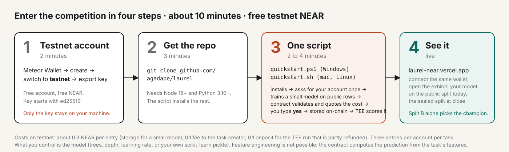
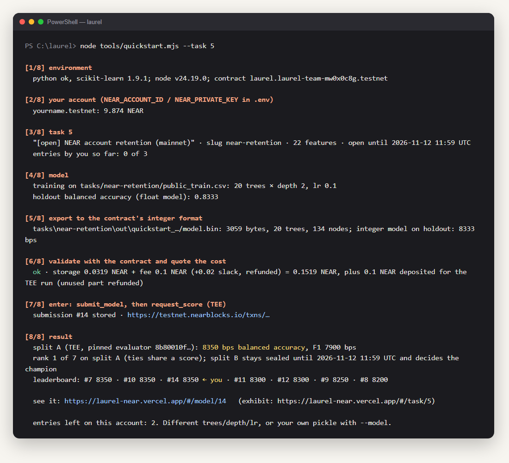

# Enter the competition in about 10 minutes

*Bahasa Indonesia: [QUICKSTART.id.md](QUICKSTART.id.md)*

Laurel runs open model competitions on a NEAR **testnet** contract. You train a small model on public data, the contract
stores it, a TEE evaluator scores it on rows nobody can see, and the leaderboard updates. If your model wins, it becomes a
paid prediction service. **Nothing here costs real money.** You do not need to know machine learning or blockchains: a
script does the work, you type `yes` once.



**You need:** a Windows, macOS or Linux computer; about 10 minutes; a free NEAR testnet account (step 1).
**You get:** your own model stored on a NEAR contract, scored by a TEE, on a public leaderboard, with your name on it.

**Open tasks right now** (live list: https://laurel-near.vercel.app):

| Task | What | Closes (UTC) |
|---|---|---|
| **5** `near-retention` | real NEAR mainnet data: will a fresh `.near` account that acted in its first week still act after day 30? [details](../tasks/near-retention/README.md) | 12 Nov 2026 11:59 |
| 4 `credit-risk-open` | classic credit-risk benchmark (UCI German Credit, a simulation) [details](../tasks/german-credit/README.md) | 25 Nov 2026 23:59 |

Three entries per account per task.

---

## Step 1 · A free NEAR testnet account (2 minutes)

Testnet is NEAR's practice network: the accounts and the NEAR on it are free and worth nothing. You need an account id
(like `yourname.testnet`) and its **private key** (a long text starting with `ed25519:`).

**With Meteor Wallet (recommended, in the browser):**

1. Open https://wallet.meteorwallet.app and choose **Create new wallet**. Write the recovery phrase down; set a password.
2. Switch the network to **Testnet** (the network switch is at the top of the wallet; it says *Mainnet* by default).
3. Create the testnet account when the wallet offers it; pick any name. A new testnet account comes with free NEAR.
   If the balance shows 0, get some at a faucet such as https://near-faucet.io (paste your account id).
4. Open **Settings → Security → Export private key** (the menu names vary slightly between versions), confirm your
   password, and copy the key. It starts with `ed25519:` and is about 90 characters long.

Keep the key where you can paste it in step 3. Never paste it anywhere else, and never commit it to git.

**Alternatives:** [MyNearWallet testnet](https://testnet.mynearwallet.com) works the same way; or, if you have
[near-cli-rs](https://github.com/near/near-cli-rs) installed:

```bash
near account create-account sponsor-by-faucet-service yourname.testnet autogenerate-new-keypair print-to-terminal network-config testnet create
```

prints the account's key pair; keep the private key.

You need about **0.3 NEAR** for one entry (storage for a small model, 0.1 fee, a refundable 0.1 deposit for the TEE run,
gas). A fresh testnet account has far more than that.

## Step 2 · Get the repository (3 minutes)

1. Install **Node.js 18 or newer** from https://nodejs.org (the LTS button) and **Python 3.10 or newer** from
   https://www.python.org/downloads/. On Windows, tick **Add python.exe to PATH** in the Python installer. If you already
   have both, skip this.
2. Get the code. Either on https://github.com/agadape/laurel click **Code → Download ZIP** and unzip it, or:
   ```bash
   git clone https://github.com/agadape/laurel
   ```
3. Open a terminal **inside the `laurel` folder**:
   - **Windows:** open the folder in Explorer, click the address bar, type `powershell` and press Enter.
   - **macOS:** right-click the folder → *New Terminal at Folder* (or open Terminal and type `cd ` then drag the folder in).
   - **Linux:** right-click → *Open in Terminal*.

## Step 3 · One script (2 to 4 minutes, most of it the TEE run)

**Windows (PowerShell):**

```powershell
powershell -ExecutionPolicy Bypass -File .\quickstart.ps1
```

**macOS / Linux:**

```bash
bash quickstart.sh
```

The script does five things and tells you about each: checks Node and Python; installs the packages; asks for your
account id and private key **once** and saves them in a file called `.env` that git ignores; runs a **rehearsal** that
trains a model, converts it to the contract's integer format and asks the contract to validate it and quote the cost
(nothing is sent); then asks you to type **`yes`**. Only then it stores the model on the contract and asks the TEE to
score it. This is what the real run looks like:



*(Illustration composed from real runs; the account name is a placeholder.)*

The last block is the part that matters: the **TEE's reading on split A**, your **rank**, and a link to your model on the
site. The two `txs:` lines are the transactions on testnet, for anyone to check.

Want to try again with a different model? The script accepts the same options as the underlying command:

```powershell
powershell -ExecutionPolicy Bypass -File .\quickstart.ps1 -Trees 40 -Depth 3     # bigger model, same trainer
powershell -ExecutionPolicy Bypass -File .\quickstart.ps1 -Task 4                # the other open task
powershell -ExecutionPolicy Bypass -File .\quickstart.ps1 -Model my_model.pkl    # your own scikit-learn GradientBoostingClassifier
```

```bash
bash quickstart.sh --trees 40 --depth 3
bash quickstart.sh --task 4
bash quickstart.sh --model my_model.pkl
```

Your pickle must be a `GradientBoostingClassifier` trained on the task's features in the order given by
`tasks/<slug>/features.json` (22 integer features for task 5). Feature engineering is not possible: the contract computes
the prediction from exactly those features. What you control is the model.

**Prefer to do it by hand?** After `cd tools && npm install && cd ..` and `pip install scikit-learn pandas numpy`, put
`NEAR_ACCOUNT_ID=…` and `NEAR_PRIVATE_KEY=ed25519:…` in `.env` at the repository root and run
`node tools/quickstart.mjs --task 5` (add `--dry` to stop at the cost quote, `--trees/--depth/--lr` or `--model` as above).
The scripts are only a wrapper around this command.

## Step 4 · See it

1. Open https://laurel-near.vercel.app and click **Connect**; choose the same testnet wallet. Connecting creates no
   transaction; it only opens the explorer.
2. **Exhibit 5** (`#/task/5`): the leaderboard with your model on the public split. The sealed split shows *Withheld* until
   the task closes, then it is unsealed and the contract names the champion.
3. **Your model** (`#/model/<your id>`, the id the script printed): every tree drawn from the bytes the contract stores.
4. The transaction links the script printed open on testnet.nearblocks.io.

## If something goes wrong

| You see | What it means | Do this |
|---|---|---|
| `node is not recognized` / `command not found: node` | Node.js is not installed, or the terminal was open before you installed it | install from https://nodejs.org, then **close and reopen** the terminal |
| `python is not recognized` / `No module named sklearn` | Python is missing from PATH, or the packages did not install | reinstall Python with *Add python.exe to PATH* ticked; or run `python -m pip install scikit-learn pandas numpy` |
| `running scripts is disabled on this system` | Windows blocks unsigned scripts | use the exact command above, with `-ExecutionPolicy Bypass` |
| `that does not look like a NEAR private key` | the key was pasted incompletely | copy it again; it starts with `ed25519:` and is about 90 characters |
| `keep at least 0.4 NEAR free` | your testnet account is almost empty | get free NEAR at https://near-faucet.io, then run again |
| `no entries left on this account for this task` | you already made three entries | use the other open task (`--task 4`) or another testnet account |
| `this task is closed` | the deadline passed | pick an open task from the table at the top |
| `not scored yet` after 4 minutes | the TEE worker is slow or testnet is congested | wait a few minutes and open the `#/model/<id>` link; your entry is stored and will be scored |
| `429` or `timeout` from the RPC | the public RPC is rate-limiting | run again; or set `WRITE_RPC=https://near-testnet.drpc.org` in `.env` |

Still stuck? Open an issue on https://github.com/agadape/laurel with the last lines the terminal printed (never your key).

## What decides the winner

Split A is 150 sealed rows you see the score of while the task is open. Split B is another 150 sealed rows whose score the
leaderboard, the site and the MCP tools withhold until `close_task` runs after the deadline; **it alone picks the champion**.
(The raw split-B figure can still be dug out of the scoring transaction's receipt on-chain; the rows cannot. Tuning
against it is pointless anyway: you cannot see which rows you got wrong.) So a model tuned against split A's
leaderboard gains nothing on B. One row of a split is worth about 0.7 to 1.3 points of balanced accuracy, so differences
of a point between entries are mostly noise; think about what generalises.

Split-A readings on task 5 (9 Nov): 8350 bps for a 1.6 KB 10-tree model and for a 3 KB 20-tree model, 8300 for the
5 KB 15-tree model this very command produced (#11), 8250 for a 32 KB 50-tree one, 8200 for a 10 KB 30-tree one. Big is not
better here.

## Costs, limits, honesty

- Testnet NEAR only. The run deposits storage (about 1 NEAR per 100 KB of model; a few hundredths for a small one),
  the task's 0.1 NEAR fee (it goes to the task creator) and 0.1 NEAR for the TEE run, of which the unused part is refunded.
- 3 entries per account per task. The script refuses when none are left.
- The evaluator is pinned by hash in the contract; your model is scored by that code inside OutLayer's TEE and by nothing
  else. The evaluator is open source (`evaluator/`), and `tools/eval_local.sh` runs the same wasm on your machine if you
  have the private splits, which you do not; that is the point.
- If you win task 5, your model answers `predict_task(5, features)` for anyone, and each call pays 0.001 NEAR to you,
  withdrawable with `withdraw_earnings`.

---

## Invitation text (copy, adapt, post)

> I'm running a small model competition on NEAR testnet and I'd like a few real entries before 12 Nov.
> Task: predict whether a brand-new NEAR account that acted in its first week is still active a month later, from 22
> integer features built from real mainnet data. You don't need to know ML: one script trains a model on the public rows,
> a TEE scores it on sealed rows, the contract names the champion. Free testnet NEAR, about 10 minutes, step-by-step guide:
> https://github.com/agadape/laurel/blob/main/docs/QUICKSTART.md

> Saya menjalankan kompetisi model kecil di NEAR testnet dan butuh beberapa peserta sungguhan sebelum 12 Nov.
> Tugasnya: memprediksi apakah akun NEAR baru yang aktif di minggu pertamanya masih aktif sebulan kemudian, dari 22 fitur
> integer yang dibangun dari data mainnet asli. Tidak perlu paham ML: satu skrip melatih model di data publik, TEE menilainya
> di baris tersegel, kontrak menetapkan juara. NEAR testnet gratis, sekitar 10 menit, panduan langkah demi langkah:
> https://github.com/agadape/laurel/blob/main/docs/QUICKSTART.id.md
