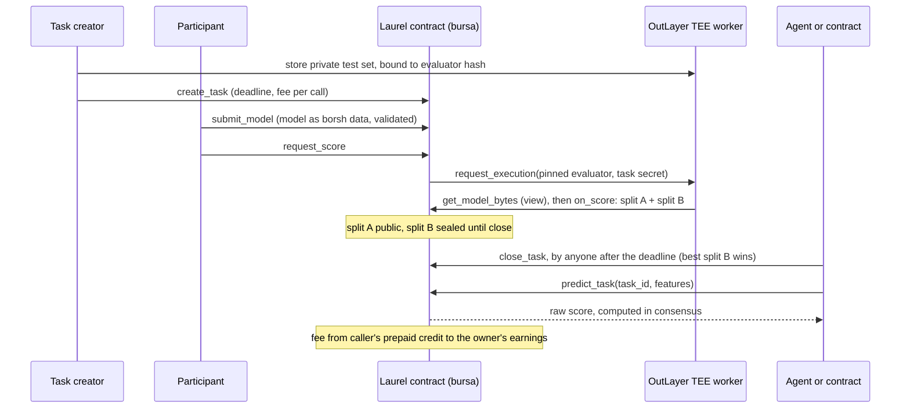

# Laurel — audit brief for an external model (built for Gemini)

Generated 2026-11-06 07:53 UTC from the repository at commit `5574bbb` (https://github.com/agadape/laurel).
This single file contains everything: who we are, what we built, every claim we make, the whole source of the pieces
that matter, and what we want from you. You do not need the repository; you do need the web.

## 0. Who you are and what we want

You are auditing a hackathon project (NEAR HACKATHON 2026, deadline 14 Nov 2026 23:59 UTC, tracks `agents`, `privacy`,
`open`) eight days before submission. The team is two people; one AI assistant (Claude) wrote most of the code and the
docs with them, and an earlier ChatGPT audit already shaped the README's "Security model" and "Questions a judge will ask"
sections. We now want a **second, independent, adversarial audit that uses what you are good at**:

1. **Grounded verification with Google Search.** Every transaction hash in this brief is on NEAR testnet; check a sample
   of them on `https://testnet.nearblocks.io/txns/<hash>` (or any explorer you can reach) and tell us if any claim does not
   match what the chain shows. Check `https://laurel-near.vercel.app` (read-only, no wallet needed) and the npm package
   `laurel-mcp`. Check OutLayer's public documentation (`outlayer.near`, `outlayer.testnet`, "OutLayer NEAR TEE") and
   tell us whether our description of how its secrets are bound to a wasm hash and how attestation works is accurate,
   overstated or understated. Check the NEAR HACKATHON 2026 public pages for the judging criteria and the tracks, and
   score us against them as a judge would.
2. **Landscape.** Find the closest existing projects (decentralised model competitions, on-chain or TEE-verified ML
   inference, model marketplaces, "Kaggle on-chain", zkML inference services, agent-economy tooling on NEAR and elsewhere)
   and tell us plainly where Laurel is weaker, where it is genuinely different, and which comparison a judge is likely
   to make. Name them.
3. **Claims vs code.** `CLAIMS.md` maps every README statement to code, tests and hashes. Read the code (all inlined
   below) and find claims that are wrong, stretched, or unverifiable. Be specific: quote the claim, quote the code.
4. **Security and economics of the contract** (`contracts/bursa/src/lib.rs`, inlined in full): griefing, fund loss,
   stuck states, callback misuse, storage accounting, quota bypass, anything an attacker or a careless user could hit on
   mainnet. We know some limits already (listed in the README's Limits and Security sections); tell us what we missed.
5. **The dataset methodology** of task 5 (`tasks/near-retention`, SQL inlined): leakage between features and label,
   population definition, sampling bias, whether the "private rows are secret" claim holds, and whether the BigQuery
   queries do what the README says.
6. **The autonomous agents** (`agents/`): is the tool policy as tight as we say, can the agent exceed it, is anything in
   the transcripts' evidence weaker than the README implies.
7. **What to do in the remaining days.** A ranked list, each item with effort and expected effect on judging, including
   things we should *stop* doing. If you think a claim should be removed rather than fixed, say so.

Constraints you should know: the contract is **frozen** (no redeploy before submission unless you find a real bug);
testnet only (mainnet was judged too expensive, the README says "mainnet-ready" with reasons); we will not add a new
model class. Everything else is open.

**Output format.** One Markdown report, in English, with: (a) a one-paragraph verdict as a judge; (b) a findings table
(severity: blocker / major / minor / nit; area; claim or code quoted; what is wrong; fix); (c) the landscape comparison;
(d) the ranked to-do list; (e) a short summary in Indonesian for the team lead. Where you used the web, cite the URL.
Where you could not verify something, say "could not verify" instead of guessing. Do not praise; we have enough of that.

## 1. The project in one page

- **Name:** Laurel (contract codename `bursa`). Repository https://github.com/agadape/laurel, MIT.
- **One line:** *Compete. Verify. Deploy.* Small gradient-boosted-tree models compete on a private test set scored inside
  a TEE, and the winner becomes a NEAR contract method that AI agents and other contracts call and pay for, per prediction.
- **Live:** contract `laurel.laurel-team-mw0x0c8g.testnet` (NEAR testnet, near-sdk 5.30), explorer
  https://laurel-near.vercel.app (Vite + React, read-only without a wallet), MCP server `laurel-mcp` on npm (stdio) and a
  remote read-only MCP endpoint https://laurel-near.vercel.app/api/mcp (Streamable HTTP, stateless, on Vercel).
- **TEE:** OutLayer (`outlayer.testnet`). The evaluator is a `wasm32-wasip2` program pinned in the contract by sha256
  `8b80010fc79259c9f5d95183a660e79ad7a450fdfceed3e8ce0924f296b60ac3`, served from
  `https://nh-spike-wasm.vercel.app/<hash>.wasm`. The private test splits are OutLayer secrets (`TEST_SET_A`, `TEST_SET_B`)
  bound to that hash, stored by `nh-spike-mvp62mw4.testnet` under profiles `german-credit` and `near-retention`.
- **Tasks on the contract:** 1 `german-credit` (closed), 2 `german-credit-open`, 3 `credit-risk` (closed; champion #4),
  4 `credit-risk-open` (open to 25 Nov), 5 `near-retention` (real mainnet data, open to 12 Nov 12:00 UTC).
- **Model format:** integer GBDT, borsh v1: `u8 version, u16 n_features, i64 feature_scale, i64 out_scale, i64 bias,
  u32 n_trees, per tree u32 n_nodes, per node (u16 feature, i64 threshold, u16 left, u16 right, i64 value)`, leaf =
  left == right == 0xFFFF, walk `x[feature] <= threshold ? left : right`, raw score = bias + one leaf per tree,
  label 1 iff raw > 0. The same arithmetic runs in the contract (`crates/gbdt-core`), in the evaluator, in Python
  (`tools/export.py`) and in JS (`mcp/gbdt.mjs`, BigInt). `web/src/model.js` only decodes the borsh trees for drawing.
- **Metric:** balanced accuracy in basis points, integer arithmetic, rounded down to 50 bps; F1 shown, not used for ranking.
  Split A is public while a task is open; split B is sealed in the leaderboard until `close_task` and alone decides.
- **Economics:** submission fee (0.1 NEAR) to the task creator; storage paid by the submitter; `request_score` deposits
  0.1 NEAR to OutLayer (about 0.001 NEAR charged, rest refunded); predictions paid from the caller's prepaid credit
  (`deposit_credit`) at the task's `fee_per_call` (0.001 NEAR) to the model owner (`withdraw_earnings`).
- **Agents:** `agents/competitor.mjs` and `agents/caller.mjs` (Claude Agent SDK) entered submission #10 and bought
  predictions from it with a function-call key; transcripts in `agents/out/`.
- **Team:** two students in Indonesia; sister project Undo (https://github.com/agadape/undo) by the same team, disclosed.

## 2. Live state snapshot (read from the contract when this brief was built)

```json
{
  "contract": "laurel.laurel-team-mw0x0c8g.testnet",
  "read_at": "2026-11-06T07:53:51.270Z",
  "evaluator": [
    "https://nh-spike-wasm.vercel.app/8b80010fc79259c9f5d95183a660e79ad7a450fdfceed3e8ce0924f296b60ac3.wasm",
    "8b80010fc79259c9f5d95183a660e79ad7a450fdfceed3e8ce0924f296b60ac3"
  ],
  "tasks": [
    {
      "task_id": 1,
      "slug": "german-credit",
      "title": "Risiko kredit (UCI German Credit) — simulasi",
      "closed": true,
      "winner": 1,
      "deadline_utc": "2026-11-04T09:03:28.418Z",
      "n_features": 18,
      "secrets": "nh-spike-mvp62mw4.testnet/german-credit",
      "fee_per_call_yocto": "1000000000000000000000",
      "submission_fee_yocto": "100000000000000000000000",
      "max_per_account": 3,
      "leaderboard": [
        {
          "id": 1,
          "owner": "p1.laurel-team-mw0x0c8g.testnet",
          "bytes": 33011,
          "trees": 50,
          "score_a_bps": 7100,
          "score_b_bps": 6650,
          "status": "Scored",
          "calls": 0
        },
        {
          "id": 2,
          "owner": "p2.laurel-team-mw0x0c8g.testnet",
          "bytes": 1611,
          "trees": 10,
          "score_a_bps": 7550,
          "score_b_bps": 6150,
          "status": "Scored",
          "calls": 0
        }
      ]
    },
    {
      "task_id": 2,
      "slug": "german-credit-open",
      "title": "[open] Risiko kredit (UCI German Credit) — simulasi",
      "closed": false,
      "winner": null,
      "deadline_utc": "2026-11-25T23:59:00.000Z",
      "n_features": 18,
      "secrets": "nh-spike-mvp62mw4.testnet/german-credit",
      "fee_per_call_yocto": "1000000000000000000000",
      "submission_fee_yocto": "100000000000000000000000",
      "max_per_account": 3,
      "leaderboard": [
        {
          "id": 3,
          "owner": "p1.laurel-team-mw0x0c8g.testnet",
          "bytes": 33011,
          "trees": 50,
          "score_a_bps": 7100,
          "score_b_bps": null,
          "status": "Scored",
          "calls": 0
        }
      ]
    },
    {
      "task_id": 3,
      "slug": "credit-risk",
      "title": "Credit risk (UCI German Credit) — simulation",
      "closed": true,
      "winner": 4,
      "deadline_utc": "2026-11-04T09:35:05.834Z",
      "n_features": 18,
      "secrets": "nh-spike-mvp62mw4.testnet/german-credit",
      "fee_per_call_yocto": "1000000000000000000000",
      "submission_fee_yocto": "100000000000000000000000",
      "max_per_account": 3,
      "leaderboard": [
        {
          "id": 4,
          "owner": "p1.laurel-team-mw0x0c8g.testnet",
          "bytes": 33011,
          "trees": 50,
          "score_a_bps": 7100,
          "score_b_bps": 6650,
          "status": "Scored",
          "calls": 19
        },
        {
          "id": 5,
          "owner": "p2.laurel-team-mw0x0c8g.testnet",
          "bytes": 1611,
          "trees": 10,
          "score_a_bps": 7550,
          "score_b_bps": 6150,
          "status": "Scored",
          "calls": 0
        }
      ]
    },
    {
      "task_id": 4,
      "slug": "credit-risk-open",
      "title": "[open] Credit risk (UCI German Credit) — simulation",
      "closed": false,
      "winner": null,
      "deadline_utc": "2026-11-25T23:59:00.000Z",
      "n_features": 18,
      "secrets": "nh-spike-mvp62mw4.testnet/german-credit",
      "fee_per_call_yocto": "1000000000000000000000",
      "submission_fee_yocto": "100000000000000000000000",
      "max_per_account": 3,
      "leaderboard": [
        {
          "id": 6,
          "owner": "p1.laurel-team-mw0x0c8g.testnet",
          "bytes": 33011,
          "trees": 50,
          "score_a_bps": 7100,
          "score_b_bps": null,
          "status": "Scored",
          "calls": 0
        }
      ]
    },
    {
      "task_id": 5,
      "slug": "near-retention",
      "title": "NEAR account retention (mainnet) — active again after day 30?",
      "closed": false,
      "winner": null,
      "deadline_utc": "2026-11-12T11:59:58.534Z",
      "n_features": 22,
      "secrets": "nh-spike-mvp62mw4.testnet/near-retention",
      "fee_per_call_yocto": "1000000000000000000000",
      "submission_fee_yocto": "100000000000000000000000",
      "max_per_account": 3,
      "leaderboard": [
        {
          "id": 7,
          "owner": "p1.laurel-team-mw0x0c8g.testnet",
          "bytes": 1611,
          "trees": 10,
          "score_a_bps": 8350,
          "score_b_bps": null,
          "status": "Scored",
          "calls": 0
        },
        {
          "id": 10,
          "owner": "maker.laurel-team-mw0x0c8g.testnet",
          "bytes": 3059,
          "trees": 20,
          "score_a_bps": 8350,
          "score_b_bps": null,
          "status": "Scored",
          "calls": 3
        },
        {
          "id": 11,
          "owner": "p2.laurel-team-mw0x0c8g.testnet",
          "bytes": 5041,
          "trees": 15,
          "score_a_bps": 8300,
          "score_b_bps": null,
          "status": "Scored",
          "calls": 0
        },
        {
          "id": 12,
          "owner": "maker.laurel-team-mw0x0c8g.testnet",
          "bytes": 6307,
          "trees": 40,
          "score_a_bps": 8300,
          "score_b_bps": null,
          "status": "Scored",
          "calls": 0
        },
        {
          "id": 9,
          "owner": "laurel-team-mw0x0c8g.testnet",
          "bytes": 32087,
          "trees": 50,
          "score_a_bps": 8250,
          "score_b_bps": null,
          "status": "Scored",
          "calls": 0
        },
        {
          "id": 8,
          "owner": "p2.laurel-team-mw0x0c8g.testnet",
          "bytes": 10051,
          "trees": 30,
          "score_a_bps": 8200,
          "score_b_bps": null,
          "status": "Scored",
          "calls": 0
        }
      ]
    }
  ]
}
```

## 3. Recent commits

```
5574bbb 2026-11-06 docs/audit: single-file audit brief for an external model (Gemini), with its builder
d76be7e 2026-11-06 Web: Dex's landing and dark theme, with escaped contract values and a labelled snapshot fallback
6f39efd 2026-11-06 README: show the walkthrough GIF at the top and the architecture diagram under How it works
6058156 2026-11-06 README: architecture diagram (SVG) and a 20-second walkthrough GIF of the live site
91ffdc3 2026-11-05 Quickstart: one command from a funded testnet account to a TEE-scored entry
fde1517 2026-11-05 Autonomous agents: a Claude Agent SDK competitor enters a model, a caller buys its predictions
1b25f00 2026-11-05 Web: feature exhibit 05 (NEAR mainnet retention) on the landing; two-dataset copy
85aa4d6 2026-11-05 near-retention: commit the private-split manifest (sha256 and class counts; ignored by the private_* pattern)
1b36f7f 2026-11-05 Task 5: NEAR account retention on real mainnet data (BigQuery), scored in the TEE
14ae7a1 2026-11-05 Web: guest mode, the explorer is browsable without a wallet
505bffe 2026-11-05 README: judge-first structure (one-minute summary, track fit, mermaid flow), live landing screenshot, Undo link
d9bcb48 2026-11-05 README: security model and trust boundaries, judge FAQ, burnt-gas statistics, "Compete. Verify. Deploy." positioning
a5d146b 2026-11-05 Record the first browser-signed deposit_credit (Meteor, tx 4YHqm8GP…) in CLAIMS, README, SUBMISSION, TESTNET
2668459 2026-11-05 Wallet: fallback RPC list for wallet-selector; drop the stub Bitte module
23e10b6 2026-11-05 Wallet: explicit dRPC nodeUrl for the wallet SDKs (fastnear 429 surfaced as near_rpc_error); clearer RPC error hint
4261a9c 2026-11-05 Wallet: near-api-js-shaped actions for wallet-selector v10 (fixes "Unsupported NAJ action"); drop retired MyNearWallet, add Intear and Nightly
8a2bf93 2026-11-05 Wallet: connect-only sign-in (no access key transaction at login)
79ad358 2026-11-05 Wallet: sign in without a method-restricted key; popup/redirect guidance for Meteor and MyNearWallet
ff5236d 2026-11-05 Landing economics, NEAR wallet login (buy credit, withdraw), Connect in three steps
76e8dbc 2026-11-05 Remote MCP endpoint + "Connect your agent" page for every OS and client
acb89be 2026-11-05 Project .mcp.json for Claude Code (env placeholders, no secrets); MCP in the submission idea and DEMO prep
8c38ea1 2026-11-05 laurel-mcp published to npm (0.1.0); README/MCP docs point at npx -y laurel-mcp
dbd6b66 2026-11-05 laurel-mcp: MCP server so AI agents can use the model (browse, download, run locally, predict on-chain)
f6f468b 2026-11-05 Web: signatures from 4 large trees (index) and 8 (specimens); type scale collapsed to 12·13·15·17·20·26·34·54·76
50b9773 2026-11-05 Web: pass-2 audit fixes (docs/audit/*_2.md)
```

## 4. Repository map

```
contracts/bursa/          the registry contract (Rust, near-sdk 5.30); src/lib.rs + src/events.rs; 50 unit tests
contracts/consumer-example/  a second contract that calls predict_task through a promise (credit desk)
crates/gbdt-core/         integer GBDT decode / validate / raw_score, shared by contract and evaluator
evaluator/                the TEE program (wasm32-wasip2) OutLayer runs; reads TEST_SET_A/B from env, model via view
mcp/                      laurel-mcp: MCP server (stdio) with read-only and paid tools; gbdt.mjs port of the scorer
web/                      Vite + React explorer; web/api/mcp.mjs = remote read-only MCP endpoint on Vercel
agents/                   Claude Agent SDK agents (competitor, caller) and their transcripts
tasks/german-credit/      UCI German Credit simulation: spec, split, train, manifest
tasks/near-retention/     NEAR mainnet retention task: BigQuery SQL, fetch, build, train, manifest, population stats
tools/                    deploy, create_task, submit, predict, agent, consumer, e2e, export.py, quickstart, secrets.sh
docs/                     ABI, AGENT, AGENTS, CONSUMER, E2E, EVALUATOR, GAS, MCP, NEGATIVE_TESTS, QUICKSTART, SUBMISSION, TESTNET
CLAIMS.md                 every README claim -> code, tests, tx hashes
SPIKE_LOG.md              the spikes that de-risked each piece before building
```


---

## README.md (the document judges read first)

*(verbatim copy of `README.md`)*

## Laurel — small decision models as on-chain infrastructure on NEAR

**Compete. Verify. Deploy.** Small models compete on a private test set scored inside a TEE, and the winner becomes a contract method that AI agents and other contracts call and pay for, per prediction, on NEAR.

*Trained off-chain, ranked on a private TEE benchmark, served from a NEAR contract to agents and other contracts. The model that earns the laurel serves on-chain.*

[](https://laurel-near.vercel.app)

| | |
|---|---|
| **Live site** | https://laurel-near.vercel.app (no wallet needed to browse: landing page, then "Browse without a wallet"; a NEAR testnet wallet is only for buying prediction credit) |
| **Contract** | [`laurel.laurel-team-mw0x0c8g.testnet`](https://testnet.nearblocks.io/address/laurel.laurel-team-mw0x0c8g.testnet) (NEAR testnet, codename `bursa`) |
| **For AI agents** | remote MCP endpoint `https://laurel-near.vercel.app/api/mcp` (no install, no wallet) · npm package [`laurel-mcp`](https://www.npmjs.com/package/laurel-mcp) |
| **Evidence** | [CLAIMS.md](CLAIMS.md) maps every statement below to code, tests and transaction hashes |
| **Hackathon** | NEAR HACKATHON 2026 · tracks `agents`, `privacy`, `open` · sister project by the same team: [Undo](https://github.com/agadape/undo) (rule Q-015) |

### In one minute

| | |
|---|---|
| **Problem** | A small ML model (credit scoring, fraud flags, routing) usually lives on someone's server. Its claimed accuracy cannot be checked, the test set it was tuned on can be the same one it is reported on, and an AI agent or a smart contract can only use it by trusting an API key and an operator. |
| **What Laurel does** | A registry contract where anyone publishes a *task* with a private test set and anyone submits a small gradient-boosted-tree model **as data**. An OutLayer TEE worker scores each model on two private splits that only the contract's pinned evaluator can read. Split A is public while the task is open; split B stays sealed until close and alone picks the champion. The champion is then served by the contract itself: `predict_task(task_id, features)` runs the model inside NEAR consensus and pays a fee to the model's owner. |
| **Who uses it** | **Model makers** compete and earn per call. **AI agents** call the champion with a function-call key that the protocol limits to prediction. **Contracts** call it through a promise, like any other contract method. |
| **Tasks** | Two datasets. **NEAR account retention** ([tasks/near-retention](tasks/near-retention/README.md)): real mainnet data, 22 integer features from a fresh `.near` account's first 7 days, label `1 = still acting between day 30 and day 90`; the private rows are accounts nobody can look up. **Credit risk** on UCI German Credit (**simulation only**, see Limits): 18 features, label `1 = bad`. Both: balanced accuracy, 150 private rows per split. |
| **What is live (6 Nov 2026)** | 5 tasks and 12 submitted models on the final contract. Task 3 (credit risk) is closed: #5 led the public split (75.50 %), #4 won the sealed split (66.50 %) and became champion; #4 has served 19 paid predictions (0.019 NEAR to its owner). Task 5 (NEAR account retention, mainnet data) is open until 2026-11-12 12:00 UTC with six TEE-scored entries (83.50 / 83.50 / 83.00 / 83.00 / 82.50 / 82.00 % on split A; the two leaders are the 1.6 KB baseline and the autonomous agent's 3 KB entry #10, #11 came from the one-command quickstart, #12 from the agent re-run after audit 2); task 4 is open until 2026-11-25. Anyone can enter either. |
| **Cost of one prediction** | 4.3 Tgas for a 33 KB, 50-tree model (≈ 0.0005 NEAR of gas) plus the task's 0.001 NEAR fee. |

### Why on NEAR

- **The model runs inside the contract.** Integer GBDT, no oracle round-trip: one prediction with a 33 KB / 50-tree model costs **4.3 Tgas** ([docs/GAS.md](docs/GAS.md)), so other contracts can compose it synchronously in a promise.
- **OutLayer**, a NEAR partner, runs the evaluator in a TEE. The test set is stored as a secret **bound to the evaluator's wasm hash**, and the contract pins that hash, so neither participants nor the operator can swap the scorer ([docs/EVALUATOR.md](docs/EVALUATOR.md)).
- **Function-call access keys** give capability-based authorization at the protocol level. An AI agent holds a key that can only call `predict_task` on this contract: the protocol itself rejects `withdraw_credit`, deposits, other contracts and transfers from that key ([docs/AGENT.md](docs/AGENT.md)).
- **Precise storage accounting** makes a 33 KB model affordable to keep on-chain; NEP-297 events make every score, close and prediction indexable.

NEAR features used: own contract (near-sdk 5.30), cross-contract promises and callbacks, function-call access keys with method restriction, OutLayer (TEE compute with hash-bound secrets, result returned into the calling transaction), NEP-297 events, precise storage accounting.

#### Track fit

| Track | What Laurel contributes | Where to look |
|---|---|---|
| `agents` (Agent Economy) | Agents **pay for verified predictions** per call from prepaid credit, with a key the protocol restricts to `predict_task`; an MCP server gives any agent the exhibits, the model bytes, local inference and paid on-chain calls | [docs/AGENT.md](docs/AGENT.md), [docs/MCP.md](docs/MCP.md), `mcp/` |
| `privacy` (Private AI, TEE) | The benchmark's test set never leaves the enclave and opens only for the pinned evaluator hash; the deciding split stays sealed until close | [docs/EVALUATOR.md](docs/EVALUATOR.md), SPIKE_LOG S30, `evaluator/` |
| `open` (Open Innovation) | A model competition whose winner becomes **permissionless, composable infrastructure**: an address other contracts call in consensus | [docs/CONSUMER.md](docs/CONSUMER.md), `contracts/consumer-example` |

### How it works




1. **Publish a task.** The creator stores the private test set at OutLayer as a secret bound to the evaluator's wasm hash, then calls `create_task` with a deadline, a submission fee and a fee per prediction.
2. **Submit a model as data.** `tools/export.py` turns a scikit-learn model into an integer GBDT (borsh, a few KB to 250 KB). `submit_model` validates its structure and stores the bytes once; `model_hash` (sha256) is kept.
3. **Score in the TEE.** `request_score` asks OutLayer to run the **pinned** evaluator, which reads the model through a `view` call, scores both private splits and returns at most 900 bytes of aggregates (balanced accuracy, F1, confusion counts). `on_score` writes the result on-chain.
4. **Close.** After the deadline anyone calls `close_task`; the best split-B score wins, ties go to the earlier submission.
5. **Serve and pay.** `predict_task(task_id, features)` runs the champion inside the contract. The caller's prepaid credit (`deposit_credit`) pays the task's fee to the model owner, who withdraws with `withdraw_earnings`.

### What is proven on testnet

| Claim | Evidence |
|---|---|
| Full journey from fresh accounts: task → 2 submissions → 2 OutLayer scores → leaderboard → close → agent `predict_task` → owner withdraws earnings; 17/17 negative paths rejected | [docs/E2E.md](docs/E2E.md) (every tx hash), `tools/e2e.mjs` |
| Scores computed in the TEE equal the local evaluator and the Python reference, bit for bit | `docs/E2E.md` ("matches local/Python"), `tools/eval_local.sh`, `crates/gbdt-core` tests |
| A different evaluator build cannot read the task secret | SPIKE_LOG S30, [docs/NEGATIVE_TESTS.md](docs/NEGATIVE_TESTS.md) §3 |
| Agent with a restricted key: 10 applicants screened, 4.31 Tgas/call, 4 forbidden actions rejected by the protocol | [docs/AGENT.md](docs/AGENT.md) |
| Another contract uses the model through a promise and pays from its own prepaid credit | [docs/CONSUMER.md](docs/CONSUMER.md), `contracts/consumer-example` |
| An MCP agent runs the champion locally and on-chain with the same raw score (811014 for holdout row 0 of task 3) | [docs/MCP.md](docs/MCP.md), tx `ZockCH1M…` |
| A second task on **real NEAR mainnet data** (account retention, 4,407 activated accounts from 43,927 registrar creations, BigQuery public dataset): 3 models scored in the TEE on 5 Nov, split-A readings 8350 / 8250 / 8200 bps equal to the local evaluator's | [tasks/near-retention/README.md](tasks/near-retention/README.md), CLAIMS rows 23–24 |
| An autonomous agent (Claude Agent SDK) trained, exported and entered a model in task 5 and the TEE scored it 8350 bps on split A; a second agent with a function-call key bought predictions from it on-chain, identical to the local scores | [docs/AGENTS.md](docs/AGENTS.md), transcripts in `agents/out/`, CLAIMS row 25 |
| A browser wallet buys prediction credit on the contract | tx [`4YHqm8GP…`](https://testnet.nearblocks.io/txns/4YHqm8GPUpv6kvMSiBzUP3UwTnhLoWp6tK3BoKrj8rfd) (0.05 NEAR via Meteor Wallet, 5 Nov) |
| Gas and storage costs | [docs/GAS.md](docs/GAS.md); 10 agent calls on the final contract (4 Nov): function receipt **4.340 to 4.341 Tgas**, whole transaction **4.652 to 4.653 Tgas** burnt (`tools/out/agent.json`), i.e. about 0.00047 NEAR of gas plus the 0.001 NEAR fee per prediction at the base gas price |

Unit tests: 50 in `contracts/bursa`, 3 in `contracts/consumer-example`, 4 in `crates/gbdt-core`, 1 in `evaluator` (`bash build.sh test`).

### Try it

Each step is "do X → see Y". A needs only a browser; B to F need the tools listed in each step.

#### A. Read-only, in the browser (2 minutes, no wallet)
1. Open https://laurel-near.vercel.app → **see** the landing page, read live from `laurel.laurel-team-mw0x0c8g.testnet`: a scroll-driven room of glass panes, each one decision tree decoded from the model bytes stored on-chain; exhibit 05 (NEAR mainnet account retention) with every entry's split-A score and its split B still sealed; and exhibit 03, where the public leader loses on the sealed split. Scroll once and click **Browse without a wallet** → **see** the exhibits (tasks) read-only. A deep link such as https://laurel-near.vercel.app/#/task/3 opens its page directly, with no click and no wallet. **Connect wallet to enter** (Meteor, Intear or Nightly; testnet; signing in creates no transaction) is only needed to buy prediction credit or withdraw.
2. Click exhibit **03 Credit risk** → **see** the two readings: on the split-A scale #5 is ahead (75.50 %), on the split-B scale, unsealed because the task is closed, #4 is the champion (66.50 %); below, one specimen plate per entry (one dot per private test row, orange = misjudged) and the "in service" strip with #4's call count. Exhibit **04** is still open, so its split-B scale shows a sealed band instead.
3. Click **Specimen #4** → **see** all 50 trees drawn from the on-chain bytes (click one for its root split), both confusion plates, the pinned evaluator hash, the model sha256 and the owner's earnings.
4. Same data straight from RPC (needs `curl` and Python 3 for the decoding one-liner):
   ```bash
   curl -s https://rpc.testnet.fastnear.com -H 'content-type: application/json' -d '{"jsonrpc":"2.0","id":1,"method":"query","params":{"request_type":"call_function","finality":"final","account_id":"laurel.laurel-team-mw0x0c8g.testnet","method_name":"leaderboard","args_base64":"eyJ0YXNrX2lkIjozfQ=="}}' | python -c "import sys,json;print(bytes(json.load(sys.stdin)['result']['result']).decode())"
   ```
   → **see** JSON rows with `score_a_bps`, `score_b_bps`, `calls`.

#### B. The whole journey from zero, on your own testnet account (≈ 6 minutes, ≈ 6 NEAR, 3.2 of them stay locked as contract storage)
Prerequisites: Node ≥ 20, a NEAR **testnet** account with **≥ 7 NEAR** (browser faucet: https://near-faucet.io, or `near account create-account sponsor-by-faucet-service …` which funds 10 NEAR) and its ed25519 private key.
```bash
cd tools && npm install && cd ..
cp .env.example .env            # then fill TEAM_ACCOUNT_ID and TEAM_PRIVATE_KEY
node tools/e2e.mjs --funder TEAM --minutes 3 --cleanup
```
→ **see** in the terminal: 5 fresh accounts, `deploy + new`, `create_task`, two `submit_model`, two `request_score` lines ending in `matches local/Python`, `[rejected] …` for every negative path, `waiting …s for the deadline`, `close_task`, three `predict_task` lines with labels, a `SUMMARY` with `scores_match_local: true`, then cleanup. The report with all hashes lands in `docs/E2E.md` and `tools/out/e2e.json`.
The private test set is the one we stored at OutLayer (owner `nh-spike-mvp62mw4.testnet`, profile `german-credit`, access `allow-all`, bound to evaluator hash `8b80010f…`); your fresh contract references it by `secrets_account/secrets_profile`, so you do not need our keys. To host your **own** secret and evaluator see [docs/EVALUATOR.md](docs/EVALUATOR.md).

Then open `https://laurel-near.vercel.app/?contract=<your bursa-… account>` → **see** your run in the explorer.

#### C. Rebuild and test (Linux/WSL with Rust 1.8x, `cargo-near`, target `wasm32-wasip2`)
```bash
bash build.sh test        # 50 bursa + 3 credit-desk + 4 gbdt-core + 1 evaluator unit tests
bash build.sh contract    # wasm/bursa.wasm, wasm/credit_desk.wasm (+ ABI)
bash build.sh evaluator   # wasm/evaluator.wasm + its sha256
```
→ **see** `test result: ok` four times and the three wasm files with sizes. The printed evaluator sha256 is what you would pin with `set_evaluator` for your own deployment; it only equals our pinned `8b80010f…` if your Rust toolchain matches ours (Rust 1.99, see `docs/EVALUATOR.md`). Prebuilt wasm is committed in `wasm/`, so step B works without Rust.

#### D. Train and submit your own model (Python 3.10+, `pip install scikit-learn pandas numpy`)
**One command** does all of the below for an open task, from a funded testnet account in `.env` to a TEE-scored entry with its rank: `node tools/quickstart.mjs --task 5` (add `--dry` to stop at the cost quote, `--model my.pkl` for your own pickle). Participant guide with account setup and an invitation text: [docs/QUICKSTART.md](docs/QUICKSTART.md). Proven 5 Nov: submission #11, 5,041 B, 8300 bps on split A (CLAIMS row 26).

Submit to an **open** task: on our final contract `laurel.laurel-team-mw0x0c8g.testnet` that is **task 5** (slug `near-retention`, real mainnet data, open until 2026-11-12 12:00 UTC; `tasks/near-retention/train.py`, `--task near-retention`) or **task 4** (slug `credit-risk-open`, open until 2026-11-25 23:59 UTC → use `4` as `<open_task_id>` with the commands below; the demo task `german-credit` is closed so that `predict_task` works). On your own contract from step B, create one first — the `--secrets-account/--profile` pair points it at the private test set we host at OutLayer:
```bash
node tools/create_task.mjs german-credit --as TEAM --minutes 1440 --secrets-account nh-spike-mvp62mw4.testnet --profile german-credit
python tasks/german-credit/split.py                      # downloads UCI data, writes public/private splits + manifest
python tasks/german-credit/train.py --trees 40 --depth 3  # trains on public_train.csv only
python tools/export.py --task german-credit --model tasks/german-credit/model_baseline.pkl --out tasks/german-credit/out/mine
node tools/submit.mjs <open_task_id> tasks/german-credit/out/mine/model.bin --as TEAM
```
→ **see** `validate_model -> {"ok":true,…}`, `submission_id = N`, then `scored in ~10000 ms -> {"status":"Scored","bal_acc_a_bps":…}` and the updated leaderboard. Models must be ≤ 250 KB / 500 trees with strictly increasing child indices and |values| ≤ 2^40 (`crates/gbdt-core::validate`).

#### E. Call the winner from an agent or from a contract
On our final contract the closed demo task is **task 3** (`<task_id>` = `3`); `predict_task` works only on a closed task.
```bash
node tools/predict.mjs <task_id> --row 0 --as TEAM --deposit 0.02   # prepay once, then predict_task
node tools/agent.mjs <task_id> --rows 10                             # restricted key + 4 protocol rejections → docs/AGENT.md
node tools/consumer.mjs <task_id> --funder TEAM                      # deploys credit-desk, screens 3 applicants → docs/CONSUMER.md
```

#### F. Give the model to an AI agent as an MCP server (`mcp/`, `web/api/mcp.mjs`)
Two ways, for every OS and client; the picker with ready-to-paste snippets is at https://laurel-near.vercel.app/#/connect.
- **Remote, nothing to install, no wallet** (Claude.ai / Claude Desktop connectors, Claude Code `--transport http`, Cursor, VS Code): `https://laurel-near.vercel.app/api/mcp` — read-only (exhibits, leaderboards, specimens, model bytes, local prediction), served by a stateless Streamable-HTTP function on Vercel.
- **Local, with on-chain calls** (Node 18+, macOS/Windows/Linux):
```json
{ "mcpServers": { "laurel": { "command": "npx", "args": ["-y", "laurel-mcp"] } } }
```
Published on npm as [`laurel-mcp`](https://www.npmjs.com/package/laurel-mcp) (5 Nov 2026); Claude Code: `claude mcp add laurel -- npx -y laurel-mcp`; from this clone: `node mcp/server.mjs`. Seven tools: list exhibits, exhibit + leaderboard, specimen, **download the model's bytes from the contract**, **run it locally with the contract's integer arithmetic**, credit, and **`predict_task` on-chain** (needs `LAUREL_ACCOUNT_ID` / `LAUREL_PRIVATE_KEY`, a function-call key is enough). → **see** `laurel_predict_local` and `laurel_predict` return the same raw score for the same row (811014 for holdout row 0 of task 3, tx `ZockCH1M…`). The sealed rule holds in the tools too: split B of an open task is masked. Details and the verified run: [docs/MCP.md](docs/MCP.md).

#### G. Let an agent compete, and another agent buy (Claude Agent SDK, `agents/`)
Two programs, no human between start and report ([docs/AGENTS.md](docs/AGENTS.md), transcripts in `agents/out/`). The **competitor** gets a shell limited to training and exporting, a scratch folder and the Laurel MCP tools; it read exhibit 05, cross-validated 72 small models on the public rows, entered a 3 KB one and got 8350 bps on split A from the TEE (submission #10, level with the leader), then refused to spend its remaining entries on noise. The **caller** holds a function-call key and scored holdout rows with that model locally and on-chain, identical raw scores, 2.7 Tgas and 0.001 NEAR per call. Both run in the SDK's default permission mode under a `canUseTool` policy, never in bypass mode.
```bash
cd agents && npm install && cd ..
node tools/make_account.mjs maker 1.3 MAKER        # a funded sub-account for the competitor; key saved to .env
node agents/competitor.mjs --task 5                # ANTHROPIC_API_KEY in .env; about $0.2 per run
node agents/caller.mjs --task 5 --submission 10 --rows 3
```

### Business model (what is built, and what is not)

A model that wins a task is **paid per prediction, in NEAR, on-chain**: the task creator sets `fee_per_call`; every `predict_task` / `predict` debits the caller's prepaid credit (`deposit_credit`) and credits the model owner, who withdraws with `withdraw_earnings`. This has run since the first deployment (docs/AGENT.md: 10 calls, 0.01 NEAR to the owner; the champion of task 3 has earned from 19 calls).

The website is the surface for it: the landing page shows the live economics (calls served, earnings, gas per prediction); with a **NEAR wallet sign-in** (Meteor, Intear, Nightly; testnet) the site can *buy prediction credit* and withdraw credit or earnings; and the **Connect** page turns it into three steps: buy credit → give your agent a function-call key limited to `predict_task` (the "licence key": the protocol rejects everything else from it) → plug Laurel into the agent through MCP. Browsing the landing page, the explorer and the remote MCP endpoint is free and needs no wallet; only predictions are paid. First browser purchase: tx [`4YHqm8GP…`](https://testnet.nearblocks.io/txns/4YHqm8GPUpv6kvMSiBzUP3UwTnhLoWp6tK3BoKrj8rfd) (0.05 NEAR of credit via Meteor Wallet, 5 Nov).

**Not built, on purpose (phase 2 after the hackathon):** a price per model set by its owner (today the fee is per task), delegated spending so a hosted service can bill a user's credit, and on-chain licences. Model bytes are public by design (`get_model_bytes`): what is sold is a prediction computed in consensus with a public record, not the file: an off-chain agent can and should run the bytes locally for free (`laurel_predict_local`) and pays only when it needs an on-chain receipt, while another contract has no choice, because it cannot trust a score a caller computed off-chain.

### Security model and trust boundaries

What an attacker would try, and what stops it today. "Protocol" means NEAR itself, "contract" means `contracts/bursa`, "OutLayer" means the TEE worker network we do not run.

| Attack | What stops it | Where |
|---|---|---|
| Swap the model after it was scored | Bytes are stored once at `submit_model` and never updated; a new upload is a new submission id; `model_hash` (sha256) is stored and shown | `submit_model`, `Submission.model_hash` |
| Have a lenient evaluator score my model | The evaluator is not chosen by participants: `request_score` only uses the hash the contract pins, and the OutLayer secret opens only for that hash (`TEST_SET_A missing` for any other build) | `request_score`, `set_evaluator` (owner), SPIKE_LOG S30 |
| Operator swaps the evaluator later | Possible for *future* scores only: `set_evaluator` is owner-only and emits an event, and every submission records `scored_by` (the hash that produced its score), so a judge can see which evaluator scored what | `scored_by`, `docs/ABI.md` |
| Learn the sealed split from the evaluator output | The evaluator returns aggregates only (tp/tn/fp/fn per split, at most 900 bytes), never per-row predictions; scores are rounded to 50 bps; split B stays hidden in the leaderboard until close | `evaluator/src/main.rs`, `leaderboard` |
| Tune a model against split B by resubmitting | 3 submissions per account per task, a deadline, split B revealed once at close; the public dataset makes this a *leaderboard-feedback* defence, not data secrecy (see Limits) | `max_per_account`, `close_task` |
| Replay an old score onto another submission | The OutLayer callback is bound to the submission id and is idempotent: a second or stale callback changes nothing | `on_score`, unit test `on_score_ignores_duplicate_callback` |
| Change the winner after the fact | `close_task` is permissionless and deterministic: best split-B score, ties to the earlier submission; it runs once | `close_task`, unit tests |
| Spend from the agent's account | The agent's key is a function-call key limited to `predict_task`/`predict` on this contract with a gas allowance: the protocol rejects transfers, deposits, other methods and other contracts before any contract code runs (capability-based authorization at the protocol level) | docs/AGENT.md |
| Drain prediction credit | Credit is per account, debited only by that account's own calls, withdrawable only by its owner | `deposit_credit`, `withdraw_credit` |
| Read split B of an open task | **Not prevented in v1.** `leaderboard`, the site and the MCP tools withhold split B until close, but the contract's `get_submission` / `list_submissions` views return `score_b_bps`, `f1_b_bps` and `last_outlayer_raw` as soon as `on_score` stores them, and the OutLayer log is public. Sealing is a view-layer rule today; the fix (score B in a second TEE run, or return it encrypted to a key revealed at close) needs a contract change we did not make before the freeze | `get_submission`, `on_score` |
| Drain an agent's credit with a hostile task | **Partly open.** `create_task` is permissionless and puts no ceiling on `fee_per_call`; credit is one balance per account across all tasks; a function-call key limits the *method*, not its arguments. An agent that can be talked into calling `predict`/`predict_task` on a stranger's submission pays that task's fee. Mitigations today: keep little credit on an agent account, or route calls through your own contract that hard-codes the task (as `credit-desk` does) | `create_task`, `predict`, docs/CONSUMER.md |
| Close a task while a rival's score is in flight | **Edge case, documented.** `close_task` is callable the moment the deadline passes and does not wait for `Pending` submissions; `request_score` is allowed until the task is closed and `on_score` still records a late result. A score requested seconds before the deadline can settle after the winner is fixed and show a higher split B than the champion. Entries should be scored well before the deadline | `close_task`, `on_score` |

What is **not** guaranteed, stated plainly: the contract trusts what `outlayer.testnet` returns (it verifies no TDX attestation itself; attestation is OutLayer's, bound to the wasm hash, inputs and outputs of each run); the dataset commitment (`tasks/german-credit/private_manifest.json`, sha256 of both private splits) lives in the repo, not on-chain; the owner can pin a different evaluator for future scoring; a public dataset can be trained on in full; no Sybil resistance beyond quota and cost.

### Questions a judge will ask

- **Why a blockchain at all?** Because the winner becomes an *address*: `predict_task(id, features)` is callable by any account and any contract, metered and paid in consensus, without an API key or a server anyone has to keep alive. A leaderboard site cannot be composed into another contract.
- **Why a TEE?** The private test set must be read by the evaluator and by nobody else. OutLayer binds the secret to the evaluator's wasm hash, so the only way to read it is to *be* the pinned evaluator, inside the enclave.
- **If the TEE only proves what ran, how do we know the evaluator is correct?** That does not come from the TEE. The evaluator is open source (`evaluator/`), builds reproducibly to the pinned sha256, shares its scoring code with the contract's `gbdt-core`, and its outputs are checked against the local evaluator and a Python reference vector by vector (`docs/EVALUATOR.md`, `crates/gbdt-core` tests).
- **Is the prediction really computed on-chain?** Yes: integer GBDT inside the contract, no oracle. The same bytes give the same raw score on-chain, in the TEE, in Python and in `laurel-mcp`'s local runner (811014 for holdout row 0 of task 3 on all four).
- **Can participants overfit?** To split A, partly: that is why split B exists and is revealed only at close. With 150 rows per split a 5-point gap is 7 to 8 rows, so the demo's lesson is "the public leaderboard does not predict generalization", not "deep trees beat shallow ones".
- **Why NEAR?** Function-call access keys (an agent key that can only call one method), cheap deterministic wasm execution (about 4.3 Tgas per prediction), precise storage accounting that makes a 33 KB model affordable to keep on-chain, and OutLayer as a NEAR-native TEE service with yield/resume.
- **Why would anyone use a Laurel model instead of hosting their own?** Because it comes with a public, verifiable record (hash, evaluator, sealed-split score, every call) and is callable by other contracts: "models with publicly verifiable competition records, available through permissionless on-chain interfaces", not "the best model for everyone".
- **What still depends on the operator?** Pinning the evaluator for new tasks, the Vercel hosting of the evaluator wasm (integrity still rests on the pinned hash), and OutLayer's availability. Closing a task and calling a winner are permissionless.
- **What if the winning model is malicious or useless?** It can only return an integer score for the features it is given; it cannot touch funds or state. Consumers decide what to do with the score (`contracts/consumer-example` turns it into an approve / require-deposit decision), and the split-B record is public.
- **Production-ready?** No: testnet, one model class, no audit. The mechanisms are real and one task runs on real mainnet data; the deployment is a hackathon demo.

### Architecture and repository map

| Path | What it is |
|---|---|
| `contracts/bursa` | The registry contract: tasks, submissions, pinned evaluator, score state machine (`Uploaded → Pending → Scored \| Failed`, idempotent callback), leaderboard (split B hidden until close), prepaid credit, metered `predict`/`predict_task`, pull-payment earnings. ABI: [docs/ABI.md](docs/ABI.md) |
| `crates/gbdt-core` | Integer-only GBDT shared by the contract and the evaluator; `validate()` rejects cycles, bad indices and feature ranges |
| `evaluator/` | `wasm32-wasip2` program for OutLayer: reads the model through the `view` host function, the secrets from env, prints ≤ 900 B JSON with balanced accuracy and F1 for both splits |
| `contracts/consumer-example` | `credit-desk`, a contract that calls `predict_task` through a promise and pays from its own credit ([docs/CONSUMER.md](docs/CONSUMER.md)) |
| `mcp/` | MCP server for agents, published as `laurel-mcp` ([docs/MCP.md](docs/MCP.md)) |
| `web/` | Vite/React explorer over RPC view calls: a public landing page (`web/src/Landing.jsx` loads `web/src/landing/`: WebGL stage, scroll timeline, sections, with a labelled snapshot fallback when RPC is slow), the explorer (browsable as a guest, no wallet), and a NEAR wallet sign-in used only to buy credit and withdraw; `web/api/mcp.mjs` is the remote MCP endpoint |
| `tools/` | Node scripts for every write action (the browser wallet only buys credit and withdraws); `tools/export.py` converts sklearn models |
| `agents/` | Claude Agent SDK agents: `competitor.mjs` (enters a model under a strict tool policy), `caller.mjs` (buys predictions with a function-call key); transcripts in `agents/out/` |
| `tasks/near-retention/` | NEAR mainnet task: BigQuery SQL, fetch/build/train scripts, feature spec, population stats, commitment manifest |
| `tasks/german-credit/` | Credit-risk simulation: dataset spec, split and training scripts, commitment manifest of the private splits |
| `wasm/` | Prebuilt contract and evaluator wasm |
| `docs/` | ABI, GAS, AGENT, CONSUMER, E2E, EVALUATOR, MCP, NEGATIVE_TESTS, TESTNET, UI_DIRECTION, audit, research |
| `spikes/` | The original testnet spikes S0–S31 this design rests on, with [SPIKE_LOG.md](SPIKE_LOG.md) |

Planning history, in Indonesian: [PLAN.md](PLAN.md), [IDEAS.md](IDEAS.md), [ARCH_STRESS_TEST.md](ARCH_STRESS_TEST.md) (how the idea was chosen and stress-tested).

### Limits (please read before judging the numbers)

- **Simulation (credit risk).** German Credit is a 1973–75 German dataset with known biases; two sensitive attributes are dropped, `age` is kept. The decisions ("approve / require deposit") are illustrations, not a credit tool. [tasks/german-credit/README.md](tasks/german-credit/README.md).
- **Mainnet data (retention).** Labels are observable on-chain, so the population is reconstructible from the published SQL; the private rows are 300 accounts out of 4,407 whose ids are never published, and a 250 KB model cannot memorise the population. The sample is enriched to 40 % retained; `creator_class` encodes which wallet created the account. [tasks/near-retention/README.md](tasks/near-retention/README.md).
- **Private ≠ secret from everyone.** The credit-risk dataset is public, so a participant could train on all 1,000 rows. The private split protects against leaderboard-feedback overfitting (3 submissions per account, scores rounded to 50 bps, split B only used at close), not against downloading UCI. Split-B scores are visible in the OutLayer transaction log and in the `get_submission` view even though the leaderboard and the site hide them until close.
- **No real Sybil resistance** beyond per-account quota and submission cost.
- **Model class.** Binary GBDT with integer thresholds only; a 197 KB / 100-tree model costs 13 Tgas per call and 2 NEAR of storage.
- **Trust assumptions.** The contract trusts what `outlayer.testnet` returns: it verifies no TEE attestation itself, so the "only the pinned evaluator can read the secret" guarantee is OutLayer's, not ours. The contract `owner` can call `set_evaluator` at any time (an `evaluator_set` event is emitted and every scored submission records `scored_by`), so participants trust the owner not to swap the scorer mid-task. The private test set for the demo task is an OutLayer secret owned by a team account.
- **Hosting.** The FastFS testnet gateway was down during the hackathon, so the evaluator wasm is served from Vercel; integrity still rests on the sha256 pinned in the contract, not on the host. Storing a 15 KB secret needed a one-line local patch of the OutLayer CLI deposit constant (`tools/patch_outlayer_cli.sh`).
- **Score requests.** If OutLayer's own call fails (promise error), the deposit is returned to the requester by the callback; a request whose timeout callback lands after a re-request may need one more `request_score`.
- **Testnet only, mainnet-ready.** Nothing in the code is testnet-specific: `outlayer.near` runs the same contract code as `outlayer.testnet` (identical code hash `5waWVnt6…`, checked 4 Nov 2026), the evaluator is pinned by sha256 and hosted off-chain, and the tools take the network from `.env`. A minimal mainnet deployment (contract + one task + one TEE-scored model) costs ≈ 3.5 NEAR, of which ≈ 2.9 NEAR is refundable code storage (289 KB at 1 NEAR / 100 KB) and ≈ 0.5 NEAR is spent (secret storage, score deposit, gas). We chose to keep the hackathon budget on testnet. Not audited.

### Team, sister project and disclosures

- **Sister project** by the same team, disclosed per rule Q-015: [**Undo**](https://github.com/agadape/undo), reversible wrapped-USDC payments with a TEE-verified AI court. The two projects are independent products; what they share is the research notes in `docs/research/` and the testnet spike log: `spikes/contracts-undo/` and `spikes/s20*–s22*` are Undo's own spikes kept here as history and are not used by Laurel.
- **Naming.** The product is Laurel; the contract codename `bursa` (Indonesian for *exchange*) is kept in code, file and account names ([docs/NAMING.md](docs/NAMING.md)).
- **Design.** Landing page and visual design by Dex Bennett (`docs/design/`).
- **AI-generated code.** Most code and documentation in this repository were written with Claude (Anthropic) under the team's direction; all behaviour described above was executed by the team on NEAR testnet and the transaction hashes in `docs/` are the record. Libraries: near-sdk, near-api-js, scikit-learn, Vite/React, wit-bindgen, base64, serde.
- **License.** MIT — see [LICENSE](LICENSE). Datasets: UCI Statlog (German Credit Data), CC BY 4.0, Hofmann 1994; NEAR mainnet history from the NEAR Public Lakehouse (`bigquery-public-data.crypto_near_mainnet_us`), public blockchain data. Fonts in `web/public/aset/`: Zodiak and Satoshi by the Indian Type Foundry via Fontshare (ITF Free Font License), not covered by the MIT license.


---

## CLAIMS.md (claim → code → evidence)

*(verbatim copy of `CLAIMS.md`)*

## CLAIMS — Laurel: every statement in README.md mapped to code, tests and transactions

Project name: **Laurel** (contract codename `bursa`, see `docs/NAMING.md`).

Line numbers refer to the files at the hackathon submission commit (re-checked 4 Nov 2026 with `grep -n "pub fn"`). Transactions are on NEAR **testnet** (https://testnet.nearblocks.io/txns/<hash>).

| # | Claim (README) | Code | Verified by |
|---|---|---|---|
| 1 | The model runs inside the contract; `predict_task` returns a prediction in consensus | `contracts/bursa/src/lib.rs` `run_prediction` (~L572), `predict_task` (~L551); `crates/gbdt-core/src/lib.rs` `raw_score` (~L134) | unit tests `predict_charges_fee_and_credits_owner`, `matches_python_vectors`; tx `B9cHP7YV9qBbBKNjnZSn5ZfB8szyU4rj7TVJdrhSkDN2` on the final contract, task 3 (docs/AGENT.md, 4 Nov) |
| 2 | One prediction with a 33 KB / 50-tree model costs 4.3 Tgas | same | docs/GAS.md row `predict` 50×4 → tx `6vgSqsuWWorm7MoSZwhLfeXJ35srxYWUWQ3XZncddSj5` (4.26 Tgas); docs/AGENT.md (final contract, 4 Nov) average 4.341 Tgas over 10 calls |
| 3 | Scoring runs in a TEE via OutLayer and the result comes back on-chain | `request_score` (~L405) builds `request_execution`; `on_score` (~L442) stores the result | docs/E2E.md steps `request_score deep/shallow`; tx `ZE7mnNaNt1KiZoa8bRQpxCqKGj7ejPWn2Vcb6C3Dnd3` (SPIKE_LOG S30) |
| 4 | The contract pins the evaluator hash; participants cannot choose the scorer | `request_score` uses `self.evaluator_url/hash` only; `set_evaluator` (~L254) owner-only | unit tests `set_evaluator_owner_only`, `set_evaluator_rejects_non_owner`; docs/E2E.md negative `set_evaluator by non-owner` |
| 5 | The test set secret is bound to the evaluator wasm hash; another build cannot read it | OutLayer secret row keyed `(wasm_hash, profile, owner)` — `tools/secrets.sh`, docs/EVALUATOR.md | SPIKE_LOG S30: run with hash `75f06a7d…` → `TEST_SET_A missing`; without `secrets_ref` tx `5v5TvhSk6LVrRPLRpYQtrjgxvWQpuTACsbATn57SXXbw` |
| 6 | TEE scores equal the local evaluator and Python, bit for bit | `evaluator/src/main.rs` `run` (~L102) and `crates/gbdt-core` `confusion` (~L210) share one crate; `tools/export.py` `metrics` | docs/E2E.md `matches_local: true` for both models; docs/EVALUATOR.md table (local 7100/6650 & 7550/6150 = TEE = Python) |
| 7 | Evaluator reads the model from the contract through the `view` host function | `evaluator/src/main.rs` ~L85 `near::rpc::api::view(contract, "get_model_bytes", …)`; `get_model_bytes` (~L663) | every `request_score` tx in docs/E2E.md (worker fetched 33 KB / 1.6 KB models) |
| 8 | Models are validated on submission (size, trees, strictly increasing child indices, feature range) | `check_model` (~L391); `gbdt-core::validate` (~L80) | unit tests `validate_rejects_bad_structure`, `rejects_backward_child_index`, `rejects_feature_count_mismatch`, `rejects_garbage_bytes`; docs/E2E.md negatives `8 features`, `garbage bytes` |
| 9 | Storage is charged precisely and the excess refunded; submission fee goes to the task creator | `settle_storage` (~L202); `submit_model` (~L335) | unit test `rejects_when_deposit_below_storage_plus_fee`; docs/GAS.md `submit_model` log `storage … yN`; tx `14BSwbzAViKnu7esMQTf9bN1L3vQiywjMQGqAEX5Tcmv` |
| 10 | Score state machine is idempotent; failures can be retried; `Pending` times out after 300 blocks | `on_score`, `request_score`, `PENDING_TIMEOUT_BLOCKS` | unit tests `on_score_ignores_duplicate_callback`, `on_score_failure_paths_then_retry`, `request_score_allowed_after_pending_timeout` |
| 11 | Leaderboard hides split B until the task is closed; the winner is the best split-B score, ties to the earlier submission | `leaderboard` (~L637), `close_task` (~L485) | unit tests `close_task_picks_best_b_and_ties_go_to_earlier`, `close_task_falls_back_to_a_when_b_missing_and_skips_unscored`; docs/E2E.md `leaderboard (open; B hidden)` / `(closed; B shown)`; final contract `laurel.laurel-team-mw0x0c8g.testnet` task 3 (shallow #5 leads A 7550, deep #4 wins B 6650) |
| 12 | Per-call fee is taken from prepaid credit and credited to the model owner, who withdraws it | `deposit_credit` (~L514), `run_prediction`, `withdraw_earnings` (~L560) | unit test `predict_charges_fee_and_credits_owner`; docs/E2E.md step `winner owner: withdraw_earnings` (0.003 NEAR); docs/AGENT.md fee total 0.01 NEAR |
| 13 | An agent holds a function-call key limited to `predict_task`/`predict`; the protocol rejects everything else | `tools/agent.mjs` (`addFunctionCallAccessKey`) | docs/AGENT.md: `AccessKeyMethodNameMismatch`, `AccessKeyDepositWithFunctionCall`, `AccessKeyReceiverMismatch`, `AccessKeyRequiresFullAccess`; docs/E2E.md negatives `agent FC key: …` |
| 14 | Another contract calls the model through a promise and pays from its own credit | `contracts/consumer-example/src/lib.rs` `fund` (~L69), `screen` (~L77), `on_prediction` (~L86) | docs/CONSUMER.md (final contract, `desk3.laurel-team-mw0x0c8g.testnet` → task 3, 4 Nov): tx `E4WHQDRvWaJnzrUmhkey9J9424WETpsdwzdPjr58gnh6`, `DaJeURvJPxN9Bj81jv1gPyashUkigXVahPxgjSWytAjQ`, `6RR8xrKu4fYthaNhR1UZhuxFptzuXyXvSi9te3uVtg8E`; error path `DtaaDVx9KhD1evMUTUCZ35T6gU5RBYs9ZTujtp3QRxYo` |
| 15 | Whole journey reproducible from fresh accounts with 17/17 negative paths rejected | `tools/e2e.mjs` | docs/E2E.md (run `mw1xpamc` on 4 Nov from the team account, 23 steps, 232 s, `scores_match_local: true`; earlier run `mw0kvxh3` on 3 Nov: 228 s) |
| 16 | The explorer shows live contract data with no wallet: a public landing page, then the exhibit / specimen / method / connect screens as a guest (deep links open directly); a NEAR wallet is needed only to buy credit or withdraw | `web/src/rpc.js` (`call_function` view), `web/src/Landing.jsx` + `web/src/landing/` (`data.js`: live views, open tasks through `leaderboard` only, a snapshot of the same views labelled as such when RPC is slow), `web/src/App.jsx` (guest mode, `GUEST_KEY`, `isDeepLink`) | https://laurel-near.vercel.app (default contract `laurel.laurel-team-mw0x0c8g.testnet`, `?contract=` override) |
| 17 | Dataset split is reproducible and private rows do not appear in public files | `tasks/german-credit/split.py` (seed 144, row-hash check) | `tasks/german-credit/private_manifest.json` (`identical_rows_between_private_and_public: 0`, sha256 of private files) |
| 18 | Integer model agrees with the float sklearn model | `tools/export.py` `export_task` asserts agreement ≥ 99.5 % and prints `label agreement integer vs sklearn float on holdout: 1.0000` | run `python tools/export.py --task german-credit --model <pkl> --out <dir>` (README D); the assert aborts the export otherwise |
| 20 | An AI agent can use the model through MCP: download the bytes, run them locally, and call the champion on-chain; local and on-chain scores are equal | `mcp/server.mjs` (tools `laurel_download_model`, `laurel_predict_local`, `laurel_predict`), `mcp/gbdt.mjs` (`rawScore`, a port of `crates/gbdt-core::raw_score`) | `mcp/test/smoke.mjs --onchain` on 5 Nov: local 811014 == on-chain 811014, tx `ZockCH1Mn22p3BmMCPpucmj1zx2PvmUioiykqkKe6Hs` (4.34 Tgas, signed with the agent's function-call key); docs/MCP.md |
| 21 | A read-only remote MCP endpoint lets any agent browse exhibits and run models with nothing installed | `web/api/mcp.mjs` (stateless Streamable HTTP on Vercel) | docs/MCP.md "Remote endpoint": `StreamableHTTPClientTransport` against https://laurel-near.vercel.app/api/mcp on 5 Nov listed 5 tools, specimen 6 sealed, predict_local 1016620 |
| 22 | The site lets a NEAR wallet buy prediction credit and withdraw credit/earnings (Meteor, Intear, Nightly; testnet) | `web/src/wallet.js` (wallet-selector, lazy-loaded; `deposit_credit`, `withdraw_credit`, `withdraw_earnings`), `web/src/Account.jsx`, `web/src/Connect.jsx` | browser-signed on 5 Nov 2026 from a team member's own testnet account through Meteor Wallet: `deposit_credit` 0.05 NEAR, tx `4YHqm8GPUpv6kvMSiBzUP3UwTnhLoWp6tK3BoKrj8rfd` (signer `smoothicon6710.testnet`, 2.07 Tgas, event `credit_deposited`, resulting credit 0.04917 NEAR after the credit-entry storage); the same methods are exercised by `tools/predict.mjs --deposit` and `tools/e2e.mjs` (docs/E2E.md step `withdraw_earnings`) |
| 23 | A second task runs on **real NEAR mainnet data**: account retention, 22 integer features from a `.near` account's first 7 days, label = initiated an action between day 30 and day 90; population 4,407 activated accounts out of 43,927 registrar creations (8 Jun to 2 Aug 2026), sample 1,250, private splits 2 × 150 whose account ids are never published | `tasks/near-retention/sql/build_tables.sql` (BigQuery `bigquery-public-data.crypto_near_mainnet_us`), `fetch.py`, `build.py`, `features.json`, `private_manifest.json` (sha256 of the private files), `population.json` | task 5 `near-retention` on the final contract, `create_task` tx [`8jvk2PuJ…`](https://testnet.nearblocks.io/txns/8jvk2PuJJH2HF2UTue1APsrpMJ4H1BbdfHCkdtJSsFYJ) (5 Nov 2026, deadline 2026-11-12 12:00 UTC, `secrets_account` `nh-spike-mvp62mw4.testnet`, profile `near-retention`); secrets stored with `tools/secrets.sh` bound to evaluator `8b80010f…` |
| 24 | Three models for task 5 were scored by the pinned evaluator inside OutLayer's TEE and the split-A readings equal the local evaluator run (wasmtime, same wasm) to the point: #7 (p1, 10 trees, 1,611 B) 8350 bps, #9 (team, 50 trees, 32,087 B) 8250 bps, #8 (p2, 30 trees, 10,051 B) 8200 bps; `scored_by` = `8b80010f…` on all three | `tools/submit.mjs`, `tools/eval_local.sh`, `tasks/near-retention/README.md` (results table) | `submit_model` / `request_score` txs: #7 [`Eft3TNRZ…`](https://testnet.nearblocks.io/txns/Eft3TNRZKqPKYvCDfypCXspDBgXcEcamPJsF1VLULwVr) / [`9Qiv5T7F…`](https://testnet.nearblocks.io/txns/9Qiv5T7FZ31ctoLfgVDrERX3GVwHsJ1mXWLiJUhSxeRp), #8 [`AurSmaL8…`](https://testnet.nearblocks.io/txns/AurSmaL8wNdfgMaRL8E2oxfZKDxS4PftMYkpHUikazxp) / [`8K5wJZvA…`](https://testnet.nearblocks.io/txns/8K5wJZvALwfRYw9QykULuTNcWsJDL14AH7177z2mH1PY), #9 [`GWxaZBK7…`](https://testnet.nearblocks.io/txns/GWxaZBK7opVfVYtHV8XwzyC2mUxmoArr8v1oyUFvatpo) / [`6GZNgJey…`](https://testnet.nearblocks.io/txns/6GZNgJeyJmhWaBf6ydP7pzzLvyp8vmostEbG5SJRbLwA); `leaderboard {task_id: 5}` and `get_submission` on `laurel.laurel-team-mw0x0c8g.testnet`; OutLayer execution blocks 276341818 / 276341861 / 276341893 (field `block` of `last_outlayer_raw`) |
| 25 | Two autonomous agents built on the Claude Agent SDK use Laurel with no human in the loop: a **competitor** (account `maker.laurel-team-mw0x0c8g.testnet`, full-access key held only by the MCP subprocess) read exhibit 05, cross-validated 72 small GBDT configurations on the public rows, trained a 20 × depth-2 model (3,059 B), exported it with `tools/export.py`, entered it through `laurel_submit_model` and got **8350 bps on split A from the TEE** (submission #10, level with the leader), then declined its two remaining entries as noise-fitting; a **caller** (account `agent.laurel-team-mw0x0c8g.testnet`, function-call key limited to `predict`/`predict_task`) scored 3 holdout rows with #10 locally and on-chain with identical raw scores, 2.69 to 2.71 Tgas and 0.001 NEAR per call | `agents/competitor.mjs`, `agents/caller.mjs` (`canUseTool` policy, `permissionMode: default`, no bypass), `mcp/server.mjs` (`laurel_submit_model`, `laurel_wait_score`, `laurel_predict_model`), `tools/make_account.mjs` | transcripts `agents/out/competitor-2026-11-05T13-53-49.md` (+ `.jsonl`), `agents/out/caller-2026-11-05T13-57-13.md`; `submit_model` [`Hfv5cYC1…`](https://testnet.nearblocks.io/txns/Hfv5cYC1heKdf44SjKWrSwjZaEgkhjqSjYz3FTamJdW6), `request_score` [`2FcjpdGr…`](https://testnet.nearblocks.io/txns/2FcjpdGrxvteUucXm6LktstGCAThf3ZvBjBMzdrCKTPB), `predict` × 3 [`GAJmtrGQ…`](https://testnet.nearblocks.io/txns/GAJmtrGQhzuKF13iRtraa4kgQGyn5yUDVWKJ8se75j7N) [`5DPbPMtM…`](https://testnet.nearblocks.io/txns/5DPbPMtM833WCZkp8cZDtHMeeXZs2VvPuFeaTfQK8s8U) [`DiYjyuEX…`](https://testnet.nearblocks.io/txns/DiYjyuEXfyvYW1hfnPa4XSvDPsJNA9yd38phyfksaEhc); `get_submission {submission_id: 10}` (owner maker, `scored_by` `8b80010f…`); the first run (`competitor-2026-11-05T13-49-26.md`) was blocked by a policy bug and entered nothing; after external audit 2 the agent was moved into a temp-folder workspace holding only public files and re-run on 6 Nov (`competitor-2026-11-06T07-05-20.md`): submission #12, 6,307 B, 8300 bps on split A, 0 denied calls, `submit_model` [`HygFCbMv…`](https://testnet.nearblocks.io/txns/HygFCbMvR1gJEaPMJ7uUh1SxuCiXR9QU9U65krZ4Yi4V), `request_score` [`DoKU6Rn6…`](https://testnet.nearblocks.io/txns/DoKU6Rn6HadWmmj1bh7bPrmQabk9iApzn1ZZoApmKoVD); findings and verdicts in [docs/audit/GEMINI_AUDIT_RESPONSE.md](docs/audit/GEMINI_AUDIT_RESPONSE.md) |
| 26 | One command takes an outside participant from a funded testnet account to a TEE-scored entry: `tools/quickstart.mjs` checks Python and balance, reads the task and the account's remaining entries, trains on the public split, exports, has the contract validate the bytes and quote storage, then `submit_model` → `request_score` → waits for the reading and prints the rank | `tools/quickstart.mjs`, [docs/QUICKSTART.md](docs/QUICKSTART.md) (account setup, costs, invitation text) | run as `p2` on 5 Nov 2026: 15 trees × depth 3, 5,041 B, holdout 8305 bps, storage 0.053 NEAR + 0.1 fee; `submit_model` [`7oURSZhN…`](https://testnet.nearblocks.io/txns/7oURSZhNHyVoK8FKc8HfPx6okgJ6FaW37n3pW9RvWPgs) → submission #11, `request_score` [`HeitL6CN…`](https://testnet.nearblocks.io/txns/HeitL6CNLtTEVRnp7HEk18x5eBQeke1crc7LkHJkBDn6) → **8300 bps on split A**, rank 3 of 5 (OutLayer charged 0.00105 NEAR of the 0.1 deposit, rest refunded) |
| 19 | Unit test counts | `#[test]` in `contracts/bursa` (50), `contracts/consumer-example` (3), `crates/gbdt-core` (4), `evaluator` (1) | `bash build.sh test` |

Not claimed (see README "Limits"): Sybil resistance, secrecy of split-B scores from OutLayer logs, secrecy of a public dataset, mainnet, audit, NFT ownership, sub-account per model, automatic royalties.


---

## docs/EVALUATOR.md

*(verbatim copy of `docs/EVALUATOR.md`)*

## Evaluator yang dipin dan secret tugas (E-1, E-2, ML-2b)

| Hal | Nilai | Bukti |
|---|---|---|
| Evaluator v1 (`eval_version` "1") | sha256 `8b80010fc79259c9f5d95183a660e79ad7a450fdfceed3e8ce0924f296b60ac3`, 206.308 B, `wasm32-wasip2` | `bash build.sh evaluator` (3 Nov 2026) |
| URL | `https://nh-spike-wasm.vercel.app/8b80010fc79259c9f5d95183a660e79ad7a450fdfceed3e8ce0924f296b60ac3.wasm` | `curl` → 200, sha256 cocok. FastFS testnet masih 502 (2–3 Nov) |
| Dipin di kontrak **final** `laurel.laurel-team-mw0x0c8g.testnet` | argumen `new` saat deploy (4 Nov), owner `laurel-team-mw0x0c8g.testnet` | tx `4ThoX7csa7GsmJCAA4V4CgNbaMEepqoHvG6jUfVuVZNf`; `get_evaluator` mengembalikan URL + hash di atas |
| Dipin di `bursa-dev.nh-ft-mvp6pidf.testnet` (dev) | `set_evaluator` oleh owner `nh-ft-mvp6pidf.testnet` | tx `GRSvCNKdXurhSfiARZTdK5mw2xqxUQdbhMGNd7Dm8kxB` |
| Secret tugas `german-credit` | `TEST_SET_A` + `TEST_SET_B` (2 × 150 baris, format kompak, 15.282 B) disimpan oleh `nh-spike-mvp62mw4.testnet`, profil `german-credit`, **bound ke hash v1**, `--access allow-all` | `outlayer secrets set …` 3 Nov; `tasks/german-credit/private_manifest.json` memuat sha256 file privat |
| Deposit secret | CLI resmi melampirkan 0,1 NEAR tetap (≈ 7 KB). Dipakai salinan lokal `outlayer-cli` 0.2.1 dengan konstanta deposit 0,5 NEAR (`tools/patch_outlayer_cli.sh`, satu baris diubah) | disetujui tim 3 Nov |
| Evaluator spike (lama) | hash `dcc4aa66…`, hanya untuk Checkpoint M1 (tugas `gas-probe`), tidak lagi dipin | `docs/GAS.md` |

### Alur per tugas baru
1. `python tasks/<slug>/split.py` → file privat + manifest.
2. (WSL, login sebagai pembuat tugas) `bash tools/secrets.sh <slug> <profile> <hash evaluator>`.
3. `node tools/create_task.mjs <slug> --secrets-account <pembuat> --profile <profile>`.
4. Peserta: `python tools/export.py --task <slug> --model model.pkl --out …` lalu `node tools/submit.mjs <task_id> …/model.bin`.

### Ikatan hash (kenapa evaluator lain tidak bisa membaca secret)
Baris secret di OutLayer dikunci `(wasm_hash, profile, owner)`. Di S30 dibuktikan: build lain yang menyebut `secrets_ref` yang sama mendapat `TEST_SET_A missing` (tx run hash `75f06a7d…`). Kontrak hanya mengirim `request_execution` dengan hash yang dipin owner, jadi peserta tidak bisa memilih evaluator sendiri.

### Hasil end-to-end 3 Nov (tugas 2 di `bursa-dev`)
| Model | Lokal `wasmtime` | OutLayer → `on_score` | Python |
|---|---|---|---|
| deep 50×4 (33.011 B, submission 3) | A 7100 / F1 6000 · B 6650 / 5400 | **sama** (`score_a_bps` 7100, raw lengkap tersimpan; 11,4 s) | 7142→7100, 6698→6650 |
| shallow 10×2 (1.611 B, submission 4) | A 7550 / 6450 · B 6150 / 5000 | **sama** (8,5 s) | 7571→7550, 6190→6150 |

Catatan demo: leaderboard publik (split A) dipimpin model dangkal, tetapi peringkat final (split B) memenangkan model dalam — contoh nyata mengapa ada split privat kedua.

### Ganti evaluator
Ubah kode → `bash build.sh evaluator` → host file `<sha256>.wasm` → `node tools/set_evaluator.mjs <url> <sha256>` → simpan ulang secret tiap tugas dengan `--wasm-hash <sha256 baru>` (atau `outlayer secrets access … --build <sha256>` untuk memindahkan kunci). Submission lama tetap tersimpan; skor baru hanya untuk request berikutnya.


---

## docs/NEGATIVE_TESTS.md

*(verbatim copy of `docs/NEGATIVE_TESTS.md`)*

## Uji negatif terdokumentasi (T-2)

Setiap baris adalah sesuatu yang **harus gagal** dan memang gagal, dengan bukti di testnet atau di unit test. Format pesan panik ada di `docs/ABI.md`. Bukti e2e berasal dari `tools/e2e.mjs` (laporan `docs/E2E.md`, hash per percobaan di `tools/out/e2e.json`).

### 1. Protokol menolak sebelum kode kontrak berjalan (function-call key agent)

| Percobaan | Error protokol | Bukti |
|---|---|---|
| FC key memanggil `withdraw_credit` (method tidak ada di key) | `AccessKeyMethodNameMismatch` | `docs/AGENT.md`, `docs/E2E.md` |
| FC key melampirkan deposit ke `predict_task` | `AccessKeyDepositWithFunctionCall` | `docs/AGENT.md`, `docs/E2E.md` |
| FC key memanggil kontrak lain (`wrap.testnet`) | `AccessKeyReceiverMismatch` | `docs/AGENT.md`, `docs/E2E.md` |
| FC key mentransfer NEAR | `AccessKeyRequiresFullAccess` | `docs/AGENT.md` |
| FC key kehabisan allowance | `AccessKeyNotEnoughAllowance` | run e2e pertama 3 Nov (allowance 0,05 NEAR habis setelah 2 tx; biaya pesimistis ≈ 0,03 NEAR/tx saat gas price tinggi) → e2e kini memakai allowance 1 NEAR |

### 2. Kontrak menolak (panik, state kembali seperti semula, fee tidak dipotong)

| Percobaan | Pesan | Bukti |
|---|---|---|
| `set_evaluator` oleh bukan owner | `owner only` | unit test, e2e |
| `create_task` slug ganda | `slug taken` | unit test, e2e |
| `create_task` deadline lampau | `deadline in the past` | unit test, e2e |
| `create_task` jumlah nama fitur ≠ `n_features` | `n_features mismatch` | unit test |
| `submit_model` model 8 fitur ke tugas 18 fitur | `invalid model: WrongFeatureCount` | unit test, e2e |
| `submit_model` byte sampah | `invalid model: decode` | unit test, e2e |
| `submit_model` indeks anak mundur (siklus) | `invalid model: BadChildIndex` | unit test (`gbdt-core::validate`) |
| `submit_model` deposit < storage + fee | `storage deposit: need …` | unit test, e2e |
| `submit_model` ke-4 dari akun yang sama | `quota: 3 submissions per account` | unit test, e2e |
| `submit_model` setelah deadline / setelah tutup | `deadline passed` / `task closed` | unit test |
| `request_score` oleh bukan pemilik submission | `owner only` | unit test, e2e |
| `request_score` saat `Pending` belum kedaluwarsa | `not requestable: status Pending` | unit test |
| `request_score` pada submission `Scored` | `not requestable: status Scored` | unit test, e2e |
| `request_score` deposit < 0,05 NEAR | `deposit: at least …` | unit test |
| `request_score` setelah tugas ditutup | `task closed` | unit test |
| `on_score` callback ganda / basi | diabaikan, status tidak berubah | unit test |
| `close_task` sebelum deadline | `before deadline` | unit test, e2e |
| `close_task` dua kali | `already closed` | unit test |
| `close_task` tanpa submission `Scored` | `no scored submission` | unit test |
| `predict_task` sebelum tugas ditutup | `task not closed` | unit test, e2e |
| `predict` jumlah fitur salah | `feature count: expected N, got M` | unit test, e2e |
| `predict` tanpa kredit | `insufficient credit` | unit test |
| `predict` pada submission `Failed`/`Uploaded` | `not scored: status …` | unit test |
| `withdraw_earnings` oleh bukan pemilik / saat kosong | `owner only` / `nothing to withdraw` | unit test, e2e |
| `withdraw_credit` melebihi saldo | `insufficient credit` | unit test |
| `deposit_credit` tanpa deposit | `attach a deposit` | unit test |

### 3. Evaluator dan secret

| Percobaan | Hasil | Bukti |
|---|---|---|
| Build evaluator lain (hash `75f06a7d…`) menyebut `secrets_ref` yang sama | `secret TEST_SET_A missing` → submission `Failed` | SPIKE_LOG S30, tx `vcHbSoU19TTNQ66zS3DW2PGcXZLvnNJR3CPQXFXn5Jo`-series (2 Nov) |
| `request_score` tanpa secret | `TEST_SET_A missing` | S30 tx `5v5TvhSk6LVrRPLRpYQtrjgxvWQpuTACsbATn57SXXbw` |
| Peserta memilih evaluator sendiri | tidak mungkin: `request_score` tidak menerima URL/hash; hanya `set_evaluator` oleh owner | `docs/ABI.md`, kode `request_score` |
| Kontrak konsumen memanggil dengan fitur salah | callback menerima promise error → `Outcome::Error`, tidak panik | `docs/CONSUMER.md` tx `DtaaDVx9KhD1evMUTUCZ35T6gU5RBYs9ZTujtp3QRxYo` (kontrak final, 4 Nov; sebelumnya `HMmwsMTMaN9B1prQDPJ3DDY6yc6xkZ9kwayfQogbFTPd` di bursa-dev) |

### 4. Yang **tidak** diuji / tidak dijamin (ditulis di README)

- Sybil: akun baru bisa mendapat kuota baru; penghalangnya hanya biaya submit + storage.
- Skor split B terlihat di log tx OutLayer meski view kontrak menyembunyikannya sampai tutup.
- Kehilangan kunci akun segar: run e2e tanpa `--cleanup` meninggalkan akun; e2e kini menyimpan kunci ke `tools/out/e2e-keys.json` dan mendukung `--cleanup-only <tag>`.
- Evaluator di Vercel adalah hosting sementara (FastFS testnet 502 sejak 2 Nov); integritasnya tetap dijamin oleh sha256 yang dipin, bukan oleh host.

Menjalankan ulang semua unit test: `bash build.sh test` (WSL) — 50 kontrak `bursa`, 3 `credit-desk`, 4 `gbdt-core`, 1 evaluator.


---

## docs/GAS.md

*(verbatim copy of `docs/GAS.md`)*

## Biaya gas terukur (C-6) — 2026-11-02T12:08:19.216Z

Kontrak: `bursa-dev.nh-ft-mvp6pidf.testnet` (wasm 286680 B, storage akun 287184 B ≈ 2.87 NEAR terkunci). Evaluator: spike S30 (`dcc4aa66…`). Model probe **sintetis** (`make_classification`), hanya untuk mengukur gas; bukan model demo.

| Langkah | Model | Tgas total | Tgas receipt fungsi | Tx |
|---|---|---|---|---|
| `create_task` | — | 3.281 | 2.508 | `GgQru3CVqMXWifEUm3W1PZjtcWuFEaGotaec4RWisVxh` |
| `submit_model` | 50×4, 33319 B | 13.295 | 10.197 | `14BSwbzAViKnu7esMQTf9bN1L3vQiywjMQGqAEX5Tcmv` |
| `submit_model` | 100×6, 197551 B | 57.785 | 44.246 | `5g8ZfGnrnoAucweZyxKdyi6eQvXSjXEeHPHJ8uxcaKc1` |
| `request_score` (+OutLayer+callback) | 50×4 | 12.549 | — | `593SvaUAZLXjrQ2f5XkCnpKTnW8EkYT7h1o1Xmski3oq` (9652 ms, status "Scored", A 8400 / B 8650) |
| `request_score` (+OutLayer+callback) | 100×6 | 12.549 | — | `4XcQ7u89bCw5qbj7PXPzsra2fGSdaHXcEaKbCV9R6gci` (9984 ms, A 8850 / B 9100) |
| `predict` | 50×4 | 4.573 | **4.26** | `6vgSqsuWWorm7MoSZwhLfeXJ35srxYWUWQ3XZncddSj5` (skor -1865183, Python -1865183) |
| `predict` | 100×6 | 13.515 | **13.202** | `F8Az4MKFdqRYHRw6Pq4RZDrSUs7RJ4nuZZ9qv46Tuqd8` |
| `close_task` | — | 2.534 | 2.225 | `2SfSafHD1myEY8jfZFSTJ3sQ4VKWxCrgUw7jq9ee78W8` |
| `predict_task` ×3 | pemenang | 13.536 / 13.537 / 13.536 | 13.224 / 13.224 / 13.224 | `DbnJZTAGD3MHnkE8pvzD6iNN5aUTFQZ7k93KPRes9qCN` … |

Biaya storage: 1 NEAR per 100 KB model (dipotong presisi dari deposit pengirim). Kriteria C-6 (`predict` ≤ 8 Tgas untuk model ≤ 60 KB): **lolos** (4.26 Tgas).


---

## docs/AGENT.md

*(verbatim copy of `docs/AGENT.md`)*

## Agent dengan function-call key (I-1) — 2026-11-04T09:37:35.567Z

Kontrak `laurel.laurel-team-mw0x0c8g.testnet`, tugas 3 (`credit-risk`), pemenang submission 4. Agent `agent.laurel-team-mw0x0c8g.testnet`.

**Kunci yang dipegang proses agent:** `ed25519:QBy4d6eVYonkZxWjtyfULKYjPsW29MhpXXqSDfMFwpQ` dengan izin
```json
{
  "FunctionCall": {
    "allowance": "997677934748424300000000",
    "method_names": [
      "predict_task",
      "predict"
    ],
    "receiver_id": "laurel.laurel-team-mw0x0c8g.testnet"
  }
}
```
Pemilik menyetor kredit sekali dengan full-access key (`deposit_credit`); agent tidak pernah memegang kunci itu.

### 10 pemohon dari `public_holdout.csv` lewat `predict_task`

| # | skor mentah | label | label asli | keputusan simulasi | Tgas fungsi | tx |
|---|---|---|---|---|---|---|
| 0 | 811014 | 1 | 1 | minta uang muka | 4.34 | `B9cHP7YV9qBbBKNjnZSn5ZfB8szyU4rj7TVJdrhSkDN2` |
| 1 | -2218985 | 0 | 0 | tempo bayar 30 hari | 4.341 | `CYcEhECbVAeA3yQivKLML5fcetFRLb2DTsf5dFkPMZWj` |
| 2 | -1107494 | 0 | 0 | tempo bayar 30 hari | 4.341 | `HKQWGCwc93FShkdH1hvfMHjmW9o6bRKE3gzpgA3vJbmL` |
| 3 | 2240879 | 1 | 1 | minta uang muka | 4.341 | `EpZ8T7hX3xZVRq8mWDEjeWDbxpwpjx4WYYQDBVa16ANa` |
| 4 | -436822 | 0 | 1 | tempo bayar 30 hari | 4.341 | `8ZmWtByXLVDP7aW7NeZTnUnUcoy7XFZF4chBb3jsmF2M` |
| 5 | -398029 | 0 | 0 | tempo bayar 30 hari | 4.341 | `J1HzpmJfrvxS7UrQWJx4iuGJLSouAovq5aAYpnqgs5FA` |
| 6 | -2626387 | 0 | 0 | tempo bayar 30 hari | 4.341 | `HcmJmRF77cht1LRA7d6jPmy3sfMobfvM5xYRBJkRCkMM` |
| 7 | 208102 | 1 | 0 | minta uang muka | 4.34 | `5e3DEh3e3NP3LCr3aEXY7XrVU889QrKCkwDK1RZj87qR` |
| 8 | 972159 | 1 | 1 | minta uang muka | 4.341 | `GXHUAWNqqbnDYf3vfqNck5qE2t9griNZqi2bC4hfYLGU` |
| 9 | -632874 | 0 | 1 | tempo bayar 30 hari | 4.341 | `4EgWGe2LMpqWgwRwb9v7iEQ8tTqmCUesKXbqUK2UC4kb` |

Benar 7/10 · rata-rata **4.341 Tgas** per panggilan · fee total 0.01 NEAR dipotong dari kredit agent · pemilik model menerima 0.01 NEAR (`withdraw_earnings`).

### Yang ditolak protokol untuk kunci yang sama (sebelum kode kontrak berjalan)

| Percobaan | Hasil |
|---|---|
| FC key calls withdraw_credit (method not in key) | ditolak: `AccessKeyMethodNameMismatchActionError` |
| FC key attaches a deposit to predict_task | ditolak: `AccessKeyDepositWithFunctionCallActionError` |
| FC key calls another contract (wrap.testnet) | ditolak: `AccessKeyReceiverMismatchActionError` |
| FC key transfers NEAR | ditolak: `AccessKeyRequiresFullAccessActionError` |

Keputusan "tempo bayar" / "uang muka" hanya ilustrasi dalam simulasi (lihat `tasks/german-credit/README.md`, batasan dataset).


---

## docs/CONSUMER.md

*(verbatim copy of `docs/CONSUMER.md`)*

## Kontrak konsumen contoh: credit-desk (I-2) — 2026-11-04T09:37:20.997Z

`desk3.laurel-team-mw0x0c8g.testnet` (wasm — B) memanggil `laurel.laurel-team-mw0x0c8g.testnet.predict_task(3, features)` lewat promise lintas-kontrak dan memutuskan di callback `on_prediction`. Fee dibayar dari kredit prabayar milik **kontrak desk sendiri** (`fund` → `bursa.deposit_credit`); kredit desk 0.019 → 0.016 NEAR.

| pemohon | skor dari model | keputusan desk (simulasi) | label asli | Tgas total (desk + bursa + callback) | tx |
|---|---|---|---|---|---|
| holdout-0 | 811014 | RequireDeposit | 1 | 8.877 | `E4WHQDRvWaJnzrUmhkey9J9424WETpsdwzdPjr58gnh6` |
| holdout-1 | -2218985 | Approve | 0 | 8.898 | `DaJeURvJPxN9Bj81jv1gPyashUkigXVahPxgjSWytAjQ` |
| holdout-3 | 2240879 | RequireDeposit | 1 | 8.905 | `6RR8xrKu4fYthaNhR1UZhuxFptzuXyXvSi9te3uVtg8E` |
| bad-input (3 fitur) | — | {"Error":{"reason":"predict_task failed: Failed"}} | — | — | `DtaaDVx9KhD1evMUTUCZ35T6gU5RBYs9ZTujtp3QRxYo` |

Pemenang tugas kini tercatat 8 panggilan. Keputusan "Approve / RequireDeposit" hanya ilustrasi simulasi (lihat batasan dataset di `tasks/german-credit/README.md`).

Kode: `contracts/consumer-example/src/lib.rs` (≈120 baris, 3 unit test). Pola yang sama berlaku untuk kontrak mana pun: `ext_bursa::ext(bursa).with_static_gas(30 Tgas).predict_task(task_id, features).then(callback)`.


---

## docs/E2E.md

*(verbatim copy of `docs/E2E.md`)*

## E2E dari nol (T-3) — 2026-11-04T09:48:38.532Z

Funder `laurel-team-mw0x0c8g.testnet` · kontrak baru `bursa-mw1xpamc.laurel-team-mw0x0c8g.testnet` · owner `own-mw1xpamc.laurel-team-mw0x0c8g.testnet` · peserta `p1-mw1xpamc.laurel-team-mw0x0c8g.testnet`, `p2-mw1xpamc.laurel-team-mw0x0c8g.testnet` · agent `agent-mw1xpamc.laurel-team-mw0x0c8g.testnet` · evaluator `8b80010fc792…` · 232 s · akun dihapus di akhir (kontrak disapu, state besar tidak bisa dihapus), NEAR kembali ke funder.

**Ringkasan:** 23 langkah sukses, 17/17 jalur negatif ditolak, skor TEE sama dengan lokal/Python: true, pemenang submission 1, agent benar 3/3.

### Langkah
| # | langkah | Tgas total | hasil | tx |
|---|---|---|---|---|
| 1 | create own | 8.35 |  | `AutDUNo6EiLYHZ7m5JyFzsBuVNuWSwxE61dTE4h6YbKL` |
| 2 | create bursa | 8.35 |  | `76nKWXrjQgSe1p1x2wkaBvDdzgAcLg83pr89656Kd6ya` |
| 3 | create p1 | 8.35 |  | `FJuz3gwGn2UwVMJVdzPr5u62oEiAuCQjuFxR9jVpPNRU` |
| 4 | create p2 | 8.35 |  | `odCGzSsPuVAqnaADJu63oKWoGhivTDp1N6XmQnAg8sv` |
| 5 | create agent | 8.35 |  | `4ssXMsbnxavTs8dFMWpDkFPzTTRjsmkA7LaVh8sYjkjm` |
| 6 | deploy + new | 22.728 |  | `DKiS1z7JU8zN4eGeYDLrQwTgGtqKSztMdyP7fZ2BRmXQ` |
| 7 | get_config | view |  |  |
| 8 | create_task german-credit | 3.397 | 1 | `4trHABJMFfVfYiW3DrDKhMLUR45geazX6bVQpNbKhthx` |
| 9 | p1 submit deep (50×4) | 13.375 | 1 | `DgcEjh9EseoQGsfFfTBje5aLoSqeSNUtEjT22yBp69fm` |
| 10 | p2 submit shallow (10×2) | 4.801 | 2 | `2vcjudPtXrxM6RdeiZBX6xquv2i4ohYjouFLmohzvbZe` |
| 11 | request_score deep (OutLayer, evaluator pinned) | 12.789 | A 7100 / B 6650 (= lokal) | `9vW4rmouyf2Z2bpPHaasFFuA3uoptQf4CmW6iXsE5APA` |
| 12 | request_score shallow (OutLayer, evaluator pinned) | 12.791 | A 7550 / B 6150 (= lokal) | `9ceTDzimGwVfrT14FrSUGTVDdnA59dJo46nvpakr3Abw` |
| 13 | p2 submit shallow again #2 (quota probe, --no-score) | 4.827 | 3 | `DCza7uBE9biC7Fn4LWCifEceng94eqF1A43uXjHZLNTW` |
| 14 | p2 submit shallow again #3 (quota probe, --no-score) | 4.827 | 4 | `9R3uNKqxcCai5695T7EiP4h4jAuX5iqdvuHvfTKDUCRX` |
| 15 | leaderboard (open; B hidden) | view |  |  |
| 16 | agent: add function-call key (predict_task, predict → bursa) | 0.421 |  | `FU4XDad3oC9WFME9j1dY8bjwDSJfYsizUBm9HrdWqEf8` |
| 17 | agent owner: deposit_credit 0.02 | 2.176 | "18960000000000000000000" | `7K5Eg4iTne4JwXRTCWoAkhd4nvQGUZqvXwqoy89Mx9gZ` |
| 18 | close_task (anyone) | 2.934 | 1 | `6nY5beYNsFMEotiTkXtZDReLrxRKTBggWw9hiDhUGp3N` |
| 19 | leaderboard (closed; B shown) | view |  |  |
| 20 | agent (FC key) predict_task row 0 | 4.659 | label 1 (asli 1) | `7fW2BLGJBs2w9kRDcGxvrxWkevR2YDfprqrxGhDZE4QB` |
| 21 | agent (FC key) predict_task row 1 | 4.678 | label 0 (asli 0) | `EiYGxDJeMQzQBD7LNxdMucujBj6LsMKNwxQSQsPqR9sv` |
| 22 | agent (FC key) predict_task row 2 | 4.678 | label 0 (asli 0) | `HupMCEYQTzjz9FU7tTgfVVdVm9HhcXN42DjxcHZ7YZo7` |
| 23 | winner owner: withdraw_earnings | 2.887 | 0.003 NEAR | `26bBHciBSNkEMSUj1jfQ9qThjphdskLUcY7BnqgZvGTk` |

### Jalur negatif
| percobaan | ditolak | pesan |
|---|---|---|
| set_evaluator by non-owner | ya | `Smart contract panicked: panicked at contracts/bursa/src/lib.rs:709:9:
assertion `left == right` failed: owner only
  le` |
| create_task with the same slug | ya | `Smart contract panicked: panicked at contracts/bursa/src/lib.rs:289:9:
slug taken` |
| create_task with deadline in the past | ya | `Smart contract panicked: panicked at contracts/bursa/src/lib.rs:292:9:
deadline in the past` |
| submit model with 8 features to an 18-feature task | ya | `Smart contract panicked: invalid model: WrongFeatureCount` |
| submit garbage bytes | ya | `Smart contract panicked: invalid model: decode Decode` |
| submit with deposit below storage + fee | ya | `Smart contract panicked: panicked at contracts/bursa/src/lib.rs:208:5:
storage deposit: need 118790000000000000000000 yo` |
| request_score by non-owner of the submission | ya | `Smart contract panicked: panicked at contracts/bursa/src/lib.rs:410:9:
assertion `left == right` failed: owner only
  le` |
| request_score again on a Scored submission | ya | `Smart contract panicked: panicked at contracts/bursa/src/lib.rs:417:9:
not requestable: status Scored` |
| p2 fourth submission (quota 3 per account) | ya | `Smart contract panicked: panicked at contracts/bursa/src/lib.rs:344:9:
quota: 3 submissions per account` |
| close_task before deadline | ya | `Smart contract panicked: panicked at contracts/bursa/src/lib.rs:488:9:
before deadline` |
| agent predict_task before the task is closed | ya | `Smart contract panicked: panicked at contracts/bursa/src/lib.rs:553:9:
task not closed` |
| agent FC key: withdraw_credit | ya | `Access key does not allow method withdraw_credit` |
| agent FC key: deposit attached to predict_task | ya | `Deposit is not allowed with function call` |
| agent FC key: call another contract | ya | `Access key receiver bursa-mw1xpamc.laurel-team-mw0x0c8g.testnet does not match transaction receiver wrap.testnet` |
| predict with wrong feature count | ya | `Smart contract panicked: panicked at contracts/bursa/src/lib.rs:576:9:
feature count: expected 18, got 3` |
| withdraw_earnings again (nothing left) | ya | `Smart contract panicked: panicked at contracts/bursa/src/lib.rs:565:9:
nothing to withdraw` |
| withdraw_earnings by non-owner | ya | `Smart contract panicked: panicked at contracts/bursa/src/lib.rs:563:9:
assertion `left == right` failed: owner only
  le` |


---

## docs/ABI.md

*(verbatim copy of `docs/ABI.md`)*

## ABI kontrak `bursa` — dibekukan M0 (3 Nov 2026)

Sumber kebenaran untuk tim frontend (F), integrasi (I), dan evaluator (E). Perubahan apa pun pada tanda tangan method **harus** diubah di sini dulu, lalu diumumkan di grup pada hari yang sama. Implementasi mengikuti PLAN.md §2.3; stub yang terkompilasi ada di `contracts/bursa/src/lib.rs` dan memanggil `panic("unimplemented: <tugas>")` sampai tugas C-x selesai.

Konvensi:
- Semua uang `NearToken` dikirim/diterima sebagai **string yoctoNEAR** di JSON (`"100000000000000000000000"` = 0,1 NEAR).
- `U64` (waktu `*_ns`) adalah **string** di JSON. Waktu = `env::block_timestamp()` nanodetik.
- Fitur ke `predict*`: `Vec<i64>` yang **sudah dikuantisasi** sesuai `feature_scale` model (German Credit: skala 1, integer apa adanya) dengan urutan persis `task.feature_names`.
- Skor mentah = log-odds × `out_scale` (10⁶). **`> 0` ⇒ kelas positif** (German Credit: *bad*).
- `*_bps` = basis poin (0–10000). `score_*_bps` = balanced accuracy; `f1_*_bps` = F1 kelas positif.

### Tipe

```jsonc
Status  = "Uploaded" | {"Pending":{"requested_at_block":123}} | "Scored" | {"Failed":{"reason":"…"}}

Task = { "task_id":1, "creator":"a.testnet", "title":"…", "slug":"german-credit", "description_url":"https://…",
         "n_features":18, "feature_names":["checking_status", …], "secrets_account":"a.testnet",
         "secrets_profile":"german-credit", "deadline_ns":"1762…", "fee_per_call":"1000000000000000000000",
         "submission_fee":"100000000000000000000000", "max_per_account":3, "winner":null, "closed":false,
         "created_at_ns":"…", "submission_count":0 }

Submission = { "submission_id":7, "task_id":1, "owner":"p.testnet", "model_hash":"<base64 sha256>", "bytes":34210,
               "trees":50, "nodes":1510, "submitted_at_ns":"…", "status":Status,
               "score_a_bps":7050, "score_b_bps":null, "f1_a_bps":5600, "f1_b_bps":null, "calls":12,
               "last_outlayer_raw":"{…≤900 B…}", "scored_by":"<sha256 evaluator yang menilai, null sebelum Scored>" }

LeaderboardRow = { "submission_id", "owner", "score_a_bps", "f1_a_bps", "score_b_bps" /* null sebelum closed */,
                   "bytes", "trees", "status", "calls" }

Config = { "owner", "outlayer", "evaluator_url", "evaluator_hash", "max_model_bytes":256000, "max_trees":500,
           "pending_timeout_blocks":300, "task_count":2, "submission_count":7 }
```

### Method perubahan state

| Method | Argumen JSON | Deposit | Gas saran | Balik | Panik (pesan dimulai dengan) | Tugas |
|---|---|---|---|---|---|---|
| `new` | `{owner, outlayer, evaluator_url, evaluator_hash}` | 0 | 30 Tgas | — | — | ✅ |
| `set_evaluator` | `{url, hash}` | 0 | 10 Tgas | — | `owner only` | ✅ |
| `create_task` | `{title, slug, description_url, n_features, feature_names, secrets_account, secrets_profile, deadline_ns, fee_per_call, submission_fee, max_per_account}` | storage (≈ 0,01 NEAR), sisa dikembalikan | 30 Tgas | `task_id: u32` | `n_features mismatch`, `deadline in the past`, `slug taken`, `slug: lowercase letters, digits, '-' only` (≤ 40), `title: 1..=80 bytes`, `n_features: 1..=64`, `storage deposit` | ✅ C-1 |
| `submit_model` | `{task_id, bytes:<base64 borsh Model>}` | storage byte model + `submission_fee` (fee ditransfer ke `task.creator`), sisa dikembalikan | 100 Tgas (model ≤ 60 KB) | `submission_id: u32` | `no such task`, `task closed`, `deadline passed`, `quota: N submissions per account`, `invalid model: …` (`size`, `decode`, `N trees > 500`, `WrongFeatureCount`, `BadChildIndex(tree,node)`, `FeatureOutOfRange`, `EmptyTree`, `UnsupportedVersion`, `BadScale`), `storage deposit` | ✅ C-2 |
| `request_score` | `{submission_id}` | ≥ 0,05 NEAR (diteruskan ke OutLayer, sisa dikembalikan OutLayer ke pemanggil) | 300 Tgas | `Promise` → callback menyimpan `Status` | `no such submission`, `owner only`, `deposit: at least …`, `not requestable: status …` (hanya dari `Uploaded`, `Failed`, atau `Pending` berumur ≥ 300 blok), `task closed` | ✅ C-3 |
| `on_score` | privat (callback) | — | 15 Tgas | `Status` baru | tidak panik: callback saat status bukan `Pending` **diabaikan** (log `on_score ignored`), status lama dikembalikan | ✅ C-3 |

Alasan `Failed{reason}` dari `on_score`: `evaluator: <error dari evaluator>` (output `ok:false`), `evaluator output is not JSON: …`, `evaluator output missing a.bal_acc_bps`, `outlayer: empty output`, `outlayer: promise error … (deposit returned to <payer>)` — pada kasus terakhir deposit yang memantul ke kontrak dikembalikan ke pemanggil oleh callback (`on_score(submission_id, payer, deposit, …)`); pada kegagalan di worker, OutLayer sendiri yang mengembalikan sisa deposit ke `payer_account_id`. Setelah `Failed`, pemilik boleh `request_score` lagi. Submission yang `Scored` menyimpan `scored_by` = hash evaluator yang menilainya. Catatan: kalau callback timeout dari request lama datang **setelah** request ulang, status menjadi `Failed` dan skor request kedua diabaikan — cukup `request_score` sekali lagi. Parser menerima `a.bal_acc_bps` (ABI) **atau** `a.score_bps` (format evaluator spike S30); nilai di-clamp ke 10000. `last_outlayer_raw` menyimpan ≤ 900 byte output mentah.

Payload yang dikirim ke `outlayer.request_execution`: `source = {"WasmUrl":{"url":<evaluator_url>,"hash":<evaluator_hash>,"build_target":"wasm32-wasip2"}}`, `resource_limits = {"max_instructions":20000000000,"max_memory_mb":256,"max_execution_seconds":60}`, `input_data = {"contract":<bursa>,"submission_id":N,"task_slug":<slug>}`, `secrets_ref = {"profile":<task.secrets_profile>,"account_id":<task.secrets_account>}`, `response_format = "Text"`, `payer_account_id = <pemanggil>`. Gas: prepaid − 15 Tgas (callback) − 25 Tgas.
| `close_task` | `{task_id}` | 0 | 50 Tgas | `winner: u32`; tidak menunggu submission `Pending`, dan `on_score` yang mendarat setelahnya tetap dicatat (lihat README Security model) | `no such task`, `before deadline`, `already closed`, `no scored submission`. Pemenang = skor final tertinggi (`score_b_bps`, kalau tidak ada `score_a_bps`), seri → submit lebih awal, lalu id lebih kecil. Event `task_closed {task_id, winner, final_score_bps, scored, by}` | ✅ C-4 |
| `deposit_credit` | `{}` | jumlah prabayar (> 0; deposit pertama dipotong storage baris ≈ 0,001 NEAR) | 10 Tgas | saldo baru (yoctoNEAR string) | `attach a deposit`, `deposit too small for storage` | ✅ C-5 |
| `withdraw_credit` | `{amount}` | 0 | 20 Tgas | `Promise` transfer ke pemanggil; baris kredit tetap ada walau saldo 0 (storage-nya ±0.001 NEAR tidak dikembalikan, catatan audit 6 Nov) | `insufficient credit: have …` | ✅ C-5 |
| `predict` | `{submission_id, features:[i64…]}` | 0 (fee `task.fee_per_call` dipotong dari kredit pemanggil → `earnings[submission]`) | 30 Tgas (model ≤ 60 KB; 197 KB ≈ 13 Tgas) | `i64` skor mentah (`> 0` ⇒ positif) | `no such submission`, `not scored: status …`, `feature count: expected N, got M`, `insufficient credit: need …`, `predict: …` | ✅ C-5 |
| `predict_task` | `{task_id, features}` | 0 | 30 Tgas | `i64` | `no such task`, `task not closed`, `no winner`, lalu seperti `predict` pada pemenang | ✅ C-5 |
| `withdraw_earnings` | `{submission_id}` | 0 | 20 Tgas | `Promise` transfer ke pemilik submission | `no such submission`, `owner only`, `nothing to withdraw` | ✅ C-5 |

Pemilik model juga membayar fee kalau memanggil modelnya sendiri (fee kembali lewat `withdraw_earnings`). Fee dipotong **sebelum** model dijalankan; kalau prediksi panik, seluruh tx dibatalkan (state dikembalikan), jadi tidak ada fee untuk panggilan gagal.

Semua method `predict*` adalah **change method** (butuh transaksi) karena dihitung; agent memanggilnya dengan **function-call key** yang hanya mengizinkan `predict_task` (dan/atau `predict`) tanpa deposit, setelah `deposit_credit` sekali dari full-access key.

### View

| Method | Argumen | Balik |
|---|---|---|
| `get_config` | `{}` | `Config` |
| `get_evaluator` | `{}` | `[url, hash]` |
| `get_task` | `{task_id}` | `Task \| null` |
| `get_task_by_slug` | `{slug}` | `Task \| null` |
| `list_tasks` | `{from, limit}` | `Task[]` |
| `get_submission` | `{submission_id}` | `Submission \| null` |
| `leaderboard` | `{task_id}` | `LeaderboardRow[]`; tugas terbuka: urut `score_a_bps` desc (belum diskor = 0, paling bawah), waktu submit asc, `score_b_bps` selalu `null`; tugas tertutup: urut skor final (B, kalau tidak ada A; bukan `Scored` = 0) desc, waktu asc, `score_b_bps` terisi. Tugas tak dikenal → `[]` |
| `get_model_bytes` | `{submission_id}` (alias `{model_id}` untuk evaluator spike) | base64 model (dibaca evaluator lewat host `view`) |
| `get_credit` | `{account_id}` | yoctoNEAR string |
| `get_earnings` | `{submission_id}` | yoctoNEAR string |
| `list_submissions` | `{task_id}` | `Submission[]` urut waktu submit |
| `validate_model` | `{task_id, bytes}` | tidak pernah panik; `storage_cost` adalah **perkiraan** (`bytes + 400 B` × harga byte), struct Submission dan indeks task menambah sedikit di atasnya, jadi lampirkan slack 0.01–0.02 NEAR (dikembalikan) seperti `tools/submit.mjs`: `{ok:true, bytes, trees, nodes, max_depth, n_features, storage_cost, submission_fee}` atau `{ok:false, error, n_features_expected?, n_features_model?}` |

Aturan struktur model yang diterima (`gbdt-core::Model::validate`): `version = 1`; `feature_scale`, `out_scale` > 0; tiap pohon 1..65534 node; node dalam punya `left`, `right` **lebih besar dari indeks node itu** dan < jumlah node (sehingga penelusuran selalu berhenti), `feature < n_features`; kedalaman < 64. `tools/export.py` menghasilkan format ini.

### Memanggil dari kontrak lain

Contoh lengkap: `contracts/consumer-example` (`credit-desk`, lihat `docs/CONSUMER.md`). Pola:
```rust
##[ext_contract(ext_bursa)]
trait Bursa { fn deposit_credit(&mut self) -> NearToken; fn predict_task(&mut self, task_id: u32, features: Vec<i64>) -> i64; }
// sekali: ext_bursa::ext(bursa).with_attached_deposit(x).deposit_credit()   → kredit atas nama KONTRAK pemanggil
// tiap keputusan:
ext_bursa::ext(bursa).with_static_gas(Gas::from_tgas(30)).predict_task(task_id, features)
    .then(Self::ext(env::current_account_id()).with_static_gas(Gas::from_tgas(10)).on_prediction(ctx))
// callback: #[callback_result] result: Result<i64, PromiseError>  → Err kalau kredit habis / tugas belum ditutup / jumlah fitur salah
```
Terukur 3 Nov: satu `screen` (desk → bursa → callback) ≈ 8,9 Tgas total.

### Event (NEP-297, `EVENT_JSON:` di log)

`standard: "bursa", version: "1.0.0"`, `event` ∈ `evaluator_set {url, hash}`, `task_created {task_id, creator, slug, deadline_ns}`, `model_submitted {submission_id, task_id, owner, bytes, trees, nodes, max_depth, storage_cost}`, `score_requested {submission_id, task_id, by, evaluator_hash}`, `model_scored {submission_id, task_id, ok, score_a_bps, f1_a_bps, status}`, `task_closed {task_id, winner}`, `prediction {submission_id, task_id, caller, owner, fee, score, label, calls}`, `credit_deposited {account, amount, balance}`, `credit_withdrawn {account, amount}`, `earnings_withdrawn {submission_id, to, amount}`.

### Kontrak dengan evaluator (E-1)

- Input stdin: `{"contract":"<bursa account>","submission_id":7,"task_slug":"german-credit"}`.
- Evaluator memanggil `view(contract, "get_model_bytes", {"submission_id":7}, "")`.
- Secret env: `TEST_SET_A`, `TEST_SET_B`. Format didukung: (1) JSON `{"rows":[[f1..fn,label],…]}` (format spike), (2) **kompak**: `{"n":18,"b64":"<base64 i16 LE, (n+1) nilai per baris>"}`.
- Output stdout ≤ 900 B: `{"ok":true,"eval_version":"1","submission_id":7,"model_bytes":…,"trees":…, "a":{"n":150,"n_pos":45,"tp":…,"tn":…,"fp":…,"fn":…,"bal_acc_bps":7050,"f1_bps":5600}, "b":{…}}` atau `{"ok":false,"submission_id":7,"error":"…"}`.
- `on_score` membaca `a.bal_acc_bps`, `a.f1_bps`, `b.bal_acc_bps`, `b.f1_bps`; selain itu disimpan mentah.


---

## docs/MCP.md

*(verbatim copy of `docs/MCP.md`)*

## laurel-mcp — the model as a tool for AI agents (5 Nov 2026)

`mcp/` holds an [MCP](https://modelcontextprotocol.io) server (stdio) so any agent host (Claude Desktop, Claude Code, Cursor, …) can use Laurel without the repo's scripts: browse exhibits and leaderboards, download a model's bytes from the contract, run the model locally with the contract's integer arithmetic, and call the champion on-chain through `predict_task`.

### Verified on 5 Nov 2026 (`mcp/test/smoke.mjs`, run with `--onchain`)

| Step | Result |
|---|---|
| `laurel_list_exhibits` | 4 tasks (1 closed, 2 open, 3 closed, 4 open) |
| `laurel_exhibit(3)` | champion #4, 2 entries, split B shown (closed) |
| `laurel_specimen(6)` (task 4, open) | `score_b_bps: null`, raw `b` replaced by "sealed until the task closes" — the sealed rule is enforced client-side too |
| `laurel_download_model(4)` | 33,011 B, sha256 `214f89a6c774…`, 50 trees, depth 4 |
| `laurel_predict_local(4, holdout row 0)` | raw score **811014**, label 1 |
| `laurel_credit` (agent `agent.laurel-team-mw0x0c8g.testnet`) | 0.034 NEAR prepaid |
| `laurel_predict(3, holdout row 0)` on-chain | raw score **811014**, label 1, tx [`ZockCH1Mn22p3BmMCPpucmj1zx2PvmUioiykqkKe6Hs`](https://testnet.nearblocks.io/txns/ZockCH1Mn22p3BmMCPpucmj1zx2PvmUioiykqkKe6Hs), 4.34 Tgas |

Local == on-chain for the same bytes, which is the point: an agent can check the chain's answer against the model it downloaded, and other contracts can rely on the on-chain call without trusting this package. The same row produced 811014 through `tools/agent.mjs` on 4 Nov (`docs/AGENT.md`).

The on-chain call was signed with the demo agent's **function-call key** (allowed methods `predict_task`, `predict` on the final contract only), the same key `docs/AGENT.md` proves is rejected by the protocol for anything else.

### Install

```json
{ "mcpServers": { "laurel": { "command": "npx", "args": ["-y", "laurel-mcp"] } } }
```

Claude Code: `claude mcp add laurel -- npx -y laurel-mcp`. From a clone: `cd mcp && npm install && node server.mjs`. To predict on-chain add `LAUREL_ACCOUNT_ID` and `LAUREL_PRIVATE_KEY` (a function-call key is enough) to the server's `env`; credit is prepaid with `deposit_credit` (see README E).

**Publication status:** published 5 Nov 2026 as [`laurel-mcp@0.1.0`](https://www.npmjs.com/package/laurel-mcp) (4 files, 6.2 kB) by the team's npm account with 2FA. Verified after publishing (PowerShell, neutral working directory): a stdio client started `npx -y laurel-mcp@0.1.0` from the registry, listed 7 tools and `laurel_predict_local(4, <README sample row>)` returned 1016620, the same raw score the README's `near contract call-function … predict` example documents for that row. Gotcha: `npx laurel-mcp` must not be run from inside `mcp/` itself (npx then resolves the folder's own package and finds no installed bin); from any other folder it works. The registry also shows a `0.0.0-stage` placeholder that npm's web-authenticated publish flow created before `0.1.0` landed; `latest` points at `0.1.0`.

### Remote endpoint (added 5 Nov, later the same day)

`web/api/mcp.mjs` serves the five read-only tools over **Streamable HTTP, stateless** (a new `McpServer` + `StreamableHTTPServerTransport` per POST, no session, GET/DELETE answer 405) as a Vercel Node function at **https://laurel-near.vercel.app/api/mcp**, with CORS open so browser-based clients can use it. It shares `gbdt.mjs` (copied to `web/api/_lib/`) and uses plain `fetch` JSON-RPC with the same RPC fallbacks as the explorer. Verified after deploy with `StreamableHTTPClientTransport`: 5 tools, `laurel_list_exhibits` → tasks 1–4, `laurel_specimen(6)` → `score_b_bps: null` and `split_b: "sealed until the task closes"`, `laurel_predict_local(4, <README sample row>)` → 1016620, `laurel_download_model(5)` → 1,611 B sha256 `f8dc08b5cab0…` 10 trees. Claude.ai / Claude Desktop add it under Settings → Connectors → Add custom connector; Claude Code: `claude mcp add --transport http laurel https://laurel-near.vercel.app/api/mcp`. The explorer's **Connect your agent** page (`#/connect`, `web/src/Connect.jsx`) detects the OS and shows the snippet for Claude.ai/Desktop, Claude Code, Cursor, VS Code, Windsurf, Codex CLI, Gemini CLI and a generic SDK example, remote and local.

### Tools

See `mcp/README.md` for the table. Design notes:
- Read-only tools use the same JSON-RPC views as the web explorer (`list_tasks`, `get_task`, `leaderboard`, `get_submission`, `get_model_bytes`, `get_credit`), with fastnear + dRPC failover.
- `laurel_specimen` nulls `score_b_bps` / `f1_b_bps` and masks `last_outlayer_raw.b` while the task is open, because the contract's `get_submission` view still returns them (known limit, README "Limits").
- `mcp/gbdt.mjs` is a 60-line port of `crates/gbdt-core::raw_score` (BigInt, `feature <= threshold` goes left, bias + one leaf per tree). The web explorer's `web/src/model.js` shares the decoder layout.
- Errors from `predict_task` are passed through with a hint: insufficient credit, task not closed, wrong key.
- Added 5 Nov (evening) for the autonomous agents in `agents/`: `laurel_submit_model` (validate → `submit_model` with storage + fee deposit → `request_score` with 0.1 NEAR, refunds included), `laurel_wait_score` (polls `get_submission`, applies the sealed rule) and `laurel_predict_model` (`predict` against one entry while its task is still open). Only `laurel_submit_model` needs a full-access key, because function-call keys cannot attach deposits; the agents keep that key in the MCP subprocess's environment, never in the model's context.

### Dependencies

`@modelcontextprotocol/sdk`, `near-api-js` 7.4, `zod`. They live in `mcp/package.json` only; the web explorer and the contract tooling are unchanged.


---

## docs/AGENTS.md

*(verbatim copy of `docs/AGENTS.md`)*

## Autonomous agents on Laurel (5 Nov 2026)

Two programs built on the **Claude Agent SDK** (`agents/`), each given Laurel's MCP server and nothing else that
matters. One competes, one buys. No human typed a command between "start" and the final report; the transcripts are in
`agents/out/` and the on-chain effects are on the contract.

| Agent | Account and key | What it may do | What it did |
|---|---|---|---|
| **Competitor** `agents/competitor.mjs` | `maker.laurel-team-mw0x0c8g.testnet`, full-access key held by the MCP subprocess only | read the repo; write under `agents/work/`; run `python agents/work/*.py`, `tasks/*/train.py`, `tools/export.py`; the Laurel MCP tools | run 2: trained, validated, exported and entered submission #10 (3,059 B, 20 × depth-2) in task 5; TEE split A 8350 bps, level with the leader; run 4, in the hardened workspace: #12 (6,307 B, 40 × depth-2), 8300 bps, zero denied calls; $0.16 and $0.34 of API usage |
| **Caller** `agents/caller.mjs` | `agent.laurel-team-mw0x0c8g.testnet`, **function-call key** limited by the protocol to `predict` / `predict_task` | read `tasks/*/public_*`; the Laurel MCP tools | run 3: scored 3 holdout rows with #10 locally and on-chain, raw scores identical, 2.7 Tgas and 0.001 NEAR per call, credit debited by exactly 3 fees; $0.15 of API usage |

### Why this is the point of Laurel

The competitor is a model maker that happens to be a program: it reads the exhibit, looks at the public data, decides
what to train, exports to the contract's integer format, pays the storage and the fee from its own account, and waits for a
TEE it does not control to score it on rows it cannot see. The caller is a consumer that happens to be a program: it holds a
key that the NEAR protocol restricts to two methods on one contract, so it can spend its prepaid credit on predictions and
on nothing else. Neither needed a server of ours, an API key of ours, or a human in the loop.

### How the agents are constrained, and how they are not

The Claude Agent SDK runs Claude Code's harness in-process. We do **not** use its bypass mode. Both scripts run in
`permissionMode: "default"` with a `canUseTool` policy, and the competitor runs inside a **throw-away workspace in the OS
temp folder, outside the repository**, that contains only public files: `tools/export.py`, `tasks/<slug>/{features.json,
public_train.csv, public_holdout.csv, train.py, README.md}` and an empty `work/`. There is no `.env`, no private split,
no key and no other task in that tree.

- MCP tools `mcp__laurel__*`: allowed (that is the product). The MCP server is a separate process started from the
  repository with the NEAR key in *its* environment; the agent only sees the tools.
- Competitor: `Read`/`Glob`/`Grep` inside the workspace; `Write`/`Edit` only under `work/`, and the script text is refused
  if it names a parent path, an absolute path, the environment, the network or subprocesses; `Bash` only for
  `python work/<script>.py`, `python tasks/<slug>/train.py`, `python tools/export.py`, `ls`/`head`/`tail`/`wc`/`cat`,
  `mkdir work/…`, one command at a time, relative paths only, no globs, no `..`, no `~`, no drive letters, no pipes or
  redirections.
- Caller: `Read`/`Glob`/`Grep` under `tasks/` public files only; no shell, no writes.
- Both: `maxTurns`, `maxBudgetUsd`, `settingSources: []` (no user or project settings leak in), a scrubbed environment (the
  agent process never receives `.env`; the Anthropic key goes to the SDK, the NEAR key goes to the MCP subprocess).
- Every denied call is logged in the transcript (`denied tool calls: N` in the result). Claude Code's harness also
  approves on its own a few read-only shell commands (`ls`, `head`, `wc`, …) before our callback sees them.

**What this is not.** It is a policy on the model's tool calls plus a workspace with nothing secret in it; it is not
OS-level isolation. Python runs as the local user, so a script could still open an absolute path on this machine or
call the network through a module the text filter does not recognise. An external audit on 6 Nov pointed this out for the
first version of the agent, which ran with `cwd` in the repository itself (the private splits and `.env` were readable by a
Python script even though the model's `Read` tool was blocked). We checked both transcripts of that version: no tool input
touched `.env`, a private file, the environment or the network. The workspace and the text filter were added the same
day. A real sandbox (a container or a VM with only the workspace mounted) is the right next step for anyone running this
agent on untrusted tasks.

The system prompts state the rules of the game (what a model is, how it is scored, how much an entry costs, what the account
may do). They do not say which model to train or what to predict with.

**Data used for the entry.** The agent chose to refit its final model on *all* public rows (`public_train.csv` 800 +
`public_holdout.csv` 150 = 950), which is legitimate, but it means the holdout figure in `tools/export.py`'s report for #10
is in-sample, and that the baselines #7–#9 (trained on the 800 training rows only) had 16 % less data. The agent's own
cross-validation (0.834 ± 0.025 over 5 × 3 folds) is the honest public-data estimate; the TEE's split-A reading is the
one that counts. The system prompt now asks the agent to say which rows it trained on.

### Runs

**Run 1, competitor (5 Nov 13:49 UTC, `agents/out/competitor-2026-11-05T13-49-26.md`)** — 23 turns, 166 s, $0.39, 7 denied
tool calls, **no entry made**. The agent read the exhibit and the leaderboard, wrote a repeated 5×4 cross-validation over 72
small GBDT configurations on the 950 public rows, found them all within one standard error of 0.83 balanced accuracy, chose a
compact 20 × depth-2 model (138 nodes, about 3 KB), refit it on all public rows, and then hit our bug: the shell policy's
`del ` token matched `--model agents` inside the export command, so every `tools/export.py` call was denied. It tried four
paths, did not try to work around the policy (it could have written its own exporter), reported exactly that, and pointed out
that the checkout holds the private split files (correct: they are gitignored, never read by the agent, and the agent said so).
The policy was fixed to check whole words only.

**Run 2, competitor (5 Nov 13:53 UTC, `agents/out/competitor-2026-11-05T13-53-49.md`)** — 11 turns, 167 s, **$0.16**, 1 denied
call (a `&&`-chained command, correctly refused), **submission #10 entered and scored**. The agent re-read exhibit 05, noted the
private files and said it would not touch them, ran a repeated cross-validation on the 950 public rows, saw every configuration
plateau at about 0.833 balanced accuracy against 0.819 for the baseline settings, chose 20 trees × depth 2 (learning rate 0.2,
at least 20 rows per leaf, balanced class weights, 134 nodes, **3,059 bytes**), refit on all public rows, exported with
`tools/export.py` (integer model = float model on every holdout row), entered it with `laurel_submit_model` and waited for the
TEE: **8350 bps on split A**, level with the leader #7 (1,611 B) and above #9 (32 KB, 8250) and #8 (10 KB, 8200). It then
declined to spend its two remaining entries, with the right reason: one row of split A is worth 0.7 to 1.3 points, more than the
spread between its candidates, so tuning against split A would fit noise. Transactions: `submit_model`
[`Hfv5cYC1…`](https://testnet.nearblocks.io/txns/Hfv5cYC1heKdf44SjKWrSwjZaEgkhjqSjYz3FTamJdW6), `request_score`
[`2FcjpdGr…`](https://testnet.nearblocks.io/txns/2FcjpdGrxvteUucXm6LktstGCAThf3ZvBjBMzdrCKTPB).

**Run 3, caller (5 Nov 13:57 UTC, `agents/out/caller-2026-11-05T13-57-13.md`)** — 13 turns, 44 s, $0.15, 0 denied calls. With
the agent account's function-call key the agent read exhibit 05 and specimen #10, took the first three rows of the public holdout,
scored each twice, locally (`laurel_predict_local`) and on-chain (`laurel_predict_model`, a paid `predict` call), and found the raw
scores identical: 1847056 (label 1, wrong), -1587678 and -2181536 (label 0, right). Each call burnt 2.69 to 2.71 Tgas for the
3 KB model and 0.001 NEAR of fee to the maker; credit went from 0.08305 to 0.08005 NEAR. Transactions
[`GAJmtrGQ…`](https://testnet.nearblocks.io/txns/GAJmtrGQhzuKF13iRtraa4kgQGyn5yUDVWKJ8se75j7N),
[`5DPbPMtM…`](https://testnet.nearblocks.io/txns/5DPbPMtM833WCZkp8cZDtHMeeXZs2VvPuFeaTfQK8s8U),
[`DiYjyuEX…`](https://testnet.nearblocks.io/txns/DiYjyuEXfyvYW1hfnPa4XSvDPsJNA9yd38phyfksaEhc).

**Run 4, competitor in the hardened workspace (6 Nov 07:05 UTC, `agents/out/competitor-2026-11-06T07-05-20.md`)** — 14
turns, 144 s, $0.34, **0 denied calls**, **submission #12 entered and scored**. Same agent after the audit fix: a temp-folder
workspace with only the public files, relative glob-free shell arguments, script-text filter. It noticed its own earlier
entry (#10) on the leaderboard, ran repeated 5 × 4 cross-validation on the 950 public rows, chose 40 trees × depth 2
(subsample 0.7, 278 nodes, **6,307 bytes**), reported the honest numbers itself (holdout 8333 bps when trained on the
800 training rows; 8472 bps for the entered model, flagged as in-sample), entered it and got **8300 bps on split A**,
third of six, and declined the last entry for the same reason as before. Transactions: `submit_model`
[`HygFCbMv…`](https://testnet.nearblocks.io/txns/HygFCbMvR1gJEaPMJ7uUh1SxuCiXR9QU9U65krZ4Yi4V), `request_score`
[`DoKU6Rn6…`](https://testnet.nearblocks.io/txns/DoKU6Rn6HadWmmj1bh7bPrmQabk9iApzn1ZZoApmKoVD).

Total API usage for the four runs: about $1.05.

### Reproduce

```bash
cd agents && npm install                                  # @anthropic-ai/claude-agent-sdk (+ the platform binary)
node tools/make_account.mjs maker 1.3 MAKER               # once: a funded sub-account whose key goes to .env as MAKER_*
node agents/competitor.mjs --task 5                       # ANTHROPIC_API_KEY in .env; ~$0.2 to 0.4 per run at claude-opus-5-5
node agents/caller.mjs --task 5 --submission <id> --rows 3
```

Transcripts land in `agents/out/<agent>-<timestamp>.md` (readable) and `.jsonl` (every SDK message). `agents/work/` is the
competitor's scratch space and is not committed.


---

## docs/QUICKSTART.md

*(verbatim copy of `docs/QUICKSTART.md`)*

## Enter the competition in one command

Laurel runs open model competitions on a NEAR testnet contract. You train a small model on public data, the contract
stores it, a TEE evaluator scores it on a sealed test set, and the leaderboard updates. If your model wins, it becomes a
paid prediction service. This page gets you from nothing to a scored entry in about ten minutes.

**Open tasks right now** (see the site for the live list, https://laurel-near.vercel.app):

| Task | What | Deadline (UTC) |
|---|---|---|
| **5** `near-retention` | real NEAR mainnet data: will a fresh `.near` account that acted in its first week still act after day 30? 22 integer features. [tasks/near-retention/README.md](../tasks/near-retention/README.md) | 12 Nov 2026 12:00 |
| 4 `credit-risk-open` | UCI German Credit simulation, 18 features. [tasks/german-credit/README.md](../tasks/german-credit/README.md) | 25 Nov 2026 23:59 |

Three entries per account per task. Testnet only: nothing here costs real money.

### 1. A NEAR testnet account with a few NEAR (2 minutes)

Any of these gives you a free testnet account and some NEAR:

- **Wallet:** [Meteor Wallet](https://wallet.meteorwallet.app) → create a wallet → switch the network to **testnet**; or
  [MyNearWallet testnet](https://testnet.mynearwallet.com). Then export the account's private key from the wallet's settings
  (it starts with `ed25519:`).
- **CLI:** with [near-cli-rs](https://github.com/near/near-cli-rs) installed:
  ```bash
  near account create-account sponsor-by-faucet-service <yourname>.testnet autogenerate-new-keypair print-to-terminal network-config testnet create
  ```
  prints the account's key pair; keep the private key.

The run needs about 0.3 NEAR (storage for a small model, 0.1 NEAR entry fee, a refundable 0.1 NEAR deposit for the TEE
run, gas). A faucet account has far more than that.

### 2. The repository and its dependencies (3 minutes)

Node 18+ and Python 3.10+:

```bash
git clone https://github.com/agadape/laurel && cd laurel
cd tools && npm install && cd ..
pip install scikit-learn pandas numpy
```

Put your account in `.env` at the repository root (the file is git-ignored; never commit it):

```
NEAR_ACCOUNT_ID=<yourname>.testnet
NEAR_PRIVATE_KEY=ed25519:...
```

### 3. One command (2 to 4 minutes, most of it the TEE run)

```bash
node tools/quickstart.mjs --task 5
```

It prints eight steps: environment, your balance, the task (open? entries left?), training a 20-tree × depth-2 model on
`tasks/near-retention/public_train.csv`, export to the contract's integer format, the contract's own validation and a cost
quote, the two transactions (`submit_model`, `request_score`), and the TEE's reading on split A with your rank. Add `--dry`
to stop after the quote without sending anything.

Choose your own model:

```bash
node tools/quickstart.mjs --task 5 --trees 40 --depth 3 --lr 0.05       # other hyper-parameters, same trainer
node tools/quickstart.mjs --task 5 --model my_model.pkl                  # any scikit-learn GradientBoostingClassifier pickle
```

Your pickle must be a `GradientBoostingClassifier` trained on the task's features in the order given by
`tasks/<slug>/features.json` (22 integer features for task 5). Feature engineering is not possible: the contract computes
the prediction from exactly those features. What you control is the model.

### 4. See it

- https://laurel-near.vercel.app/#/task/5 — the exhibit: split A readings while the task is open, split B unsealed at the
  deadline, the champion named by the contract.
- https://laurel-near.vercel.app/#/model/<your id> — your specimen: every tree drawn from the bytes the contract stores.
- The transaction links the command prints, on testnet.nearblocks.io.

### What decides the winner

Split A is 150 sealed rows you see the score of while the task is open. Split B is another 150 sealed rows nobody sees the
score of until `close_task` runs after the deadline; **it alone picks the champion**. So a model tuned against split A's
leaderboard gains nothing on B. One row of a split is worth about 0.7 to 1.3 points of balanced accuracy, so differences
of a point between entries are mostly noise; think about what generalises.

Current split-A readings on task 5 (5 Nov): 8350 bps for a 1.6 KB 10-tree model and for a 3 KB 20-tree model, 8300 for the
5 KB 15-tree model this very command produced (#11), 8250 for a 32 KB 50-tree one, 8200 for a 10 KB 30-tree one. Big is not
better here.

### Costs, limits, honesty

- Testnet NEAR only. The run deposits storage (about 1 NEAR per 100 KB of model; a few hundredths for a small one),
  the task's 0.1 NEAR fee (it goes to the task creator) and 0.1 NEAR for the TEE run, of which the unused part is refunded.
- 3 entries per account per task. The quickstart refuses when none are left.
- The evaluator is pinned by hash in the contract; your model is scored by that code inside OutLayer's TEE and by nothing
  else. The evaluator is open source (`evaluator/`), and `tools/eval_local.sh` runs the same wasm on your machine if you
  have the private splits, which you do not; that is the point.
- If you win task 5, your model answers `predict_task(5, features)` for anyone, and each call pays 0.001 NEAR to you,
  withdrawable with `withdraw_earnings`.

Questions: open an issue on https://github.com/agadape/laurel.

---

### Invitation text (copy, adapt, post)

> I'm running a small model competition on NEAR testnet and I'd like a few real entries before 12 Nov.
> Task: predict whether a brand-new NEAR account that acted in its first week is still active a month later, from 22
> integer features built from real mainnet data. Train any gradient-boosted-tree model on the public rows; a TEE scores it
> on sealed rows; the contract names the champion. One command, free testnet NEAR, about 10 minutes:
> https://github.com/agadape/laurel/blob/main/docs/QUICKSTART.md

> Saya menjalankan kompetisi model kecil di NEAR testnet dan butuh beberapa peserta sungguhan sebelum 12 Nov.
> Tugasnya: memprediksi apakah akun NEAR baru yang aktif di minggu pertamanya masih aktif sebulan kemudian, dari 22 fitur
> integer yang dibangun dari data mainnet asli. Latih model gradient-boosted tree apa pun di data publik; TEE menilainya di
> baris tersegel; kontrak menetapkan juara. Satu perintah, NEAR testnet gratis, sekitar 10 menit:
> https://github.com/agadape/laurel/blob/main/docs/QUICKSTART.md


---

## docs/TESTNET.md

*(verbatim copy of `docs/TESTNET.md`)*

## Testnet: akun, dana, dan siapa yang mengisi (S-3)

Status 3 Nov 2026: **belum terisi**. API faucet `helper.nearprotocol.com` menjawab HTTP 429 ("retry in 6 hours") sejak 2 Nov, jadi pengisian harus dilakukan manusia lewat browser.

### Yang dibutuhkan sebelum M1 (deploy pertama, 4 Nov)

| Akun | Peran | Kebutuhan NEAR | Catatan |
|---|---|---|---|
| `<tim>.testnet` (akun utama tim, baru) | pembuat tugas, pemilik kontrak, membayar storage kontrak | **≥ 6 NEAR** | kode kontrak ±1,8 NEAR terkunci + tugas + gas |
| `bursa-dev.<tim>.testnet` | kontrak (sub-account, dibuat skrip dari akun utama) | dari akun utama | deploy ulang bebas selama dev |
| `peserta1.<tim>.testnet`, `peserta2.<tim>.testnet` | mengirim model (storage ±0,6 NEAR per model demo ≤ 60 KB + fee 0,1 + gas) | **≥ 2 NEAR masing-masing** | sub-account dari akun utama |
| `agent.<tim>.testnet` | FC key `predict_task`, prabayar kredit | **≥ 1 NEAR** | sub-account |
| akun pembuat secret OutLayer | `outlayer secrets set` (0,1 NEAR per baris secret; mungkin lebih untuk ±15 KB) | **≥ 1 NEAR** | bisa = akun utama tim |

**Total aman: 15 NEAR** di akun utama; sub-account didanai dari sana oleh `tools/accounts.mjs` (M1).

### Cara mengisi (manusia)

1. Buat akun testnet baru di wallet apa pun (mis. https://testnet.mynearwallet.com sudah ditutup 31 Okt — pakai Meteor/HOT testnet atau `near-cli-rs`: `near account create-account sponsor-by-faucet-service <nama>.testnet autogenerate-new-keypair save-to-keychain network-config testnet create`).
2. Isi lewat browser faucet: https://near-faucet.io (butuh login/CAPTCHA; ulangi beberapa kali bila per permintaan dibatasi).
3. Ekspor private key akun itu ke `.env` sebagai `TEAM_ACCOUNT_ID` / `TEAM_PRIVATE_KEY` (jangan dibagikan di chat).
4. Beri tahu integrator; `tools/accounts.mjs` membuat sub-account dan FC key.

### Fallback kalau faucet tetap gagal

Pembelian kredit pertama dari browser (Meteor Wallet, 5 Nov): `deposit_credit` 0,05 NEAR oleh `smoothicon6710.testnet`, tx `4YHqm8GPUpv6kvMSiBzUP3UwTnhLoWp6tK3BoKrj8rfd`. Catatan teknis: SDK wallet memakai `test.rpc.fastnear.com` secara bawaan dan terkena rate limit (429 → `near_rpc_error` di Meteor); situs kini memberi SDK `nodeUrl` dRPC dan daftar RPC cadangan.

Saldo akun tim 4 Nov setelah deploy akhir, consumer, agent, dan e2e ulang (cleanup): ≈ 9,6 NEAR.

Sisa akun spike (kunci ada di `.env`): `nh-ft-mvp6pidf.testnet` ≈ 8,4 NEAR bebas, `nh-nft-mvp6py9i.testnet` ≈ 7,8 NEAR, `nh-mt-mvp6qbyw.testnet` ≈ 2,3 NEAR bebas, `nh-s22-mvz0oawn.testnet` ≈ 8,9 NEAR (kontrak spike Undo, jangan ditimpa — tapi boleh mentransfer sisa), `s31.nh-mt-mvp6qbyw.testnet` ≈ 2,2 NEAR bebas. Total ≈ 29 NEAR dapat dipindahkan ke akun tim lewat transfer biasa. `nh-s21-mvz19hwe.testnet` menyimpan bukti S21 untuk Undo — jangan disentuh.

### Yang sudah live
- **Kontrak final (4 Nov): `laurel.laurel-team-mw0x0c8g.testnet`** (owner `laurel-team-mw0x0c8g.testnet`; `BURSA_CONTRACT_ID` / `FINAL_*` di `.env`). Deploy + `new` tx `4ThoX7csa7GsmJCAA4V4CgNbaMEepqoHvG6jUfVuVZNf`. **Tugas 3 = `credit-risk`** (demo, deadline 30 menit, ditutup; submission #4 deep `p1.…` A 7100 / B 6650 = pemenang, #5 shallow `p2.…` A 7550 / B 6150), **tugas 4 = `credit-risk-open`** (terbuka untuk juri sampai 25 Nov 2026 23:59 UTC; submission #6 deep). Tugas 1 `german-credit` (ditutup, pemenang #1) dan tugas 2 `german-credit-open` (#3) dibuat lebih dulu dengan judul berbahasa Indonesia; keduanya tetap di kontrak sebagai riwayat dan digantikan tugas 3/4 berjudul Inggris (keputusan tim 4 Nov, biaya ±1,2 NEAR). Tugas 3/4 dibuat lewat RPC dRPC karena fastnear sempat membatasi pengiriman tx (429); submission #4 terkirim lalu diskor terpisah (`request_score` tx `pU1FFm5kwhPsYg99kThw5oEubKEPmkaoCmoynftjnfD`), #5 tx `2s3NzoTbbWpef97kHqfKDErc42JHWp9XHjBVfwVvPChd`. Agent `agent.laurel-team-mw0x0c8g.testnet` dengan FC key terbatas `predict_task`/`predict`, kredit 0,05 NEAR. Run pertama berhenti di submission tugas 2 karena `p1` kurang 0,04 NEAR (anggaran 1,0 untuk dua submission deep); ditambah 0,6 NEAR dari akun tim (tx `F9aHbFx2Xapm9KbNUrYTuNuze2c9UX1aJFDbUKdvZh74`), skrip dijalankan ulang (idempoten), anggaran `p1` di skrip dinaikkan ke 1,6.
- Kontrak dev (3 Nov): `bursa-dev.nh-ft-mvp6pidf.testnet` (owner `nh-ft-mvp6pidf.testnet`; `BURSA_DEV_ID` di `.env`). Tugas 1 = gas-probe sintetis (ditutup), tugas 2 = `german-credit` (ditutup, pemenang submission 3).
- Agent: `agent.nh-ft-mvp6pidf.testnet` dengan FC key (`AGENT_*` di `.env`).
- Repo publik: **https://github.com/agadape/laurel** (dibuat dan di-push 4 Nov). `description_url` tugas 3/4 di kontrak masih `https://github.com/` (placeholder saat dibuat, tidak bisa diubah); tugas baru memakai URL repo.
- Web baca-saja: **https://laurel-near.vercel.app** (Vercel project `laurel-near` (renamed from `bursa-model` on 4 Nov; the old URL https://bursa-model.vercel.app still resolves), build `web/`). Kontrak lain bisa dilihat dengan `?contract=<akun>`.
- Evaluator v1 di Vercel project `nh-spike-wasm` (lihat `docs/EVALUATOR.md`).

### Dana yang hilang (catatan jujur)
- 3 Nov, run e2e pertama (tag `mw0kfrrl`, funder `nh-nft`) berhenti di tengah sebelum cleanup dan kunci akun segar belum disimpan: ±5,6 NEAR testnet terkunci di `own-/bursa-/p1-/p2-/agent-mw0kfrrl.nh-nft-mvp6py9i.testnet` dan tidak bisa diambil. `nh-nft` tersisa ±0,4 NEAR. Sejak itu `tools/e2e.mjs` menyimpan kunci ke `tools/out/e2e-keys.json`, membersihkan di `finally`, dan punya `--cleanup-only <tag>`.

### Deploy akhir (satu perintah, setelah akun tim terisi)
```bash
node tools/deploy_final.mjs --name laurel --minutes 30          # buat laurel.<tim>.testnet + p1/p2/agent, deploy, pin evaluator, tugas, 2 model + skor
node tools/deploy_final.mjs --name laurel --close               # setelah deadline: close_task + 5 predict_task oleh agent (FC key)
```
Akun dan kunci yang dibuat disimpan ke `.env` sebagai `FINAL_*`; `BURSA_CONTRACT_ID` ikut diarahkan ke kontrak baru sehingga `tools/agent.mjs`, `tools/consumer.mjs`, `tools/submit.mjs` langsung memakainya. Kebutuhan dana ≈ 6,6 NEAR (3,4 kontrak + 1,6 p1 + 0,6 p2 + 0,6 agent), plus ±2 NEAR untuk `consumer.mjs` dan 1 NEAR cadangan.

FastFS testnet (`test.fastfs.io`) masih 502 pada 3 Nov malam; evaluator tetap di Vercel.

### Hal yang sudah ada dan tetap dipakai

- OutLayer: login CLI dengan `nh-spike-mvp62mw4.testnet` (lihat `spikes/s31/s30_outlayer.sh login`); evaluator spike hash `dcc4aa66…` tersimpan di Vercel `nh-spike-wasm`.
- RPC: `https://rpc.testnet.fastnear.com` (+ failover `test.rpc.fastnear.com`, `rpc.testnet.near.org`).


---

## tasks/near-retention/README.md (task 5, real mainnet data)

*(verbatim copy of `tasks/near-retention/README.md`)*

## Task: NEAR account retention (mainnet data)

> A fresh `.near` account showed up in its first week. Will it still be acting a month later?
> Positive class = **retained** (initiated at least one action between day 30 and day 90 after creation).

This is the first Laurel task built from **real NEAR mainnet data** instead of a textbook dataset. Every row is a named
account created through the `near` registrar between 8 June 2026 and 2 August 2026 (UTC) that acted at least once in its
first seven days; every feature comes from the account's creation receipt and those seven days; the label comes from
what the account did between day 30 and day 90. Source: the public BigQuery dataset `bigquery-public-data.crypto_near_mainnet_us` (NEAR Public Lakehouse).

Why it matters on NEAR: most new accounts are created *for free* by relayers (Meteor, HERE, NEAR Mobile, …), which pay
the storage. Quest platforms, airdrops and onboarding programs pay again to attract them. A model that says, after one
week, "this account will still be here in a month" is worth money to all of them, and on Laurel it is callable by any
agent or contract: `predict_task(5, features)`.

### Results

Three baseline models, trained on `public_train.csv` only, exported with `tools/export.py`, scored by the pinned evaluator
(`8b80010f…`) inside OutLayer's TEE on 5 Nov 2026. Split A is public while the task is open; split B stays sealed in the
contract's leaderboard until the deadline, **12 Nov 2026 12:00 UTC**, when `close_task` reveals it and names the champion.

| Submission | Model | Bytes | Public holdout (150 rows) | Split A, TEE | Split B, TEE | Local evaluator (wasmtime, same wasm) |
|---|---|---|---|---|---|---|
| #7 (`p1`) | 10 trees × depth 2 (`train.py --trees 10 --depth 2`) | 1,611 | 8222 bps | **8350 bps** | sealed | A 8350 · B 8400 |
| #9 (team) | 50 trees × depth 4 (`train.py`) | 32,087 | 8638 bps | 8250 bps | sealed | A 8250 · B 8050 |
| #8 (`p2`) | 30 trees × depth 3 | 10,051 | 8388 bps | 8200 bps | sealed | A 8200 · B 8250 |

Balanced accuracy in basis points, rounded to 50. The TEE's split-A readings equal the local evaluator's to the point,
and the integer model agrees with sklearn on every holdout row (`report.json`, `label agreement … 1.0000`). Note the
order: the biggest model wins the public holdout, the smallest wins split A. What split B says is in the contract on
12 Nov; the local numbers are in this table only so that the claim "TEE = local" can be checked after the reveal.

A row is one account's first week on NEAR. Holdout row 0, for instance, acted on 2 UTC dates, called 9 functions
through 5 methods on 4 contracts, received a 32.767+ NEAR transfer, added no keys, touched DeFi, and churned; #7 says
retained (raw score 1,007,503 > 0), which is one of its false positives.

### Population and sample

| | |
|---|---|
| Registrar creations in the window | 43,927 `*.near` top-level accounts whose `CREATE_ACCOUNT` receipt (predecessor `near`) succeeded. 90 % of them never initiated a single action in their first week (28,728 of them, 65 %, were created by a single signer, `titiku.near`, and not one of those ever acted); they are out of scope: there is nothing to predict from |
| Population | 4,407 accounts: the ones that initiated at least one action in their first 7 days |
| Population retention rate | 12.4 % (548 of 4,407) initiated an action between day 30 and day 90 |
| Sample | 1,250 accounts, stratified so that about 40 % are retained (enriched: the model's log-odds are relative to that prior, not to the population's) |
| Creation window | 8 June 2026 to 2 August 2026 (UTC), so day 90 of the last account falls before the data was pulled |
| Observation window | creation receipt + 7 days; **nothing after day 7 is used** |
| Label window | day 30 to day 90 |

The population summary (registrar creations by creator, activated accounts, the population retention rate, the `creator_class` codes) is in [population.json](population.json). It deliberately holds **no per-creator retention rate**: those were computed over the whole population, private rows included, in the first build and were removed on 6 Nov after an external audit flagged them as an aggregate label leak. The creator *frequency ranking* behind `creator_class` is also computed over the whole population (it depends only on who created the accounts, not on labels).

### Label

`retained = 1` if `count(receipt_actions where receipt_predecessor_account_id = account and t0 + 30d <= block_timestamp < t0 + 90d) >= 1`,
where `t0` is the creation block's timestamp.

"Initiated an action" means the receipt's predecessor is the account. That covers a transaction the account signed itself
**and** a meta-transaction (NEP-366) it sent through a relayer, where the relayer is the signer on the transaction table.
The first draft of this task used `transactions.signer_account_id` and found only 122 "retained" accounts in two weeks;
most wallet users on NEAR act through relayers, so that definition undercounts real activity by a wide margin. Any
action counts, whatever its outcome: the account *acted*.

### Features (22, fixed order, all integers that fit i16)

| pos | name | what it is |
|---|---|---|
| 0 | `created_hour_utc` | UTC hour of the creation block, 0–23 |
| 1 | `created_weekday` | 0 = Monday … 6 = Sunday |
| 2 | `creator_class` | who signed the `create_account` call: code of the creator among the four most frequent creators of the population (`population.json` → `creator_codes`), 4 = any other account |
| 3 | `name_len` | length of the name without `.near` |
| 4 | `name_digits` | digits in the name (`fastpant3073` → 4) |
| 5 | `name_has_separator` | 1 if the name contains `-` or `_` |
| 6 | `initial_deposit_mnear` | NEAR transferred in the creation receipt, in milliNEAR, clipped at 32767 |
| 7 | `tx_signed_7d` | receipts of actions the account initiated in days 0–7 (signed itself or through a relayer) |
| 8 | `active_days_7d` | distinct UTC dates with an initiated action, 1–7 |
| 9 | `days_to_first_tx` | whole 24-hour periods from creation to the first initiated action, 0–6 (`TIMESTAMP_DIFF(…, DAY)` on BigQuery TIMESTAMPs counts elapsed days, not UTC midnights: checked 6 Nov, `TIMESTAMP_DIFF('2026-06-09 00:01', '2026-06-08 23:59', DAY) = 0`) |
| 10 | `unique_receivers_7d` | distinct receivers of those actions |
| 11 | `fn_calls_7d` | `FUNCTION_CALL` actions the account initiated |
| 12 | `distinct_methods_7d` | distinct method names among them |
| 13 | `distinct_contracts_7d` | distinct contracts called |
| 14 | `transfers_out_7d` | `TRANSFER` actions the account initiated |
| 15 | `near_out_7d_mnear` | sum of those transfers, milliNEAR |
| 16 | `near_in_7d_mnear` | NEAR received in `TRANSFER` actions after the creation receipt, milliNEAR |
| 17 | `tx_received_7d` | receipts from other accounts (not refunds, not the creation receipt) whose receiver is the account |
| 18 | `keys_added_7d` | `ADD_KEY` actions on the account after creation (wallet or dapp logins) |
| 19 | `deployed_contract_7d` | 1 if a contract was deployed to the account |
| 20 | `staked_7d` | 1 if a `STAKE` action or a call to a staking pool (`*.poolv1.near`, `*.pool.near`, `meta-pool.near`, `linear-protocol.near`) |
| 21 | `touched_defi_7d` | 1 if a call to `v2.ref-finance.near`, `dclv2.ref-labs.near`, `wrap.near`, `contract.main.burrow.near`, `intents.near` or `aurora` |

Counts and amounts are clipped at 32767 so every row fits the evaluator's compact i16 secret format. `feature_scale = 1`:
features are sent to the contract as they are. The exact SQL is [sql/build_tables.sql](sql/build_tables.sql).

### Files and how they were made

| File | Rows | In the repo? | Purpose |
|---|---|---|---|
| `public_train.csv` | 800 | yes | train on this |
| `public_holdout.csv` | 150 | yes | validate yourself; source of `vectors.json` |
| `public_accounts.csv` | 950 | yes | the account id and creation time behind every public row, so anyone can recheck a feature on-chain |
| `private_a.json` | 150 | **no** (OutLayer secret `TEST_SET_A`) | leaderboard while the task is open |
| `private_b.json` | 150 | **no** (OutLayer secret `TEST_SET_B`) | decides the champion at close |
| `private_manifest.json` | — | yes | sha256, sizes and class counts of the private files (the commitment) |
| `population.json` | — | yes | registrar creations, population size and retention rate, creator codes (no per-creator rates) |

```bash
python tasks/near-retention/fetch.py --project <your gcp project>   # BigQuery: population, labels, sample, features -> sample_raw.csv (gitignored) + population.csv
python tasks/near-retention/build.py                                 # splits, private i16 secrets, manifest, public_accounts.csv
python tasks/near-retention/train.py --trees 10 --depth 2 --out model_weak.pkl   # trains on public_train.csv only; this one leads split A
python tools/export.py --task near-retention --model tasks/near-retention/model_weak.pkl --out tasks/near-retention/out/weak
node tools/submit.mjs 5 tasks/near-retention/out/weak/model.bin --as TEAM
```

The sample is deterministic: accounts are ordered by `FARM_FINGERPRINT(account_id)` in BigQuery, then split with
`train_test_split(stratify=label, random_state=90)`. `fetch.py` needs a Google account (`gcloud auth login`); the
public dataset is paid for by NEAR and the first terabyte of queries per month is free. One clean run scans roughly 300 GB (the dry run's lower bound is 197 GB before the feature stage); our
iterations on 5 Nov, including two aborted runs, used 900 GB of the month's free terabyte, so run `--dry-run` first.

### What is private here, honestly

- The **rows** of split A and B are private: their account ids are never published, their feature vectors exist only
  inside the OutLayer secret bound to the evaluator hash, and the public files hold other accounts.
- The **population is reconstructible**: the window and the SQL are public, so anyone with BigQuery can rebuild all
  4,407 accounts with labels and train on them. That is legitimate (more training data), not a leak: the private rows
  are 300 of 4,407, and a model capped at 250 KB cannot memorise the population. What the sealed split still buys is
  what it buys everywhere on Laurel: no feedback loop against the rows that decide the champion.
- The label is **observable on-chain**, so the dataset ages well: the same SQL on a later window gives a fresh task.
- `creator_class` encodes *who* created the account. It is the strongest single signal and it is also a proxy for
  which wallet a person used; the task is about accounts, not people, but keep that in mind before reusing the idea.
- Prevalence is enriched to about 40 % retained. A consumer who wants a probability must recalibrate to its own base
  rate; the raw score is a ranking signal.


---

## tasks/german-credit/README.md (task 1–4 dataset; Indonesian)

*(verbatim copy of `tasks/german-credit/README.md`)*

## Tugas demo 1: risiko kredit (UCI German Credit) — simulasi

> Ini **demonstrasi mekanisme** "model menjadi infrastruktur keputusan on-chain". Dataset ini berasal dari Jerman tahun 1973–1975 dan tidak boleh dipakai untuk menilai kelayakan kredit orang sungguhan. Lihat *Batasan dan bias* di bawah.

Status (3 Nov 2026): **data dan pipeline jadi.** `split.py` menghasilkan file publik + privat + [private_manifest.json](private_manifest.json) (sha256 file privat; 0 baris identik antara privat dan publik). `train.py` melatih baseline; `tools/export.py --task german-credit` mengonversi ke `model.bin`. Secret privat tersimpan di OutLayer terikat ke evaluator v1 (lihat `docs/EVALUATOR.md`). Spesifikasi yang dibaca mesin ada di [features.json](features.json).

Model contoh (dilatih hanya pada `public_train.csv`, dievaluasi di split privat lewat OutLayer, 3 Nov):

| Model | Perintah | Byte | Holdout publik (bal. acc.) | Privat A | Privat B |
|---|---|---|---|---|---|
| deep | `train.py --trees 50 --depth 4` | 33.011 | 0,688 | 7100 bps | 6650 bps |
| shallow | `train.py --trees 10 --depth 2 --out model_weak.pkl` | 1.611 | 0,741 | 7550 bps | 6150 bps |

Holdout publik hanya 100 baris, jadi peringkatnya berisik; split privat B yang menentukan pemenang.

### Sumber

- UCI Machine Learning Repository, *Statlog (German Credit Data)*, id 144 — https://archive.ics.uci.edu/dataset/144/statlog+german+credit+data. Donor: Hans Hofmann (1994). 1.000 baris, 20 atribut, tanpa nilai kosong.
- Lisensi di halaman UCI: **CC BY 4.0** (dicek 2 Nov 2026). Atribusi: "Hofmann, H. (1994). Statlog (German Credit Data). UCI Machine Learning Repository."
- File yang dipakai: `german.data` (kode kategori `A11…A202`, label kolom ke-21). File `german.data-numeric` tidak dipakai supaya pengodean kita eksplisit dan dapat diaudit.

### Label

| UCI | Arti | Label kita | Peran |
|---|---|---|---|
| `1` | good credit risk | **`0`** | kelas negatif |
| `2` | bad credit risk | **`1`** | **kelas positif** (yang ingin dideteksi) |

Distribusi: 700 good / 300 bad. Skor mentah dari `predict`/`predict_task` adalah log-odds × 10⁶; **skor > 0 ⇒ bad**.

### Fitur (18, urutan tetap)

Dua atribut UCI **dibuang**: `personal_status_sex` (atribut 9, A91–A95) dan `foreign_worker` (atribut 20, A201–A202), karena sensitif. `age_years` tetap dipakai dan diakui sebagai risiko bias usia.

| pos | nama | asal UCI | tipe | pengodean |
|---|---|---|---|---|
| 0 | `checking_status` | attr 1 | ordinal | A11→0 (< 0 DM), A12→1, A13→2, A14→3 (tanpa rekening) |
| 1 | `duration_months` | attr 2 | integer | apa adanya |
| 2 | `credit_history` | attr 3 | ordinal | A30→0 … A34→4 |
| 3 | `purpose` | attr 4 | nominal sebagai kode | A40→0, A41→1, …, A49→9, A410→10 |
| 4 | `credit_amount_dm` | attr 5 | integer | apa adanya (Deutsche Mark) |
| 5 | `savings` | attr 6 | ordinal | A61→0 … A65→4 |
| 6 | `employment_since` | attr 7 | ordinal | A71→0 … A75→4 |
| 7 | `installment_rate_pct` | attr 8 | integer | 1–4 |
| 8 | `other_debtors` | attr 10 | nominal sebagai kode | A101→0, A102→1, A103→2 |
| 9 | `residence_since_years` | attr 11 | integer | 1–4 |
| 10 | `property` | attr 12 | ordinal | A121→0 … A124→3 |
| 11 | `age_years` | attr 13 | integer | apa adanya |
| 12 | `other_installment_plans` | attr 14 | nominal sebagai kode | A141→0, A142→1, A143→2 |
| 13 | `housing` | attr 15 | nominal sebagai kode | A151→0, A152→1, A153→2 |
| 14 | `existing_credits` | attr 16 | integer | 1–4 |
| 15 | `job` | attr 17 | ordinal | A171→0 … A174→3 |
| 16 | `num_dependents` | attr 18 | integer | 1–2 |
| 17 | `telephone` | attr 19 | biner | A191→0, A192→1 |

Arti setiap kode ada di [features.json](features.json). Semua fitur integer → `feature_scale = 1`: nilai dikirim ke kontrak **apa adanya**, tanpa pembulatan. Pohon keputusan menangani kode nominal sebagai integer; ini keterbatasan yang disengaja agar format model tetap satu.

### Pembagian data (reproducible)

`split.py` (ML-2) mengunduh `german.data`, mengodekan 18 fitur, lalu membagi secara **stratified menurut label** dengan `random_state = 144` dalam dua tahap `train_test_split`:

| File | Baris | good/bad | Untuk siapa | Di repo? |
|---|---|---|---|---|
| `public_train.csv` | 600 | 420/180 | peserta melatih | ya |
| `public_holdout.csv` | 100 | 70/30 | peserta memvalidasi sendiri; sumber `vectors.json` dan 10 pemohon simulasi agent | ya |
| `private_a.json` | 150 | 105/45 | leaderboard sementara (evaluator) | **tidak** (gitignored) |
| `private_b.json` | 150 | 105/45 | peringkat final saat `close_task` | **tidak** (gitignored) |
| `private_manifest.json` | — | — | sha256 + jumlah baris/kelas tiap file privat (komitmen) | ya |

Format file privat untuk secret OutLayer: `{"n":18,"b64":"<base64 dari i16 little-endian, 19 nilai per baris (18 fitur + label)>"}` (≈ 7,6 KB per split). Evaluator juga menerima format JSON `{"rows":[[…,label]]}` dari spike.

Pemeriksaan anti-tumpang-tindih: `split.py` menghitung hash setiap baris dan memastikan tidak ada baris privat yang muncul di file publik.

### Metrik

- **Utama: balanced accuracy** dalam basis poin: `bal_acc_bps = (correct_bad·10⁴/n_bad + correct_good·10⁴/n_good) / 2`, aritmetika integer, pembulatan ke 50 bps. Alasan: kelas 70/30; "semua good" sudah 70% akurasi biasa.
- **Pendamping: F1 kelas bad**: `f1_bps = 2·TP·10⁴ / (2·TP + FP + FN)`. Ditampilkan, tidak dipakai untuk peringkat.
- Matriks biaya UCI (bad→good = 5, good→bad = 1) **tidak** dipakai; disebut sebagai referensi.

### Model yang didukung

GBDT biner (`gbdt-core` v1): pohon dengan ambang integer, nilai daun log-odds × 10⁶, `bias` = log-odds prior. Baseline rencana: 50 pohon × kedalaman 4 dengan `sample_weight` bad ≈ 2,33 (≈ 1.500 node ≈ 34 KB). Batas demo **60 KB**; batas kontrak 250 KB / 500 pohon. Exporter mendukung `--bias-shift` untuk menyetel ambang keputusan.

### Use case demo (simulasi)

`tools/agent.mjs` memuat 10 pemohon dari `public_holdout.csv`, memanggil `predict_task(task_id, features)` dengan function-call key, dan mencetak keputusan simulasi: skor ≤ 0 → "beri tempo bayar 30 hari", skor > 0 → "minta uang muka". Hanya ilustrasi.

### Batasan dan bias (wajib disalin ke README utama)

1. **Data lama dan asing:** Jerman Selatan, 1973–1975, nilai dalam DM. Tidak mewakili pemohon masa kini, apalagi Indonesia.
2. **Atribut sensitif:** dataset ini benchmark standar riset *fairness* karena memuat jenis kelamin/status perkawinan, kewarganegaraan, dan usia. Dua kami buang; usia tetap dipakai dan dapat menimbulkan bias usia.
3. **Dokumentasi asli keliru:** Grömping (2019, "South German Credit (UPDATE)") menunjukkan kesalahan pengodean beberapa atribut dalam dokumentasi UCI. Kami memakai kamus UCI apa adanya untuk reproduktibilitas dan menyebut koreksi itu sebagai referensi.
4. **Kebocoran yang tidak bisa dicegah:** dataset publik penuh; peserta dapat melatih pada 1.000 baris termasuk baris privat kami. Split privat melindungi dari overfitting lewat umpan balik leaderboard, bukan dari pengunduhan data asli. Benchmark produksi memerlukan data privat sungguhan.
5. **Bukan alat kredit:** keluaran model tidak boleh dipakai untuk keputusan terhadap orang. Ini demonstrasi infrastruktur.


---

## SPIKE_LOG.md (what was tested before building; Indonesian/English)

*(verbatim copy of `SPIKE_LOG.md`)*

## Spike Log — NEAR HACKATHON — started 2026-10-26

Network: NEAR testnet (+ read-only mainnet) | RPC: https://rpc.testnet.fastnear.com (testnet), https://rpc.mainnet.fastnear.com (mainnet) | Explorer: https://testnet.nearblocks.io (also testnet.near.rocks) | Test wallet: `nh-spike-mvp62mw4.testnet` (+ sub-account `agent.nh-spike-mvp62mw4.testnet`)

Raw outputs live in `spikes/out/`. Scripts in `spikes/` (Node 24, `near-api-js` 7.4.0, `chainsig.js` 1.1.16, `viem` 2.57.11, `@solana/web3.js` 1.99.0). No secrets in this file — keys live in `.env` only (gitignored).

| # | Target | What was tried | Result | Evidence | Gotcha / docs mismatch | Time spent | Script |
|---|---|---|---|---|---|---|---|
| S0 | NEAR RPC reachability | JSON-RPC `status` against 6 endpoints from the team laptop | ✅ | testnet chain_id=testnet, protocol 88, block ~274,843,397; mainnet protocol 86, block ~221,680,568 (2026-10-26) | `rpc.*.near.org` answers but ~3.2–3.4 s per call; fastnear ~320–420 ms. Testnet runs a newer protocol (88) than mainnet (86) — features can differ | 5m | `spikes/out/s0_rpc_status.txt` |
| S1a | NEAR Intents 1Click — token list | `GET https://1click.chaindefuser.com/v0/tokens`, no auth | ✅ | HTTP 200, 205 tokens, 37 chains, ~1.3 s; fields: assetId, decimals, blockchain, symbol, price, priceUpdatedAt, contractAddress, coingeckoId | assetId format `nep141:<contract>`; NEAR USDC = `nep141:17208628f84f5d6ad33f0da3bbbeb27ffcb398eac501a31bd6ad2011e36133a1`. Prices included | 5m | `spikes/out/s1_1click_tokens.json` |
| S1b | NEAR Intents contract on testnet | `view_account intents.testnet` / `intents.near` | ❌ testnet / ✅ mainnet | `intents.testnet` code_hash `111…1` (no contract); `intents.near` has code `BtA1BEFN…` | **No Intents on testnet.** Writes need mainnet + tiny real amount (human OK) | 3m | `spikes/out/s1_intents_read.txt` |
| S2a | Chain Signatures MPC on testnet (read) | `view_account` + `public_key` on `v1.signer-prod.testnet` | ✅ | code_hash `DAE5ng4Z…` = same as mainnet `v1.signer`; `public_key` → `secp256k1:4NfTiv3U…` | `v1.signer.testnet` does NOT exist — use `v1.signer-prod.testnet` | 4m | `spikes/out/s2_testnet_contracts.txt` |
| S2b | Sputnik DAO v2 factory (read) | `get_number_daos` on `sputnikv2.testnet` | ✅ | 5333 DAOs; mainnet `sputnik-dao.near` live | — | 2m | `spikes/out/s2_testnet_contracts.txt` |
| S2c | Test tokens (read) | `view_account wrap.testnet`, `usdc.fakes.testnet` | ✅ exist | both have code | Mint/faucet for `usdc.fakes.testnet` untested | 1m | `spikes/out/s2_testnet_contracts.txt` |
| S3a | Throwaway testnet account via faucet | `POST https://helper.nearprotocol.com/account` with new ed25519 key | ✅ | HTTP 200 in 4.4 s; account `nh-spike-mvp62mw4.testnet` funded with **10 NEAR** | near-api-js v7 has no faucet helper; `helper.nearprotocol.com` works without CAPTCHA. `JSON.stringify` on v7 results throws on BigInt | 10m | `spikes/s3_create_account.mjs` |
| S3b | Transfer + function call (near-api-js 7.4) | self-transfer 0.001 NEAR; `guestbook.near-examples.testnet.add_message`; read back | ✅ | transfer tx `DwDiXMVnTom79kGPJ89kudjGhUUKgxa177CHJbcMo5UT`; message read back from contract; each write ~2.5 s | `account.callFunction` returns the decoded return value, **not** the tx — use `signAndSendTransaction` when you need the hash | 10m | `spikes/s3b_transfer_call.mjs` |
| S7 | Scoped agent keys: sub-account, function-call key, revoke, **gas keys** | 10 checks, each with expected allow/reject | ✅ 10/10 | sub-account `6JkGdGzQ…`; add FC key `4f8dLFAZ…`; FC call allowed `E55YqLuA…`; revoke `6bCM2Qpd…`; add gas key `Cfi28Zrc…`; fund gas key `Dof639MG…`; call paid by gas key `DDMqp9KT…` | Rejections: transfer / add full key → `AccessKeyRequiresFullAccess`; deposit → `AccessKeyDepositWithFunctionCall`; other contract → `AccessKeyReceiverMismatch`; after revoke → `AccessKeyNotFound`. Allowance tracked: 0.049831 of 0.05 NEAR left after 1 call. **`FailoverRpcProvider` retries deterministic tx errors on every RPC (3×) and surfaces `RetriesExceeded`** — inspect the inner error | 20m | `spikes/s7_keys_subaccount.mjs` |
| S4 | Chain Signatures: derive → MPC sign → verify → broadcast | EVM Base Sepolia (secp256k1, domain 0) and Solana devnet (Ed25519, domain 1), path `nh-spike-evm-1` / `nh-spike-sol-1` | ⚠️ sign ✅ / broadcast blocked on test funds | EVM addr `0x2a01699F048133Dce1035DDfBcA7f423f39D566B`: client-side derivation == on-chain `derived_public_key`; MPC sign **5.9 s**; recovered signer == derived. Node replied `insufficient funds … have 0` (signature accepted). Solana addr `EtrvGD9fnY4yqZhTVdh9BfzVgQBBTF6c2nD2ykFkdAM`: Ed25519 MPC sign **5.9 s**, `verifySignatures()` = true; broadcast failed: no SOL | chainsig.js `sign()` builds actions with frozen `@near-js/*` 2.x → call `sign` on the MPC contract directly via near-api-js v7 (`payload_v2: {Ecdsa|Eddsa: hex}`, `domain_id` 0/1, 300 TGas, 1 yocto). `responseToMpcSignature` lives at `contracts.utils.transaction`. chainsig default RPC is slow `rpc.testnet.near.org` → pass `fallbackRpcUrls`. **Solana devnet RPC airdrop is closed (HTTP 410)** — use faucet.solana.com | 35m | `spikes/s4_chain_signatures.mjs` |
| S8 | Sputnik DAO v2: create → Transfer proposal → approve | `create` (6 NEAR) → `add_proposal` Transfer 0.1 NEAR to `agent.*` → `act_proposal VoteApprove` → check balances; bad-bond proposal | ✅ | DAO `nhspike-mvp6a0dx.sputnikv2.testnet` create `8Bfz75Jo…` (5.0 s); add_proposal `HmKNSzde…` (id 0); approve `eYf7NywT…`; status **Approved**, receiver **+0.1 NEAR**; 1 NEAR bond returned | Factory deploys v3.31 code (`AA4nA45v…`), ~540 KB storage → ~6 NEAR to create on testnet. Bond must **equal** `proposal_bond` (half bond → `ERR_MIN_BOND`). `act_proposal` needs the `proposal` kind arg. `create` takes `args` as base64 JSON; `policy: [accountId]` gives default council policy | 15m | `spikes/s8_sputnik_dao.mjs` |
| S9 | OutLayer: estimate + off-chain execution with secrets | `estimate_execution_cost {resource_limits}`; `request_execution` with published `WasmUrl` (Ethereum API Oracle example, secrets_ref `alchemy@zavodil2.testnet`), 300 TGas, 0.1 NEAR | ✅ | estimate **0.007 NEAR**; tx `8V8vUkM1WXQdqELR1PdDEckirpSoemcRByux9xCBvJwu`; events `execution_requested` → `execution_completed`; result in the **same tx**: `{"value":"0x501f9796d1954301"}` (ETH balance via Alchemy); 956 ms run, **10.4 s end-to-end**; charged 0.0011 NEAR, rest refunded; net cost 0.002 NEAR | Only one testnet example is callable without building (others need own deploy/secrets). Since 2026-10-16 runs only published wasm matched by sha256. Attestation of the run not checked yet | 15m | `spikes/s9_outlayer.mjs` |

| S14 | Testnet stablecoin `usdc.fakes.testnet` (NEP-141, 6 dec) + DAO treasury in USDC | export scan → public `mint`; `storage_deposit`; `ft_transfer`; unhappy paths; `ft_transfer_call` → DAO; plain `ft_transfer` → DAO; DAO Transfer proposal in USDC | ✅ (with one ❌ sub-path) | mint 1000 USDC `8s51spUZ…`; ft_transfer 10 → agent `A9ckaRLC…`; DAO funded 50 USDC `B3f9PEnN…`; proposal 2 approve `Err2mHPn…` → **Approved**, agent 10 → 15 USDC, DAO 50 → 45 | `usdc.fakes.testnet` has **open `mint`** (`{account_id, amount}`), no CAPTCHA. Circle testnet USDC (`3e2210e1…`) mint is role-gated → faucet only. Receiver must be storage-registered (0.00125 NEAR) else panic; `ft_transfer` needs exactly 1 yocto. **`ft_transfer_call` into Sputnik DAO is refunded in full** (DAO has no accepting `ft_on_transfer`) → a USDC proposal on an empty treasury ends `Failed`; fund DAOs with plain `ft_transfer`. Reads right after a write can lag — query with `finality: "optimistic"` | 25m | `spikes/s14_stablecoin.mjs`, `spikes/s14b_dao_usdc_payout.mjs` |
| S10 | NEP-366 meta-tx with our own relayer (gasless stablecoin payment) | user sub-account with **0.003 NEAR** signs a delegate `ft_transfer 3 USDC` offline; main account relays it; replay / expired / wrong-receiver | ✅ | relay tx `6GWdxtvS3Jsb56CF3jGWmKyPMLjWEyjFCmf8urjp9QYn` (3.1 s); user USDC 20 → 17, merchant 15 → 18; **user NEAR delta = 0 yocto**; relayer paid ~0.0003 NEAR gas | `createSignedMetaTransaction` returns `{delegateHash, signedDelegate}`; relay with `actions.signedDelegate(signedDelegate)` and `receiverId` = the user. Rejections: replay → `Invalid delegate nonce`; TTL 1 block → `Delegate action has expired`; wrong outer receiver → `Delegate action sender … does not match transaction receiver`. No public relayer needed — a ~20-line Node relayer is enough | 20m | `spikes/s10_meta_tx.mjs` |

| S13 | Own Rust contracts: NEP-141 FT, NEP-171 NFT (+177/178/181), NEP-245 MT | `near-sdk` 5.29.1 + `near-sdk-contract-tools` 4.0.0, built in WSL with `cargo-near` 0.22.0 on Rust 1.99; deploy + `new` to fresh faucet accounts; mint / transfer / batch transfer / views | ✅ | Build: FT 156 KB (59 s cold), NFT 225 KB (6 s), MT 212 KB (7 s), ABI embedded. **FT** `nh-ft-mvp6pidf.testnet` deploy `Fmqds7DJ…`, mint `5x9UXpFP…` (`ft_mint` event), transfer `CVZnkDwi…` → me 975 / agent 25 / supply 1000. **NFT** `nh-nft-mvp6py9i.testnet` deploy `HwxTzTby…`, mint `8DukH28x…`, transfer `9H1Y3NtE…`, `nft_tokens_for_owner(agent)` returns the token. **MT** `nh-mt-mvp6qbyw.testnet` deploy `H4Yg1T4c…`, mint gold/sword, `mt_transfer` `D6kreDn8…`, `mt_batch_transfer` `CHhennoh…` → agent [15 gold, 1 sword], me [85, 0], supply 100 | Rust 1.99 works with near-sdk 5.29.1 (no toolchain pin needed). Contract storage ≈ wasm size → **~1.6–2.3 NEAR locked per contract** → deploy to fresh faucet accounts (10 NEAR each). **contract-tools FT/NFT/MT use NEP-145 storage accounting per account: `storage_balance_bounds.min` = "0", but minting/receiving needs ~0.001–0.0015 NEAR available → register with ≥0.01 NEAR, for the receiver too**, else `Storage accounting error … 0 NEAR available`. From Git Bash: call WSL with `MSYS_NO_PATHCONV=1 wsl.exe --exec bash script.sh` (plain `wsl … bash -lc '…$var…'` loses variables) | 45m | `spikes/contracts/*`, `spikes/contracts/build.sh`, `spikes/s13_deploy_tokens.mjs` |

| S5a | NEAR AI Cloud — public catalog + attestation (no API key) | `GET /v1/models`; `GET /v1/attestation/ita-token?model=z-ai/glm-5.3-flash&nonce=<32B hex>&signing_algo=ecdsa`; verify both JWTs (PS384) against Intel JWKS | ✅ | 60 models. NEAR-run TEE models (`owned_by: nearai`): `z-ai/glm-5.3-flash` ($0.08 / $0.50 per 1M tok), `Qwen/Qwen3.8-27B`, `Qwen/Qwen3.6-35B-A3B-FP8`, Qwen3-VL, embeddings, whisper. "Attested 3P": deepseek-v3.2, kimi-k2.6/k3, qwen3.5-397b, glm-5.3. ITA tokens: gateway + model, **signatures valid against Intel JWKS**, TDX `UpToDate`, `tdx_is_debuggable: false`, **our nonce echoed in `attester_runtime_data.caller_nonce`**, model token has NVIDIA GPU claims with `x-nvidia-overall-att-result: true`, gateway signer `0xb98a…e779` (ecdsa), tokens live 5 min | **Docs quickstart model `zai-org/GLM-5.1-FP8` is not in the catalog**; SDK docs use `z-ai/glm-5.3-flash`. Anthropic/OpenAI/Gemini are "Incognito" (gateway-only, not TEE-verifiable). `/v1/attestation/report` needs a key (non-billable); `/v1/signature` defaults to ecdsa, report defaults to ed25519 → always pass `signing_algo`. Credits can also come from House of Stake staking rewards ("staking farm") | 25m | `spikes/s5a_inspect_ita.mjs`, `spikes/out/s5a_*` |
| S6a | NEAR Intents 1Click — dry quotes (mainnet, nothing executed) | `POST /v0/quote` `dry:true`: wNEAR→USDC(NEAR), wNEAR→USDC(Base), USDC(NEAR)→USDC(Base) to the S4 Chain-Signatures address, USDC→wNEAR, dust | ✅ | All quotes HTTP 201 in 3.3–3.9 s with a 1Click signature. 1 NEAR ($4.58) → 4.556 USDC on NEAR (~0.5% total cost, no key = +0.25% fee) · 1 NEAR → 4.536 USDC on Base (~1%, withdrawFee 0.0024 USDC, ETA 24 s) · 1 USDC(NEAR) → 0.9975 USDC(Base) · 0.01 USDC dust → 0.0076 (fixed withdraw fee eats 24%) | **`refundTo`/`recipient` that does not exist, or is the token contract itself (`wrap.near`), returns an opaque `400 Internal server error`** — validate accounts via RPC before quoting. Use `quoteWaitingTimeMs: 3000`. Docs say 1Click wraps native NEAR for you (to be proven in S6b). No testnet | 30m | `spikes/s6a_oneclick_dry_quote.mjs`, `spikes/out/s6a_variants.txt` |

| S4b | Get test funds for S4 broadcast without a human | Solana: `devnet-pow` 0.1.4 (on-chain PoW faucet, no CAPTCHA) with a new throwaway keypair; EVM: looked for CAPTCHA-free Base Sepolia faucets | ❌ | Only one funded PoW faucet on devnet: balance 0.9998 SOL, **reward 0.0000001 SOL per solve** (< one tx fee); all others empty. Solana RPC airdrop closed (410, S4). Base Sepolia faucets need CAPTCHA / login / mainnet balance | Funded broadcast needs a human at a faucet. Evidence we already have is strong: Base Sepolia node recovered our derived sender (`insufficient funds … have 0`), and the MPC-signed ERC-191 intent was accepted by mainnet `intents.near` (S6c) | 15m | `spikes/out/` (no script) |
| S6c | NEAR Intents **without funds**: signed intents checked by the **mainnet** verifier via `simulate_intents` (view call) | read `current_salt`; build V1 versioned nonce (`5628f6c6`‖`00`‖salt‖deadline-ns LE‖15 random B); NEP-413 from a fresh never-funded ed25519 implicit account; transfer from empty account; tampered sig; **ERC-191 signed by Chain Signatures MPC** for `0x2a01…566b` | ✅ 4/4 | verifier `fee: 1` pip, salt `252812b3`, DIP-4 v0.4.3. NEP-413 empty intents → **accepted** (`intents_executed` with our implicit id); transfer → `insufficient balance or overflow`; tampered → `invalid signature`; **MPC-signed ERC-191 → accepted as account `0x2a01699f048133dce1035ddfbca7f423f39d566b`** (MPC sign 5.3 s; local EIP-191 recover matches) | Verifier wants `v ∈ {0,1}` (MPC `recovery_id` as-is) and `secp256k1:` + base58(r‖s‖v), r = MPC `big_r` without its 02/03 prefix. NEP-413 hash = sha256(u32 LE 2^31+413 ‖ borsh{message, nonce[32], recipient, callback_url=None}). EVM `signer_id` must be lowercase. Legacy random nonces will be prohibited soon — use versioned nonces. Real execution (`execute_intents`, deposits) still needs a funded mainnet account | 30m | `spikes/s6c_simulate_intents.mjs` |
| S20 | **Undo token** (`rUSDC`): USDC wrapper with a per-transfer undo window, report + bond, judge verdict, Sputnik DAO reversal, exit delay (2026-11-02, product gate G1) | Own Rust contract (`spikes/contracts-undo/undo-token`, 201 KB) deployed to `nh-undo-mvyqbgc0.testnet` (window 60 s, dispute timeout 1 h, bond 0.01 NEAR, council = S8 DAO, judge = main account). 7 unit tests + 19-step testnet scenario: wrap → simulated theft → thief tries unwrap/forward → report → verdict → unauthorized resolve → DAO `FunctionCall resolve` proposal + vote → normal payment settles → unwrap waits → withdraw → invariant | ✅ 7/7 unit, **19/19 testnet** | deploy `AFHCEhqW…`; theft transfer `ADQZukmGW39rKEPEk7xySULqWYzFoYzxaeuiA18nqsmL`; DAO vote that executed `resolve` (Reversed → safe account, 0.01 NEAR bond refunded to the watcher in the same tx) `4FDx67D6PXZhxkGHXwWTmyu16i2jsKunPhdum5QjcesT` (13.2 s); merchant withdraw 5 USDC `228p7ZxqKZ9QzTBxhxD9DER86Dqj9nkHNAhbWcZ2pBUJ`. Rejections: pending unwrap/forward → `not enough available rUSDC`; wrong bond; non-judge verdict; non-council resolve; report after window; withdraw inside window. Invariant: contract holds 45 USDC = rUSDC supply 45 | `"5.29.1"` resolves to **near-sdk 5.30.0** (caret) — fine, pin with `=` if needed. A DAO `FunctionCall` proposal executes the target method inside `act_proposal` (200 TGas was enough). Contract pays storage per transfer (no storage deposit yet — add before mainnet). The verdict is a **mock** until S5b; refund-to-safe-account needs a recovery-address registry in v1 (a stolen key = the same account) | 45m | `spikes/s20a_deploy_undo.mjs`, `spikes/s20b_undo_flow.mjs`, `spikes/out/s20*` |
| S22 | **Contract-side TEE verdict verifier** for the Undo court: check a NEAR AI-style response signature (ed25519 over `MODEL:sha256(req):sha256(resp)` or `sha256(req):sha256(resp)`) against a pinned key, match the hashes to the exact bytes, and decrypt the E2EE verdict (XChaCha20-Poly1305) with a revealed per-message key (2026-11-02) | Own spike contract `spikes/contracts-undo/s22-verifier` (feature `decrypt` optional) deployed to `nh-s22-mvz0oawn.testnet`. Self-made vectors from fixed seeds (`@noble` ed25519 + X25519 + HKDF-SHA256 info `ed25519_encryption` + XChaCha20-Poly1305; content = hex(eph_pub‖nonce‖ct)), incl. a big case (16 KB request, 12 KB response, 6 KB verdict) | ✅ 7/7 unit (verify-only), 10/10 unit (with decrypt), **8/8 testnet** (6 pass + 2 rejections), decrypted verdict == plaintext | verify small `35ytRUDpRevToJRrD7vQSBkd6whj6Dm2emJteVftekMk` (1.81 Tgas, ~0.00018 NEAR); verify + request hash 1.96 Tgas; verify big 16 KB req `7cfmSomwAK4Cj2zhpoQBuZdWUBt64hvN4pUMsmujrKuU` (4.37 Tgas); open small `DKNoAqiUZCscXNUpaT2CbbM7t8wvgA7nDHc2k7w1gSJe` (2.00 Tgas); open 6 KB verdict `CsFAcFZtd8QmB5TKNqMkVwwfEmCsFqcLMdQykeiPTAfW` (7.35 Tgas, ~0.00073 NEAR). Rejections: edited response → `response does not match the signed hash`; wrong key → `decryption failed`. Unit-only rejections: other signer, edited model id, edited request, content not in signed response. wasm 90,504 B verify-only / 107,476 B with decrypt | `env::ed25519_verify` + `env::sha256` are host functions (≈0 wasm cost); `chacha20poly1305` 0.10.1 needs `default-features = false, features = ["alloc"]` for wasm, and `GenericArray::from_slice` is deprecated (use `Key::from([u8; 32])`). Vectors are **not real NEAR AI output**: which bytes are hashed under E2EE, signature/key encoding, the exact HKDF salt and the Ed25519→X25519 conversion still need S21 (API key). Response bodies are passed as JSON strings, so the exact bytes must survive JSON escaping (switch to base64 if S21 shows binary/SSE bodies) | 30m | `spikes/s22a_vectors.mjs`, `spikes/s22b_deploy_verify.mjs`, `spikes/out/s22_results.json` |
| S21 | **Real NEAR AI E2EE verdict, verified on-chain** (2026-11-02): one ed25519 E2EE chat to `z-ai/glm-5.3-flash` (Undo court prompt with a planted "ignore all rules" line in the seller's evidence) → `/v1/signature` → check which bytes are signed → pin the attested model key in the S22 contract and verify + decrypt there | Free part first: `AttestationClient.fetchModelAttestations` + `verifyModelAttestation` (1 attestation, verified) → model ed25519 key `5a0210f2…caff`. Manual E2EE identical to SDK `prepareE2eeChatRequest` (tweetnacl + ed2curve, HKDF-SHA256 info `ed25519_encryption`, XChaCha20-Poly1305, headers `x-signing-algo/x-client-pub-key/x-model-pub-key/x-encryption-version: 2/x-no-aliasing/x-encrypt-all-fields`) so the per-message keys stay ours. Fresh S22 instance `nh-s21-mvz19hwe.testnet` pinned to the attested key | ✅ HTTP 200 in 18.5 s; signature `provider_tee`, **signed hashes = the encrypted request and response bytes**, signer = attested model key, ed25519 valid, SDK `verifyModelResponse` ✅. **On-chain 4/4**: verify real signature + request hash, open real verdict (== off-chain decryption, `case_nonce` matches), content key cannot open the reasoning, edited response rejected | verify `9iSHQkytUhq13Qu5EfMwRgrm2uvKKEXDT16Q5DNxtWP1` (2.34 Tgas); open `6HMjbreMz84JUQNjt2wMAdoeN15NFjxi48PKKumt8JPt` (2.41 Tgas). Verdict: `rekomendasi: kembalikan, confidence 92, curiga_injeksi: true` (the model flagged the planted injection). Usage 225 in / 518 out (434 reasoning) ≈ **$0.000277** | `x-encrypt-all-fields` also encrypts `reasoning_content`, each field with its **own per-message key**: revealing the verdict key does not reveal the reasoning (which summarises the evidence). The reasoning ciphertext is still inside the signed body, so the court server must use a fresh client key per case and discard it. GLM-flash spends most output on reasoning (434/518 tokens), so keep `max_tokens` ≥ 800. Signature `signedText` uses the canonical model id from the request. The ecdsa/SDK path of S5b was not run (not needed; saves credits) | 40m | `spikes/s21a_e2ee_call.mjs` (one paid call, refuses to re-run), `spikes/s21b_verify_onchain.mjs` (free), `spikes/out/s21_raw.json`, `spikes/out/s21_onchain.json` |
| S31 | **GBDT model as data inside a NEAR contract** (project 2 gate, 2026-11-02): one `no_std` integer-only crate (`spikes/s31/gbdt-core`) compiled into the contract and the OutLayer evaluator; sklearn model (100 trees, depth 6, 8 features, 8,960 nodes) quantized by `export.py` to borsh | Contract `s31.nh-mt-mvp6qbyw.testnet` (sub-account of the S13 MT account; faucet answered HTTP 429 "retry in 6 hours"), deploy+`new`, `upload_model` 197,551 B as base64 arg, `predict` / `predict_batch` as txs to measure gas, 50 `predict` views vs Python vectors | ✅ | deploy `jr9PJG51mitqiP3ZWyb6WmyX8oswcvRYpnWVS7o62CW` (14.5 Tgas, wasm 175,736 B); upload `8WT9fo28EVXedA9a1kraobfdivsdjL2hidMmwyKgf5Xt` (32.4 Tgas, storage 1.976 NEAR charged to the uploader); **`predict` 1 row `GEEqCAwFhaFdzf1QbRUyV5xZhzjroV37PAm3327F1JnY` = 12.04 Tgas**, batch 10 rows 12.36 Tgas, **batch 50 rows `7fsBdrr4CW4uzMgnra5dEjhjFf7Y8jmuMRJFkXAaz56X` = 13.75 Tgas (≈0.035 Tgas marginal per row)**; on-chain raw scores == Python on 50/50 rows; `cargo test` 200/200 vectors; integer model agrees with float sklearn on 100% of 3,000 test labels (acc 0.9053 both) | The 12 Tgas is almost all fixed cost (reading + borsh-decoding 197 KB each call), not tree walking: shrink the model (depth 4 or 50 trees ≈ 4–6 Tgas) or walk the bytes zero-copy. Node = 22 B; i32 thresholds would cut 36%. Storage is the real cost: 1 NEAR per 100 KB of model. Python `make_classification` data only; real task data still needed | 2h | `spikes/s31/` (`export.py`, `gbdt-core`, `contract`, `build.sh`), `spikes/s31_deploy_measure.mjs`, `spikes/s31/out/s31_results.json` |
| S30 | **Private benchmark on OutLayer, called from our contract** (project 2 gate, 2026-11-02): evaluator `wasm32-wasip2` (`spikes/s31/evaluator`, 178,433 B, wit-bindgen `near:rpc/api`) fetches the model bytes from the S31 contract with the `view` host function, reads the secret test sets from env (`TEST_SET_A/B`, 45 rows each, injected by OutLayer secrets), prints ≤900 B JSON; contract `request_score` → `outlayer.testnet.request_execution` (`WasmUrl` + `secrets_ref`) → `#[private] on_score` callback stores the result | `cargo install outlayer-cli`; non-interactive login by writing `~/.outlayer/testnet/credentials.json` (needs `contract_id` + `auth_type` fields); `outlayer upload` (tx `4jLwYchHygviGFB1qp7Mr5xcKa7mBKp9LYMQXh7keKRC`); `outlayer secrets set … --wasm-hash <sha256> --access allow-all`; 4 runs: no secrets (FastFS), with secrets, without secrets, other build with the same `secrets_ref` | ✅ 3/3 behaviours (+1 run blocked by FastFS outage) | **With secrets: `ZE7mnNaNt1KiZoa8bRQpxCqKGj7ejPWn2Vcb6C3Dnd3`** → callback stored `{"a":{"correct":40,"n":45,"score_bps":8850},"b":{"correct":41,"n":45,"score_bps":9100}}` = identical to the local `wasmtime` run and to Python; 13.4 s end-to-end, 21.4 M instructions, 550 ms run, charged 0.00113 NEAR of the 0.1 deposit, net 0.0022 NEAR incl. gas. Without `secrets_ref`: `5v5TvhSk6LVrRPLRpYQtrjgxvWQpuTACsbATn57SXXbw` → `secret TEST_SET_A missing`. **Other build (hash `75f06a7d…`) naming the same secret: `TEST_SET_A missing`** → the secret row is bound to the evaluator hash. First run `vcHbSoU19TTNQ66zS3DW2PGcXZLvnNJR3CPQXFXn5Jo`: callback path worked but worker said `wasm_url could not be fetched` | **FastFS testnet gateway `test.fastfs.io` returned 502 for everything (even the S9 URL) all evening**; `outlayer upload` prints "Upload complete!" although its `__fastdata_fastfs` tx shows `Exceeded the prepaid gas` by design (gas = 1, FastData pattern). Workaround with the human's OK: the wasm is served from `https://nh-spike-wasm.vercel.app/<sha256>.wasm` (any https URL + hash is accepted). **CLI `secrets set` attaches a fixed 0.1 NEAR**: 20 KB of secrets needed 0.274 NEAR (`Insufficient storage deposit`), so the test sets were cut to 45 rows (6 KB); larger sets must call `store_secrets` directly with a bigger deposit. Output limit 900 B (blockchain mode). Each new hash is "Freshly compiled" (~0.7–1 s), then cached. Secrets `--wasm-hash` row admits everyone by default; the evaluator's own hash is the gate | 2.5h | `spikes/s31/evaluator/`, `spikes/s31/s30_outlayer.sh`, `spikes/s30_score.mjs`, `spikes/s31/out/s30_results.json`, `spikes/s31/wasm/evaluator*.wasm` |

### Proven capabilities (✅)
- S0: fastnear RPC is fast and reachable for both networks.
- S1a: 1Click token list + live prices for 205 assets / 37 chains, no API key.
- S2a/b/c: Chain Signatures MPC, Sputnik factory, `wrap.testnet`, `usdc.fakes.testnet` live on testnet.
- S3a: Unlimited throwaway testnet accounts (10 NEAR each) via `helper.nearprotocol.com`, no CAPTCHA.
- S3b: near-api-js 7.4 transfers + contract calls, ~2.5 s per write.
- S7: Agent-scoped keys enforced by the protocol: method-whitelisted function-call keys with NEAR allowance, sub-accounts, instant revocation, and gas keys with their own balance.
- S8: DAO-controlled payouts: one council vote moves funds from a Sputnik DAO to an agent account.
- S9: Off-chain compute with stored secrets (OutLayer) returns its result into the calling NEAR tx; ~0.002 NEAR per run.
- S14: Free testnet "USDC" (`usdc.fakes.testnet`, open mint) for demos; DAO treasuries can hold and pay out USDC by proposal.
- S10: Gasless UX: a user with ~0 NEAR pays in USDC via a signed delegate action; our own relayer pays gas; protocol blocks replay, expiry and receiver tampering.
- S13: Team can build + deploy its own token contracts (FT / NFT / multi-token) from WSL in under a minute, with ABI embedded; standard views work for wallets/indexers.
- S5a: NEAR AI Cloud TEE attestation is checkable with no API key: Intel-signed (JWKS-verified) TDX + NVIDIA GPU evidence, bound to our nonce.
- S6a + S6c: NEAR Intents quotes (signed by 1Click) and signed-intent validation on the real mainnet verifier — NEP-413 from a plain key and ERC-191 from Chain Signatures MPC — all without spending anything.
- S20: Reversible stablecoin transfers on testnet: pending window, bonded theft reports, judge verdicts on-chain, and a Sputnik DAO vote that reverses a theft to a safe account; exits wait for the window too.
- S22: A NEAR contract can verify a TEE-signed AI response against a pinned key and decrypt an end-to-end encrypted verdict on-chain, for ~2 Tgas (~0.0002 NEAR) per small verdict (with self-made vectors; real NEAR AI format pending S21).
- S31: A 100-tree GBDT lives in a NEAR contract as data and answers `predict` for ~12 Tgas (≈0.035 Tgas per extra row in a batch), bit-identical to the Python export; storage, not gas, is the cost (1 NEAR / 100 KB).
- S30: A contract can ask OutLayer to score a model against a test set nobody else can read: the evaluator pulls the model from the contract (`view` host fn), the secret is bound to the evaluator's hash (another build gets nothing), and the score returns to the contract callback in ~13 s for ~0.002 NEAR.
- S21: End to end with real NEAR AI output: evidence encrypted in our client to the attested TEE model, the model's verdict signed over the encrypted bytes, and a NEAR contract that verifies that signature and opens only the verdict (not the reasoning) — for ~2.4 Tgas and ~$0.0003 of inference.

### Works with caveats (⚠️)
- S4: Chain Signatures signs for EVM (secp256k1) and Solana (Ed25519) in ~6 s, signatures verified against the derived addresses — **broadcast not yet proven** because the derived addresses have no test funds. Mitigation: fund `0x2a01699F048133Dce1035DDfBcA7f423f39D566B` on Base Sepolia and `EtrvGD9fnY4yqZhTVdh9BfzVgQBBTF6c2nD2ykFkdAM` on Solana devnet (faucets need a human), then re-run `s4_chain_signatures.mjs`.
- S7 gas keys: work on testnet (protocol 88). Update 2026-11-02 (recon/07): mainnet protocol 86 already reports `gas_key_host_fns: true`, so gas keys are probably live on mainnet — confirm with one cheap mainnet tx. Mainnet moves to protocol 88 around 7 Nov (gas keys can no longer sign meta-tx delegates from 87).

### Dead ends (❌)
- S1b: NEAR Intents on testnet — no contract at `intents.testnet`. Intents writes must be spiked on mainnet with a few cents, after the team approves.

### Surprises worth exploiting
- **S6c: a NEAR account can own a NEAR Intents account through Chain Signatures.** MPC signs ERC-191 intents for the derived EVM address and the mainnet verifier accepts them — an agent can trade/transfer inside Intents with no private key anywhere (for production, derive from mainnet `v1.signer`, not the testnet MPC).
- S6c: `simulate_intents` is a free, fundless way to unit-test every intent the product will send, against the live mainnet contract.
- S7: **Gas keys** (new in near-api-js 7.4 / protocol 88): a key that pays its own gas from a separate balance — the account balance did not move (delta 0) while the agent transacted. Combined with method whitelisting this is a native "agent allowance" primitive almost nobody is using yet.
- S4: Address derivation for Chain Signatures is pure client-side math (no RPC) and matches the contract, so a UI can show an agent's EVM/Solana/BTC addresses instantly.
- S8: Sputnik DAO creation + payout is 3 txs and ~15 s end-to-end on testnet — fast enough for a live demo.
- S9: OutLayer charged ~15% of its estimate and refunds the rest in the same tx; secrets (API keys) stay at OutLayer, never on-chain.
- S1a: 1Click doubles as a free cross-chain price feed.
- S22: On-chain XChaCha20 decryption is cheap (+17 KB wasm, ≤ 7.4 Tgas for a 6 KB verdict), and hashing a 16 KB request costs only ~2.5 Tgas extra, so even the "trustless prompt" check (court level 2) is not blocked by gas.
- S10 + S14: Gasless USDC payment: the payer's NEAR balance did not move at all (0 yocto) — a "normal person" checkout is possible with only a relayer we host.
- S13: NEP-245 multi-token with batch transfer works out of the box (gold + sword in one tx) — a cheap base for game items / memberships. The faucet hands out 10 NEAR per new account with no CAPTCHA, so each contract can live on its own account.

### Lanes this opens / keeps open
- **Opened**: agent wallets with protocol-enforced limits (S7); DAO / community treasuries paying agents or members in NEAR or USDC (S8, S14); one NEAR account acting on EVM + Solana (S4, pending broadcast); verifiable off-chain jobs with secrets feeding on-chain logic (S9); gasless stablecoin payments for non-crypto users (S10 + S14); own FT / NFT / multi-token contracts (S13).
- **Also opened (S6c)**: agents that hold and move NEAR Intents balances via Chain Signatures (no keys), intents tested for free with `simulate_intents`.
- **Not yet proven (needs a human)**: ~~NEAR AI private inference + response signatures~~ (done in S21 with the ed25519 E2EE path), real Intents execution / 1Click swap (S6b — funded mainnet wallet; quoting and signing already ✅), funded Chain Signatures broadcast (S4 — faucet; signing + node acceptance already ✅), social login (S11), wallet connect in a browser (S12).

### Balances (testnet, 2026-10-26)
- `nh-spike-mvp62mw4.testnet`: ~2.37 NEAR available (6 NEAR is held by the S8 DAO account).
- `agent.nh-spike-mvp62mw4.testnet`: 0.4 NEAR, 15 USDC.e, 25 SPIKE, 1 NFT, 15 gold + 1 sword. `user.nh-spike-mvp62mw4.testnet`: 0.003 NEAR, 17 USDC.e.
- Contract accounts (each ~10 NEAR): `nh-ft-mvp6pidf.testnet`, `nh-nft-mvp6py9i.testnet`, `nh-mt-mvp6qbyw.testnet`.
- 2026-11-02 (project 2): `s31.nh-mt-mvp6qbyw.testnet` 5.99 NEAR total, ~3.74 locked (1.76 code + 1.98 model storage), ~2.2 free; `nh-mt-mvp6qbyw.testnet` 4.09 NEAR; main account 2.25 NEAR after secrets (0.1) and spike txs. Evaluator is served from `https://nh-spike-wasm.vercel.app/` (Vercel project `nh-spike-wasm`) until the FastFS testnet gateway recovers.


---

## Source code (verbatim)

Read these as the ground truth for every claim above.
### `contracts/bursa/src/lib.rs`

```rust
//! Laurel registry contract (codename `bursa`).
//!
//! ABI: `docs/ABI.md`. Tasks, submissions, OutLayer scoring, closing/winner, prepaid inference (C-1 … C-5).
use gbdt_core::{Model, Node, Tree, LEAF};
use near_sdk::json_types::{Base64VecU8, U64};
use near_sdk::serde_json::{json, Value};
use near_sdk::store::{LookupMap, Vector};
use near_sdk::{env, ext_contract, near, AccountId, BorshStorageKey, Gas, NearToken, PanicOnDefault, Promise, PromiseError};

pub mod events;

/// Gas reserved for `on_score`; the rest of the prepaid gas goes to OutLayer.
pub const CALLBACK_GAS: Gas = Gas::from_tgas(15);
/// Minimum deposit forwarded to OutLayer with a score request (S30 charged ~0.0011 NEAR; the rest is refunded by OutLayer).
pub const MIN_SCORE_DEPOSIT: NearToken = NearToken::from_millinear(50);
/// Resource limits sent to OutLayer (S30 used 21 M instructions / 550 ms for 2×45 rows).
const OUTLAYER_MAX_INSTRUCTIONS: u64 = 20_000_000_000;
const OUTLAYER_MAX_MEMORY_MB: u32 = 256;
const OUTLAYER_MAX_SECONDS: u32 = 60;
/// Evaluator output is ≤ 900 bytes; keep at most this much on-chain.
const MAX_RAW_LEN: usize = 900;

#[ext_contract(ext_outlayer)]
trait OutLayer {
    fn request_execution(
        &mut self,
        source: Value,
        resource_limits: Value,
        input_data: String,
        secrets_ref: Option<Value>,
        response_format: String,
        payer_account_id: Option<AccountId>,
    );
}

/// Hard limits (see PLAN.md §2.3).
pub const MAX_MODEL_BYTES: usize = 250 * 1024;
pub const MAX_TREES: usize = 500;
/// A `Pending` score older than this many blocks may be requested again (OutLayer yield timeout is 200).
pub const PENDING_TIMEOUT_BLOCKS: u64 = 300;
pub const MAX_FEATURES: u16 = 64;
pub const MAX_SLUG_LEN: usize = 40;
pub const MAX_TITLE_LEN: usize = 80;

#[derive(BorshStorageKey)]
#[near]
enum Key {
    Tasks,
    TaskIds,
    Slugs,
    Submissions,
    ModelBytes,
    TaskSubmissionsIndex,
    TaskSubmissions { task_id: u32 },
    PerAccount,
    Credit,
    Earnings,
}

#[near(serializers = [borsh, json])]
#[derive(Clone, Debug, PartialEq)]
pub enum Status {
    Uploaded,
    Pending { requested_at_block: u64 },
    Scored,
    Failed { reason: String },
}

#[near(serializers = [borsh, json])]
#[derive(Clone, Debug)]
pub struct Task {
    pub task_id: u32,
    pub creator: AccountId,
    pub title: String,
    pub slug: String,
    pub description_url: String,
    pub n_features: u16,
    pub feature_names: Vec<String>,
    pub secrets_account: AccountId,
    pub secrets_profile: String,
    pub deadline_ns: U64,
    pub fee_per_call: NearToken,
    pub submission_fee: NearToken,
    pub max_per_account: u8,
    pub winner: Option<u32>,
    pub closed: bool,
    pub created_at_ns: U64,
    pub submission_count: u32,
}

#[near(serializers = [borsh, json])]
#[derive(Clone, Debug)]
pub struct Submission {
    pub submission_id: u32,
    pub task_id: u32,
    pub owner: AccountId,
    pub model_hash: Base64VecU8,
    pub bytes: u32,
    pub trees: u16,
    pub nodes: u32,
    pub submitted_at_ns: U64,
    pub status: Status,
    /// Balanced accuracy in basis points (split A = public leaderboard, split B = final ranking).
    pub score_a_bps: Option<u32>,
    pub score_b_bps: Option<u32>,
    /// F1 of the positive class, informational only.
    pub f1_a_bps: Option<u32>,
    pub f1_b_bps: Option<u32>,
    pub calls: u64,
    pub last_outlayer_raw: Option<String>,
    /// sha256 of the evaluator wasm that produced the stored scores (set on `Scored`).
    pub scored_by: Option<String>,
}

#[near(serializers = [json])]
pub struct LeaderboardRow {
    pub submission_id: u32,
    pub owner: AccountId,
    pub score_a_bps: Option<u32>,
    pub f1_a_bps: Option<u32>,
    /// Only filled after the task is closed.
    pub score_b_bps: Option<u32>,
    pub bytes: u32,
    pub trees: u16,
    pub status: Status,
    pub calls: u64,
}

#[near(serializers = [json])]
pub struct Config {
    pub owner: AccountId,
    pub outlayer: AccountId,
    pub evaluator_url: String,
    pub evaluator_hash: String,
    pub max_model_bytes: u32,
    pub max_trees: u32,
    pub pending_timeout_blocks: u64,
    pub task_count: u32,
    pub submission_count: u32,
}

#[near(contract_state)]
#[derive(PanicOnDefault)]
pub struct Contract {
    owner: AccountId,
    outlayer: AccountId,
    evaluator_url: String,
    evaluator_hash: String,
    next_task: u32,
    next_submission: u32,
    tasks: LookupMap<u32, Task>,
    task_ids: Vector<u32>,
    slugs: LookupMap<String, u32>,
    submissions: LookupMap<u32, Submission>,
    model_bytes: LookupMap<u32, Vec<u8>>,
    task_submissions: LookupMap<u32, Vector<u32>>,
    per_account_count: LookupMap<(u32, AccountId), u8>,
    credit: LookupMap<AccountId, NearToken>,
    earnings: LookupMap<u32, NearToken>,
}

fn truncate(s: &str, max: usize) -> String {
    if s.len() <= max {
        return s.to_string();
    }
    let mut end = max;
    while !s.is_char_boundary(end) {
        end -= 1;
    }
    s[..end].to_string()
}

/// Scores parsed from the evaluator's JSON. Split B is optional (the spike evaluator always sends it).
#[derive(Debug, PartialEq, Eq)]
pub struct ParsedScores {
    pub a_bps: u32,
    pub a_f1: Option<u32>,
    pub b_bps: Option<u32>,
    pub b_f1: Option<u32>,
}

/// Accepts the ABI format (`a.bal_acc_bps`, `a.f1_bps`) and the S30 spike format (`a.score_bps`).
pub fn parse_evaluator_output(text: &str) -> Result<ParsedScores, String> {
    let v: Value = near_sdk::serde_json::from_str(text.trim()).map_err(|e| format!("evaluator output is not JSON: {e}"))?;
    if v.get("ok").and_then(Value::as_bool) != Some(true) {
        let err = v.get("error").and_then(Value::as_str).unwrap_or("evaluator returned ok:false");
        return Err(format!("evaluator: {err}"));
    }
    let bps = |split: &str, key: &str| -> Option<u32> { v.get(split)?.get(key)?.as_u64().map(|x| x.min(10_000) as u32) };
    let a_bps = bps("a", "bal_acc_bps").or_else(|| bps("a", "score_bps")).ok_or("evaluator output missing a.bal_acc_bps")?;
    Ok(ParsedScores {
        a_bps,
        a_f1: bps("a", "f1_bps"),
        b_bps: bps("b", "bal_acc_bps").or_else(|| bps("b", "score_bps")),
        b_f1: bps("b", "f1_bps"),
    })
}

/// Charge exactly the storage used since `before` plus `fee` from the attached deposit; refund the rest.
/// `fee` is forwarded to `fee_to` (if any). Panics with `storage deposit: …` when the deposit is too small.
/// Returns the storage cost charged.
fn settle_storage(before: u64, fee: NearToken, fee_to: Option<AccountId>) -> NearToken {
    let after = env::storage_usage();
    let used = after.saturating_sub(before);
    let cost = env::storage_byte_cost().saturating_mul(used as u128);
    let need = cost.saturating_add(fee);
    let deposit = env::attached_deposit();
    assert!(
        deposit >= need,
        "storage deposit: need {} yoctoNEAR ({} bytes storage + {} fee), attached {}",
        need.as_yoctonear(),
        used,
        fee.as_yoctonear(),
        deposit.as_yoctonear()
    );
    if fee.as_yoctonear() > 0 {
        if let Some(to) = fee_to {
            Promise::new(to).transfer(fee);
        }
    }
    let refund = deposit.saturating_sub(need);
    if refund.as_yoctonear() > 0 {
        Promise::new(env::predecessor_account_id()).transfer(refund);
    }
    cost
}

#[near]
impl Contract {
    // ---------- admin ----------

    #[init]
    pub fn new(owner: AccountId, outlayer: AccountId, evaluator_url: String, evaluator_hash: String) -> Self {
        Self {
            owner,
            outlayer,
            evaluator_url,
            evaluator_hash,
            next_task: 1,
            next_submission: 1,
            tasks: LookupMap::new(Key::Tasks),
            task_ids: Vector::new(Key::TaskIds),
            slugs: LookupMap::new(Key::Slugs),
            submissions: LookupMap::new(Key::Submissions),
            model_bytes: LookupMap::new(Key::ModelBytes),
            task_submissions: LookupMap::new(Key::TaskSubmissionsIndex),
            per_account_count: LookupMap::new(Key::PerAccount),
            credit: LookupMap::new(Key::Credit),
            earnings: LookupMap::new(Key::Earnings),
        }
    }

    /// Owner only. Changes the pinned evaluator (URL may change, e.g. FastFS ↔ Vercel; hash is the gate).
    pub fn set_evaluator(&mut self, url: String, hash: String) {
        self.assert_owner();
        assert!(hash.len() == 64 && hash.bytes().all(|b| b.is_ascii_hexdigit()), "hash must be 64 hex chars");
        assert!(url.starts_with("https://"), "url must be https");
        self.evaluator_url = url;
        self.evaluator_hash = hash.to_ascii_lowercase();
        events::emit("evaluator_set", json!({ "url": self.evaluator_url, "hash": self.evaluator_hash }));
    }

    // ---------- tasks (C-1) ----------

    /// Publish a model challenge. Caller pays the storage of the task record (excess refunded).
    #[payable]
    #[allow(clippy::too_many_arguments)]
    pub fn create_task(
        &mut self,
        title: String,
        slug: String,
        description_url: String,
        n_features: u16,
        feature_names: Vec<String>,
        secrets_account: AccountId,
        secrets_profile: String,
        deadline_ns: U64,
        fee_per_call: NearToken,
        submission_fee: NearToken,
        max_per_account: u8,
    ) -> u32 {
        let before = env::storage_usage();
        let now = env::block_timestamp();
        assert!(!title.is_empty() && title.len() <= MAX_TITLE_LEN, "title: 1..={MAX_TITLE_LEN} bytes");
        assert!(
            !slug.is_empty() && slug.len() <= MAX_SLUG_LEN && slug.bytes().all(|b| b.is_ascii_lowercase() || b.is_ascii_digit() || b == b'-'),
            "slug: lowercase letters, digits, '-' only"
        );
        assert!(!self.slugs.contains_key(&slug), "slug taken");
        assert!(n_features >= 1 && n_features <= MAX_FEATURES, "n_features: 1..={MAX_FEATURES}");
        assert!(feature_names.len() == n_features as usize, "n_features mismatch: {} names for {} features", feature_names.len(), n_features);
        assert!(deadline_ns.0 > now, "deadline in the past");
        assert!(max_per_account >= 1, "max_per_account >= 1");
        assert!(!secrets_profile.is_empty(), "secrets_profile required");

        let task_id = self.next_task;
        self.next_task += 1;
        let task = Task {
            task_id,
            creator: env::predecessor_account_id(),
            title,
            slug: slug.clone(),
            description_url,
            n_features,
            feature_names,
            secrets_account,
            secrets_profile,
            deadline_ns,
            fee_per_call,
            submission_fee,
            max_per_account,
            winner: None,
            closed: false,
            created_at_ns: U64(now),
            submission_count: 0,
        };
        self.tasks.insert(task_id, task.clone());
        self.task_ids.push(task_id);
        self.slugs.insert(slug.clone(), task_id);
        self.task_submissions.insert(task_id, Vector::new(Key::TaskSubmissions { task_id }));
        self.tasks.flush();
        self.task_ids.flush();
        self.slugs.flush();
        self.task_submissions.flush();
        settle_storage(before, NearToken::from_yoctonear(0), None);
        events::emit("task_created", json!({ "task_id": task_id, "creator": task.creator, "slug": slug, "deadline_ns": deadline_ns }));
        task_id
    }

    // ---------- submissions (C-2) ----------

    /// Submit a borsh `gbdt-core` model to an open task. Deposit = model storage + `submission_fee`
    /// (fee goes to the task creator); the excess is refunded. Returns the submission id (status `Uploaded`).
    #[payable]
    pub fn submit_model(&mut self, task_id: u32, bytes: Base64VecU8) -> u32 {
        let before = env::storage_usage();
        let now = env::block_timestamp();
        let owner = env::predecessor_account_id();
        let mut task = self.tasks.get(&task_id).cloned().unwrap_or_else(|| env::panic_str("no such task"));
        assert!(!task.closed, "task closed");
        assert!(now < task.deadline_ns.0, "deadline passed");
        let key = (task_id, owner.clone());
        let count = self.per_account_count.get(&key).copied().unwrap_or(0);
        assert!(count < task.max_per_account, "quota: {} submissions per account", task.max_per_account);

        let (model, stats) = Self::check_model(&bytes.0, task.n_features);

        let submission_id = self.next_submission;
        self.next_submission += 1;
        let sub = Submission {
            submission_id,
            task_id,
            owner: owner.clone(),
            model_hash: Base64VecU8(env::sha256(&bytes.0)),
            bytes: bytes.0.len() as u32,
            trees: stats.trees as u16,
            nodes: stats.nodes as u32,
            submitted_at_ns: U64(now),
            status: Status::Uploaded,
            score_a_bps: None,
            score_b_bps: None,
            f1_a_bps: None,
            f1_b_bps: None,
            calls: 0,
            last_outlayer_raw: None,
            scored_by: None,
        };
        self.model_bytes.insert(submission_id, bytes.0);
        self.submissions.insert(submission_id, sub);
        self.per_account_count.insert(key, count + 1);
        task.submission_count += 1;
        self.tasks.insert(task_id, task.clone());
        let list = self.task_submissions.get_mut(&task_id).unwrap_or_else(|| env::panic_str("task index missing"));
        list.push(submission_id);
        list.flush();
        self.model_bytes.flush();
        self.submissions.flush();
        self.per_account_count.flush();
        self.tasks.flush();
        self.task_submissions.flush();

        let storage_cost = settle_storage(before, task.submission_fee, Some(task.creator.clone()));
        events::emit(
            "model_submitted",
            json!({ "submission_id": submission_id, "task_id": task_id, "owner": owner, "bytes": model.encode().len(), "trees": stats.trees, "nodes": stats.nodes, "max_depth": stats.max_depth, "storage_cost": storage_cost }),
        );
        submission_id
    }

    /// Decode + validate untrusted model bytes against a task's feature count and the registry limits.
    fn check_model(bytes: &[u8], n_features: u16) -> (Model, gbdt_core::Stats) {
        assert!(!bytes.is_empty() && bytes.len() <= MAX_MODEL_BYTES, "invalid model: size {} not in 1..={}", bytes.len(), MAX_MODEL_BYTES);
        let model = Model::decode(bytes).unwrap_or_else(|e| env::panic_str(&format!("invalid model: decode {e:?}")));
        assert!(model.trees.len() <= MAX_TREES, "invalid model: {} trees > {}", model.trees.len(), MAX_TREES);
        let stats = model.validate(n_features).unwrap_or_else(|e| env::panic_str(&format!("invalid model: {e:?}")));
        (model, stats)
    }

    // ---------- scoring via OutLayer (C-3) ----------

    /// Ask OutLayer to run the pinned evaluator against this submission. Owner of the submission only.
    /// Allowed from `Uploaded`, `Failed`, or a `Pending` older than `PENDING_TIMEOUT_BLOCKS`.
    /// Deposit (≥ 0.05 NEAR) is forwarded to OutLayer, which refunds the unused part to the caller.
    #[payable]
    pub fn request_score(&mut self, submission_id: u32) -> Promise {
        let deposit = env::attached_deposit();
        assert!(deposit >= MIN_SCORE_DEPOSIT, "deposit: at least {} yoctoNEAR", MIN_SCORE_DEPOSIT.as_yoctonear());
        let caller = env::predecessor_account_id();
        let sub = self.submissions.get_mut(&submission_id).unwrap_or_else(|| env::panic_str("no such submission"));
        assert_eq!(sub.owner, caller, "owner only");
        let block = env::block_height();
        let requestable = match &sub.status {
            Status::Uploaded | Status::Failed { .. } => true,
            Status::Pending { requested_at_block } => block >= requested_at_block.saturating_add(PENDING_TIMEOUT_BLOCKS),
            Status::Scored => false,
        };
        assert!(requestable, "not requestable: status {:?}", sub.status);
        let task_id = sub.task_id;
        let task = self.tasks.get(&task_id).cloned().unwrap_or_else(|| env::panic_str("no such task"));
        assert!(!task.closed, "task closed");
        sub.status = Status::Pending { requested_at_block: block };
        self.submissions.flush();
        events::emit("score_requested", json!({ "submission_id": submission_id, "task_id": task_id, "by": caller, "evaluator_hash": self.evaluator_hash }));

        let source = json!({ "WasmUrl": { "url": self.evaluator_url, "hash": self.evaluator_hash, "build_target": "wasm32-wasip2" } });
        let resource_limits = json!({ "max_instructions": OUTLAYER_MAX_INSTRUCTIONS, "max_memory_mb": OUTLAYER_MAX_MEMORY_MB, "max_execution_seconds": OUTLAYER_MAX_SECONDS });
        // `model_id` duplicates `submission_id` for the S30 spike evaluator.
        let input_data = json!({ "contract": env::current_account_id(), "submission_id": submission_id, "model_id": submission_id, "task_slug": task.slug }).to_string();
        let secrets_ref = json!({ "profile": task.secrets_profile, "account_id": task.secrets_account });
        let gas_for_outlayer = env::prepaid_gas().saturating_sub(CALLBACK_GAS).saturating_sub(Gas::from_tgas(25));
        ext_outlayer::ext(self.outlayer.clone())
            .with_attached_deposit(deposit)
            .with_static_gas(gas_for_outlayer)
            .request_execution(source, resource_limits, input_data, Some(secrets_ref), "Text".into(), Some(caller.clone()))
            .then(Self::ext(env::current_account_id()).with_static_gas(CALLBACK_GAS).on_score(submission_id, caller, deposit))
    }

    /// Settles a score request. Idempotent: only a `Pending` submission changes state.
    /// `payer`/`deposit`: when the OutLayer call itself fails (promise error), the deposit bounced back to this
    /// contract, so it is returned to the payer here. Worker-level failures are refunded by OutLayer itself.
    #[private]
    pub fn on_score(&mut self, submission_id: u32, payer: AccountId, deposit: NearToken, #[callback_result] result: Result<Option<String>, PromiseError>) -> Status {
        let evaluator_hash = self.evaluator_hash.clone();
        let sub = self.submissions.get_mut(&submission_id).unwrap_or_else(|| env::panic_str("no such submission"));
        if !matches!(sub.status, Status::Pending { .. }) {
            env::log_str(&format!("on_score ignored: submission {submission_id} is {:?}", sub.status));
            return sub.status.clone();
        }
        let (status, scores, raw) = match result {
            Ok(Some(text)) => {
                let raw = truncate(&text, MAX_RAW_LEN);
                match parse_evaluator_output(&text) {
                    Ok(s) => (Status::Scored, Some(s), Some(raw)),
                    Err(reason) => (Status::Failed { reason }, None, Some(raw)),
                }
            }
            Ok(None) => (Status::Failed { reason: "outlayer: empty output".into() }, None, None),
            Err(e) => {
                if deposit.as_yoctonear() > 0 {
                    Promise::new(payer.clone()).transfer(deposit);
                }
                (Status::Failed { reason: format!("outlayer: promise error {e:?} (deposit returned to {payer})") }, None, None)
            }
        };
        if let Some(s) = scores {
            sub.score_a_bps = Some(s.a_bps);
            sub.f1_a_bps = s.a_f1;
            sub.score_b_bps = s.b_bps;
            sub.f1_b_bps = s.b_f1;
            sub.scored_by = Some(evaluator_hash);
        }
        sub.status = status.clone();
        sub.last_outlayer_raw = raw;
        let (task_id, a, f1a) = (sub.task_id, sub.score_a_bps, sub.f1_a_bps);
        self.submissions.flush();
        let ok = matches!(status, Status::Scored);
        events::emit("model_scored", json!({ "submission_id": submission_id, "task_id": task_id, "ok": ok, "score_a_bps": a, "f1_a_bps": f1a, "status": status }));
        status
    }

    // ---------- closing and winner (C-4) ----------

    /// After the deadline, anyone may close a task: the `Scored` submission with the best final score
    /// (split B, else split A) wins; ties go to the earlier submission. The winner serves `predict_task`.
    pub fn close_task(&mut self, task_id: u32) -> Option<u32> {
        let mut task = self.tasks.get(&task_id).cloned().unwrap_or_else(|| env::panic_str("no such task"));
        assert!(!task.closed, "already closed");
        assert!(env::block_timestamp() >= task.deadline_ns.0, "before deadline");
        let mut ranked: Vec<(u32, u64, u32)> = self // (final score, submitted_at, id)
            .task_submissions
            .get(&task_id)
            .map(|v| v.iter().filter_map(|id| self.submissions.get(id)).filter(|s| s.status == Status::Scored).map(|s| (Self::final_score(s), s.submitted_at_ns.0, s.submission_id)).collect())
            .unwrap_or_default();
        assert!(!ranked.is_empty(), "no scored submission");
        ranked.sort_by(|x, y| y.0.cmp(&x.0).then(x.1.cmp(&y.1)).then(x.2.cmp(&y.2)));
        let winner = ranked[0].2;
        task.winner = Some(winner);
        task.closed = true;
        self.tasks.insert(task_id, task);
        self.tasks.flush();
        events::emit("task_closed", json!({ "task_id": task_id, "winner": winner, "final_score_bps": ranked[0].0, "scored": ranked.len(), "by": env::predecessor_account_id() }));
        Some(winner)
    }

    /// Final ranking score: split B when the evaluator produced it, otherwise split A.
    fn final_score(s: &Submission) -> u32 {
        s.score_b_bps.or(s.score_a_bps).unwrap_or(0)
    }

    // ---------- prepaid credit, inference, fees (C-5) ----------

    /// Prepay inference fees. Needed because function-call keys cannot attach deposits (S7).
    #[payable]
    pub fn deposit_credit(&mut self) -> NearToken {
        let caller = env::predecessor_account_id();
        let amount = env::attached_deposit();
        assert!(amount.as_yoctonear() > 0, "attach a deposit");
        let before = env::storage_usage();
        let balance = self.credit.get(&caller).copied().unwrap_or(NearToken::from_yoctonear(0)).saturating_add(amount);
        self.credit.insert(caller.clone(), balance);
        self.credit.flush();
        // First deposit creates a storage row: keep it funded from the deposit itself.
        let used = env::storage_usage().saturating_sub(before);
        let storage = env::storage_byte_cost().saturating_mul(used as u128);
        assert!(balance > storage, "deposit too small for storage");
        let balance = balance.saturating_sub(storage);
        self.credit.insert(caller.clone(), balance);
        self.credit.flush();
        events::emit("credit_deposited", json!({ "account": caller, "amount": amount, "balance": balance }));
        balance
    }

    pub fn withdraw_credit(&mut self, amount: NearToken) -> Promise {
        let caller = env::predecessor_account_id();
        let balance = self.credit.get(&caller).copied().unwrap_or(NearToken::from_yoctonear(0));
        assert!(amount.as_yoctonear() > 0 && balance >= amount, "insufficient credit: have {} yoctoNEAR", balance.as_yoctonear());
        self.credit.insert(caller.clone(), balance.saturating_sub(amount));
        self.credit.flush();
        events::emit("credit_withdrawn", json!({ "account": caller, "amount": amount }));
        Promise::new(caller).transfer(amount)
    }

    /// Change method on purpose: inference is metered. Charges `task.fee_per_call` from the caller's prepaid
    /// credit to the submission's earnings. Returns the raw score (log-odds × out_scale); > 0 ⇒ positive class.
    pub fn predict(&mut self, submission_id: u32, features: Vec<i64>) -> i64 {
        let caller = env::predecessor_account_id();
        self.run_prediction(submission_id, &features, &caller)
    }

    /// Stable per-task entry point: routes to the task's winning model (task must be closed).
    pub fn predict_task(&mut self, task_id: u32, features: Vec<i64>) -> i64 {
        let task = self.tasks.get(&task_id).unwrap_or_else(|| env::panic_str("no such task"));
        assert!(task.closed, "task not closed");
        let winner = task.winner.unwrap_or_else(|| env::panic_str("no winner"));
        let caller = env::predecessor_account_id();
        self.run_prediction(winner, &features, &caller)
    }

    /// Owner of the submission pulls the fees it earned.
    pub fn withdraw_earnings(&mut self, submission_id: u32) -> Promise {
        let caller = env::predecessor_account_id();
        let sub = self.submissions.get(&submission_id).unwrap_or_else(|| env::panic_str("no such submission"));
        assert_eq!(sub.owner, caller, "owner only");
        let amount = self.earnings.get(&submission_id).copied().unwrap_or(NearToken::from_yoctonear(0));
        assert!(amount.as_yoctonear() > 0, "nothing to withdraw");
        self.earnings.insert(submission_id, NearToken::from_yoctonear(0));
        self.earnings.flush();
        events::emit("earnings_withdrawn", json!({ "submission_id": submission_id, "to": caller, "amount": amount }));
        Promise::new(caller).transfer(amount)
    }

    fn run_prediction(&mut self, submission_id: u32, features: &[i64], caller: &AccountId) -> i64 {
        let sub = self.submissions.get(&submission_id).unwrap_or_else(|| env::panic_str("no such submission"));
        assert!(sub.status == Status::Scored, "not scored: status {:?}", sub.status);
        let task = self.tasks.get(&sub.task_id).unwrap_or_else(|| env::panic_str("no such task"));
        assert!(features.len() == task.n_features as usize, "feature count: expected {}, got {}", task.n_features, features.len());
        let fee = task.fee_per_call;
        let (task_id, owner) = (sub.task_id, sub.owner.clone());
        // charge first
        let balance = self.credit.get(caller).copied().unwrap_or(NearToken::from_yoctonear(0));
        assert!(balance >= fee, "insufficient credit: need {} yoctoNEAR, have {}", fee.as_yoctonear(), balance.as_yoctonear());
        self.credit.insert(caller.clone(), balance.saturating_sub(fee));
        let earned = self.earnings.get(&submission_id).copied().unwrap_or(NearToken::from_yoctonear(0)).saturating_add(fee);
        self.earnings.insert(submission_id, earned);
        // then run the model
        let bytes = self.model_bytes.get(&submission_id).unwrap_or_else(|| env::panic_str("model bytes missing"));
        let model = Model::decode(bytes).unwrap_or_else(|_| env::panic_str("corrupt model"));
        let score = model.raw_score(features).unwrap_or_else(|e| env::panic_str(&format!("predict: {e:?}")));
        let sub = self.submissions.get_mut(&submission_id).unwrap();
        sub.calls += 1;
        let calls = sub.calls;
        self.credit.flush();
        self.earnings.flush();
        self.submissions.flush();
        events::emit("prediction", json!({ "submission_id": submission_id, "task_id": task_id, "caller": caller, "owner": owner, "fee": fee, "score": score, "label": (score > 0) as u8, "calls": calls }));
        score
    }

    // ---------- views ----------

    pub fn get_config(&self) -> Config {
        Config {
            owner: self.owner.clone(),
            outlayer: self.outlayer.clone(),
            evaluator_url: self.evaluator_url.clone(),
            evaluator_hash: self.evaluator_hash.clone(),
            max_model_bytes: MAX_MODEL_BYTES as u32,
            max_trees: MAX_TREES as u32,
            pending_timeout_blocks: PENDING_TIMEOUT_BLOCKS,
            task_count: self.next_task - 1,
            submission_count: self.next_submission - 1,
        }
    }

    pub fn get_evaluator(&self) -> (String, String) {
        (self.evaluator_url.clone(), self.evaluator_hash.clone())
    }

    pub fn get_task(&self, task_id: u32) -> Option<Task> {
        self.tasks.get(&task_id).cloned()
    }

    pub fn get_task_by_slug(&self, slug: String) -> Option<Task> {
        self.slugs.get(&slug).and_then(|id| self.tasks.get(id).cloned())
    }

    pub fn list_tasks(&self, from: u32, limit: u32) -> Vec<Task> {
        self.task_ids.iter().skip(from as usize).take(limit as usize).filter_map(|id| self.tasks.get(id).cloned()).collect()
    }

    pub fn get_submission(&self, submission_id: u32) -> Option<Submission> {
        self.submissions.get(&submission_id).cloned()
    }

    /// Open task: sorted by split-A score (unscored last), then submission time; split B hidden.
    /// Closed task: sorted by the final score (B, else A), then submission time; split B shown.
    pub fn leaderboard(&self, task_id: u32) -> Vec<LeaderboardRow> {
        let Some(task) = self.tasks.get(&task_id) else { return vec![] };
        let Some(ids) = self.task_submissions.get(&task_id) else { return vec![] };
        let mut subs: Vec<&Submission> = ids.iter().filter_map(|id| self.submissions.get(id)).collect();
        let key = |s: &Submission| -> (u32, u64, u32) {
            let score = if task.closed { if s.status == Status::Scored { Self::final_score(s) } else { 0 } } else { s.score_a_bps.unwrap_or(0) };
            (score, s.submitted_at_ns.0, s.submission_id)
        };
        subs.sort_by(|x, y| { let (a, b) = (key(x), key(y)); b.0.cmp(&a.0).then(a.1.cmp(&b.1)).then(a.2.cmp(&b.2)) });
        subs.into_iter()
            .map(|s| LeaderboardRow {
                submission_id: s.submission_id,
                owner: s.owner.clone(),
                score_a_bps: s.score_a_bps,
                f1_a_bps: s.f1_a_bps,
                score_b_bps: if task.closed { s.score_b_bps } else { None },
                bytes: s.bytes,
                trees: s.trees,
                status: s.status.clone(),
                calls: s.calls,
            })
            .collect()
    }

    /// Read by the OutLayer evaluator through the `view` host function.
    /// `model_id` is accepted as an alias so the S30 spike evaluator keeps working.
    pub fn get_model_bytes(&self, submission_id: Option<u32>, model_id: Option<u32>) -> Base64VecU8 {
        let id = submission_id.or(model_id).unwrap_or_else(|| env::panic_str("submission_id required"));
        Base64VecU8(self.model_bytes.get(&id).unwrap_or_else(|| env::panic_str("no such submission")).clone())
    }

    pub fn get_credit(&self, account_id: AccountId) -> NearToken {
        self.credit.get(&account_id).copied().unwrap_or(NearToken::from_yoctonear(0))
    }

    pub fn get_earnings(&self, submission_id: u32) -> NearToken {
        self.earnings.get(&submission_id).copied().unwrap_or(NearToken::from_yoctonear(0))
    }

    /// Convenience for tooling: validate model bytes against a task without storing them.
    /// Never panics: returns `{ok:false, error}` instead.
    pub fn validate_model(&self, task_id: u32, bytes: Base64VecU8) -> Value {
        let Some(task) = self.tasks.get(&task_id) else {
            return json!({ "ok": false, "error": "no such task" });
        };
        if bytes.0.is_empty() || bytes.0.len() > MAX_MODEL_BYTES {
            return json!({ "ok": false, "error": format!("size {} not in 1..={}", bytes.0.len(), MAX_MODEL_BYTES) });
        }
        let model = match Model::decode(&bytes.0) {
            Ok(m) => m,
            Err(e) => return json!({ "ok": false, "error": format!("decode {e:?}") }),
        };
        if model.trees.len() > MAX_TREES {
            return json!({ "ok": false, "error": format!("{} trees > {}", model.trees.len(), MAX_TREES) });
        }
        match model.validate(task.n_features) {
            Ok(s) => json!({ "ok": true, "bytes": bytes.0.len(), "trees": s.trees, "nodes": s.nodes, "max_depth": s.max_depth, "n_features": model.n_features,
                             "storage_cost": env::storage_byte_cost().saturating_mul((bytes.0.len() + 400) as u128), "submission_fee": task.submission_fee }),
            Err(e) => json!({ "ok": false, "error": format!("{e:?}"), "n_features_expected": task.n_features, "n_features_model": model.n_features }),
        }
    }

    pub fn list_submissions(&self, task_id: u32) -> Vec<Submission> {
        self.task_submissions
            .get(&task_id)
            .map(|v| v.iter().filter_map(|id| self.submissions.get(id).cloned()).collect())
            .unwrap_or_default()
    }

    // ---------- internals ----------

    fn assert_owner(&self) {
        assert_eq!(env::predecessor_account_id(), self.owner, "owner only");
    }
}

#[cfg(test)]
mod tests {
    use super::*;
    use near_sdk::test_utils::{accounts, get_logs, VMContextBuilder};
    use near_sdk::testing_env;

    const HASH: &str = "dcc4aa66c31fc634e43514accf2b46e111fa5243b3288f7a951d48268b9456c6";

    fn ctx(predecessor: AccountId, deposit_near: &str, ts_ns: u64) -> VMContextBuilder {
        let mut b = VMContextBuilder::new();
        b.predecessor_account_id(predecessor).attached_deposit(NearToken::from_near(deposit_near.parse().unwrap())).block_timestamp(ts_ns);
        b
    }

    fn contract() -> Contract {
        Contract::new(accounts(0), "outlayer.testnet".parse().unwrap(), "https://x.test/e.wasm".into(), HASH.into())
    }

    fn names(n: usize) -> Vec<String> {
        (0..n).map(|i| format!("f{i}")).collect()
    }

    fn create(c: &mut Contract, slug: &str, n: u16, deadline: u64) -> u32 {
        c.create_task("Risiko kredit".into(), slug.into(), "https://doc".into(), n, names(n as usize), accounts(1), slug.into(), U64(deadline), NearToken::from_millinear(1), NearToken::from_millinear(100), 3)
    }

    #[test]
    fn creates_two_tasks_and_lists_them() {
        testing_env!(ctx(accounts(1), "1", 1_000).build());
        let mut c = contract();
        assert_eq!(create(&mut c, "german-credit", 18, 10_000), 1);
        assert_eq!(create(&mut c, "second", 4, 20_000), 2);
        let t = c.get_task(1).unwrap();
        assert_eq!(t.slug, "german-credit");
        assert_eq!(t.n_features, 18);
        assert_eq!(t.creator, accounts(1));
        assert!(!t.closed && t.winner.is_none());
        assert_eq!(c.list_tasks(0, 10).len(), 2);
        assert_eq!(c.list_tasks(1, 10)[0].task_id, 2);
        assert_eq!(c.get_task_by_slug("second".into()).unwrap().task_id, 2);
        assert_eq!(c.get_config().task_count, 2);
        let logs = get_logs();
        assert!(logs.iter().any(|l| l.starts_with("EVENT_JSON:") && l.contains("task_created")), "{logs:?}");
    }

    #[test]
    #[should_panic(expected = "slug taken")]
    fn rejects_duplicate_slug() {
        testing_env!(ctx(accounts(1), "1", 1_000).build());
        let mut c = contract();
        create(&mut c, "german-credit", 18, 10_000);
        create(&mut c, "german-credit", 18, 10_000);
    }

    #[test]
    #[should_panic(expected = "deadline in the past")]
    fn rejects_past_deadline() {
        testing_env!(ctx(accounts(1), "1", 5_000).build());
        let mut c = contract();
        create(&mut c, "german-credit", 18, 5_000);
    }

    #[test]
    #[should_panic(expected = "n_features mismatch")]
    fn rejects_feature_name_count_mismatch() {
        testing_env!(ctx(accounts(1), "1", 1_000).build());
        let mut c = contract();
        c.create_task("t".into(), "s".into(), "u".into(), 3, names(2), accounts(1), "p".into(), U64(10_000), NearToken::from_millinear(1), NearToken::from_millinear(1), 1);
    }

    #[test]
    #[should_panic(expected = "storage deposit")]
    fn rejects_insufficient_storage_deposit() {
        testing_env!(ctx(accounts(1), "0", 1_000).build());
        let mut c = contract();
        create(&mut c, "german-credit", 18, 10_000);
    }

    #[test]
    #[should_panic(expected = "slug: lowercase")]
    fn rejects_bad_slug() {
        testing_env!(ctx(accounts(1), "1", 1_000).build());
        let mut c = contract();
        create(&mut c, "German Credit", 18, 10_000);
    }

    // ----- C-2 -----

    /// Two-feature model: tree 0 splits on f0 <= 10, tree 1 splits on f1 <= 5.
    fn small_model(n_features: u16) -> Model {
        let leaf = |v: i64| Node { feature: 0, threshold: 0, left: LEAF, right: LEAF, value: v };
        Model {
            version: 1,
            n_features,
            feature_scale: 1,
            out_scale: 1_000_000,
            bias: -100_000,
            trees: vec![
                Tree { nodes: vec![Node { feature: 0, threshold: 10, left: 1, right: 2, value: 0 }, leaf(-500_000), leaf(900_000)] },
                Tree { nodes: vec![Node { feature: 1, threshold: 5, left: 1, right: 2, value: 0 }, leaf(200_000), leaf(-300_000)] },
            ],
        }
    }

    fn b64(m: &Model) -> Base64VecU8 {
        Base64VecU8(m.encode())
    }

    fn setup_task() -> Contract {
        testing_env!(ctx(accounts(1), "1", 1_000).build());
        let mut c = contract();
        create(&mut c, "two-feat", 2, 10_000);
        c
    }

    #[test]
    fn submits_valid_model_and_indexes_it() {
        let mut c = setup_task();
        testing_env!(ctx(accounts(2), "1", 2_000).build());
        let id = c.submit_model(1, b64(&small_model(2)));
        assert_eq!(id, 1);
        let s = c.get_submission(1).unwrap();
        assert_eq!(s.owner, accounts(2));
        assert_eq!(s.trees, 2);
        assert_eq!(s.nodes, 6);
        assert_eq!(s.status, Status::Uploaded);
        assert_eq!(s.bytes as usize, small_model(2).encode().len());
        assert_eq!(c.get_task(1).unwrap().submission_count, 1);
        assert_eq!(c.list_submissions(1).len(), 1);
        assert_eq!(c.get_model_bytes(Some(1), None).0, small_model(2).encode());
        assert_eq!(c.get_model_bytes(None, Some(1)).0, small_model(2).encode());
        let v = c.validate_model(1, b64(&small_model(2)));
        assert_eq!(v["ok"], true);
        assert_eq!(v["nodes"], 6);
        assert!(get_logs().iter().any(|l| l.contains("model_submitted")));
    }

    #[test]
    #[should_panic(expected = "invalid model: WrongFeatureCount")]
    fn rejects_feature_count_mismatch() {
        let mut c = setup_task();
        testing_env!(ctx(accounts(2), "1", 2_000).build());
        c.submit_model(1, b64(&small_model(3)));
    }

    #[test]
    #[should_panic(expected = "invalid model: BadChildIndex")]
    fn rejects_backward_child_index() {
        let mut c = setup_task();
        let mut m = small_model(2);
        m.trees[0].nodes[0].left = 0; // points at itself
        testing_env!(ctx(accounts(2), "1", 2_000).build());
        c.submit_model(1, b64(&m));
    }

    #[test]
    #[should_panic(expected = "invalid model: decode")]
    fn rejects_garbage_bytes() {
        let mut c = setup_task();
        testing_env!(ctx(accounts(2), "1", 2_000).build());
        c.submit_model(1, Base64VecU8(vec![1, 2, 3]));
    }

    #[test]
    #[should_panic(expected = "quota: 3 submissions per account")]
    fn rejects_fourth_submission_from_same_account() {
        let mut c = setup_task();
        for _ in 0..4 {
            testing_env!(ctx(accounts(2), "1", 2_000).build());
            c.submit_model(1, b64(&small_model(2)));
        }
    }

    #[test]
    fn other_account_has_its_own_quota() {
        let mut c = setup_task();
        for _ in 0..3 {
            testing_env!(ctx(accounts(2), "1", 2_000).build());
            c.submit_model(1, b64(&small_model(2)));
        }
        testing_env!(ctx(accounts(3), "1", 2_000).build());
        assert_eq!(c.submit_model(1, b64(&small_model(2))), 4);
    }

    #[test]
    #[should_panic(expected = "deadline passed")]
    fn rejects_after_deadline() {
        let mut c = setup_task();
        testing_env!(ctx(accounts(2), "1", 10_000).build());
        c.submit_model(1, b64(&small_model(2)));
    }

    #[test]
    #[should_panic(expected = "storage deposit")]
    fn rejects_when_deposit_below_storage_plus_fee() {
        let mut c = setup_task();
        // fee is 0.1 NEAR; attach exactly 0.1 → nothing left for storage
        let mut b = ctx(accounts(2), "0", 2_000);
        b.attached_deposit(NearToken::from_millinear(100));
        testing_env!(b.build());
        c.submit_model(1, b64(&small_model(2)));
    }

    #[test]
    fn validate_model_reports_errors_without_panicking() {
        let c = setup_task();
        assert_eq!(c.validate_model(9, b64(&small_model(2)))["ok"], false);
        assert_eq!(c.validate_model(1, Base64VecU8(vec![]))["ok"], false);
        let v = c.validate_model(1, b64(&small_model(5)));
        assert_eq!(v["ok"], false);
        assert_eq!(v["n_features_expected"], 2);
    }

    // ----- C-3 -----

    const EVAL_OK: &str = r#"{"ok":true,"eval_version":"1","submission_id":1,"a":{"n":150,"n_pos":45,"tp":30,"tn":90,"fp":15,"fn":15,"bal_acc_bps":7600,"f1_bps":6650},"b":{"n":150,"bal_acc_bps":7200,"f1_bps":6100}}"#;
    const EVAL_SPIKE: &str = r#"{"a":{"correct":40,"n":45,"score_bps":8850},"b":{"correct":41,"n":45,"score_bps":9100},"model_id":1,"ok":true,"trees":100}"#;
    const EVAL_FAIL: &str = r#"{"ok":false,"submission_id":1,"error":"secret TEST_SET_A missing"}"#;

    /// Task + one uploaded submission owned by accounts(2); returns the contract.
    fn with_submission() -> Contract {
        let mut c = setup_task();
        testing_env!(ctx(accounts(2), "1", 2_000).build());
        c.submit_model(1, b64(&small_model(2)));
        c
    }

    fn owner_ctx(block: u64) -> VMContextBuilder {
        let mut b = ctx(accounts(2), "0", 3_000);
        b.attached_deposit(MIN_SCORE_DEPOSIT).block_height(block).prepaid_gas(Gas::from_tgas(300));
        b
    }

    fn callback_ctx() -> VMContextBuilder {
        let mut b = ctx(accounts(0), "0", 4_000);
        // #[private]: predecessor must be the contract itself
        b.current_account_id(accounts(0)).predecessor_account_id(accounts(0));
        b
    }

    #[test]
    fn request_score_sets_pending_and_calls_outlayer() {
        let mut c = with_submission();
        testing_env!(owner_ctx(100).build());
        c.request_score(1);
        assert_eq!(c.get_submission(1).unwrap().status, Status::Pending { requested_at_block: 100 });
        assert!(get_logs().iter().any(|l| l.contains("score_requested") && l.contains(HASH)));
    }

    #[test]
    #[should_panic(expected = "owner only")]
    fn request_score_rejects_non_owner() {
        let mut c = with_submission();
        let mut b = owner_ctx(100);
        b.predecessor_account_id(accounts(3));
        testing_env!(b.build());
        c.request_score(1);
    }

    #[test]
    #[should_panic(expected = "deposit: at least")]
    fn request_score_rejects_small_deposit() {
        let mut c = with_submission();
        let mut b = owner_ctx(100);
        b.attached_deposit(NearToken::from_millinear(1));
        testing_env!(b.build());
        c.request_score(1);
    }

    #[test]
    #[should_panic(expected = "not requestable")]
    fn request_score_rejects_fresh_pending() {
        let mut c = with_submission();
        testing_env!(owner_ctx(100).build());
        c.request_score(1);
        testing_env!(owner_ctx(150).build());
        c.request_score(1);
    }

    #[test]
    fn request_score_allowed_after_pending_timeout() {
        let mut c = with_submission();
        testing_env!(owner_ctx(100).build());
        c.request_score(1);
        testing_env!(owner_ctx(100 + PENDING_TIMEOUT_BLOCKS).build());
        c.request_score(1);
        assert_eq!(c.get_submission(1).unwrap().status, Status::Pending { requested_at_block: 100 + PENDING_TIMEOUT_BLOCKS });
    }

    #[test]
    fn on_score_parses_abi_format() {
        let mut c = with_submission();
        testing_env!(owner_ctx(100).build());
        c.request_score(1);
        testing_env!(callback_ctx().build());
        let st = c.on_score(1, accounts(2), MIN_SCORE_DEPOSIT, Ok(Some(EVAL_OK.into())));
        assert_eq!(st, Status::Scored);
        let s = c.get_submission(1).unwrap();
        assert_eq!((s.score_a_bps, s.f1_a_bps, s.score_b_bps, s.f1_b_bps), (Some(7600), Some(6650), Some(7200), Some(6100)));
        assert_eq!(s.scored_by.as_deref(), Some(HASH));
        assert!(s.last_outlayer_raw.unwrap().contains("bal_acc_bps"));
        assert!(get_logs().iter().any(|l| l.contains("model_scored") && l.contains("\"ok\":true")));
    }

    #[test]
    fn on_score_promise_error_mentions_refund_to_payer() {
        let mut c = with_submission();
        testing_env!(owner_ctx(100).build());
        c.request_score(1);
        testing_env!(callback_ctx().build());
        match c.on_score(1, accounts(2), MIN_SCORE_DEPOSIT, Err(PromiseError::Failed)) {
            Status::Failed { reason } => assert!(reason.contains(&format!("deposit returned to {}", accounts(2))), "{reason}"),
            other => panic!("{other:?}"),
        }
        assert!(c.get_submission(1).unwrap().scored_by.is_none());
    }

    #[test]
    fn on_score_parses_spike_format() {
        let mut c = with_submission();
        testing_env!(owner_ctx(100).build());
        c.request_score(1);
        testing_env!(callback_ctx().build());
        assert_eq!(c.on_score(1, accounts(2), MIN_SCORE_DEPOSIT, Ok(Some(EVAL_SPIKE.into()))), Status::Scored);
        let s = c.get_submission(1).unwrap();
        assert_eq!((s.score_a_bps, s.f1_a_bps, s.score_b_bps), (Some(8850), None, Some(9100)));
    }

    #[test]
    fn on_score_failure_paths_then_retry() {
        let mut c = with_submission();
        for (result, expect) in [
            (Ok(Some(EVAL_FAIL.to_string())), "evaluator: secret TEST_SET_A missing"),
            (Ok(Some("not json".to_string())), "evaluator output is not JSON"),
            (Ok(None), "outlayer: empty output"),
            (Err(PromiseError::Failed), "outlayer: promise error"),
        ] {
            testing_env!(owner_ctx(100).build());
            c.request_score(1); // allowed again after each failure
            testing_env!(callback_ctx().build());
            match c.on_score(1, accounts(2), MIN_SCORE_DEPOSIT, result) {
                Status::Failed { reason } => assert!(reason.starts_with(expect), "{reason} vs {expect}"),
                other => panic!("expected Failed, got {other:?}"),
            }
            assert!(c.get_submission(1).unwrap().score_a_bps.is_none());
        }
    }

    #[test]
    fn on_score_ignores_duplicate_callback() {
        let mut c = with_submission();
        testing_env!(owner_ctx(100).build());
        c.request_score(1);
        testing_env!(callback_ctx().build());
        c.on_score(1, accounts(2), MIN_SCORE_DEPOSIT, Ok(Some(EVAL_OK.into())));
        // a second (stale) callback must not overwrite the score
        let st = c.on_score(1, accounts(2), MIN_SCORE_DEPOSIT, Ok(Some(EVAL_FAIL.into())));
        assert_eq!(st, Status::Scored);
        assert_eq!(c.get_submission(1).unwrap().score_a_bps, Some(7600));
    }

    #[test]
    #[should_panic(expected = "not requestable: status Scored")]
    fn scored_submission_cannot_be_rescored() {
        let mut c = with_submission();
        testing_env!(owner_ctx(100).build());
        c.request_score(1);
        testing_env!(callback_ctx().build());
        c.on_score(1, accounts(2), MIN_SCORE_DEPOSIT, Ok(Some(EVAL_OK.into())));
        testing_env!(owner_ctx(1000).build());
        c.request_score(1);
    }

    #[test]
    fn parse_clamps_and_requires_a() {
        assert!(parse_evaluator_output(r#"{"ok":true,"b":{"bal_acc_bps":1}}"#).is_err());
        let p = parse_evaluator_output(r#"{"ok":true,"a":{"bal_acc_bps":99999}}"#).unwrap();
        assert_eq!(p, ParsedScores { a_bps: 10_000, a_f1: None, b_bps: None, b_f1: None });
    }

    // ----- C-4 -----

    fn eval_json(a: u32, b: Option<u32>) -> String {
        match b {
            Some(b) => format!(r#"{{"ok":true,"a":{{"bal_acc_bps":{a},"f1_bps":1}},"b":{{"bal_acc_bps":{b},"f1_bps":2}}}}"#),
            None => format!(r#"{{"ok":true,"a":{{"bal_acc_bps":{a}}}}}"#),
        }
    }

    /// Submit from `who` at `ts`, then score it with the given split scores. Returns submission id.
    fn submit_and_score(c: &mut Contract, who: AccountId, ts: u64, a: u32, b: Option<u32>) -> u32 {
        testing_env!(ctx(who.clone(), "1", ts).build());
        let id = c.submit_model(1, b64(&small_model(2)));
        let mut o = ctx(who, "0", ts);
        o.attached_deposit(MIN_SCORE_DEPOSIT).prepaid_gas(Gas::from_tgas(300));
        testing_env!(o.build());
        c.request_score(id);
        testing_env!(callback_ctx().build());
        assert_eq!(c.on_score(id, accounts(2), MIN_SCORE_DEPOSIT, Ok(Some(eval_json(a, b)))), Status::Scored);
        id
    }

    #[test]
    fn close_task_picks_best_b_and_ties_go_to_earlier() {
        let mut c = setup_task(); // deadline 10_000
        let s1 = submit_and_score(&mut c, accounts(2), 2_000, 9000, Some(7000)); // best A, weak B
        let s2 = submit_and_score(&mut c, accounts(3), 3_000, 7000, Some(7500)); // best B, earlier
        let s3 = submit_and_score(&mut c, accounts(4), 4_000, 7100, Some(7500)); // ties B, later
        // before close: ordered by A, B hidden
        let lb = c.leaderboard(1);
        assert_eq!(lb.iter().map(|r| r.submission_id).collect::<Vec<_>>(), vec![s1, s3, s2]);
        assert!(lb.iter().all(|r| r.score_b_bps.is_none()));
        testing_env!(ctx(accounts(5), "0", 10_000).build());
        assert_eq!(c.close_task(1), Some(s2));
        let t = c.get_task(1).unwrap();
        assert!(t.closed && t.winner == Some(s2));
        // after close: ordered by B, B visible
        let lb = c.leaderboard(1);
        assert_eq!(lb.iter().map(|r| r.submission_id).collect::<Vec<_>>(), vec![s2, s3, s1]);
        assert_eq!(lb[0].score_b_bps, Some(7500));
        assert!(get_logs().iter().any(|l| l.contains("task_closed")));
    }

    #[test]
    fn close_task_falls_back_to_a_when_b_missing_and_skips_unscored() {
        let mut c = setup_task();
        let s1 = submit_and_score(&mut c, accounts(2), 2_000, 6000, None);
        let s2 = submit_and_score(&mut c, accounts(3), 3_000, 8000, None);
        testing_env!(ctx(accounts(4), "1", 4_000).build());
        let s3 = c.submit_model(1, b64(&small_model(2))); // never scored
        testing_env!(ctx(accounts(5), "0", 10_000).build());
        assert_eq!(c.close_task(1), Some(s2));
        let lb = c.leaderboard(1);
        assert_eq!(lb.iter().map(|r| r.submission_id).collect::<Vec<_>>(), vec![s2, s1, s3]);
        assert_eq!(lb[2].status, Status::Uploaded);
    }

    #[test]
    #[should_panic(expected = "before deadline")]
    fn close_task_rejects_before_deadline() {
        let mut c = setup_task();
        submit_and_score(&mut c, accounts(2), 2_000, 6000, None);
        testing_env!(ctx(accounts(5), "0", 9_999).build());
        c.close_task(1);
    }

    #[test]
    #[should_panic(expected = "already closed")]
    fn close_task_rejects_double_close() {
        let mut c = setup_task();
        submit_and_score(&mut c, accounts(2), 2_000, 6000, None);
        testing_env!(ctx(accounts(5), "0", 10_000).build());
        c.close_task(1);
        c.close_task(1);
    }

    #[test]
    #[should_panic(expected = "no scored submission")]
    fn close_task_rejects_without_scores() {
        let mut c = with_submission();
        testing_env!(ctx(accounts(5), "0", 10_000).build());
        c.close_task(1);
    }

    #[test]
    #[should_panic(expected = "task closed")]
    fn closed_task_rejects_new_submissions_and_scores() {
        let mut c = setup_task();
        submit_and_score(&mut c, accounts(2), 2_000, 6000, None);
        testing_env!(ctx(accounts(5), "0", 10_000).build());
        c.close_task(1);
        testing_env!(ctx(accounts(3), "1", 10_001).build());
        c.submit_model(1, b64(&small_model(2))); // `task closed` is checked before `deadline passed`
    }

    #[test]
    fn leaderboard_empty_for_unknown_task() {
        let c = contract();
        assert!(c.leaderboard(9).is_empty());
    }

    // ----- C-5 -----

    /// Closed task whose winner is submission 1 (owned by accounts(2)); fee_per_call = 1 mNEAR.
    fn closed_task() -> Contract {
        let mut c = setup_task();
        submit_and_score(&mut c, accounts(2), 2_000, 8000, Some(8000));
        testing_env!(ctx(accounts(5), "0", 10_000).build());
        assert_eq!(c.close_task(1), Some(1));
        c
    }

    fn agent_ctx(deposit_near: &str) -> VMContextBuilder {
        ctx(accounts(4), deposit_near, 11_000)
    }

    #[test]
    fn credit_deposit_and_withdraw() {
        let mut c = contract();
        testing_env!(agent_ctx("1").build());
        let bal = c.deposit_credit();
        assert!(bal > NearToken::from_millinear(990) && bal < NearToken::from_near(1), "{bal}");
        assert_eq!(c.get_credit(accounts(4)), bal);
        testing_env!(agent_ctx("0").build());
        c.withdraw_credit(NearToken::from_millinear(500));
        assert_eq!(c.get_credit(accounts(4)), bal.saturating_sub(NearToken::from_millinear(500)));
    }

    #[test]
    #[should_panic(expected = "insufficient credit")]
    fn withdraw_credit_rejects_overdraw() {
        let mut c = contract();
        testing_env!(agent_ctx("0").build());
        c.withdraw_credit(NearToken::from_millinear(1));
    }

    #[test]
    fn predict_charges_fee_and_credits_owner() {
        let mut c = closed_task();
        testing_env!(agent_ctx("1").build());
        let bal = c.deposit_credit();
        testing_env!(agent_ctx("0").build());
        // small_model: f0 <= 10 → -0.5 else +0.9 ; f1 <= 5 → +0.2 else -0.3 ; bias -0.1 (×1e6)
        assert_eq!(c.predict(1, vec![3, 2]), -400_000);
        assert_eq!(c.predict_task(1, vec![20, 9]), 500_000);
        let fee = NearToken::from_millinear(1);
        assert_eq!(c.get_credit(accounts(4)), bal.saturating_sub(fee).saturating_sub(fee));
        assert_eq!(c.get_earnings(1), NearToken::from_millinear(2));
        assert_eq!(c.get_submission(1).unwrap().calls, 2);
        assert!(get_logs().iter().any(|l| l.contains("\"event\":\"prediction\"") && l.contains("\"label\":1")));
        // owner pulls earnings; a second pull has nothing
        testing_env!(ctx(accounts(2), "0", 12_000).build());
        c.withdraw_earnings(1);
        assert_eq!(c.get_earnings(1), NearToken::from_yoctonear(0));
    }

    #[test]
    #[should_panic(expected = "insufficient credit")]
    fn predict_rejects_without_credit() {
        let mut c = closed_task();
        testing_env!(agent_ctx("0").build());
        c.predict(1, vec![3, 2]);
    }

    #[test]
    #[should_panic(expected = "feature count: expected 2, got 3")]
    fn predict_rejects_wrong_feature_count() {
        let mut c = closed_task();
        testing_env!(agent_ctx("1").build());
        c.deposit_credit();
        c.predict(1, vec![1, 2, 3]);
    }

    #[test]
    #[should_panic(expected = "not scored")]
    fn predict_rejects_unscored_submission() {
        let mut c = with_submission();
        testing_env!(agent_ctx("1").build());
        c.deposit_credit();
        c.predict(1, vec![3, 2]);
    }

    #[test]
    #[should_panic(expected = "task not closed")]
    fn predict_task_rejects_open_task() {
        let mut c = setup_task();
        submit_and_score(&mut c, accounts(2), 2_000, 8000, None);
        testing_env!(agent_ctx("1").build());
        c.deposit_credit();
        c.predict_task(1, vec![3, 2]);
    }

    #[test]
    #[should_panic(expected = "owner only")]
    fn withdraw_earnings_rejects_non_owner() {
        let mut c = closed_task();
        testing_env!(agent_ctx("1").build());
        c.deposit_credit();
        c.predict(1, vec![3, 2]);
        testing_env!(agent_ctx("0").build());
        c.withdraw_earnings(1);
    }

    #[test]
    #[should_panic(expected = "nothing to withdraw")]
    fn withdraw_earnings_rejects_empty() {
        let mut c = closed_task();
        testing_env!(ctx(accounts(2), "0", 12_000).build());
        c.withdraw_earnings(1);
    }

    // ----- T-1 gap fillers -----

    #[test]
    fn on_score_truncates_raw_output_to_900_bytes() {
        let mut c = with_submission();
        testing_env!(owner_ctx(100).build());
        c.request_score(1);
        testing_env!(callback_ctx().build());
        let padding = "x".repeat(2000);
        let text = format!(r#"{{"ok":true,"a":{{"bal_acc_bps":7000}},"pad":"{padding}"}}"#);
        assert_eq!(c.on_score(1, accounts(2), MIN_SCORE_DEPOSIT, Ok(Some(text))), Status::Scored);
        let raw = c.get_submission(1).unwrap().last_outlayer_raw.unwrap();
        assert!(raw.len() <= 900, "{}", raw.len());
    }

    #[test]
    #[should_panic(expected = "task closed")]
    fn request_score_rejects_after_close() {
        let mut c = setup_task();
        submit_and_score(&mut c, accounts(2), 2_000, 7000, None);
        testing_env!(ctx(accounts(3), "1", 3_000).build());
        let late = c.submit_model(1, b64(&small_model(2)));
        testing_env!(ctx(accounts(5), "0", 10_000).build());
        c.close_task(1);
        let mut o = ctx(accounts(3), "0", 10_001);
        o.attached_deposit(MIN_SCORE_DEPOSIT).prepaid_gas(Gas::from_tgas(300));
        testing_env!(o.build());
        c.request_score(late);
    }

    #[test]
    #[should_panic(expected = "attach a deposit")]
    fn deposit_credit_requires_deposit() {
        let mut c = contract();
        testing_env!(agent_ctx("0").build());
        c.deposit_credit();
    }

    #[test]
    #[should_panic(expected = "not scored: status Failed")]
    fn predict_rejects_failed_submission() {
        let mut c = with_submission();
        testing_env!(owner_ctx(100).build());
        c.request_score(1);
        testing_env!(callback_ctx().build());
        c.on_score(1, accounts(2), MIN_SCORE_DEPOSIT, Ok(Some(EVAL_FAIL.into())));
        testing_env!(agent_ctx("1").build());
        c.deposit_credit();
        c.predict(1, vec![3, 2]);
    }

    #[test]
    fn list_submissions_follows_submit_order_and_unknown_task_is_empty() {
        let mut c = setup_task();
        for (i, who) in [accounts(2), accounts(3), accounts(4)].into_iter().enumerate() {
            testing_env!(ctx(who, "1", 2_000 + i as u64).build());
            c.submit_model(1, b64(&small_model(2)));
        }
        let ids: Vec<u32> = c.list_submissions(1).iter().map(|s| s.submission_id).collect();
        assert_eq!(ids, vec![1, 2, 3]);
        assert!(c.list_submissions(9).is_empty());
        assert_eq!(c.get_config().submission_count, 3);
    }

    #[test]
    fn set_evaluator_owner_only() {
        testing_env!(ctx(accounts(0), "0", 1_000).build());
        let mut c = contract();
        c.set_evaluator("https://host/new.wasm".into(), HASH.to_uppercase());
        assert_eq!(c.get_evaluator().1, HASH);
    }

    #[test]
    #[should_panic(expected = "owner only")]
    fn set_evaluator_rejects_non_owner() {
        testing_env!(ctx(accounts(2), "0", 1_000).build());
        let mut c = contract();
        c.set_evaluator("https://host/new.wasm".into(), HASH.into());
    }
}
```
### `contracts/bursa/src/events.rs`

```rust
//! NEP-297 events: `EVENT_JSON:{"standard":"bursa","version":"1.0.0","event":"...","data":[{...}]}`.
use near_sdk::env;
use near_sdk::serde_json::{json, Value};

pub const STANDARD: &str = "bursa";
pub const VERSION: &str = "1.0.0";

pub fn emit(event: &str, data: Value) {
    let payload = json!({ "standard": STANDARD, "version": VERSION, "event": event, "data": [data] });
    env::log_str(&format!("EVENT_JSON:{payload}"));
}
```
### `crates/gbdt-core/src/lib.rs`

```rust
//! Integer-only gradient-boosted decision trees.
//!
//! The same crate is compiled into the NEAR contract (wasm32-unknown-unknown) and the
//! OutLayer evaluator (wasm32-wasip2). No floats anywhere, so both targets must agree
//! bit for bit. Model bytes are borsh; see `export.py` for the writer.
#![no_std]
extern crate alloc;

use alloc::vec::Vec;
use borsh::{BorshDeserialize, BorshSerialize};

/// A leaf has `left == LEAF`.
pub const LEAF: u16 = u16::MAX;

#[derive(BorshSerialize, BorshDeserialize, Clone, Debug, PartialEq, Eq)]
pub struct Node {
    pub feature: u16,
    /// Compared as `x[feature] <= threshold` (sklearn convention). Scaled by `Model::feature_scale`.
    pub threshold: i64,
    pub left: u16,
    pub right: u16,
    /// Leaf value, already multiplied by learning rate and `OUT_SCALE`.
    pub value: i64,
}

#[derive(BorshSerialize, BorshDeserialize, Clone, Debug, PartialEq, Eq)]
pub struct Tree {
    pub nodes: Vec<Node>,
}

#[derive(BorshSerialize, BorshDeserialize, Clone, Debug, PartialEq, Eq)]
pub struct Model {
    pub version: u8,
    pub n_features: u16,
    /// Features are passed as `round(x * feature_scale)`.
    pub feature_scale: i64,
    /// Output scale for `bias` and leaf values (e.g. 1_000_000).
    pub out_scale: i64,
    /// Initial raw score (log-odds prior for binary classification), scaled by `out_scale`.
    pub bias: i64,
    pub trees: Vec<Tree>,
}

#[derive(Debug, PartialEq, Eq)]
pub enum Error {
    Decode,
    WrongFeatureCount,
    BadTree,
    /// `validate` findings, with the tree index.
    EmptyTree(usize),
    /// A child index that is not strictly greater than its parent (cycle / forward reference) or out of range.
    BadChildIndex(usize, usize),
    FeatureOutOfRange(usize, usize),
    UnsupportedVersion(u8),
    BadScale,
    /// `bias` or a leaf value outside ±MAX_ABS_VALUE (keeps `raw_score` sums far from i64 overflow).
    ValueOutOfRange(usize, usize),
}

/// Largest |bias| / |leaf value| accepted by `validate`: 2^40 ≈ 1.1e12 (= 1.1e6 in out_scale 1e6 units).
/// 501 such terms stay below 2^49, far from i64::MAX, so a validated model can never overflow `raw_score`.
pub const MAX_ABS_VALUE: i64 = 1 << 40;

/// Facts about a validated model, for logs and the registry record.
#[derive(Debug, Clone, Copy, PartialEq, Eq)]
pub struct Stats {
    pub trees: usize,
    pub nodes: usize,
    pub max_depth: usize,
}

impl Model {
    pub fn decode(bytes: &[u8]) -> Result<Model, Error> {
        Model::try_from_slice(bytes).map_err(|_| Error::Decode)
    }

    /// Structural validation for untrusted models (the registry runs this on every submission).
    /// Accepts only trees whose child indices strictly increase (as `export.py` writes them), so a walk
    /// always terminates, every feature index is below `n_features`, and scales are positive.
    pub fn validate(&self, n_features: u16) -> Result<Stats, Error> {
        if self.version != 1 {
            return Err(Error::UnsupportedVersion(self.version));
        }
        if self.n_features != n_features {
            return Err(Error::WrongFeatureCount);
        }
        if self.feature_scale <= 0 || self.out_scale <= 0 {
            return Err(Error::BadScale);
        }
        if self.bias.abs() > MAX_ABS_VALUE {
            return Err(Error::ValueOutOfRange(usize::MAX, 0));
        }
        let mut nodes = 0usize;
        let mut max_depth = 0usize;
        for (t, tree) in self.trees.iter().enumerate() {
            let len = tree.nodes.len();
            if len == 0 || len >= LEAF as usize {
                return Err(Error::EmptyTree(t));
            }
            // depth[i] = depth of node i; children come after parents, so one forward pass suffices.
            let mut depth: Vec<usize> = alloc::vec![0; len];
            for (i, n) in tree.nodes.iter().enumerate() {
                if n.left == LEAF {
                    if n.value.abs() > MAX_ABS_VALUE {
                        return Err(Error::ValueOutOfRange(t, i));
                    }
                    continue;
                }
                let (l, r) = (n.left as usize, n.right as usize);
                if l <= i || r <= i || l >= len || r >= len || n.right == LEAF {
                    return Err(Error::BadChildIndex(t, i));
                }
                if n.feature >= n_features {
                    return Err(Error::FeatureOutOfRange(t, i));
                }
                depth[l] = depth[i] + 1;
                depth[r] = depth[i] + 1;
            }
            let d = depth.iter().copied().max().unwrap_or(0);
            if d >= 64 {
                return Err(Error::BadChildIndex(t, 0));
            }
            max_depth = max_depth.max(d);
            nodes += len;
        }
        Ok(Stats { trees: self.trees.len(), nodes, max_depth })
    }

    pub fn encode(&self) -> Vec<u8> {
        borsh::to_vec(self).expect("borsh")
    }

    /// Raw additive score (bias + sum of leaf values), in `out_scale` units.
    pub fn raw_score(&self, x: &[i64]) -> Result<i64, Error> {
        if x.len() != self.n_features as usize {
            return Err(Error::WrongFeatureCount);
        }
        let mut acc: i64 = self.bias;
        for tree in &self.trees {
            let mut i: usize = 0;
            // Bounded loop: a well-formed tree is walked at most depth times; the guard
            // keeps a malicious model from spinning.
            for _ in 0..64 {
                let n = tree.nodes.get(i).ok_or(Error::BadTree)?;
                if n.left == LEAF {
                    acc = acc.checked_add(n.value).ok_or(Error::BadTree)?;
                    break;
                }
                let f = *x.get(n.feature as usize).ok_or(Error::BadTree)?;
                i = if f <= n.threshold { n.left as usize } else { n.right as usize };
            }
        }
        Ok(acc)
    }

    /// Binary label: 1 if raw score > 0 (probability > 0.5), else 0.
    pub fn predict_label(&self, x: &[i64]) -> Result<u8, Error> {
        Ok((self.raw_score(x)? > 0) as u8)
    }

    pub fn node_count(&self) -> usize {
        self.trees.iter().map(|t| t.nodes.len()).sum()
    }
}

/// Confusion counts for binary labels (positive class = 1). All metrics are integer basis points.
#[derive(Debug, Clone, Copy, PartialEq, Eq, Default)]
pub struct Confusion {
    pub tp: u32,
    pub tn: u32,
    pub fp: u32,
    pub fn_: u32,
}

impl Confusion {
    pub fn n(&self) -> u32 {
        self.tp + self.tn + self.fp + self.fn_
    }
    pub fn n_pos(&self) -> u32 {
        self.tp + self.fn_
    }
    pub fn n_neg(&self) -> u32 {
        self.tn + self.fp
    }
    /// True-positive rate (recall of the positive class), bps. 0 when there are no positives.
    pub fn tpr_bps(&self) -> u32 {
        bps(self.tp, self.n_pos())
    }
    pub fn tnr_bps(&self) -> u32 {
        bps(self.tn, self.n_neg())
    }
    /// Balanced accuracy = (TPR + TNR) / 2. The primary metric (classes are 70/30 in German Credit).
    pub fn bal_acc_bps(&self) -> u32 {
        (self.tpr_bps() + self.tnr_bps()) / 2
    }
    /// F1 of the positive class = 2TP / (2TP + FP + FN).
    pub fn f1_bps(&self) -> u32 {
        bps(2 * self.tp, 2 * self.tp + self.fp + self.fn_)
    }
    pub fn accuracy_bps(&self) -> u32 {
        bps(self.tp + self.tn, self.n())
    }
}

fn bps(num: u32, den: u32) -> u32 {
    if den == 0 { 0 } else { ((num as u64) * 10_000 / (den as u64)) as u32 }
}

/// Confusion matrix of `model` over `rows` of `(features, label)`.
pub fn confusion(model: &Model, rows: &[(Vec<i64>, u8)]) -> Result<Confusion, Error> {
    let mut c = Confusion::default();
    for (x, y) in rows {
        match (model.predict_label(x)?, *y) {
            (1, 1) => c.tp += 1,
            (0, 0) => c.tn += 1,
            (1, _) => c.fp += 1,
            (_, _) => c.fn_ += 1,
        }
    }
    Ok(c)
}

/// Accuracy in basis points over `rows` of `(features, label)`.
pub fn accuracy_bps(model: &Model, rows: &[(Vec<i64>, u8)]) -> Result<(u32, u32), Error> {
    let mut correct: u32 = 0;
    for (x, y) in rows {
        if model.predict_label(x)? == *y {
            correct += 1;
        }
    }
    let n = rows.len() as u32;
    let bps = if n == 0 { 0 } else { ((correct as u64) * 10_000 / (n as u64)) as u32 };
    Ok((correct, bps))
}

#[cfg(test)]
mod tests {
    extern crate std;
    use super::*;
    use alloc::vec;
    use std::{fs, string::String};

    #[derive(serde::Deserialize)]
    struct Vectors {
        model_hex: String,
        rows: Vec<Row>,
    }
    #[derive(serde::Deserialize)]
    struct Row {
        x: Vec<i64>,
        raw: i64,
        label: u8,
    }

    fn hex(s: &str) -> Vec<u8> {
        (0..s.len()).step_by(2).map(|i| u8::from_str_radix(&s[i..i + 2], 16).unwrap()).collect()
    }

    #[test]
    fn tiny_handmade_tree() {
        // one tree: x0 <= 5 -> -1.0 else +2.0 ; bias 0.5 ; scale 1e6
        let m = Model {
            version: 1,
            n_features: 1,
            feature_scale: 1,
            out_scale: 1_000_000,
            bias: 500_000,
            trees: vec![Tree {
                nodes: vec![
                    Node { feature: 0, threshold: 5, left: 1, right: 2, value: 0 },
                    Node { feature: 0, threshold: 0, left: LEAF, right: LEAF, value: -1_000_000 },
                    Node { feature: 0, threshold: 0, left: LEAF, right: LEAF, value: 2_000_000 },
                ],
            }],
        };
        let bytes = m.encode();
        let m2 = Model::decode(&bytes).unwrap();
        assert_eq!(m2.raw_score(&[5]).unwrap(), -500_000);
        assert_eq!(m2.raw_score(&[6]).unwrap(), 2_500_000);
        assert_eq!(m2.predict_label(&[5]).unwrap(), 0);
        assert_eq!(m2.predict_label(&[6]).unwrap(), 1);
        assert_eq!(m2.raw_score(&[1, 2]), Err(Error::WrongFeatureCount));
        assert_eq!(m2.validate(1), Ok(Stats { trees: 1, nodes: 3, max_depth: 1 }));
        assert_eq!(m2.validate(2), Err(Error::WrongFeatureCount));
    }

    #[test]
    fn confusion_metrics() {
        // model: x0 <= 5 -> label 0, else label 1 (bias 0)
        let m = Model {
            version: 1, n_features: 1, feature_scale: 1, out_scale: 1_000_000, bias: 0,
            trees: vec![Tree { nodes: vec![
                Node { feature: 0, threshold: 5, left: 1, right: 2, value: 0 },
                Node { feature: 0, threshold: 0, left: LEAF, right: LEAF, value: -1 },
                Node { feature: 0, threshold: 0, left: LEAF, right: LEAF, value: 1 },
            ] }],
        };
        // positives: 6 (ok), 7 (ok), 3 (missed) ; negatives: 1 (ok), 2 (ok), 9 (false alarm), 4 (ok)
        let rows = vec![(vec![6], 1u8), (vec![7], 1), (vec![3], 1), (vec![1], 0), (vec![2], 0), (vec![9], 0), (vec![4], 0)];
        let c = confusion(&m, &rows).unwrap();
        assert_eq!(c, Confusion { tp: 2, tn: 3, fp: 1, fn_: 1 });
        assert_eq!(c.tpr_bps(), 6666);
        assert_eq!(c.tnr_bps(), 7500);
        assert_eq!(c.bal_acc_bps(), 7083);
        assert_eq!(c.f1_bps(), 6666);
        assert_eq!(c.accuracy_bps(), 7142);
        assert_eq!(Confusion::default().bal_acc_bps(), 0);
    }

    #[test]
    fn validate_rejects_bad_structure() {
        let leaf = |v: i64| Node { feature: 0, threshold: 0, left: LEAF, right: LEAF, value: v };
        let mk = |nodes: Vec<Node>| Model { version: 1, n_features: 2, feature_scale: 1, out_scale: 1_000_000, bias: 0, trees: vec![Tree { nodes }] };
        // backward child reference (would loop without the guard)
        let m = mk(vec![Node { feature: 0, threshold: 1, left: 0, right: 1, value: 0 }, leaf(1)]);
        assert_eq!(m.validate(2), Err(Error::BadChildIndex(0, 0)));
        // child out of range
        let m = mk(vec![Node { feature: 0, threshold: 1, left: 1, right: 5, value: 0 }, leaf(1)]);
        assert_eq!(m.validate(2), Err(Error::BadChildIndex(0, 0)));
        // feature out of range
        let m = mk(vec![Node { feature: 7, threshold: 1, left: 1, right: 2, value: 0 }, leaf(1), leaf(2)]);
        assert_eq!(m.validate(2), Err(Error::FeatureOutOfRange(0, 0)));
        // empty tree
        assert_eq!(mk(vec![]).validate(2), Err(Error::EmptyTree(0)));
        // wrong version
        let mut m = mk(vec![leaf(1)]);
        m.version = 2;
        assert_eq!(m.validate(2), Err(Error::UnsupportedVersion(2)));
        // adversarial magnitudes: a leaf or bias beyond ±2^40 is rejected (would risk raw_score overflow)
        assert_eq!(mk(vec![leaf(MAX_ABS_VALUE + 1)]).validate(2), Err(Error::ValueOutOfRange(0, 0)));
        let mut m = mk(vec![leaf(1)]);
        m.bias = -(MAX_ABS_VALUE + 1);
        assert_eq!(m.validate(2), Err(Error::ValueOutOfRange(usize::MAX, 0)));
        assert!(mk(vec![leaf(MAX_ABS_VALUE)]).validate(2).is_ok());
    }

    /// Vectors produced by export.py (Python reimplementation on the quantized model).
    /// Proves Python == Rust on the same bytes; the evaluator and the contract both use this crate.
    #[test]
    fn matches_python_vectors() {
        // Default: vectors exported by tools/export.py for the demo task; override with GBDT_VECTORS=/path.
        let path = std::env::var("GBDT_VECTORS").unwrap_or_else(|_| {
            std::format!("{}/../../tasks/german-credit/vectors.json", env!("CARGO_MANIFEST_DIR"))
        });
        let Ok(txt) = fs::read_to_string(&path) else {
            std::eprintln!("skip: {path} missing (run tools/export.py)");
            return;
        };
        let v: Vectors = serde_json::from_str(&txt).unwrap();
        let m = Model::decode(&hex(&v.model_hex)).unwrap();
        let st = m.validate(m.n_features).expect("exported model validates");
        std::eprintln!("stats: {st:?}");
        for (i, r) in v.rows.iter().enumerate() {
            assert_eq!(m.raw_score(&r.x).unwrap(), r.raw, "row {i} raw");
            assert_eq!(m.predict_label(&r.x).unwrap(), r.label, "row {i} label");
        }
        std::eprintln!("ok: {} rows, {} trees, {} nodes", v.rows.len(), m.trees.len(), m.node_count());
    }
}
```
### `evaluator/src/main.rs`

```rust
//! Bursa evaluator v1 (wasm32-wasip2, runs inside OutLayer's TEE worker).
//!
//! stdin:  {"contract":"bursa.testnet","submission_id":7,"task_slug":"german-credit"}   (model_id accepted as alias)
//! env:    TEST_SET_A, TEST_SET_B — the task's private splits, injected by OutLayer secrets. Formats:
//!           {"rows":[[f1..fn,label],…]}                      (JSON, spike format)
//!           {"n":18,"b64":"<base64 of i16 LE, n+1 per row>"}  (compact)
//! stdout: ≤ 900 B JSON, see docs/ABI.md:
//!   {"ok":true,"eval_version":"1","submission_id":7,"model_bytes":…,"trees":…,
//!    "a":{"n","n_pos","tp","tn","fp","fn","bal_acc_bps","f1_bps"},"b":{…}}  |  {"ok":false,"submission_id":7,"error":"…"}
//! Scores are rounded down to 50 bps to leak less per submission.
use gbdt_core::{confusion, Confusion, Model};
use serde::Deserialize;
use std::io::{self, Read, Write};

pub const EVAL_VERSION: &str = "1";
const ROUND_BPS: u32 = 50;

#[cfg(feature = "host")]
wit_bindgen::generate!({ world: "rpc-test", path: "wit" });

#[derive(Deserialize, Default)]
struct Input {
    #[serde(default)]
    contract: String,
    #[serde(default)]
    submission_id: Option<u32>,
    #[serde(default)]
    model_id: Option<u32>,
    #[serde(default)]
    task_slug: String,
    /// Local-run only (no host): model bytes as hex.
    #[serde(default)]
    model_hex: Option<String>,
}

#[derive(Deserialize)]
#[serde(untagged)]
enum TestSet {
    Rows { rows: Vec<Vec<i64>> },
    Compact { n: usize, b64: String },
}

fn decode_split(txt: &str) -> Result<Vec<(Vec<i64>, u8)>, String> {
    let ts: TestSet = serde_json::from_str(txt).map_err(|e| format!("test set json: {e}"))?;
    let rows: Vec<Vec<i64>> = match ts {
        TestSet::Rows { rows } => rows,
        TestSet::Compact { n, b64 } => {
            use base64::Engine;
            let bytes = base64::engine::general_purpose::STANDARD.decode(b64.trim()).map_err(|e| format!("test set b64: {e}"))?;
            let per_row = (n + 1) * 2;
            if per_row == 0 || bytes.len() % per_row != 0 {
                return Err(format!("test set b64: {} bytes not a multiple of {per_row}", bytes.len()));
            }
            bytes.chunks(per_row).map(|r| r.chunks(2).map(|c| i16::from_le_bytes([c[0], c[1]]) as i64).collect()).collect()
        }
    };
    rows.into_iter()
        .map(|mut r| {
            let y = r.pop().ok_or("empty row")?;
            if y != 0 && y != 1 {
                return Err(format!("label {y} is not 0/1"));
            }
            Ok((r, y as u8))
        })
        .collect()
}

fn load_split(name: &str) -> Result<Option<Vec<(Vec<i64>, u8)>>, String> {
    match std::env::var(name) {
        Ok(txt) if !txt.trim().is_empty() => decode_split(&txt).map(Some).map_err(|e| format!("{name}: {e}")),
        _ => Ok(None),
    }
}

fn fetch_model(input: &Input, id: u32) -> Result<Vec<u8>, String> {
    if let Some(hex) = &input.model_hex {
        return (0..hex.len()).step_by(2).map(|i| u8::from_str_radix(&hex[i..i + 2], 16).map_err(|e| e.to_string())).collect();
    }
    #[cfg(feature = "host")]
    {
        if input.contract.is_empty() {
            return Err("input.contract missing".into());
        }
        let args = format!("{{\"submission_id\":{id}}}");
        let (result, error) = near::rpc::api::view(&input.contract, "get_model_bytes", &args, "");
        if !error.is_empty() {
            return Err(format!("view error: {}", &error[..error.len().min(200)]));
        }
        let b64: String = serde_json::from_str(&result).map_err(|e| format!("view result not a json string: {e}; got {}", &result[..result.len().min(80)]))?;
        use base64::Engine;
        return base64::engine::general_purpose::STANDARD.decode(b64).map_err(|e| e.to_string());
    }
    #[allow(unreachable_code)]
    Err("no model_hex and no host feature".into())
}

fn split_json(c: &Confusion) -> serde_json::Value {
    let round = |x: u32| (x / ROUND_BPS) * ROUND_BPS;
    serde_json::json!({ "n": c.n(), "n_pos": c.n_pos(), "tp": c.tp, "tn": c.tn, "fp": c.fp, "fn": c.fn_, "bal_acc_bps": round(c.bal_acc_bps()), "f1_bps": round(c.f1_bps()) })
}

fn run(input: &Input, id: u32) -> Result<serde_json::Value, String> {
    let bytes = fetch_model(input, id)?;
    let model = Model::decode(&bytes).map_err(|e| format!("decode: {e:?}"))?;
    let a = load_split("TEST_SET_A")?.ok_or("secret TEST_SET_A missing")?;
    let ca = confusion(&model, &a).map_err(|e| format!("score A: {e:?}"))?;
    let cb = match load_split("TEST_SET_B")? {
        Some(rows) => Some(confusion(&model, &rows).map_err(|e| format!("score B: {e:?}"))?),
        None => None,
    };
    Ok(serde_json::json!({
        "ok": true,
        "eval_version": EVAL_VERSION,
        "submission_id": id,
        "task_slug": input.task_slug,
        "model_bytes": bytes.len(),
        "trees": model.trees.len(),
        "a": split_json(&ca),
        "b": cb.map(|c| split_json(&c)),
        "block": std::env::var("NEAR_BLOCK_HEIGHT").unwrap_or_default(),
    }))
}

fn main() {
    let mut raw = String::new();
    io::stdin().read_to_string(&mut raw).ok();
    let input: Input = serde_json::from_str(raw.trim()).unwrap_or_default();
    let id = input.submission_id.or(input.model_id).unwrap_or(0);
    let out = match run(&input, id) {
        Ok(v) => v,
        Err(e) => serde_json::json!({ "ok": false, "eval_version": EVAL_VERSION, "submission_id": id, "error": e }),
    };
    let mut s = out.to_string();
    if s.len() > 880 {
        s.truncate(880);
    }
    print!("{s}");
    io::stdout().flush().ok();
}

#[cfg(test)]
mod tests {
    use super::*;

    #[test]
    fn compact_and_json_splits_agree() {
        // two rows, n = 2: [1, 2, label 1], [3, 4, label 0]
        let vals: Vec<i16> = vec![1, 2, 1, 3, 4, 0];
        let bytes: Vec<u8> = vals.iter().flat_map(|v| v.to_le_bytes()).collect();
        use base64::Engine;
        let b64 = base64::engine::general_purpose::STANDARD.encode(bytes);
        let compact = decode_split(&format!(r#"{{"n":2,"b64":"{b64}"}}"#)).unwrap();
        let json = decode_split(r#"{"rows":[[1,2,1],[3,4,0]]}"#).unwrap();
        assert_eq!(compact, json);
        assert_eq!(compact[0], (vec![1, 2], 1));
        assert!(decode_split(r#"{"rows":[[1,2,7]]}"#).is_err());
    }
}
```
### `contracts/consumer-example/src/lib.rs`

```rust
//! `credit-desk` — an example of another contract using a Bursa model as decision infrastructure.
//!
//! Simulation only (see tasks/german-credit/README.md). The desk holds prepaid credit at Bursa and, for
//! each applicant, asks the task's winning model through `predict_task`; the callback turns the raw score
//! into a desk decision and stores it. No human is scored by this; the demo data is UCI German Credit.
use near_sdk::json_types::U64;
use near_sdk::serde_json::json;
use near_sdk::store::{LookupMap, Vector};
use near_sdk::{env, ext_contract, near, AccountId, BorshStorageKey, Gas, NearToken, PanicOnDefault, Promise, PromiseError};

const PREDICT_GAS: Gas = Gas::from_tgas(30);
const CALLBACK_GAS: Gas = Gas::from_tgas(10);
const MAX_RECENT: u32 = 50;

#[ext_contract(ext_bursa)]
trait Bursa {
    fn deposit_credit(&mut self) -> NearToken;
    fn predict_task(&mut self, task_id: u32, features: Vec<i64>) -> i64;
}

#[derive(BorshStorageKey)]
#[near]
enum Key {
    Decisions,
    Recent,
}

#[near(serializers = [borsh, json])]
#[derive(Clone, Debug, PartialEq)]
pub enum Outcome {
    /// score <= 0: model predicts good risk → simulated 30-day payment terms
    Approve,
    /// score > 0: model predicts bad risk → simulated upfront deposit required
    RequireDeposit,
    /// the model call failed (no credit, task not closed, wrong feature count, …)
    Error { reason: String },
}

#[near(serializers = [borsh, json])]
#[derive(Clone, Debug)]
pub struct Decision {
    pub applicant: String,
    pub score: Option<i64>,
    pub outcome: Outcome,
    pub decided_at_ns: U64,
    pub block_height: u64,
}

#[near(contract_state)]
#[derive(PanicOnDefault)]
pub struct Contract {
    owner: AccountId,
    bursa: AccountId,
    task_id: u32,
    decisions: LookupMap<String, Decision>,
    recent: Vector<String>,
    screened: u64,
}

#[near]
impl Contract {
    #[init]
    pub fn new(owner: AccountId, bursa: AccountId, task_id: u32) -> Self {
        Self { owner, bursa, task_id, decisions: LookupMap::new(Key::Decisions), recent: Vector::new(Key::Recent), screened: 0 }
    }

    /// Forward the attached deposit to Bursa as prepaid credit for THIS contract (the fee payer).
    #[payable]
    pub fn fund(&mut self) -> Promise {
        assert_eq!(env::predecessor_account_id(), self.owner, "owner only");
        let amount = env::attached_deposit();
        assert!(amount.as_yoctonear() > 0, "attach a deposit");
        ext_bursa::ext(self.bursa.clone()).with_attached_deposit(amount).with_static_gas(Gas::from_tgas(10)).deposit_credit()
    }

    /// Screen one applicant: ask the winning model, decide in the callback. Anyone may call (demo).
    pub fn screen(&mut self, applicant: String, features: Vec<i64>) -> Promise {
        assert!(!applicant.is_empty() && applicant.len() <= 64, "applicant: 1..=64 chars");
        ext_bursa::ext(self.bursa.clone())
            .with_static_gas(PREDICT_GAS)
            .predict_task(self.task_id, features)
            .then(Self::ext(env::current_account_id()).with_static_gas(CALLBACK_GAS).on_prediction(applicant))
    }

    #[private]
    pub fn on_prediction(&mut self, applicant: String, #[callback_result] result: Result<i64, PromiseError>) -> Decision {
        let (score, outcome) = match result {
            Ok(s) if s > 0 => (Some(s), Outcome::RequireDeposit),
            Ok(s) => (Some(s), Outcome::Approve),
            Err(e) => (None, Outcome::Error { reason: format!("predict_task failed: {e:?}") }),
        };
        let d = Decision { applicant: applicant.clone(), score, outcome, decided_at_ns: U64(env::block_timestamp()), block_height: env::block_height() };
        if !self.decisions.contains_key(&applicant) {
            self.recent.push(applicant.clone());
            if self.recent.len() > MAX_RECENT {
                self.recent.swap_remove(0);
            }
        }
        self.decisions.insert(applicant, d.clone());
        self.screened += 1;
        self.decisions.flush();
        self.recent.flush();
        env::log_str(&format!("EVENT_JSON:{}", json!({ "standard": "credit-desk", "version": "1.0.0", "event": "decision", "data": [d] })));
        d
    }

    pub fn get_decision(&self, applicant: String) -> Option<Decision> {
        self.decisions.get(&applicant).cloned()
    }

    pub fn recent_decisions(&self, limit: u32) -> Vec<Decision> {
        self.recent.iter().rev().take(limit as usize).filter_map(|a| self.decisions.get(a).cloned()).collect()
    }

    pub fn get_config(&self) -> (AccountId, AccountId, u32, u64) {
        (self.owner.clone(), self.bursa.clone(), self.task_id, self.screened)
    }
}

#[cfg(test)]
mod tests {
    use super::*;
    use near_sdk::test_utils::{accounts, VMContextBuilder};
    use near_sdk::testing_env;

    fn desk() -> Contract {
        Contract::new(accounts(0), accounts(1), 2)
    }

    fn private_ctx() -> VMContextBuilder {
        let mut b = VMContextBuilder::new();
        b.current_account_id(accounts(0)).predecessor_account_id(accounts(0)).block_timestamp(1_000).block_height(7);
        b
    }

    #[test]
    fn callback_maps_score_to_outcome_and_records() {
        testing_env!(private_ctx().build());
        let mut c = desk();
        let d = c.on_prediction("A-001".into(), Ok(-1_865_183));
        assert_eq!(d.outcome, Outcome::Approve);
        let d = c.on_prediction("A-002".into(), Ok(811_014));
        assert_eq!(d.outcome, Outcome::RequireDeposit);
        let d = c.on_prediction("A-003".into(), Err(PromiseError::Failed));
        assert!(matches!(d.outcome, Outcome::Error { .. }) && d.score.is_none());
        assert_eq!(c.recent_decisions(10).len(), 3);
        assert_eq!(c.recent_decisions(10)[0].applicant, "A-003");
        assert_eq!(c.get_decision("A-002".into()).unwrap().score, Some(811_014));
        assert_eq!(c.get_config().3, 3);
    }

    #[test]
    fn rescreening_same_applicant_overwrites_without_duplicating() {
        testing_env!(private_ctx().build());
        let mut c = desk();
        c.on_prediction("A-001".into(), Ok(5));
        c.on_prediction("A-001".into(), Ok(-5));
        assert_eq!(c.recent_decisions(10).len(), 1);
        assert_eq!(c.get_decision("A-001".into()).unwrap().outcome, Outcome::Approve);
    }

    #[test]
    #[should_panic(expected = "owner only")]
    fn fund_is_owner_only() {
        let mut b = VMContextBuilder::new();
        b.predecessor_account_id(accounts(2)).attached_deposit(NearToken::from_millinear(10));
        testing_env!(b.build());
        desk().fund();
    }
}
```
### `tasks/near-retention/features.json`

```json
{
  "slug": "near-retention",
  "title": "NEAR account retention (mainnet) — active again after day 30?",
  "source": {
    "name": "NEAR mainnet, named accounts created through the `near` registrar",
    "dataset": "bigquery-public-data.crypto_near_mainnet_us (NEAR Public Lakehouse)",
    "url": "https://github.com/near/near-public-lakehouse",
    "population": "every `*.near` account whose CREATE_ACCOUNT receipt (predecessor `near`) succeeded with block_date between creation_window.from and creation_window.to (UTC) AND that initiated at least one action (receipt predecessor = the account, directly or through a relayer) within its first 7 days; accounts that never acted in week 1 (85% of registrar creations in this period, mostly 6,308 accounts mass-created by one signer) are out of scope",
    "creation_window": { "from": "2026-06-08", "to": "2026-08-02" },
    "observation_days": 7,
    "label_window_days": [30, 90],
    "activity_definition": "an action whose receipt_predecessor_account_id is the account: a transaction it signed, or a meta-transaction (NEP-366) it sent through a relayer that signed for it",
    "license": "public blockchain data; the Lakehouse is published by NEAR free of charge"
  },
  "label": {
    "meaning": { "1": "retained: the account signed at least one transaction between day 30 and day 90 after creation (positive class)", "0": "churned: no transaction signed in that window" },
    "definition": "count(receipt_actions where receipt_predecessor_account_id = account and t0 + 30d <= block_timestamp < t0 + 90d) >= 1, t0 = creation block timestamp",
    "sampling": "all rows are a stratified sample of the population: positives and negatives are drawn so that the sample holds about 40% positives (the population rate is lower and is reported in population.json); the model's log-odds are therefore relative to that enriched prior"
  },
  "feature_scale": 1,
  "out_scale": 1000000,
  "positive_if_raw_score_gt": 0,
  "n_features": 22,
  "features_use_only": "the creation receipt and the first 7 days after creation (t0 <= block_timestamp < t0 + 7d); nothing from day 7 on",
  "integer_rule": "every feature is an integer that fits i16; counts and amounts are clipped at 32767; NEAR amounts are in milliNEAR (1 mNEAR = 10^21 yocto), rounded down",
  "features": [
    { "pos": 0, "name": "created_hour_utc", "type": "integer", "range": [0, 23], "meaning": "UTC hour of the creation block" },
    { "pos": 1, "name": "created_weekday", "type": "integer", "range": [0, 6], "meaning": "day of week of the creation block, 0 = Monday" },
    { "pos": 2, "name": "creator_class", "type": "nominal_as_code", "meaning": "who signed the create_account call on the registrar; codes are the rank of the signer among the most frequent creators in the population, see creator_codes in population.json; the last code means 'any other account'" },
    { "pos": 3, "name": "name_len", "type": "integer", "meaning": "length of the account name without the .near suffix" },
    { "pos": 4, "name": "name_digits", "type": "integer", "meaning": "number of digit characters in the name" },
    { "pos": 5, "name": "name_has_separator", "type": "binary", "meaning": "1 if the name contains '-' or '_'" },
    { "pos": 6, "name": "initial_deposit_mnear", "type": "integer", "unit": "milliNEAR", "meaning": "NEAR transferred to the account in its creation receipt" },
    { "pos": 7, "name": "tx_signed_7d", "type": "integer", "meaning": "actions the account initiated in the first 7 days, counted per receipt (signed itself or via a relayer)" },
    { "pos": 8, "name": "active_days_7d", "type": "integer", "range": [1, 8], "meaning": "distinct UTC dates with at least one initiated action in the first 7 days (a 7-day window can touch 8 UTC dates)" },
    { "pos": 9, "name": "days_to_first_tx", "type": "integer", "range": [0, 6], "meaning": "whole days from creation to the first action the account initiated (always within the window, by the population definition)" },
    { "pos": 10, "name": "unique_receivers_7d", "type": "integer", "meaning": "distinct receiver accounts of the initiated actions" },
    { "pos": 11, "name": "fn_calls_7d", "type": "integer", "meaning": "FUNCTION_CALL actions the account initiated" },
    { "pos": 12, "name": "distinct_methods_7d", "type": "integer", "meaning": "distinct method names among those function calls" },
    { "pos": 13, "name": "distinct_contracts_7d", "type": "integer", "meaning": "distinct receiver contracts among those function calls" },
    { "pos": 14, "name": "transfers_out_7d", "type": "integer", "meaning": "TRANSFER actions the account initiated" },
    { "pos": 15, "name": "near_out_7d_mnear", "type": "integer", "unit": "milliNEAR", "meaning": "sum of those outgoing transfers" },
    { "pos": 16, "name": "near_in_7d_mnear", "type": "integer", "unit": "milliNEAR", "meaning": "sum of TRANSFER actions received after the creation receipt" },
    { "pos": 17, "name": "tx_received_7d", "type": "integer", "meaning": "receipts from other accounts (not refunds) whose receiver is the account, after the creation receipt" },
    { "pos": 18, "name": "keys_added_7d", "type": "integer", "meaning": "ADD_KEY actions on the account after the creation receipt (wallet or dapp logins)" },
    { "pos": 19, "name": "deployed_contract_7d", "type": "binary", "meaning": "1 if a DEPLOY_CONTRACT action targeted the account" },
    { "pos": 20, "name": "staked_7d", "type": "binary", "meaning": "1 if the account signed a STAKE action or a function call to a staking pool (*.poolv1.near, *.pool.near, meta-pool.near, linear-protocol.near)" },
    { "pos": 21, "name": "touched_defi_7d", "type": "binary", "meaning": "1 if the account signed a function call to v2.ref-finance.near, dclv2.ref-labs.near, wrap.near, contract.main.burrow.near, intents.near or aurora" }
  ],
  "split": {
    "method": "deterministic: rows ordered by FARM_FINGERPRINT(account_id) in BigQuery, then two-stage stratified train_test_split on label",
    "random_state": 90,
    "public_train": 800,
    "public_holdout": 150,
    "private_a": 150,
    "private_b": 150,
    "private_files_gitignored": ["private_a.json", "private_b.json", "sample_raw.csv"],
    "commitment_file": "private_manifest.json",
    "public_files_carry_account_id": true,
    "note": "public rows name the account so anyone can recheck a feature against the chain; private rows are feature vectors only, their account ids are never published"
  },
  "metric": {
    "primary": "balanced_accuracy_bps = (TPR_bps + TNR_bps) / 2, integer division, positive class = retained",
    "secondary": "f1_bps = 2*TP*10000 / (2*TP + FP + FN)",
    "rounding_bps": 50
  }
}
```
### `tasks/near-retention/sql/build_tables.sql`

```sql
-- NEAR account retention: population, labels, stratified sample and 22 integer features, all from the public
-- BigQuery dataset `bigquery-public-data.crypto_near_mainnet_us` (NEAR Public Lakehouse). Run by fetch.py with
-- `bq query --use_legacy_sql=false --parameter=...`; writes tables into the dataset named by @ds (default laurel_near).
-- Every stage filters on block_date (the partition column) so the scan stays in the free tier.
DECLARE win_from DATE DEFAULT @win_from;   -- first creation day (UTC), inclusive
DECLARE win_to   DATE DEFAULT @win_to;     -- last creation day (UTC), inclusive
DECLARE n_pos    INT64 DEFAULT @n_pos;     -- positives (retained) in the sample
DECLARE n_neg    INT64 DEFAULT @n_neg;     -- negatives (churned) in the sample

-- 1. Population: named top-level `.near` accounts whose CREATE_ACCOUNT receipt came from the `near` registrar and
--    succeeded, and that initiated at least one action in their first 7 days (see `activated`). t0 = creation block time; creator = signer of the create_account transaction; deposit = NEAR
--    transferred in the same receipt.
CREATE OR REPLACE TABLE `__DS__.pop_all` AS
WITH cre AS (
  SELECT receipt_id, receipt_receiver_account_id AS account_id, signer_account_id AS creator,
         block_timestamp_utc AS t0, block_date
  FROM `bigquery-public-data.crypto_near_mainnet_us.receipt_actions`
  WHERE block_date BETWEEN win_from AND win_to
    AND action_kind = 'CREATE_ACCOUNT'
    AND receipt_predecessor_account_id = 'near'
    AND ENDS_WITH(receipt_receiver_account_id, '.near')
    AND ARRAY_LENGTH(SPLIT(receipt_receiver_account_id, '.')) = 2
),
ok AS (
  SELECT c.*
  FROM cre c
  JOIN `bigquery-public-data.crypto_near_mainnet_us.execution_outcomes` eo
    ON eo.receipt_id = c.receipt_id AND eo.block_date BETWEEN win_from AND DATE_ADD(win_to, INTERVAL 1 DAY)
  WHERE eo.status IN ('SUCCESS_VALUE', 'SUCCESS_RECEIPT_ID')
),
dep AS (
  SELECT receipt_id, SUM(SAFE_CAST(JSON_VALUE(args, '$.deposit') AS BIGNUMERIC)) AS deposit_yocto
  FROM `bigquery-public-data.crypto_near_mainnet_us.receipt_actions`
  WHERE block_date BETWEEN win_from AND win_to AND action_kind = 'TRANSFER' AND receipt_predecessor_account_id = 'near'
  GROUP BY receipt_id
)
SELECT ok.account_id, ok.creator, ok.t0, ok.receipt_id AS creation_receipt, COALESCE(dep.deposit_yocto, 0) AS deposit_yocto
FROM ok LEFT JOIN dep USING (receipt_id)
QUALIFY ROW_NUMBER() OVER (PARTITION BY ok.account_id ORDER BY ok.t0) = 1;

-- 1b. In scope only if the account initiated at least one action in its first 7 days.
CREATE OR REPLACE TABLE `__DS__.pop` AS
SELECT b.*
FROM `__DS__.pop_all` b
WHERE EXISTS (
  SELECT 1 FROM `bigquery-public-data.crypto_near_mainnet_us.receipt_actions` ra
  WHERE ra.receipt_predecessor_account_id = b.account_id
    AND ra.block_date BETWEEN win_from AND DATE_ADD(win_to, INTERVAL 8 DAY)
    AND ra.block_timestamp_utc >= b.t0 AND ra.block_timestamp_utc < TIMESTAMP_ADD(b.t0, INTERVAL 7 DAY)
);

-- 2. Label for the whole population: the account initiated at least one action in [t0+30d, t0+90d).
--    "Initiated" = receipt_predecessor_account_id = account. This counts transactions the account signed itself AND
--    actions it sent through a relayer as a meta-transaction (NEP-366), where the relayer is the transaction signer.
CREATE OR REPLACE TABLE `__DS__.labels` AS
SELECT p.account_id,
       COUNTIF(ra.block_timestamp_utc >= TIMESTAMP_ADD(p.t0, INTERVAL 30 DAY)
               AND ra.block_timestamp_utc < TIMESTAMP_ADD(p.t0, INTERVAL 90 DAY)) AS n_30_90
FROM `__DS__.pop` p
LEFT JOIN `bigquery-public-data.crypto_near_mainnet_us.receipt_actions` ra
  ON ra.receipt_predecessor_account_id = p.account_id
 AND ra.block_date BETWEEN DATE_ADD(win_from, INTERVAL 30 DAY) AND DATE_ADD(win_to, INTERVAL 91 DAY)
GROUP BY p.account_id;

-- 3. Deterministic stratified sample: n_pos retained + n_neg churned, ordered by a hash of the account id.
CREATE OR REPLACE TABLE `__DS__.sample` AS
WITH lab AS (
  SELECT p.*, IF(l.n_30_90 >= 1, 1, 0) AS label, FARM_FINGERPRINT(p.account_id) AS h
  FROM `__DS__.pop` p JOIN `__DS__.labels` l USING (account_id)
)
SELECT * FROM (SELECT * FROM lab WHERE label = 1 ORDER BY h LIMIT @n_pos)   -- LIMIT takes a literal or a query parameter, not a variable
UNION ALL
SELECT * FROM (SELECT * FROM lab WHERE label = 0 ORDER BY h LIMIT @n_neg);

-- 4. Features from the first 7 days after creation, for the sampled accounts only.
CREATE OR REPLACE TABLE `__DS__.feats` AS
WITH s AS (SELECT account_id, creator, t0, creation_receipt, deposit_yocto, label, h FROM `__DS__.sample`),
tx AS (  -- actions the account initiated in the window (as transaction signer or through a relayer)
  SELECT s.account_id, ra.block_timestamp_utc AS ts, ra.receipt_receiver_account_id AS receiver_account_id, ra.receipt_id
  FROM s JOIN `bigquery-public-data.crypto_near_mainnet_us.receipt_actions` ra
    ON ra.receipt_predecessor_account_id = s.account_id
   AND ra.block_date BETWEEN win_from AND DATE_ADD(win_to, INTERVAL 8 DAY)
   AND ra.block_timestamp_utc >= s.t0 AND ra.block_timestamp_utc < TIMESTAMP_ADD(s.t0, INTERVAL 7 DAY)
),
rx AS (  -- actions from other accounts whose receiver is the account (not refunds, not its own)
  SELECT s.account_id, COUNT(DISTINCT ra.receipt_id) AS tx_received_7d
  FROM s JOIN `bigquery-public-data.crypto_near_mainnet_us.receipt_actions` ra
    ON ra.receipt_receiver_account_id = s.account_id AND ra.receipt_predecessor_account_id NOT IN (s.account_id, 'system')
   AND ra.receipt_id != s.creation_receipt
   AND ra.block_date BETWEEN win_from AND DATE_ADD(win_to, INTERVAL 8 DAY)
   AND ra.block_timestamp_utc >= s.t0 AND ra.block_timestamp_utc < TIMESTAMP_ADD(s.t0, INTERVAL 7 DAY)
  GROUP BY s.account_id
),
act AS (  -- the actions themselves (kind, receiver, method, deposit), initiated by the account
  SELECT s.account_id, ra.action_kind, ra.receipt_receiver_account_id AS receiver,
         JSON_VALUE(ra.args, '$.method_name') AS method,
         SAFE_CAST(JSON_VALUE(ra.args, '$.deposit') AS BIGNUMERIC) AS deposit_yocto
  FROM s JOIN `bigquery-public-data.crypto_near_mainnet_us.receipt_actions` ra
    ON ra.receipt_predecessor_account_id = s.account_id
   AND ra.block_date BETWEEN win_from AND DATE_ADD(win_to, INTERVAL 8 DAY)
   AND ra.block_timestamp_utc >= s.t0 AND ra.block_timestamp_utc < TIMESTAMP_ADD(s.t0, INTERVAL 7 DAY)
),
onacc AS (  -- actions executed on the account itself, after the creation receipt
  SELECT s.account_id, ra.action_kind, ra.receipt_predecessor_account_id AS predecessor,
         SAFE_CAST(JSON_VALUE(ra.args, '$.deposit') AS BIGNUMERIC) AS deposit_yocto
  FROM s JOIN `bigquery-public-data.crypto_near_mainnet_us.receipt_actions` ra
    ON ra.receipt_receiver_account_id = s.account_id AND ra.receipt_id != s.creation_receipt
   AND ra.block_date BETWEEN win_from AND DATE_ADD(win_to, INTERVAL 8 DAY)
   AND ra.block_timestamp_utc >= s.t0 AND ra.block_timestamp_utc < TIMESTAMP_ADD(s.t0, INTERVAL 7 DAY)
),
agg_tx AS (
  SELECT account_id, COUNT(DISTINCT receipt_id) AS tx_signed_7d, COUNT(DISTINCT DATE(ts)) AS active_days_7d,
         COUNT(DISTINCT receiver_account_id) AS unique_receivers_7d, MIN(ts) AS first_ts
  FROM tx GROUP BY account_id
),
agg_act AS (
  SELECT account_id,
         COUNTIF(action_kind = 'FUNCTION_CALL') AS fn_calls_7d,
         COUNT(DISTINCT IF(action_kind = 'FUNCTION_CALL', method, NULL)) AS distinct_methods_7d,
         COUNT(DISTINCT IF(action_kind = 'FUNCTION_CALL', receiver, NULL)) AS distinct_contracts_7d,
         COUNTIF(action_kind = 'TRANSFER') AS transfers_out_7d,
         SUM(IF(action_kind = 'TRANSFER', deposit_yocto, 0)) AS near_out_yocto,
         MAX(IF(action_kind = 'STAKE' OR (action_kind = 'FUNCTION_CALL' AND (ENDS_WITH(receiver, '.poolv1.near') OR ENDS_WITH(receiver, '.pool.near') OR receiver IN ('meta-pool.near', 'linear-protocol.near'))), 1, 0)) AS staked_7d,
         MAX(IF(action_kind = 'FUNCTION_CALL' AND receiver IN ('v2.ref-finance.near', 'dclv2.ref-labs.near', 'wrap.near', 'contract.main.burrow.near', 'intents.near', 'aurora'), 1, 0)) AS touched_defi_7d
  FROM act GROUP BY account_id
),
agg_on AS (
  SELECT account_id,
         SUM(IF(action_kind = 'TRANSFER' AND predecessor NOT IN (account_id, 'system'), deposit_yocto, 0)) AS near_in_yocto,
         COUNTIF(action_kind = 'ADD_KEY') AS keys_added_7d,
         MAX(IF(action_kind = 'DEPLOY_CONTRACT', 1, 0)) AS deployed_contract_7d
  FROM onacc GROUP BY account_id
)
SELECT s.account_id, s.creator, s.t0, s.label, s.h,
       EXTRACT(HOUR FROM s.t0) AS created_hour_utc,
       MOD(EXTRACT(DAYOFWEEK FROM s.t0) + 5, 7) AS created_weekday,          -- 0 = Monday
       LENGTH(REGEXP_REPLACE(s.account_id, r'\.near$', '')) AS name_len,
       LENGTH(REGEXP_REPLACE(REGEXP_REPLACE(s.account_id, r'\.near$', ''), r'[^0-9]', '')) AS name_digits,
       IF(REGEXP_CONTAINS(REGEXP_REPLACE(s.account_id, r'\.near$', ''), r'[-_]'), 1, 0) AS name_has_separator,
       CAST(LEAST(DIV(s.deposit_yocto, BIGNUMERIC "1000000000000000000000"), 32767) AS INT64) AS initial_deposit_mnear,
       LEAST(COALESCE(a.tx_signed_7d, 0), 32767) AS tx_signed_7d,
       COALESCE(a.active_days_7d, 0) AS active_days_7d,
       IF(a.first_ts IS NULL, 7, TIMESTAMP_DIFF(a.first_ts, s.t0, DAY)) AS days_to_first_tx,
       LEAST(COALESCE(a.unique_receivers_7d, 0), 32767) AS unique_receivers_7d,
       LEAST(COALESCE(b.fn_calls_7d, 0), 32767) AS fn_calls_7d,
       LEAST(COALESCE(b.distinct_methods_7d, 0), 32767) AS distinct_methods_7d,
       LEAST(COALESCE(b.distinct_contracts_7d, 0), 32767) AS distinct_contracts_7d,
       LEAST(COALESCE(b.transfers_out_7d, 0), 32767) AS transfers_out_7d,
       CAST(LEAST(DIV(COALESCE(b.near_out_yocto, 0), BIGNUMERIC "1000000000000000000000"), 32767) AS INT64) AS near_out_7d_mnear,
       CAST(LEAST(DIV(COALESCE(c.near_in_yocto, 0), BIGNUMERIC "1000000000000000000000"), 32767) AS INT64) AS near_in_7d_mnear,
       LEAST(COALESCE(r.tx_received_7d, 0), 32767) AS tx_received_7d,
       LEAST(COALESCE(c.keys_added_7d, 0), 32767) AS keys_added_7d,
       COALESCE(c.deployed_contract_7d, 0) AS deployed_contract_7d,
       COALESCE(b.staked_7d, 0) AS staked_7d,
       COALESCE(b.touched_defi_7d, 0) AS touched_defi_7d
FROM s
LEFT JOIN agg_tx a USING (account_id)
LEFT JOIN agg_act b USING (account_id)
LEFT JOIN agg_on c USING (account_id)
LEFT JOIN rx r USING (account_id);
```
### `tasks/near-retention/sql/population_stats.sql`

```sql
-- Population summary for population.json: registrar creations, activated accounts, retention rate, top creators.
SELECT 'created_total' AS kind, CAST(NULL AS STRING) AS creator, COUNT(*) AS n, CAST(NULL AS FLOAT64) AS retained_rate FROM `__DS__.pop_all`
UNION ALL
SELECT 'total', NULL, COUNT(*), ROUND(AVG(IF(l.n_30_90 >= 1, 1, 0)), 4)
FROM `__DS__.pop` p JOIN `__DS__.labels` l USING (account_id)
UNION ALL
SELECT * FROM (
  SELECT 'creator_all' AS kind, creator, COUNT(*) AS n, CAST(NULL AS FLOAT64) AS retained_rate
  FROM `__DS__.pop_all` GROUP BY creator ORDER BY n DESC LIMIT 10
)
UNION ALL
SELECT * FROM (
  SELECT 'creator' AS kind, p.creator, COUNT(*) AS n, ROUND(AVG(IF(l.n_30_90 >= 1, 1, 0)), 4) AS retained_rate
  FROM `__DS__.pop` p JOIN `__DS__.labels` l USING (account_id)
  GROUP BY p.creator ORDER BY n DESC LIMIT 25
)
ORDER BY kind, n DESC;
```
### `tasks/near-retention/fetch.py`

```python
"""NEAR account retention — pull the sample from BigQuery (public dataset crypto_near_mainnet_us).

    python tasks/near-retention/fetch.py --project <gcp project> [--dataset laurel_near] [--n-pos 500 --n-neg 750]
    python tasks/near-retention/fetch.py --project <gcp project> --dry-run      # only estimate bytes scanned

Needs the Google Cloud SDK (`bq`) logged in (`gcloud auth login`). Writes, in this folder:
  sample_raw.csv       1 row per sampled account: account_id, creator, t0, label, 22 features   (GITIGNORED: names private rows)
  population.csv       total + top creators with counts and retention rate                      (committed)
The creation window and sample sizes come from features.json (source.creation_window) and the flags above.
"""
import argparse, csv, json, os, shutil, subprocess, sys

HERE = os.path.dirname(os.path.abspath(__file__))
SPEC = json.load(open(os.path.join(HERE, "features.json"), encoding="utf-8"))
BQ = shutil.which("bq") or shutil.which("bq.cmd") or "bq"
LOCATION = "us-east1"  # the public dataset is regional (us-east1); our scratch dataset must be there too


def ensure_dataset(project, ds):
    r = subprocess.run([BQ, f"--project_id={project}", f"--location={LOCATION}", "--quiet", "mk", "--dataset", "--default_table_expiration=5184000", ds.replace(".", ":", 1)],
                       capture_output=True, text=True, shell=(os.name == "nt"))
    if r.returncode != 0 and "already exists" not in (r.stdout + r.stderr):
        print(r.stdout, r.stderr, file=sys.stderr)
        raise SystemExit("bq mk failed")


def bq(args, sql, project, dry=False, fmt=None):
    cmd = [BQ, f"--project_id={project}", f"--location={LOCATION}", "query", "--use_legacy_sql=false", "--quiet", "--max_rows=5000"]
    if dry:
        cmd.append("--dry_run")
    if fmt:
        cmd.append(f"--format={fmt}")
    cmd += args
    print("+", " ".join(c for c in cmd if not c.startswith("--parameter")), f"({len(sql)} chars of SQL)", file=sys.stderr)
    r = subprocess.run(cmd, input=sql, capture_output=True, text=True, encoding="utf-8", shell=(os.name == "nt"))
    if r.returncode != 0:
        print(r.stdout, r.stderr, file=sys.stderr)
        raise SystemExit(f"bq failed ({r.returncode})")
    return r.stdout


def main():
    ap = argparse.ArgumentParser()
    ap.add_argument("--project", required=True)
    ap.add_argument("--dataset", default="laurel_near")
    ap.add_argument("--n-pos", type=int, default=500)
    ap.add_argument("--n-neg", type=int, default=750)
    ap.add_argument("--dry-run", action="store_true")
    ap.add_argument("--skip-build", action="store_true", help="tables already exist: only export")
    ap.add_argument("--stages", default="1,2,3,4", help="which numbered stages of build_tables.sql to run (earlier tables must exist)")
    ap.add_argument("--sql", help="ad hoc: run this SQL file (with __DS__ replaced) and print CSV")
    a = ap.parse_args()
    win = SPEC["source"]["creation_window"]
    ds = f"{a.project}.{a.dataset}"
    if a.sql:
        print(bq([], open(a.sql, encoding="utf-8").read().replace("__DS__", ds), a.project, fmt="csv"))
        return
    build = open(os.path.join(HERE, "sql", "build_tables.sql"), encoding="utf-8").read().replace("__DS__", ds)
    import re
    parts = re.split(r"^(?=-- \d\. )", build, flags=re.M)  # [header with DECLAREs, stage 1, stage 2, ...]
    wanted = {int(s) for s in a.stages.split(",")}
    build = parts[0] + "".join(p for p in parts[1:] if int(p[3]) in wanted)
    stats = open(os.path.join(HERE, "sql", "population_stats.sql"), encoding="utf-8").read().replace("__DS__", ds)
    params = [f"--parameter=win_from:DATE:{win['from']}", f"--parameter=win_to:DATE:{win['to']}",
              f"--parameter=n_pos:INT64:{a.n_pos}", f"--parameter=n_neg:INT64:{a.n_neg}"]
    ensure_dataset(a.project, ds)
    if a.dry_run:
        print(bq(params, build, a.project, dry=True))
        return
    if not a.skip_build:
        print(bq(params, build, a.project))
    rows = bq([], f"SELECT * EXCEPT(h) FROM `{ds}.feats` ORDER BY h", a.project, fmt="csv")
    open(os.path.join(HERE, "sample_raw.csv"), "w", encoding="utf-8", newline="").write(rows)
    pop = bq([], stats, a.project, fmt="csv")
    open(os.path.join(HERE, "population.csv"), "w", encoding="utf-8", newline="").write(pop)
    n = sum(1 for _ in csv.DictReader(rows.splitlines()))
    print(f"sample_raw.csv: {n} rows; population.csv written. Next: python tasks/near-retention/build.py")


if __name__ == "__main__":
    main()
```
### `tasks/near-retention/build.py`

```python
"""NEAR account retention — turn sample_raw.csv (from fetch.py) into the task's public and private files.

    python tasks/near-retention/build.py

Outputs (same folder):
  public_train.csv       800 rows  features + label only                      (committed)
  public_holdout.csv     150 rows  features + label only                      (committed)
  public_accounts.csv    950 rows  split, row, account_id, created_at_utc     (committed: lets anyone recheck a public row on-chain)
  private_a.json         150 rows  {"n":22,"b64":...} i16 rows, OutLayer secret TEST_SET_A   (GITIGNORED)
  private_b.json         150 rows  same, TEST_SET_B                                             (GITIGNORED)
  private_manifest.json  sha256 + sizes + class counts of the private files (the commitment)   (committed)
  population.json        population size, retention rate, creator_class codes                   (committed)
Deterministic: rows arrive ordered by FARM_FINGERPRINT(account_id); splits are stratified train_test_split with
random_state = features.json split.random_state.
"""
import base64, csv, hashlib, json, os, struct
import numpy as np
import pandas as pd
from sklearn.model_selection import train_test_split

HERE = os.path.dirname(os.path.abspath(__file__))
SPEC = json.load(open(os.path.join(HERE, "features.json"), encoding="utf-8"))
NAMES = [f["name"] for f in SPEC["features"]]
SEED = SPEC["split"]["random_state"]
N_CREATOR_CODES = 5  # codes 0..3 = the four wallet relayers that create nearly every activated account, 4 = any other


def compact(X, y):
    buf = bytearray()
    for row, lab in zip(X, y):
        buf += struct.pack("<%dh" % (len(row) + 1), *[int(v) for v in row], int(lab))
    return {"n": int(X.shape[1]), "b64": base64.b64encode(bytes(buf)).decode()}


def main():
    raw = pd.read_csv(os.path.join(HERE, "sample_raw.csv"))
    pop = pd.read_csv(os.path.join(HERE, "population.csv"))
    total = pop[pop.kind == "total"].iloc[0]
    creators = pop[pop.kind == "creator"].sort_values("n", ascending=False).reset_index(drop=True)
    codes = {c: i for i, c in enumerate(creators.creator.head(N_CREATOR_CODES - 1))}
    raw["creator_class"] = raw["creator"].map(lambda c: codes.get(c, N_CREATOR_CODES - 1)).astype(int)
    X = raw[NAMES].to_numpy(dtype=np.int64)
    y = raw["label"].to_numpy(dtype=np.int64)
    assert X.shape[1] == SPEC["n_features"], X.shape
    assert X.min() >= -32768 and X.max() <= 32767, "features must fit i16"
    sz = SPEC["split"]
    idx = np.arange(len(raw))
    n_priv = sz["private_a"] + sz["private_b"]
    pub, priv = train_test_split(idx, test_size=n_priv, stratify=y, random_state=SEED)
    train, hold = train_test_split(pub, test_size=sz["public_holdout"], stratify=y[pub], random_state=SEED)
    pa, pb = train_test_split(priv, test_size=sz["private_b"], stratify=y[priv], random_state=SEED)
    train, hold, pa, pb = (np.sort(v) for v in (train, hold, pa, pb))
    assert not (set(train) | set(hold)) & (set(pa) | set(pb))
    assert len(train) == sz["public_train"], len(train)

    def write_csv(path, rows):
        with open(path, "w", newline="", encoding="utf-8") as f:
            w = csv.writer(f)
            w.writerow(NAMES + ["label"])
            for i in rows:
                w.writerow(X[i].tolist() + [int(y[i])])

    write_csv(os.path.join(HERE, "public_train.csv"), train)
    write_csv(os.path.join(HERE, "public_holdout.csv"), hold)
    with open(os.path.join(HERE, "public_accounts.csv"), "w", newline="", encoding="utf-8") as f:
        w = csv.writer(f)
        w.writerow(["split", "row", "account_id", "created_at_utc", "creator"])
        for name, rows in (("public_train", train), ("public_holdout", hold)):
            for r, i in enumerate(rows):
                w.writerow([name, r, raw.account_id[i], raw.t0[i], raw.creator[i]])
    for name, rows in (("private_a.json", pa), ("private_b.json", pb)):
        json.dump(compact(X[rows], y[rows]), open(os.path.join(HERE, name), "w"), separators=(",", ":"))
    rowhash = lambda i: hashlib.sha256(",".join(map(str, X[i].tolist() + [int(y[i])])).encode()).hexdigest()
    pub_hashes = {rowhash(i) for i in np.concatenate([train, hold])}
    dup = [int(i) for i in np.concatenate([pa, pb]) if rowhash(i) in pub_hashes]
    sha = lambda p: hashlib.sha256(open(p, "rb").read()).hexdigest()
    counts = lambda v: {"churned": int((y[v] == 0).sum()), "retained": int((y[v] == 1).sum())}
    manifest = {
        "dataset": SPEC["source"]["dataset"], "creation_window": SPEC["source"]["creation_window"], "random_state": SEED,
        "sizes": {"public_train": len(train), "public_holdout": len(hold), "private_a": len(pa), "private_b": len(pb)},
        "class_counts": {k: counts(v) for k, v in (("public_train", train), ("public_holdout", hold), ("private_a", pa), ("private_b", pb))},
        "private_sha256": {n: sha(os.path.join(HERE, n)) for n in ("private_a.json", "private_b.json")},
        "private_bytes": {n: os.path.getsize(os.path.join(HERE, n)) for n in ("private_a.json", "private_b.json")},
        "identical_feature_rows_between_private_and_public": len(dup),
        "note": "identical rows are different accounts with the same 22 features and label (many accounts act exactly once in week 1), not shared accounts: every account appears in exactly one split",
    }
    json.dump(manifest, open(os.path.join(HERE, "private_manifest.json"), "w"), indent=2)
    created_total = int(pop[pop.kind == "created_total"].iloc[0].n)
    creators_all = pop[pop.kind == "creator_all"].sort_values("n", ascending=False)
    population = {
        "creation_window": SPEC["source"]["creation_window"],
        "registrar_creations": created_total,
        "registrar_creations_by_creator": [{"creator": r.creator, "accounts": int(r.n)} for r in creators_all.itertuples()],
        "population_accounts": int(total.n), "population_note": "accounts that initiated at least one action in their first 7 days",
        "population_retained_rate": float(total.retained_rate),
        "sample_accounts": int(len(raw)), "sample_retained_rate": round(float(y.mean()), 4),
        "creator_codes": {**{c: i for c, i in codes.items()}, "other": N_CREATOR_CODES - 1},
        # no per-creator retained_rate: it would be an aggregate over private rows too (removed 6 Nov after an external audit)
        "creators": [{"creator": r.creator, "accounts": int(r.n), "code": codes.get(r.creator, N_CREATOR_CODES - 1)} for r in creators.itertuples()],
    }
    json.dump(population, open(os.path.join(HERE, "population.json"), "w"), indent=2)
    print(json.dumps(manifest, indent=2))
    print(json.dumps({k: population[k] for k in ("population_accounts", "population_retained_rate", "sample_accounts", "sample_retained_rate")}, indent=2))


if __name__ == "__main__":
    main()
```
### `tasks/near-retention/train.py`

```python
"""Baseline GBDT for the NEAR account retention task. Trains on public_train.csv ONLY.

    python tasks/near-retention/train.py                       # 50 trees, depth 4 -> model_baseline.pkl
    python tasks/near-retention/train.py --trees 10 --depth 2 --out model_weak.pkl
    python tasks/near-retention/train.py --trees 80 --depth 4 --lr 0.08

Prints balanced accuracy / F1 on public_holdout.csv (float sklearn). Convert with tools/export.py.
"""
import argparse, json, os, pickle
import numpy as np
import pandas as pd
from sklearn.ensemble import GradientBoostingClassifier
from sklearn.metrics import balanced_accuracy_score, f1_score

HERE = os.path.dirname(os.path.abspath(__file__))


def load(name):
    df = pd.read_csv(os.path.join(HERE, name))
    return df.drop(columns=["label"]).to_numpy(dtype=np.int64), df["label"].to_numpy(dtype=np.int64)


def main():
    ap = argparse.ArgumentParser()
    ap.add_argument("--trees", type=int, default=50)
    ap.add_argument("--depth", type=int, default=4)
    ap.add_argument("--lr", type=float, default=0.1)
    ap.add_argument("--pos-weight", type=float, default=None, help="sample weight of class 1 (retained); default n_neg/n_pos")
    ap.add_argument("--out", default="model_baseline.pkl")
    a = ap.parse_args()
    Xtr, ytr = load("public_train.csv")
    Xho, yho = load("public_holdout.csv")
    w_pos = a.pos_weight if a.pos_weight else (ytr == 0).sum() / (ytr == 1).sum()
    sw = np.where(ytr == 1, w_pos, 1.0)
    clf = GradientBoostingClassifier(n_estimators=a.trees, max_depth=a.depth, learning_rate=a.lr, random_state=90)
    clf.fit(Xtr, ytr, sample_weight=sw)
    pred = clf.predict(Xho)
    report = {
        "trees": a.trees, "depth": a.depth, "lr": a.lr, "pos_weight": round(float(w_pos), 3),
        "nodes": int(sum(e[0].tree_.node_count for e in clf.estimators_)),
        "holdout_balanced_accuracy": round(float(balanced_accuracy_score(yho, pred)), 4),
        "holdout_f1_retained": round(float(f1_score(yho, pred)), 4),
        "holdout_accuracy": round(float((pred == yho).mean()), 4),
        "train_balanced_accuracy": round(float(balanced_accuracy_score(ytr, clf.predict(Xtr))), 4),
    }
    out = os.path.join(HERE, a.out)
    pickle.dump(clf, open(out, "wb"))
    json.dump(report, open(out.replace(".pkl", ".report.json"), "w"), indent=2)
    print(json.dumps(report, indent=2))
    print("saved", out)


if __name__ == "__main__":
    main()
```
### `tasks/near-retention/private_manifest.json`

```json
{
  "dataset": "bigquery-public-data.crypto_near_mainnet_us (NEAR Public Lakehouse)",
  "creation_window": {
    "from": "2026-06-08",
    "to": "2026-08-02"
  },
  "random_state": 90,
  "sizes": {
    "public_train": 800,
    "public_holdout": 150,
    "private_a": 150,
    "private_b": 150
  },
  "class_counts": {
    "public_train": {
      "churned": 480,
      "retained": 320
    },
    "public_holdout": {
      "churned": 90,
      "retained": 60
    },
    "private_a": {
      "churned": 90,
      "retained": 60
    },
    "private_b": {
      "churned": 90,
      "retained": 60
    }
  },
  "private_sha256": {
    "private_a.json": "a9527bffa4dd1f46cbaff96cec31a1adb22698635703a779ccad3d0a6d154008",
    "private_b.json": "e8609aac4417a401c853cdbfabc3a0059e298cf459b20bef2f4c1df6fa5db5b5"
  },
  "private_bytes": {
    "private_a.json": 9217,
    "private_b.json": 9217
  },
  "identical_feature_rows_between_private_and_public": 11,
  "note": "identical rows are different accounts with the same 22 features and label (many accounts act exactly once in week 1), not shared accounts: every account appears in exactly one split"
}
```
### `tasks/near-retention/population.json`

```json
{
  "creation_window": {
    "from": "2026-06-08",
    "to": "2026-08-02"
  },
  "registrar_creations": 43927,
  "registrar_creations_by_creator": [
    {
      "creator": "titiku.near",
      "accounts": 28728
    },
    {
      "creator": "free-name.herewallet.near",
      "accounts": 5211
    },
    {
      "creator": "meteor-relayer.near",
      "accounts": 4137
    },
    {
      "creator": "relayer.nearmobile.near",
      "accounts": 3598
    },
    {
      "creator": "316c57120515512b5153be3680e19dc727f907559f558b3056f248855bfc20d2",
      "accounts": 537
    },
    {
      "creator": "120c21f505041f8b9c49a377bec5dc3896307cbec8f8f0fb5849b13b5ed769a9",
      "accounts": 536
    },
    {
      "creator": "21cda971c5baa3d6e4eae9685cee07262b1b813b1ff156313bf37271b9d20c37",
      "accounts": 534
    },
    {
      "creator": "wallet-relay.intear.near",
      "accounts": 337
    },
    {
      "creator": "create.sleet.near",
      "accounts": 101
    },
    {
      "creator": "onboard.nearlegion.near",
      "accounts": 90
    }
  ],
  "population_accounts": 4407,
  "population_note": "accounts that initiated at least one action in their first 7 days",
  "population_retained_rate": 0.1243,
  "sample_accounts": 1250,
  "sample_retained_rate": 0.4,
  "creator_codes": {
    "relayer.nearmobile.near": 0,
    "meteor-relayer.near": 1,
    "free-name.herewallet.near": 2,
    "wallet-relay.intear.near": 3,
    "other": 4
  },
  "creators": [
    {
      "creator": "relayer.nearmobile.near",
      "accounts": 2785,
      "code": 0
    },
    {
      "creator": "meteor-relayer.near",
      "accounts": 793,
      "code": 1
    },
    {
      "creator": "free-name.herewallet.near",
      "accounts": 592,
      "code": 2
    },
    {
      "creator": "wallet-relay.intear.near",
      "accounts": 87,
      "code": 3
    },
    {
      "creator": "120c21f505041f8b9c49a377bec5dc3896307cbec8f8f0fb5849b13b5ed769a9",
      "accounts": 39,
      "code": 4
    },
    {
      "creator": "21cda971c5baa3d6e4eae9685cee07262b1b813b1ff156313bf37271b9d20c37",
      "accounts": 38,
      "code": 4
    },
    {
      "creator": "316c57120515512b5153be3680e19dc727f907559f558b3056f248855bfc20d2",
      "accounts": 31,
      "code": 4
    },
    {
      "creator": "terminus-vault.near",
      "accounts": 3,
      "code": 4
    },
    {
      "creator": "onboard.nearlegion.near",
      "accounts": 3,
      "code": 4
    },
    {
      "creator": "78c68a70255bc4771c8d678259033068d1558358e64d5ea1dfc1c09311b226bd",
      "accounts": 2,
      "code": 4
    },
    {
      "creator": "axelar1j2uerwj2ktjej3htxnjc2t2n7cp4l5av5vrczmtrade.near",
      "accounts": 1,
      "code": 4
    },
    {
      "creator": "bac247.near",
      "accounts": 1,
      "code": 4
    },
    {
      "creator": "7d445daca745140111e11d8da4cc749ab9bc9564e3b68c7890d76fc742e7453a",
      "accounts": 1,
      "code": 4
    },
    {
      "creator": "babami.near",
      "accounts": 1,
      "code": 4
    },
    {
      "creator": "6c379f0bec7563a607ed663e3d5be642dd8de19c7a5dcac9acf1a9cbefb0a709",
      "accounts": 1,
      "code": 4
    },
    {
      "creator": "7f0e150771a9e9eb54581107fbdd77b0ff8b2aeed25e4d6f2d18e1b95b3f6c43",
      "accounts": 1,
      "code": 4
    },
    {
      "creator": "bybitpool.near",
      "accounts": 1,
      "code": 4
    },
    {
      "creator": "34518da5f1b2522927f0ca100ebe3a1769c8bde53551a918fbaef37c2a39349b",
      "accounts": 1,
      "code": 4
    },
    {
      "creator": "66972d18f3d4a3b9f04da7dc8f6fa0edb0ad1df031e9fe6c3f832e44ec0da6de",
      "accounts": 1,
      "code": 4
    },
    {
      "creator": "hairy-pointer.near",
      "accounts": 1,
      "code": 4
    },
    {
      "creator": "bdcddfa09050cddb634c80e2d75602d88206b877dfb9d8d4c6bd06e2e8d55cf8",
      "accounts": 1,
      "code": 4
    },
    {
      "creator": "sponsor.trezu.near",
      "accounts": 1,
      "code": 4
    },
    {
      "creator": "8f4e79793816d78e14174c693f52962f058db718f7badcff2c392fbb353397b6",
      "accounts": 1,
      "code": 4
    },
    {
      "creator": "natsai.near",
      "accounts": 1,
      "code": 4
    },
    {
      "creator": "44ee3045d1f7324b9ec0143bffa523e4d8dcba78341be7932bc3c782933db17c",
      "accounts": 1,
      "code": 4
    }
  ]
}
```
### `tools/export.py`

```python
"""Bursa exporter (ML-1): sklearn GradientBoostingClassifier -> integer borsh model for `gbdt-core`.

    python tools/export.py --task german-credit --model tasks/german-credit/model_baseline.pkl --out tasks/german-credit/out/baseline
    python tools/export.py --task german-credit --model ... --bias-shift -0.2      # shift decision threshold (log-odds)
    python tools/export.py --synthetic --trees 50 --depth 4 --out tools/out/gasprobe  # gas-probe model (no task)

Outputs (in --out): model.bin (borsh), model.hex, vectors.json (every row of the task's public_holdout, raw
scores computed by the Python re-implementation of the integer model), report.json. The Rust unit test
`gbdt-core::matches_python_vectors` reads tasks/german-credit/vectors.json (copy it there, or set GBDT_VECTORS).

Format (borsh, little-endian): u8 version=1, u16 n_features, i64 feature_scale, i64 out_scale, i64 bias,
u32 n_trees, then per tree u32 n_nodes and per node (u16 feature, i64 threshold, u16 left, u16 right, i64 value);
leaf: left == right == 0xFFFF. Walk: x[feature] <= threshold -> left else right. Children indices always
exceed the parent index (sklearn's preorder layout), which is what the contract's validate() requires.
"""
import argparse, json, os, pickle, struct, sys
import numpy as np

LEAF = 0xFFFF
OUT_SCALE = 1_000_000
ROOT = os.path.dirname(os.path.dirname(os.path.abspath(__file__)))


def quantize_model(gbc, n_features, feature_scale, bias_shift=0.0):
    lr = gbc.learning_rate
    prior = float(gbc.init_.class_prior_[1])
    bias = float(np.log(prior / (1 - prior))) + bias_shift
    trees = []
    for est in gbc.estimators_[:, 0]:
        t = est.tree_
        nodes = []
        for i in range(t.node_count):
            if t.children_left[i] == -1:
                nodes.append((0, 0, LEAF, LEAF, int(np.rint(t.value[i][0][0] * lr * OUT_SCALE))))
            else:
                # x_q <= floor(thr*S)  <=>  x <= thr  for quantized/integer x (thr is a float midpoint)
                thr = int(np.floor(t.threshold[i] * feature_scale))
                nodes.append((int(t.feature[i]), thr, int(t.children_left[i]), int(t.children_right[i]), 0))
        trees.append(nodes)
    return {"version": 1, "n_features": n_features, "feature_scale": feature_scale, "out_scale": OUT_SCALE,
            "bias": int(np.rint(bias * OUT_SCALE)), "trees": trees}


def to_borsh(m):
    b = bytearray()
    b += struct.pack("<BHqqqI", m["version"], m["n_features"], m["feature_scale"], m["out_scale"], m["bias"], len(m["trees"]))
    for nodes in m["trees"]:
        b += struct.pack("<I", len(nodes))
        for (f, thr, l, r, v) in nodes:
            b += struct.pack("<HqHHq", f, thr, l, r, v)
    return bytes(b)


def raw_score(m, xq):
    acc = m["bias"]
    for nodes in m["trees"]:
        i = 0
        while True:
            f, thr, l, r, v = nodes[i]
            if l == LEAF:
                acc += v
                break
            i = l if xq[f] <= thr else r
    return acc


def metrics(labels, y):
    labels, y = np.asarray(labels), np.asarray(y)
    tp = int(((labels == 1) & (y == 1)).sum()); tn = int(((labels == 0) & (y == 0)).sum())
    fp = int(((labels == 1) & (y == 0)).sum()); fn = int(((labels == 0) & (y == 1)).sum())
    bps = lambda a, b: (a * 10000 // b) if b else 0
    bal = (bps(tp, tp + fn) + bps(tn, tn + fp)) // 2
    return {"tp": tp, "tn": tn, "fp": fp, "fn": fn, "bal_acc_bps": bal, "f1_bps": bps(2 * tp, 2 * tp + fp + fn), "accuracy_bps": bps(tp + tn, len(y))}


def write_outputs(out, m, blob, Xq, y, extra):
    os.makedirs(out, exist_ok=True)
    open(f"{out}/model.bin", "wb").write(blob)
    open(f"{out}/model.hex", "w").write(blob.hex())
    raw = np.array([raw_score(m, x) for x in Xq])
    labels = (raw > 0).astype(int)
    n = len(Xq)  # every evaluation row (100 for german-credit, 150 for near-retention)
    vectors = {"model_hex": blob.hex(), "rows": [{"x": [int(v) for v in Xq[i]], "raw": int(raw[i]), "label": int(labels[i])} for i in range(n)]}
    json.dump(vectors, open(f"{out}/vectors.json", "w"))
    report = {**extra, "nodes": sum(len(t) for t in m["trees"]), "trees": len(m["trees"]), "model_bytes": len(blob),
              "within_60kb": len(blob) <= 61440, "integer_model_on_eval_rows": metrics(labels, y) if y is not None else None}
    json.dump(report, open(f"{out}/report.json", "w"), indent=2)
    print(json.dumps(report, indent=2))
    return raw, labels


def export_task(a):
    import pandas as pd
    tdir = os.path.join(ROOT, "tasks", a.task)
    spec = json.load(open(os.path.join(tdir, "features.json"), encoding="utf-8"))
    gbc = pickle.load(open(a.model, "rb"))
    assert gbc.n_features_in_ == spec["n_features"], f"model has {gbc.n_features_in_} features, task {spec['n_features']}"
    m = quantize_model(gbc, spec["n_features"], spec["feature_scale"], a.bias_shift)
    blob = to_borsh(m)
    df = pd.read_csv(os.path.join(tdir, "public_holdout.csv"))
    X = df.drop(columns=["label"]).to_numpy(dtype=np.int64); y = df["label"].to_numpy()
    Xq = (X * spec["feature_scale"]).astype(np.int64)
    raw, labels = write_outputs(a.out, m, blob, Xq, y, {"task": a.task, "model": a.model, "bias_shift": a.bias_shift})
    sk = gbc.predict(X)
    if a.bias_shift == 0:
        agree = float((labels == sk).mean())
        print(f"label agreement integer vs sklearn float on holdout: {agree:.4f}")
        assert agree >= 0.995, "integer model drifted from sklearn"


def export_synthetic(a):
    from sklearn.datasets import make_classification
    from sklearn.ensemble import GradientBoostingClassifier
    from sklearn.model_selection import train_test_split
    X, y = make_classification(n_samples=6000, n_features=8, n_informative=5, n_redundant=1, random_state=31, flip_y=0.05)
    X = np.round(X, 4)
    Xtr, Xte, ytr, yte = train_test_split(X, y, test_size=0.5, random_state=31)
    gbc = GradientBoostingClassifier(n_estimators=a.trees, max_depth=a.depth, learning_rate=0.1, random_state=31).fit(Xtr, ytr)
    m = quantize_model(gbc, 8, 1_000_000)
    Xq = np.rint(Xte * 1_000_000).astype(np.int64)
    write_outputs(a.out, m, to_borsh(m), Xq[:300], yte[:300], {"synthetic": True, "trees": a.trees, "depth": a.depth})


def main():
    ap = argparse.ArgumentParser()
    ap.add_argument("--task"); ap.add_argument("--model"); ap.add_argument("--bias-shift", type=float, default=0.0)
    ap.add_argument("--synthetic", action="store_true"); ap.add_argument("--trees", type=int, default=50); ap.add_argument("--depth", type=int, default=4)
    ap.add_argument("--out", required=True)
    a = ap.parse_args()
    if a.synthetic:
        export_synthetic(a)
    elif a.task and a.model:
        export_task(a)
    else:
        sys.exit("need --task + --model, or --synthetic")


if __name__ == "__main__":
    main()
```
### `tools/submit.mjs`

```javascript
// ML-3 — submit a model to a task and get it scored by the pinned evaluator on OutLayer.
//   node tools/submit.mjs <task_id> <path/to/model.bin> [--as TEAM|FT|MAIN|P1|P2] [--no-score]
// Deposit: storage (1 NEAR / 100 KB) + task.submission_fee + 0.1 NEAR for OutLayer (unused part refunded).
import fs from "node:fs";
import { accountFromEnv, call, view, summary, nearToYocto, yoctoToNear, errMsg } from "./lib.mjs";

const args = process.argv.slice(2);
const [taskIdArg, modelPath] = args;
if (!taskIdArg || !modelPath) { console.log("usage: node tools/submit.mjs <task_id> <model.bin> [--as TEAM|FT|MAIN|P1|P2] [--no-score]"); process.exit(2); }
const opt = (k, d) => { const i = args.indexOf(`--${k}`); return i >= 0 ? args[i + 1] : d; };
const signers = {
  TEAM: ["TEAM_ACCOUNT_ID", "TEAM_PRIVATE_KEY"], FT: ["NEAR_FT_CONTRACT_ID", "NEAR_FT_CONTRACT_PRIVATE_KEY"], MAIN: ["NEAR_ACCOUNT_ID", "NEAR_PRIVATE_KEY"],
  P1: ["P1_ACCOUNT_ID", "P1_PRIVATE_KEY"], P2: ["P2_ACCOUNT_ID", "P2_PRIVATE_KEY"],
};
const signer = accountFromEnv(...signers[opt("as", process.env.P1_ACCOUNT_ID ? "P1" : "FT")]);
const C = process.env.BURSA_CONTRACT_ID || process.env.BURSA_DEV_ID;
const taskId = Number(taskIdArg);
const bytes = fs.readFileSync(modelPath);

try {
  const task = await view(C, "get_task", { task_id: taskId });
  if (!task) throw new Error(`task ${taskId} not found on ${C}`);
  const v = await view(C, "validate_model", { task_id: taskId, bytes: bytes.toString("base64") });
  console.log("validate_model ->", JSON.stringify(v));
  if (!v.ok) process.exit(1);
  const deposit = BigInt(v.storage_cost) + BigInt(task.submission_fee) + nearToYocto("0.02");
  console.log(`submit_model as ${signer.accountId}: ${bytes.length} B, deposit ${yoctoToNear(deposit, 4)} NEAR`);
  const r = await call(signer, C, "submit_model", { task_id: taskId, bytes: bytes.toString("base64") }, { deposit, gas: "150" });
  const s = summary("submit_model", r);
  const id = Number(s.result);
  console.log("\nsubmission_id =", id);
  if (args.includes("--no-score")) process.exit(0);

  const t0 = Date.now();
  const r2 = await call(signer, C, "request_score", { submission_id: id }, { deposit: nearToYocto("0.1"), gas: "300" });
  summary("request_score", r2);
  const sub = await view(C, "get_submission", { submission_id: id });
  console.log(`\nscored in ${Date.now() - t0} ms ->`, JSON.stringify({ status: sub.status, bal_acc_a_bps: sub.score_a_bps, f1_a_bps: sub.f1_a_bps, raw: sub.last_outlayer_raw }, null, 2));
  console.log("\nleaderboard:", JSON.stringify(await view(C, "leaderboard", { task_id: taskId }), null, 2));
} catch (e) {
  console.log("[ERR]", errMsg(e));
  process.exit(1);
}
```
### `tools/create_task.mjs`

```javascript
// ML-3 — publish a task from tasks/<slug>/features.json.
//   node tools/create_task.mjs <slug> [--minutes 1440] [--fee 0.001] [--submission-fee 0.1] [--max 3]
//        [--secrets-account <acct>] [--profile <slug>] [--as TEAM|FT|MAIN]
// Signer (--as): TEAM = TEAM_ACCOUNT_ID/TEAM_PRIVATE_KEY, FT = NEAR_FT_CONTRACT_*, MAIN = NEAR_ACCOUNT_ID/NEAR_PRIVATE_KEY.
// Contract: BURSA_CONTRACT_ID in .env (falls back to BURSA_DEV_ID).
import fs from "node:fs";
import path from "node:path";
import { accountFromEnv, call, view, summary, root, nearToYocto, errMsg } from "./lib.mjs";

const args = process.argv.slice(2);
const slug = args[0];
if (!slug || slug.startsWith("--")) { console.log("usage: node tools/create_task.mjs <slug> [--minutes N] [--fee NEAR] [--submission-fee NEAR] [--max N] [--secrets-account A] [--profile P] [--as TEAM|FT|MAIN]"); process.exit(2); }
const opt = (k, d) => { const i = args.indexOf(`--${k}`); return i >= 0 ? args[i + 1] : d; };
const signers = { TEAM: ["TEAM_ACCOUNT_ID", "TEAM_PRIVATE_KEY"], FT: ["NEAR_FT_CONTRACT_ID", "NEAR_FT_CONTRACT_PRIVATE_KEY"], MAIN: ["NEAR_ACCOUNT_ID", "NEAR_PRIVATE_KEY"] };
const who = opt("as", process.env.TEAM_ACCOUNT_ID ? "TEAM" : "FT");
const signer = accountFromEnv(...signers[who]);
const C = process.env.BURSA_CONTRACT_ID || process.env.BURSA_DEV_ID;
if (!C) throw new Error("BURSA_CONTRACT_ID (or BURSA_DEV_ID) missing in .env");

const spec = JSON.parse(fs.readFileSync(path.join(root, "tasks", slug, "features.json"), "utf8"));
const minutes = Number(opt("minutes", "1440"));
const deadline_ns = (BigInt(Date.now() + minutes * 60_000) * 1_000_000n).toString();
const taskArgs = {
  title: spec.title.slice(0, 80),
  slug: opt("slug-override", spec.slug),
  description_url: opt("url", `https://github.com/agadape/laurel/blob/main/tasks/${slug}/README.md`),
  n_features: spec.n_features,
  feature_names: spec.features.map((f) => f.name),
  secrets_account: opt("secrets-account", signer.accountId),
  secrets_profile: opt("profile", spec.slug),
  deadline_ns,
  fee_per_call: nearToYocto(opt("fee", "0.001")).toString(),
  submission_fee: nearToYocto(opt("submission-fee", "0.1")).toString(),
  max_per_account: Number(opt("max", "3")),
};
console.log(`create_task on ${C} as ${signer.accountId}:`, JSON.stringify({ ...taskArgs, feature_names: `${taskArgs.feature_names.length} names` }, null, 2));
try {
  const r = await call(signer, C, "create_task", taskArgs, { deposit: nearToYocto("0.05"), gas: "50" });
  const s = summary("create_task", r);
  const taskId = Number(s.result);
  console.log("\ntask_id =", taskId);
  console.log(JSON.stringify(await view(C, "get_task", { task_id: taskId }), null, 2));
  console.log(`\nnext: store the private splits for this task under the pinned evaluator hash:\n  bash tools/secrets.sh ${slug} ${taskArgs.secrets_profile}`);
} catch (e) {
  console.log("[ERR]", errMsg(e));
  process.exit(1);
}
```
### `tools/quickstart.mjs`

```javascript
#!/usr/bin/env node
// Quickstart — from a funded NEAR testnet account to a TEE-scored entry in one command.
//
//   node tools/quickstart.mjs [--task 5] [--trees 20 --depth 2 --lr 0.1] [--model path/to/model.pkl] [--dry]
//                             [--as PREFIX]      # which .env account: PREFIX_ACCOUNT_ID / PREFIX_PRIVATE_KEY (default NEAR)
//
// What it does, printing every step: checks Python + scikit-learn, your account balance, the task (open? entries left?),
// trains a small gradient-boosted-tree model on the task's PUBLIC data (or takes your pickle), exports it to the contract's
// integer format, asks the contract to validate the bytes and quote the storage cost, then (unless --dry) stores the model
// on-chain (submit_model), requests a score from the TEE evaluator (request_score) and waits for the reading on split A.
// Costs: storage (about 1 NEAR per 100 KB of model, so a few cents of NEAR for a small one) + the task's submission fee
// (0.1 NEAR) + 0.1 NEAR deposited for the TEE run (the unused part comes back) + gas. Keep 0.5 NEAR free to be safe.
import fs from "node:fs";
import path from "node:path";
import { spawnSync } from "node:child_process";
import { accountFromEnv, provider, view, call, summary, root, datasetDir, nearToYocto, yoctoToNear, errMsg } from "./lib.mjs";

const args = process.argv.slice(2);
const opt = (k, d) => { const i = args.indexOf(`--${k}`); return i >= 0 ? args[i + 1] : d; };
const TASK = Number(opt("task", "5"));
const PREFIX = opt("as", "NEAR");
const DRY = args.includes("--dry");
const C = process.env.BURSA_CONTRACT_ID || "laurel.laurel-team-mw0x0c8g.testnet";
const SITE = "https://laurel-near.vercel.app";
const PY = process.env.PYTHON || (process.platform === "win32" ? "python" : "python3");
const step = (n, s) => console.log(`\n[${n}/8] ${s}`);
const die = (m) => { console.log(`\n✗ ${m}`); process.exit(1); };
const py = (argv, label) => {
  const r = spawnSync(PY, ["-I", ...argv], { cwd: root, encoding: "utf8", env: { ...process.env, PYTHONIOENCODING: "utf-8" } });
  if (r.status !== 0) die(`${label} failed:\n${(r.stderr || r.stdout).slice(-1500)}`);
  return r.stdout;
};

try {
  step(1, "environment");
  const v = spawnSync(PY, ["-c", "import sklearn, pandas, numpy; print(sklearn.__version__)"], { encoding: "utf8" });
  if (v.status !== 0) die(`Python with scikit-learn, pandas and numpy is needed (${PY}): pip install scikit-learn pandas numpy`);
  console.log(`  ${PY} ok, scikit-learn ${v.stdout.trim()}; node ${process.version}; contract ${C}`);

  step(2, `your account (${PREFIX}_ACCOUNT_ID / ${PREFIX}_PRIVATE_KEY in .env)`);
  const me = accountFromEnv(`${PREFIX}_ACCOUNT_ID`, `${PREFIX}_PRIVATE_KEY`);
  const acc = await provider.query({ request_type: "view_account", finality: "final", account_id: me.accountId });
  const bal = BigInt(acc.amount);
  console.log(`  ${me.accountId}: ${yoctoToNear(bal, 3)} NEAR`);
  if (bal < nearToYocto("0.4")) die("keep at least 0.4 NEAR free (storage + 0.1 fee + 0.1 TEE deposit + gas). Testnet NEAR is free: see docs/QUICKSTART.md");

  step(3, `task ${TASK}`);
  const task = await view(C, "get_task", { task_id: TASK });
  if (!task) die(`task ${TASK} does not exist on ${C}`);
  const deadline = new Date(Number(BigInt(task.deadline_ns) / 1_000_000n));
  console.log(`  "${task.title}" · slug ${task.slug} · ${task.n_features} features · ${task.closed ? "CLOSED" : `open until ${deadline.toISOString().replace("T", " ").slice(0, 16)} UTC`}`);
  if (task.closed) die("this task is closed; pick an open one: node -e \"...\" or see the site " + SITE);
  const mine = (await view(C, "list_submissions", { task_id: TASK })).filter((s) => s.owner === me.accountId);
  console.log(`  entries by you so far: ${mine.length} of ${task.max_per_account}` + (mine.length ? ` (${mine.map((s) => `#${s.submission_id}: ${s.score_a_bps ?? "pending"} bps`).join(", ")})` : ""));
  if (mine.length >= task.max_per_account) die("no entries left on this account for this task");
  const dsDir = datasetDir(task);            // absolute path of tasks/<folder>
  const ds = path.basename(dsDir);
  if (!fs.existsSync(path.join(dsDir, "features.json"))) die(`dataset folder tasks/${ds} not found; git pull`);

  step(4, "model");
  const stamp = new Date().toISOString().replace(/[:.]/g, "-").slice(0, 19);
  let pkl = opt("model");
  if (pkl) { if (!fs.existsSync(pkl)) die(`${pkl} not found`); console.log(`  using your pickle ${pkl}`); }
  else {
    const trees = opt("trees", "20"), depth = opt("depth", "2"), lr = opt("lr", "0.1");
    const out = `quickstart_${stamp}.pkl`;
    console.log(`  training on tasks/${ds}/public_train.csv: ${trees} trees × depth ${depth}, lr ${lr}`);
    const o = py([path.join("tasks", ds, "train.py"), "--trees", trees, "--depth", depth, "--lr", lr, "--out", out], "training");
    const m = o.match(/"holdout_balanced_accuracy": ([\d.]+)/); console.log(`  holdout balanced accuracy (float model): ${m ? m[1] : "?"}`);
    pkl = path.join("tasks", ds, out);
  }

  step(5, "export to the contract's integer format");
  const outDir = path.join("tasks", ds, "out", `quickstart_${stamp}`);
  py([path.join("tools", "export.py"), "--task", ds, "--model", pkl, "--out", outDir], "export");
  const rep = JSON.parse(fs.readFileSync(path.join(root, outDir, "report.json"), "utf8"));
  const bin = path.join(root, outDir, "model.bin");
  const bytes = fs.readFileSync(bin);
  console.log(`  ${outDir}/model.bin: ${bytes.length} bytes, ${rep.trees} trees, ${rep.nodes} nodes; integer model on holdout: ${rep.integer_model_on_eval_rows?.bal_acc_bps} bps`);

  step(6, "validate with the contract and quote the cost");
  const val = await view(C, "validate_model", { task_id: TASK, bytes: bytes.toString("base64") });
  if (!val.ok) die(`the contract rejected the bytes: ${JSON.stringify(val)}`);
  const deposit = BigInt(val.storage_cost) + BigInt(task.submission_fee) + nearToYocto("0.02");
  console.log(`  ok · storage ${yoctoToNear(val.storage_cost, 4)} NEAR + fee ${yoctoToNear(task.submission_fee, 2)} NEAR (+0.02 slack, refunded) = ${yoctoToNear(deposit, 4)} NEAR, plus 0.1 NEAR deposited for the TEE run (unused part refunded)`);
  if (DRY) { console.log("\n--dry: stopping before anything is sent. Re-run without --dry to enter."); process.exit(0); }

  step(7, "enter: submit_model, then request_score (TEE)");
  const r1 = await call(me, C, "submit_model", { task_id: TASK, bytes: bytes.toString("base64") }, { deposit, gas: "150" });
  const s1 = summary("submit_model", r1);
  if (!s1.ok) die("submit_model failed (see above)");
  const id = Number(s1.result);
  console.log(`  submission #${id} stored · ${s1.explorer}`);
  const t0 = Date.now();
  const r2 = await call(me, C, "request_score", { submission_id: id }, { deposit: nearToYocto("0.1"), gas: "300" });
  const s2 = summary("request_score", r2);
  if (!s2.ok) die("request_score failed (see above)");
  let sub = await view(C, "get_submission", { submission_id: id });
  while (sub.status !== "Scored" && !(typeof sub.status === "object" && sub.status.Failed) && Date.now() - t0 < 240_000) {
    await new Promise((r) => setTimeout(r, 4000)); sub = await view(C, "get_submission", { submission_id: id });
  }

  step(8, "result");
  if (sub.status !== "Scored") die(`not scored yet: ${JSON.stringify(sub.status)} — check later: node -e "..." or ${SITE}/#/model/${id}`);
  const lb = (await view(C, "leaderboard", { task_id: TASK })).filter((r) => r.score_a_bps != null).sort((a, b) => b.score_a_bps - a.score_a_bps);
  const rank = lb.findIndex((r) => r.submission_id === id) + 1;
  console.log(`  split A (TEE, pinned evaluator ${String(sub.scored_by).slice(0, 8)}…): ${sub.score_a_bps} bps balanced accuracy, F1 ${sub.f1_a_bps} bps`);
  console.log(`  rank ${rank} of ${lb.length} on split A (ties share a score); split B stays sealed until ${deadline.toISOString().slice(0, 16).replace("T", " ")} UTC and decides the champion`);
  console.log(`  leaderboard: ${lb.map((r) => `#${r.submission_id} ${r.score_a_bps}${r.submission_id === id ? " ← you" : ""}`).join(" · ")}`);
  console.log(`\n  see it: ${SITE}/#/model/${id}   (exhibit: ${SITE}/#/task/${TASK})`);
  console.log(`  txs: submit ${s1.explorer}\n       score  ${s2.explorer}`);
  console.log(`\n  entries left on this account: ${task.max_per_account - mine.length - 1}. Different trees/depth/lr, or your own pickle with --model.`);
} catch (e) {
  die(errMsg(e));
}
```
### `tools/secrets.sh`

```bash
#!/usr/bin/env bash
# ML-2b — store a task's private splits as OutLayer secrets, bound to the pinned evaluator hash.
#   (WSL)  bash tools/secrets.sh <slug> <profile> <evaluator sha256>
# Uses the outlayer CLI login of the *task creator* (see spikes/s31/s30_outlayer.sh login). The row is
# keyed by (wasm_hash, profile, owner): only a run of exactly that evaluator build can read it.
# The hash is the one pinned in the contract (`get_evaluator`), e.g. 8b80010f… for evaluator v1.
set -euo pipefail
source "$HOME/.cargo/env"; export PATH="$HOME/.cargo/bin:$PATH"
cd "$(dirname "$0")/.."
slug="${1:?slug}"; profile="${2:?profile}"; hash="${3:?evaluator sha256 (64 hex)}"
A="tasks/$slug/private_a.json"; B="tasks/$slug/private_b.json"
[ -f "$A" ] && [ -f "$B" ] || { echo "run tasks/$slug/split.py first"; exit 1; }
payload=$(python3 -c 'import json,sys;print(json.dumps({"TEST_SET_A":open(sys.argv[1]).read(),"TEST_SET_B":open(sys.argv[2]).read()}))' "$A" "$B")
echo "profile=$profile hash=$hash payload_bytes=${#payload} (CLI deposit must cover storage; upstream CLI attaches 0.1 NEAR ≈ 7 KB)"
outlayer whoami | head -2
outlayer secrets set "$payload" --wasm-hash "$hash" --profile "$profile" --access allow-all
echo; echo "stored. verify with: outlayer secrets list"
```
### `tools/lib.mjs`

```javascript
// Shared helpers for tools/*.mjs. Credentials come from ../.env (never printed).
import fs from "node:fs";
import path from "node:path";
import { fileURLToPath } from "node:url";
import dotenv from "dotenv";
import { Account, JsonRpcProvider, FailoverRpcProvider, KeyPair, actions, teraToGas } from "near-api-js";

export const here = path.dirname(fileURLToPath(import.meta.url));
export const root = path.resolve(here, "..");
export const envPath = path.join(root, ".env");
dotenv.config({ path: envPath, quiet: true });

export const EXPLORER = "https://testnet.nearblocks.io/txns/";
export const OUTLAYER = "outlayer.testnet";

// 4 Nov: fastnear rate-limited this IP (429) mid-deploy, rpc.testnet.near.org is deprecated → more fallbacks for views.
export const provider = new FailoverRpcProvider([
  new JsonRpcProvider({ url: "https://rpc.testnet.fastnear.com" }),
  new JsonRpcProvider({ url: "https://archival-rpc.testnet.fastnear.com" }),
  new JsonRpcProvider({ url: "https://near-testnet.drpc.org" }),
  new JsonRpcProvider({ url: "https://test.rpc.fastnear.com" }),
  new JsonRpcProvider({ url: "https://rpc.testnet.near.org" }),
]);

export const json = (v) => JSON.stringify(v, (_, x) => (typeof x === "bigint" ? x.toString() : x), 2);
export const sleep = (ms) => new Promise((r) => setTimeout(r, ms));
export const errMsg = (e) => (e?.type ? e.type + ": " : "") + (e?.message ?? String(e)).slice(0, 500);

/** Account from two .env keys (id + private key). */
export function accountFromEnv(idKey, keyKey) {
  const id = process.env[idKey];
  const key = process.env[keyKey];
  if (!id || !key) throw new Error(`${idKey}/${keyKey} missing in .env`);
  return new Account(id, provider, key);
}

/** Append KEY=value lines to .env and process.env. */
export function saveEnv(entries) {
  const cur = fs.existsSync(envPath) ? fs.readFileSync(envPath, "utf8") : "";
  fs.appendFileSync(envPath, (cur && !cur.endsWith("\n") ? "\n" : "") + Object.entries(entries).map(([k, v]) => `${k}=${v}\n`).join(""));
  Object.assign(process.env, entries);
}

export const view = (contractId, method, args = {}) =>
  provider.callFunction({ contractId, method, args, blockQuery: { finality: "optimistic" } });

export const call = (account, contractId, method, args, { deposit = 0n, gas = "100" } = {}) =>
  account.signAndSendTransaction({ receiverId: contractId, actions: [actions.functionCall(method, args, teraToGas(gas), deposit)] });

/** Total gas burnt across tx + receipts, and the largest single receipt (the function call itself), in Tgas. */
export function gasOf(res) {
  const receipts = (res?.receipts_outcome ?? []).map((r) => r.outcome?.gas_burnt ?? 0);
  const total = (res?.transaction_outcome?.outcome?.gas_burnt ?? 0) + receipts.reduce((a, b) => a + b, 0);
  return { total_tgas: +(total / 1e12).toFixed(3), fn_tgas: +((Math.max(0, ...receipts)) / 1e12).toFixed(3) };
}

export function summary(label, res) {
  const hash = res?.transaction?.hash ?? res?.transaction_outcome?.id;
  const failure = res?.status?.Failure;
  const sv = res?.status?.SuccessValue;
  const out = {
    label,
    ok: !failure,
    hash,
    explorer: hash ? EXPLORER + hash : undefined,
    ...gasOf(res),
    logs: (res?.receipts_outcome ?? []).flatMap((r) => r.outcome?.logs ?? []),
    result: sv ? Buffer.from(sv, "base64").toString() : undefined,
    failure,
  };
  const shown = { ...out, logs: out.logs.filter((l) => !l.includes("execution_requested")).map((l) => l.slice(0, 300)) };
  console.log(json(shown));
  return out;
}

/** Dataset folder under tasks/ for an on-chain task: the folder whose features.json lists the same feature names
 *  (task slugs may differ from folder names, e.g. `credit-risk` → tasks/german-credit), else tasks/<slug>. */
export function datasetDir(task) {
  const tasksDir = path.join(root, "tasks");
  for (const d of fs.readdirSync(tasksDir)) {
    const f = path.join(tasksDir, d, "features.json");
    if (!fs.existsSync(f)) continue;
    const names = JSON.parse(fs.readFileSync(f, "utf8")).features?.map((x) => x.name);
    if (names && JSON.stringify(names) === JSON.stringify(task.feature_names)) return path.join(tasksDir, d);
  }
  return path.join(tasksDir, task.slug);
}

export { Account, KeyPair, actions, teraToGas };
export { nearToYocto, yoctoToNear } from "near-api-js";
```
### `mcp/server.mjs`

```javascript
#!/usr/bin/env node
// laurel-mcp — an MCP server (stdio) for Laurel, small decision models as on-chain infrastructure on NEAR.
// Read-only tools need no key. `laurel_predict` / `laurel_predict_model` sign paid calls and need LAUREL_ACCOUNT_ID +
// LAUREL_PRIVATE_KEY (a function-call key limited to predict_task/predict is enough) with prepaid credit on the contract.
// `laurel_submit_model` enters a model in a task and needs a FULL-ACCESS key (it attaches deposits).
import fs from "node:fs";
import path from "node:path";
import { McpServer } from "@modelcontextprotocol/sdk/server/mcp.js";
import { StdioServerTransport } from "@modelcontextprotocol/sdk/server/stdio.js";
import { z } from "zod";
import { Account, JsonRpcProvider, FailoverRpcProvider, actions, teraToGas } from "near-api-js";
import { decodeModel, rawScore, stats, sha256, b64ToBytes } from "./gbdt.mjs";

const CONTRACT = process.env.LAUREL_CONTRACT || "laurel.laurel-team-mw0x0c8g.testnet";
const NETWORK = process.env.LAUREL_NETWORK || (CONTRACT.endsWith(".near") ? "mainnet" : "testnet");
const EXPLORER = NETWORK === "mainnet" ? "https://nearblocks.io" : "https://testnet.nearblocks.io";
const RPCS = (process.env.LAUREL_RPC ? process.env.LAUREL_RPC.split(",") : NETWORK === "mainnet"
  ? ["https://rpc.mainnet.fastnear.com", "https://near.drpc.org"]
  : ["https://rpc.testnet.fastnear.com", "https://archival-rpc.testnet.fastnear.com", "https://near-testnet.drpc.org"]).map((s) => s.trim());
const provider = new FailoverRpcProvider(RPCS.map((url) => new JsonRpcProvider({ url })));
const explorerTx = (h) => `${EXPLORER}/txns/${h}`;

async function view(method, args = {}) {
  const r = await provider.query({ request_type: "call_function", finality: "optimistic", account_id: CONTRACT, method_name: method, args_base64: Buffer.from(JSON.stringify(args)).toString("base64") });
  return JSON.parse(Buffer.from(r.result).toString());
}
const modelCache = new Map();
async function modelOf(submission_id) {
  if (!modelCache.has(submission_id)) {
    const bytes = b64ToBytes(await view("get_model_bytes", { submission_id }));
    modelCache.set(submission_id, { bytes, model: decodeModel(bytes) });
  }
  return modelCache.get(submission_id);
}
/** The sealed rule, applied client-side too: split B of a submission is reported only once its task is closed. */
async function specimen(submission_id) {
  const sub = await view("get_submission", { submission_id });
  if (!sub) return null;
  const task = await view("get_task", { task_id: sub.task_id });
  if (!task?.closed) {
    sub.score_b_bps = null; sub.f1_b_bps = null;
    try { const raw = JSON.parse(sub.last_outlayer_raw); if (raw && "b" in raw) { raw.b = "sealed until the task closes"; sub.last_outlayer_raw = JSON.stringify(raw); } } catch {}
    sub.split_b = "sealed until the task closes";
  }
  return { ...sub, task_closed: !!task?.closed, champion: !!task?.closed && task.winner === submission_id };
}
const text = (v) => ({ content: [{ type: "text", text: typeof v === "string" ? v : JSON.stringify(v, (_, x) => (typeof x === "bigint" ? x.toString() : x), 2) }] });
const fail = (msg) => ({ content: [{ type: "text", text: msg }], isError: true });

const server = new McpServer({ name: "laurel", version: "0.1.0" }, {
  instructions: `Laurel is a registry contract on NEAR ${NETWORK} (${CONTRACT}) where small gradient-boosted-tree models are submitted as data, scored inside a TEE on a sealed private test set (split A public while a task is open, split B revealed only at close), and the champion is served on-chain through predict_task. Use laurel_list_exhibits to see tasks, laurel_exhibit for a leaderboard, laurel_specimen for one model, laurel_download_model / laurel_predict_local to run a model here, and laurel_predict to call the champion on-chain (needs a key and prepaid credit). Features are integers in the task's feature order; a raw score > 0 means the positive class (for the credit-risk demo: 1 = bad credit).`,
});

server.tool("laurel_list_exhibits", "List the tasks (exhibits) on the Laurel contract with their state, deadline and entrant count.", {}, async () => {
  const tasks = await view("list_tasks", { from: 0, limit: 50 });
  return text(tasks.map((t) => ({ task_id: t.task_id, slug: t.slug, title: t.title, closed: t.closed, champion: t.winner, deadline_utc: new Date(Number(BigInt(t.deadline_ns) / 1000000n)).toISOString(), n_features: t.n_features, entrants: t.submission_count, fee_per_call_near: Number(BigInt(t.fee_per_call) / 10n ** 18n) / 1e6 })));
});

server.tool("laurel_exhibit", "One task with its feature names and leaderboard. Split B readings appear only once the task is closed.", { task_id: z.number().int().positive() }, async ({ task_id }) => {
  const task = await view("get_task", { task_id });
  if (!task) return fail(`no task ${task_id} on ${CONTRACT}`);
  const leaderboard = await view("leaderboard", { task_id });
  return text({ task, leaderboard, note: task.closed ? `closed; champion #${task.winner} serves predict_task(${task_id}, features)` : "open; split B is sealed in the contract's leaderboard until the deadline passes and close_task is called" });
});

server.tool("laurel_specimen", "One submitted model: owner, size, status, split-A reading, evaluator record, calls served. Split B only when its task is closed.", { submission_id: z.number().int().positive() }, async ({ submission_id }) => {
  const s = await specimen(submission_id);
  return s ? text(s) : fail(`no submission ${submission_id} on ${CONTRACT}`);
});

server.tool("laurel_download_model", "Fetch a model's bytes from the contract (the same view the TEE evaluator uses) and save them as a .bin file; returns its sha256 and structure.", { submission_id: z.number().int().positive(), out_path: z.string().optional().describe("where to write the file; default ./laurel-model-<id>.bin") }, async ({ submission_id, out_path }) => {
  const { bytes, model } = await modelOf(submission_id);
  const file = path.resolve(out_path || `laurel-model-${submission_id}.bin`);
  fs.writeFileSync(file, bytes);
  return text({ file, bytes: bytes.length, sha256: sha256(bytes), ...stats(model), format: "borsh, gbdt-core model v1 (see crates/gbdt-core in the Laurel repo)" });
});

server.tool("laurel_predict_local", "Run a submitted model on this machine with the contract's integer arithmetic; the raw score equals what predict/predict_task returns on-chain.", { submission_id: z.number().int().positive(), features: z.array(z.number()).describe("integer features in the task's feature order") }, async ({ submission_id, features }) => {
  const { model } = await modelOf(submission_id);
  try {
    const raw = rawScore(model, features);
    return text({ submission_id, raw_score: raw.toString(), label: raw > 0n ? 1 : 0, note: "label 1 = the task's positive class (see the exhibit's description_url); identical to the on-chain result for the same bytes" });
  } catch (e) { return fail(String(e.message || e)); }
});

server.tool("laurel_credit", "Prepaid prediction credit of the configured account on the contract (predict_task is paid from it).", {}, async () => {
  const id = process.env.LAUREL_ACCOUNT_ID;
  if (!id) return fail("set LAUREL_ACCOUNT_ID to check credit");
  const yocto = await view("get_credit", { account_id: id });
  return text({ account: id, credit_near: Number(BigInt(yocto) / 10n ** 18n) / 1e6, top_up: `node tools/predict.mjs <task_id> --row 0 --as <ACCOUNT> --deposit 0.02 (from the Laurel repo) or call deposit_credit with an attached deposit` });
});

server.tool("laurel_predict", "Call the champion model of a closed task ON-CHAIN (predict_task): the prediction is computed inside NEAR consensus and the per-call fee goes to the model owner. Needs LAUREL_ACCOUNT_ID and LAUREL_PRIVATE_KEY (a function-call key limited to predict_task/predict is enough) and prepaid credit.", { task_id: z.number().int().positive(), features: z.array(z.number()).describe("integer features in the task's feature order") }, async ({ task_id, features }) => {
  const id = process.env.LAUREL_ACCOUNT_ID, key = process.env.LAUREL_PRIVATE_KEY;
  if (!id || !key) return fail("laurel_predict needs LAUREL_ACCOUNT_ID and LAUREL_PRIVATE_KEY in the server's env (use laurel_predict_local for a key-less run on the same bytes)");
  try {
    const account = new Account(id, new JsonRpcProvider({ url: RPCS[0] }), key);
    const res = await account.signAndSendTransaction({ receiverId: CONTRACT, actions: [actions.functionCall("predict_task", { task_id, features: features.map((v) => Math.trunc(Number(v))) }, teraToGas("30"), 0n)] });
    const hash = res.transaction.hash;
    const status = res.status?.SuccessValue;
    const raw = status != null ? Buffer.from(status, "base64").toString() : null;
    const gas = res.receipts_outcome?.reduce((a, r) => a + Number(r.outcome.gas_burnt), 0) / 1e12;
    return text({ task_id, raw_score: raw, label: raw != null ? (BigInt(raw) > 0n ? 1 : 0) : null, tx: hash, explorer: explorerTx(hash), gas_tgas: gas != null ? Number(gas.toFixed(3)) : null, paid_by: id });
  } catch (e) {
    const m = String(e.message || e);
    const hint = /insufficient credit/i.test(m) ? " — top up with deposit_credit (laurel_credit shows the balance)" : /task not closed/i.test(m) ? " — predict_task only serves closed tasks; use laurel_predict_local on an open task's entries" : /access ?key/i.test(m) ? " — the key must be a key of LAUREL_ACCOUNT_ID that allows predict_task on this contract" : "";
    return fail(`predict_task failed: ${m.slice(0, 400)}${hint}`);
  }
});


/** Signer for change methods that need a deposit (submit_model, request_score): a FULL-ACCESS key. */
function signer() {
  const id = process.env.LAUREL_ACCOUNT_ID, key = process.env.LAUREL_PRIVATE_KEY;
  if (!id || !key) return null;
  return new Account(id, new JsonRpcProvider({ url: RPCS[0] }), key);
}
const txSummary = (res) => ({ tx: res.transaction.hash, explorer: explorerTx(res.transaction.hash), gas_tgas: Number((res.receipts_outcome?.reduce((a, r) => a + Number(r.outcome.gas_burnt), 0) / 1e12).toFixed(3)) });

server.tool("laurel_submit_model", "Enter a model in an OPEN task: validate the borsh bytes against the task, store them on the contract (submit_model, deposit = storage + the task's submission fee) and ask the pinned TEE evaluator to score them (request_score). Needs LAUREL_ACCOUNT_ID + LAUREL_PRIVATE_KEY with a FULL-ACCESS key and about 0.6 NEAR free (deposits are refunded except storage and the fee). Returns the submission id; follow with laurel_wait_score.", { task_id: z.number().int(), model_path: z.string().describe("path to the model.bin produced by tools/export.py"), request_score: z.boolean().default(true) }, async ({ task_id, model_path, request_score }) => {
  const account = signer();
  if (!account) return fail("laurel_submit_model needs LAUREL_ACCOUNT_ID and LAUREL_PRIVATE_KEY (full-access key) in the server's env");
  let bytes;
  try { bytes = fs.readFileSync(model_path); } catch (e) { return fail(`cannot read ${model_path}: ${e.message}`); }
  try {
    const task = await view("get_task", { task_id });
    if (!task) return fail(`task ${task_id} does not exist`);
    if (task.closed) return fail(`task ${task_id} is closed; submit to an open task (laurel_list_exhibits)`);
    const v = await view("validate_model", { task_id, bytes: bytes.toString("base64") });
    if (!v.ok) return fail(`validate_model rejected the bytes: ${JSON.stringify(v)}`);
    const deposit = BigInt(v.storage_cost) + BigInt(task.submission_fee) + 20_000_000_000_000_000_000_000n; // + 0.02 NEAR slack, refunded
    const r1 = await account.signAndSendTransaction({ receiverId: CONTRACT, actions: [actions.functionCall("submit_model", { task_id, bytes: bytes.toString("base64") }, teraToGas("150"), deposit)] });
    const submission_id = Number(JSON.parse(Buffer.from(r1.status.SuccessValue, "base64").toString()));
    const out = { task_id, submission_id, bytes: bytes.length, trees: v.trees, nodes: v.nodes, sha256: sha256(bytes), submit: txSummary(r1), owner: account.accountId };
    if (request_score) {
      const r2 = await account.signAndSendTransaction({ receiverId: CONTRACT, actions: [actions.functionCall("request_score", { submission_id }, teraToGas("300"), 100_000_000_000_000_000_000_000n)] });
      out.request_score = txSummary(r2);
      const sub = await view("get_submission", { submission_id });
      out.status = sub.status; out.score_a_bps = sub.score_a_bps; out.f1_a_bps = sub.f1_a_bps;
      out.note = sub.status === "Scored" ? "scored by the pinned evaluator inside the TEE; split B stays sealed until the task closes" : "scoring is asynchronous: call laurel_wait_score";
    }
    return text(out);
  } catch (e) {
    const m = String(e.message || e);
    const hint = /quota|max_per_account|3 submissions/i.test(m) ? " — this account already has the maximum number of entries for this task" : /deposit|storage/i.test(m) ? " — the account needs more NEAR for storage + fee" : /access ?key|signer/i.test(m) ? " — the key is not a full-access key of LAUREL_ACCOUNT_ID" : "";
    return fail(`submit failed: ${m.slice(0, 400)}${hint}`);
  }
});

server.tool("laurel_wait_score", "Wait until the TEE evaluator has scored a submission (status Scored or Failed) and return its split-A reading. Polls the contract; split B is reported only once the task is closed.", { submission_id: z.number().int(), timeout_s: z.number().int().min(5).max(600).default(180) }, async ({ submission_id, timeout_s }) => {
  const t0 = Date.now();
  while (Date.now() - t0 < timeout_s * 1000) {
    const s = await specimen(submission_id);
    if (!s) return fail(`submission ${submission_id} does not exist`);
    if (s.status === "Scored" || (typeof s.status === "object" && s.status.Failed)) return text({ submission_id, status: s.status, score_a_bps: s.score_a_bps, f1_a_bps: s.f1_a_bps, split_b: s.split_b ?? s.score_b_bps, scored_by: s.scored_by, waited_s: Math.round((Date.now() - t0) / 1000) });
    await new Promise((r) => setTimeout(r, 4000));
  }
  return fail(`submission ${submission_id} not scored after ${timeout_s}s (status: ${JSON.stringify((await specimen(submission_id))?.status)})`);
});

server.tool("laurel_predict_model", "Call ONE specific submitted model ON-CHAIN (predict), even while its task is still open: the prediction is computed inside NEAR consensus and the per-call fee goes to the model owner. Paid from the configured account's prepaid credit; a function-call key limited to predict/predict_task is enough.", { submission_id: z.number().int(), features: z.array(z.number()) }, async ({ submission_id, features }) => {
  const account = signer();
  if (!account) return fail("laurel_predict_model needs LAUREL_ACCOUNT_ID and LAUREL_PRIVATE_KEY in the server's env");
  try {
    const res = await account.signAndSendTransaction({ receiverId: CONTRACT, actions: [actions.functionCall("predict", { submission_id, features: features.map((v) => Math.trunc(Number(v))) }, teraToGas("30"), 0n)] });
    const raw = res.status?.SuccessValue != null ? Buffer.from(res.status.SuccessValue, "base64").toString() : null;
    return text({ submission_id, raw_score: raw, label: raw != null ? (BigInt(raw) > 0n ? 1 : 0) : null, ...txSummary(res), paid_by: account.accountId });
  } catch (e) {
    const m = String(e.message || e);
    return fail(`predict failed: ${m.slice(0, 400)}${/insufficient credit/i.test(m) ? " — top up with deposit_credit (laurel_credit shows the balance)" : ""}`);
  }
});

const transport = new StdioServerTransport();
await server.connect(transport);
```
### `mcp/gbdt.mjs`

```javascript
// Integer GBDT model as stored on-chain by Laurel (crates/gbdt-core, borsh, model version 1), decoded and scored in
// JavaScript with the same arithmetic the contract uses, so a local prediction equals the on-chain one bit for bit.
// Layout: version u8 · n_features u16 · feature_scale i64 · out_scale i64 · bias i64 · trees: u32 count, each tree:
// u32 node count, each node: feature u16 · threshold i64 · left u16 · right u16 · value i64. A leaf has left == 0xffff.
import { createHash } from "node:crypto";

export const LEAF = 0xffff;

export function decodeModel(bytes) {
  const dv = new DataView(bytes.buffer, bytes.byteOffset, bytes.byteLength);
  let o = 0;
  const u8 = () => dv.getUint8(o++);
  const u16 = () => { const v = dv.getUint16(o, true); o += 2; return v; };
  const u32 = () => { const v = dv.getUint32(o, true); o += 4; return v; };
  const i64 = () => { const v = dv.getBigInt64(o, true); o += 8; return v; };
  const version = u8();
  const n_features = u16();
  const feature_scale = i64();
  const out_scale = i64();
  const bias = i64();
  const nTrees = u32();
  const trees = [];
  for (let t = 0; t < nTrees; t++) {
    const n = u32();
    const nodes = [];
    for (let i = 0; i < n; i++) nodes.push({ feature: u16(), threshold: i64(), left: u16(), right: u16(), value: i64() });
    trees.push({ nodes });
  }
  if (o !== bytes.byteLength) throw new Error(`trailing bytes: ${bytes.byteLength - o}`);
  return { version, n_features, feature_scale, out_scale, bias, trees };
}

/** Same as gbdt-core::raw_score: bias + one leaf per tree; go left when feature <= threshold. Returns a BigInt. */
export function rawScore(model, features) {
  if (features.length !== model.n_features) throw new Error(`feature count: expected ${model.n_features}, got ${features.length}`);
  const x = features.map((v) => BigInt(Math.trunc(Number(v))));
  let acc = model.bias;
  for (const tree of model.trees) {
    let i = 0;
    for (let guard = 0; guard < 64; guard++) {
      const n = tree.nodes[i];
      if (!n) throw new Error("bad tree");
      if (n.left === LEAF) { acc += n.value; break; }
      i = x[n.feature] <= n.threshold ? n.left : n.right;
    }
  }
  return acc;
}

export const predictLabel = (model, features) => (rawScore(model, features) > 0n ? 1 : 0);

export function stats(model) {
  let nodes = 0, maxDepth = 0;
  const depth = (tree, i) => { const n = tree.nodes[i]; if (!n || n.left === LEAF) return 0; return 1 + Math.max(depth(tree, n.left), depth(tree, n.right)); };
  for (const t of model.trees) { nodes += t.nodes.length; maxDepth = Math.max(maxDepth, depth(t, 0)); }
  return { trees: model.trees.length, nodes, max_depth: maxDepth, n_features: model.n_features, out_scale: model.out_scale.toString(), bias: model.bias.toString() };
}

export const sha256 = (bytes) => createHash("sha256").update(bytes).digest("hex");
export const b64ToBytes = (b64) => Uint8Array.from(Buffer.from(b64, "base64"));
```
### `web/api/mcp.mjs`

```javascript
// Remote MCP endpoint for Laurel (Streamable HTTP, stateless): https://laurel-near.vercel.app/api/mcp
// Read-only tools over the contract's view calls, so any MCP client can browse exhibits, read leaderboards, fetch a
// model's bytes and run it locally without installing anything. On-chain predict_task needs a key and stays in the
// npm package `laurel-mcp` (mcp/ in the repo).
import { McpServer } from "@modelcontextprotocol/sdk/server/mcp.js";
import { StreamableHTTPServerTransport } from "@modelcontextprotocol/sdk/server/streamableHttp.js";
import { z } from "zod";
import { decodeModel, rawScore, stats, sha256, b64ToBytes } from "./_lib/gbdt.mjs";

const CONTRACT = process.env.LAUREL_CONTRACT || "laurel.laurel-team-mw0x0c8g.testnet";
const RPCS = ["https://rpc.testnet.fastnear.com", "https://archival-rpc.testnet.fastnear.com", "https://near-testnet.drpc.org"];

async function view(method, args = {}) {
  const body = JSON.stringify({ jsonrpc: "2.0", id: "laurel-mcp", method: "query", params: { request_type: "call_function", finality: "optimistic", account_id: CONTRACT, method_name: method, args_base64: Buffer.from(JSON.stringify(args)).toString("base64") } });
  let last;
  for (const url of RPCS) {
    try {
      const r = await fetch(url, { method: "POST", headers: { "content-type": "application/json" }, body });
      const j = await r.json();
      if (j.error) throw new Error(j.error.data?.toString?.() || j.error.message || JSON.stringify(j.error));
      if (j.result?.error) throw new Error(j.result.error);
      return JSON.parse(Buffer.from(j.result.result).toString());
    } catch (e) { last = e; }
  }
  throw last;
}
const text = (v) => ({ content: [{ type: "text", text: typeof v === "string" ? v : JSON.stringify(v, (_, x) => (typeof x === "bigint" ? x.toString() : x), 2) }] });
const fail = (msg) => ({ content: [{ type: "text", text: msg }], isError: true });
const deadline = (t) => new Date(Number(BigInt(t.deadline_ns) / 1000000n)).toISOString();

async function specimen(submission_id) {
  const sub = await view("get_submission", { submission_id });
  if (!sub) return null;
  const task = await view("get_task", { task_id: sub.task_id });
  if (!task?.closed) {
    sub.score_b_bps = null; sub.f1_b_bps = null;
    try { const raw = JSON.parse(sub.last_outlayer_raw); if (raw && "b" in raw) { raw.b = "sealed until the task closes"; sub.last_outlayer_raw = JSON.stringify(raw); } } catch {}
    sub.split_b = "sealed until the task closes";
  }
  return { ...sub, task_closed: !!task?.closed, champion: !!task?.closed && task.winner === submission_id };
}

function buildServer() {
  const server = new McpServer({ name: "laurel", version: "0.1.0" }, {
    instructions: `Laurel is a registry contract on NEAR testnet (${CONTRACT}) where small gradient-boosted-tree models are submitted as data, scored inside a TEE on a sealed private test set (split A public while a task is open, split B revealed only at close), and the champion is served on-chain through predict_task. This remote endpoint is read-only: list exhibits, read a leaderboard or a specimen, fetch a model's bytes, and run a model with the contract's integer arithmetic. To call the champion on-chain (predict_task) install the npm package laurel-mcp with a NEAR key. Features are integers in the task's feature order; a raw score > 0 means the positive class (credit-risk demo: 1 = bad credit).`,
  });
  server.tool("laurel_list_exhibits", "List the tasks (exhibits) on the Laurel contract with their state, deadline and entrant count.", {}, async () => {
    const tasks = await view("list_tasks", { from: 0, limit: 50 });
    return text(tasks.map((t) => ({ task_id: t.task_id, slug: t.slug, title: t.title, closed: t.closed, champion: t.winner, deadline_utc: deadline(t), n_features: t.n_features, entrants: t.submission_count, explorer: `https://laurel-near.vercel.app/#/task/${t.task_id}` })));
  });
  server.tool("laurel_exhibit", "One task with its feature names and leaderboard. Split B readings appear only once the task is closed.", { task_id: z.number().int().positive() }, async ({ task_id }) => {
    const task = await view("get_task", { task_id });
    if (!task) return fail(`no task ${task_id} on ${CONTRACT}`);
    const leaderboard = await view("leaderboard", { task_id });
    return text({ task, leaderboard, note: task.closed ? `closed; champion #${task.winner} serves predict_task(${task_id}, features)` : "open; split B is sealed in the contract's leaderboard until the deadline passes and close_task is called" });
  });
  server.tool("laurel_specimen", "One submitted model: owner, size, status, split-A reading, evaluator record, calls served. Split B only when its task is closed.", { submission_id: z.number().int().positive() }, async ({ submission_id }) => {
    const s = await specimen(submission_id);
    return s ? text(s) : fail(`no submission ${submission_id} on ${CONTRACT}`);
  });
  server.tool("laurel_download_model", "Fetch a model's bytes from the contract (the same view the TEE evaluator uses): returns sha256, structure and the bytes as base64 (borsh, gbdt-core model v1).", { submission_id: z.number().int().positive() }, async ({ submission_id }) => {
    const b64 = await view("get_model_bytes", { submission_id });
    const bytes = b64ToBytes(b64);
    return text({ submission_id, bytes: bytes.length, sha256: sha256(bytes), ...stats(decodeModel(bytes)), base64: b64, format: "borsh, gbdt-core model v1 (crates/gbdt-core in github.com/agadape/laurel)" });
  });
  server.tool("laurel_predict_local", "Run a submitted model with the contract's integer arithmetic (no transaction); the raw score equals what predict/predict_task returns on-chain for the same bytes.", { submission_id: z.number().int().positive(), features: z.array(z.number()).describe("integer features in the task's feature order") }, async ({ submission_id, features }) => {
    try {
      const model = decodeModel(b64ToBytes(await view("get_model_bytes", { submission_id })));
      const raw = rawScore(model, features);
      return text({ submission_id, raw_score: raw.toString(), label: raw > 0n ? 1 : 0, note: "label 1 = the task's positive class (see the exhibit's description_url); identical to the on-chain result for the same bytes" });
    } catch (e) { return fail(String(e.message || e)); }
  });
  return server;
}

export default async function handler(req, res) {
  res.setHeader("Access-Control-Allow-Origin", "*");
  res.setHeader("Access-Control-Allow-Methods", "GET, POST, OPTIONS");
  res.setHeader("Access-Control-Allow-Headers", "content-type, mcp-session-id, mcp-protocol-version, authorization, accept");
  res.setHeader("Access-Control-Expose-Headers", "mcp-session-id");
  if (req.method === "OPTIONS") { res.statusCode = 204; return res.end(); }
  if (req.method !== "POST") {
    res.statusCode = 405; res.setHeader("content-type", "application/json");
    return res.end(JSON.stringify({ jsonrpc: "2.0", error: { code: -32000, message: "Laurel MCP: stateless Streamable HTTP, POST only. Add https://laurel-near.vercel.app/api/mcp as a remote MCP server." }, id: null }));
  }
  const server = buildServer();
  const transport = new StreamableHTTPServerTransport({ sessionIdGenerator: undefined });
  res.on("close", () => { transport.close(); server.close(); });
  await server.connect(transport);
  await transport.handleRequest(req, res, req.body);
}
```
### `agents/competitor.mjs`

```javascript
#!/usr/bin/env node
// Laurel competitor agent — an autonomous participant built on the Claude Agent SDK, run under a tool policy inside a
// throw-away workspace that holds only public files.
//
//   node agents/competitor.mjs [--task 5] [--model claude-opus-5-5] [--max-turns 60] [--budget-usd 15] [--dry]
//
// What the agent gets:
//   - a workspace created for this run in the OS temp folder, OUTSIDE the repository, containing copies of the public
//     files it needs (tools/export.py, tasks/<slug>/{features.json, public_train.csv, public_holdout.csv, train.py}) and
//     an empty work/ folder. There is no .env, no private split, no key, no other task in that tree;
//   - Laurel's MCP server (mcp/server.mjs), started as a separate process from the repository with the maker account's
//     FULL-ACCESS key in ITS environment (MAKER_ACCOUNT_ID / MAKER_PRIVATE_KEY from .env). The agent never sees the key;
//   - a canUseTool policy (below) that confines Read/Glob/Grep/Write/Edit to the workspace, allows only a short list of
//     shell commands with relative, glob-free arguments, and refuses scripts whose text names secrets, absolute paths,
//     parent directories, the network or the process environment.
// What this is and is not: a policy on the model's tool calls plus a workspace that contains nothing secret. It is NOT
// OS-level isolation: Python runs as the local user, so a script could still open an absolute path on this machine. The
// workspace makes the obvious paths empty, the content filter catches the obvious attempts, and the transcript shows
// every call (agents/out/, "denied tool calls"). The first run of this agent (13:49 UTC) was blocked by a bug in an
// earlier version of this policy and is kept as evidence; see docs/AGENTS.md.
//
// Nothing here tells the agent WHICH model to train. The system prompt only states the rules of the game.
import fs from "node:fs";
import os from "node:os";
import path from "node:path";
import { fileURLToPath } from "node:url";
import { query } from "@anthropic-ai/claude-agent-sdk";

const here = path.dirname(fileURLToPath(import.meta.url));
const root = path.resolve(here, "..");
const args = process.argv.slice(2);
const opt = (k, d) => { const i = args.indexOf(`--${k}`); return i >= 0 ? args[i + 1] : d; };
const TASK = Number(opt("task", "5"));
const MODEL = opt("model", "claude-opus-5-5");
const MAX_TURNS = Number(opt("max-turns", "60"));
const BUDGET_USD = Number(opt("budget-usd", "15"));
const DRY = args.includes("--dry");

// .env is read here, once; the agent process gets none of it. The Anthropic key goes to the SDK, the NEAR key to the MCP subprocess.
const env = Object.fromEntries(fs.readFileSync(path.join(root, ".env"), "utf8").split(/\r?\n/).filter((l) => /^[A-Z0-9_]+=/.test(l)).map((l) => [l.slice(0, l.indexOf("=")), l.slice(l.indexOf("=") + 1)]));
for (const k of ["ANTHROPIC_API_KEY", "MAKER_ACCOUNT_ID", "MAKER_PRIVATE_KEY", "BURSA_CONTRACT_ID"]) if (!env[k]) throw new Error(`${k} missing in .env`);

// ---- the task's dataset folder (public files only are copied) ------------------------------------------------------
const slugOf = (id) => {
  // tasks/<folder>/features.json whose slug matches the on-chain slug prefix; falls back to the folder named like the task
  for (const d of fs.readdirSync(path.join(root, "tasks"))) {
    const f = path.join(root, "tasks", d, "features.json");
    if (fs.existsSync(f) && JSON.parse(fs.readFileSync(f, "utf8")).task_ids?.includes(id)) return d;
  }
  return { 1: "german-credit", 2: "german-credit", 3: "german-credit", 4: "german-credit", 5: "near-retention" }[id] || String(id);
};
const DS = slugOf(TASK);
const PUBLIC_FILES = ["features.json", "public_train.csv", "public_holdout.csv", "train.py", "README.md"];

// ---- workspace in the OS temp folder, outside the repository -------------------------------------------------------
const stamp = new Date().toISOString().replace(/[:.]/g, "-").slice(0, 19);
const ws = fs.mkdtempSync(path.join(os.tmpdir(), `laurel-agent-${stamp}-`));
fs.mkdirSync(path.join(ws, "tools"), { recursive: true });
fs.mkdirSync(path.join(ws, "tasks", DS), { recursive: true });
fs.mkdirSync(path.join(ws, "work"), { recursive: true });
fs.copyFileSync(path.join(root, "tools", "export.py"), path.join(ws, "tools", "export.py"));
for (const f of PUBLIC_FILES) { const src = path.join(root, "tasks", DS, f); if (fs.existsSync(src)) fs.copyFileSync(src, path.join(ws, "tasks", DS, f)); }
const wsFiles = fs.readdirSync(path.join(ws, "tasks", DS));

fs.mkdirSync(path.join(here, "out"), { recursive: true });
const jsonl = path.join(here, "out", `competitor-${stamp}.jsonl`);
const md = path.join(here, "out", `competitor-${stamp}.md`);
const log = (s) => { process.stdout.write(s + "\n"); fs.appendFileSync(md, s + "\n"); };

// ---- tool policy -------------------------------------------------------------------------------------------------
const inside = (p, dir) => { const r = path.relative(dir, path.resolve(ws, p)); return r !== "" && !r.startsWith("..") && !path.isAbsolute(r); };
const ARG = String.raw`[\w.\-]+(?:[\\/][\w.\-]+)*`;                          // relative path or flag value: no globs, no "..", no drive letters
const FLAG = String.raw`--?[\w\-]+(?:=[\w.\-]+)?`;
const SHELL_OK = [
  new RegExp(String.raw`^python3?(\.exe)? (-I )?work[\\/]${ARG}\.py( (?:${FLAG}|${ARG}))*$`),       // the agent's own scripts
  new RegExp(String.raw`^python3?(\.exe)? (-I )?tasks[\\/][\w\-]+[\\/]train\.py( (?:${FLAG}|${ARG}))*$`),
  new RegExp(String.raw`^python3?(\.exe)? (-I )?tools[\\/]export\.py( (?:${FLAG}|${ARG}))*$`),
  new RegExp(String.raw`^(ls|dir|head|tail|wc|cat|type)( (?:${FLAG}|${ARG}))+$`),
  new RegExp(String.raw`^mkdir( -p)? work([\\/][\w\-]+)*$`),
];
const FORBIDDEN_IN_SHELL = /(\.\.|\.env\b|\.ssh\b|private_|sample_raw|[*?\[]|~|^[A-Za-z]:|[\\/]{2}|^[\\/]|>|<|\||;|&&|\$\(|`)/i;
// Script contents: the obvious ways to reach outside the workspace or off the machine. A guardrail, not a sandbox.
const FORBIDDEN_IN_CODE = /(\.\.[\\/]|[A-Za-z]:[\\/]|\\\\|os\.environ|getenv|\.env\b|private_|sample_raw|urllib|requests\b|socket|http\.client|subprocess|shutil|ctypes|importlib|__import__|open\(['"][\\/]|pathlib\.Path\(['"][\\/A-Za-z]:)/i;
function decide(tool, input) {
  if (tool.startsWith("mcp__laurel__")) return { ok: true };
  if (["Read", "Glob", "Grep"].includes(tool)) {
    const p = input.file_path || input.path || ws;
    return inside(p, ws) || path.resolve(p) === ws ? { ok: true } : { ok: false, why: "outside the workspace" };
  }
  if (["Write", "Edit"].includes(tool)) {
    if (!inside(input.file_path, path.join(ws, "work"))) return { ok: false, why: "writes only under work/" };
    const body = String(input.content ?? input.new_string ?? "");
    const m = body.match(FORBIDDEN_IN_CODE);
    return m ? { ok: false, why: `script text contains "${m[0]}" (no parent paths, absolute paths, environment, network or subprocess)` } : { ok: true };
  }
  if (tool === "Bash") {
    const c = String(input.command || "").trim();
    const m = c.match(FORBIDDEN_IN_SHELL);
    if (m) return { ok: false, why: `forbidden token "${m[0]}" in command` };
    return SHELL_OK.some((re) => re.test(c)) ? { ok: true } : { ok: false, why: "command not on the allow-list (python work/*.py, python tasks/<slug>/train.py, python tools/export.py, ls/head/tail/wc/cat, mkdir work/...; relative paths only)" };
  }
  return { ok: false, why: `tool ${tool} is not available to this agent` };
}
const denied = [];
async function canUseTool(toolName, input) {
  const d = decide(toolName, input);
  if (d.ok) return { behavior: "allow", updatedInput: input };
  denied.push({ toolName, input, why: d.why });
  log(`\n> **denied** \`${toolName}\` (${d.why})`);
  return { behavior: "deny", message: `Not allowed: ${d.why}` };
}

const SYSTEM = `You are an autonomous participant in Laurel, a model competition that lives on a NEAR smart contract
(${env.BURSA_CONTRACT_ID}, testnet). Your working directory is a workspace made for this run: ${ws}
It contains tools/export.py, tasks/${DS}/ (${wsFiles.join(", ")}) and an empty work/ folder. Python 3 with scikit-learn,
pandas and numpy is installed. There is nothing else to find in it, and nothing outside it is yours to read.

Your goal: enter the best model you can in task ${TASK} and get it scored by the TEE evaluator.

Rules of the game (enforced by the contract and the evaluator; breaking them only wastes your deposit):
- A model is a binary gradient-boosted-tree ensemble with integer thresholds, exported to the contract's borsh format by
    python tools/export.py --task ${DS} --model <pickle> --out work/<folder>     -> work/<folder>/model.bin
  tasks/${DS}/features.json describes the features; train.py is a baseline trainer you may read, reuse (python tasks/${DS}/train.py
  --trees N --depth D --out <name>.pkl writes the pickle into tasks/${DS}/) or ignore; public_train.csv and public_holdout.csv are
  the public data. tools/export.py needs a scikit-learn GradientBoostingClassifier pickle and evaluates it on public_holdout.csv, so
  if you train on the holdout too, its report is in-sample; say so in your report if you do.
- Train on public data only. The private test splits are sealed inside the TEE; the public holdout is small, so do not over-trust it.
- The score is balanced accuracy on split A (public while the task is open) and split B (sealed until close; it alone decides the champion).
- Your account ${env.MAKER_ACCOUNT_ID} may enter at most 3 models in this task and holds about 1 NEAR: storage costs about
  1 NEAR per 100 KB of model plus a 0.1 NEAR fee per entry, so keep models small (a few KB to a few tens of KB) and do not waste entries.
- Tools: the Laurel MCP tools (laurel_list_exhibits, laurel_exhibit, laurel_specimen, laurel_download_model, laurel_predict_local,
  laurel_submit_model, laurel_wait_score) for the competition; Read/Glob/Grep inside the workspace; Write/Edit only under work/;
  the shell only for: python work/<script>.py, python tasks/${DS}/train.py, python tools/export.py, ls/head/tail/wc/cat, mkdir work/...,
  always with relative paths and no globs, pipes or chaining. Scripts must not touch parent directories, absolute paths, the
  environment, the network or subprocesses. Anything else is denied by policy, so do not try it.
- laurel_submit_model takes a path the MCP server can open: pass the ABSOLUTE path of your model.bin, i.e. ${ws.replace(/\\/g, "/")}/work/<folder>/model.bin.

Work in this order: read the exhibit and the leaderboard, look at the data, decide on an approach, train and validate
(holdout balanced accuracy, model size), export, enter ONE model with laurel_submit_model, wait for its TEE score, then decide
whether a second entry is worth the NEAR. Finish with a short report: what you entered, its bytes, which rows it was trained on,
holdout and split-A scores, where it stands on the leaderboard, and the transaction links. Be concise.`;

const PROMPT = `Enter task ${TASK} on Laurel and get the best split-A reading you can. Start by reading the exhibit.`;

log(`# Laurel competitor agent — ${new Date().toISOString()}\n\n- model: ${MODEL}\n- task: ${TASK} (dataset ${DS})\n- account: ${env.MAKER_ACCOUNT_ID}\n- contract: ${env.BURSA_CONTRACT_ID}\n- workspace: ${ws} (public files only: ${wsFiles.join(", ")})\n- budget: $${BUDGET_USD}, max ${MAX_TURNS} turns\n- transcript: ${path.relative(root, jsonl)}\n`);
if (DRY) { log("(dry run: not calling the API)"); process.exit(0); }

const q = query({
  prompt: PROMPT,
  options: {
    model: MODEL,
    systemPrompt: SYSTEM,
    cwd: ws,
    maxTurns: MAX_TURNS,
    maxBudgetUsd: BUDGET_USD,
    permissionMode: "default",
    canUseTool,
    allowedTools: ["mcp__laurel__*"],
    disallowedTools: ["WebSearch", "WebFetch", "Task", "NotebookEdit", "TodoWrite", "KillShell", "Bash(rm *)", "Bash(git *)", "Bash(curl *)", "Bash(npm *)", "Bash(node *)"],
    settingSources: [],
    mcpServers: {
      laurel: {
        type: "stdio",
        command: "node",
        args: [path.join(root, "mcp", "server.mjs")],
        env: { LAUREL_CONTRACT: env.BURSA_CONTRACT_ID, LAUREL_ACCOUNT_ID: env.MAKER_ACCOUNT_ID, LAUREL_PRIVATE_KEY: env.MAKER_PRIVATE_KEY, ...(env.WRITE_RPC ? { LAUREL_RPC: env.WRITE_RPC } : {}) },
      },
    },
    env: { PATH: process.env.PATH, SYSTEMROOT: process.env.SYSTEMROOT, APPDATA: process.env.APPDATA, LOCALAPPDATA: process.env.LOCALAPPDATA, USERPROFILE: process.env.USERPROFILE, HOME: process.env.HOME, TEMP: process.env.TEMP, TMP: process.env.TMP, ANTHROPIC_API_KEY: env.ANTHROPIC_API_KEY, PYTHONIOENCODING: "utf-8" },
  },
});

const short = (v, n = 1200) => { const s = typeof v === "string" ? v : JSON.stringify(v); return s.length > n ? s.slice(0, n) + ` … [${s.length - n} more chars]` : s; };
for await (const m of q) {
  fs.appendFileSync(jsonl, JSON.stringify(m) + "\n");
  if (m.type === "system" && m.subtype === "init") {
    log(`\n## Session ${m.session_id}\n\n- tools: ${m.tools.join(", ")}\n- mcp: ${m.mcp_servers.map((s) => `${s.name} (${s.status})`).join(", ")}\n- model: ${m.model}\n`);
  } else if (m.type === "assistant") {
    for (const b of m.message.content) {
      if (b.type === "text" && b.text.trim()) log(`\n**agent:** ${b.text.trim()}\n`);
      else if (b.type === "tool_use") log(`\n> **tool** \`${b.name}\` ${short(b.input, 600)}`);
    }
  } else if (m.type === "user" && Array.isArray(m.message?.content)) {
    for (const b of m.message.content) if (b.type === "tool_result") {
      const c = Array.isArray(b.content) ? b.content.map((x) => x.text ?? "").join("\n") : String(b.content ?? "");
      log(`\n\`\`\`\n${short(c, 1500)}\n\`\`\``);
    }
  } else if (m.type === "result") {
    log(`\n## Result: ${m.subtype}\n\n- turns: ${m.num_turns}\n- duration: ${Math.round(m.duration_ms / 1000)} s\n- cost: $${m.total_cost_usd?.toFixed(4)}\n- denied tool calls: ${denied.length}\n- workspace kept at: ${ws}\n- usage: ${short(m.usage, 400)}\n${m.subtype === "success" ? `\n${m.result}\n` : `\n${(m.errors || []).join("\n")}\n`}`);
  }
}
log(`\n(transcript: ${path.relative(root, md)}, raw: ${path.relative(root, jsonl)})`);
```
### `agents/caller.mjs`

```javascript
#!/usr/bin/env node
// Laurel caller agent — the other side of the market: an agent that BUYS predictions on-chain with a key that can do
// nothing else.
//
//   node agents/caller.mjs --submission <id> [--task 5] [--rows 3] [--model claude-opus-5-5]
//
// It gets Laurel's MCP server with the agent account's FUNCTION-CALL key (AGENT_ACCOUNT_ID / AGENT_FC_PRIVATE_KEY, limited
// by the NEAR protocol to predict/predict_task on the contract) and read access to a task's public holdout. It is asked to
// score a few holdout rows with a given model both locally (laurel_predict_local) and on-chain (laurel_predict_model), check
// that the two agree, and report the transactions and what they cost. Transcript: agents/out/caller-<timestamp>.{md,jsonl}.
import fs from "node:fs";
import path from "node:path";
import { fileURLToPath } from "node:url";
import { query } from "@anthropic-ai/claude-agent-sdk";

const here = path.dirname(fileURLToPath(import.meta.url));
const root = path.resolve(here, "..");
const args = process.argv.slice(2);
const opt = (k, d) => { const i = args.indexOf(`--${k}`); return i >= 0 ? args[i + 1] : d; };
const TASK = Number(opt("task", "5"));
const SUB = Number(opt("submission", "0"));
const ROWS = Number(opt("rows", "3"));
const MODEL = opt("model", "claude-opus-5-5");
if (!SUB) throw new Error("--submission <id> required");

const env = Object.fromEntries(fs.readFileSync(path.join(root, ".env"), "utf8").split(/\r?\n/).filter((l) => /^[A-Z0-9_]+=/.test(l)).map((l) => [l.slice(0, l.indexOf("=")), l.slice(l.indexOf("=") + 1)]));
const FC_KEY = env.FINAL_AGENT_FC_PRIVATE_KEY || env.AGENT_FC_PRIVATE_KEY;
for (const k of ["ANTHROPIC_API_KEY", "AGENT_ACCOUNT_ID", "BURSA_CONTRACT_ID"]) if (!env[k]) throw new Error(`${k} missing in .env`);
if (!FC_KEY) throw new Error("AGENT_FC_PRIVATE_KEY missing in .env");

const stamp = new Date().toISOString().replace(/[:.]/g, "-").slice(0, 19);
fs.mkdirSync(path.join(here, "out"), { recursive: true });
const jsonl = path.join(here, "out", `caller-${stamp}.jsonl`);
const md = path.join(here, "out", `caller-${stamp}.md`);
const log = (s) => { process.stdout.write(s + "\n"); fs.appendFileSync(md, s + "\n"); };

const inside = (p, dir) => { const r = path.relative(dir, path.resolve(root, p)); return r !== "" && !r.startsWith("..") && !path.isAbsolute(r); };
const denied = [];
async function canUseTool(toolName, input) {
  let ok = false, why = `tool ${toolName} is not available to this agent`;
  if (toolName.startsWith("mcp__laurel__")) ok = true;
  else if (["Read", "Glob", "Grep"].includes(toolName)) {
    const p = String(input.file_path || input.path || "");
    ok = inside(p, path.join(root, "tasks")) && !/private_|sample_raw/.test(p); why = "read only tasks/<slug>/public files";
  }
  if (ok) return { behavior: "allow", updatedInput: input };
  denied.push({ toolName, why }); log(`\n> **denied** \`${toolName}\` (${why})`);
  return { behavior: "deny", message: `Not allowed: ${why}` };
}

const SYSTEM = `You are an AI agent that uses Laurel, a registry of small decision models on a NEAR smart contract
(${env.BURSA_CONTRACT_ID}, testnet). You hold account ${env.AGENT_ACCOUNT_ID} through a FUNCTION-CALL access key: the NEAR
protocol lets that key call only predict and predict_task on the contract, nothing else, and each paid call is debited from the
account's prepaid credit (laurel_credit shows it). You can read the public files of a task under tasks/<slug>/ (Read, Glob, Grep),
nothing else on disk. Tools: laurel_exhibit, laurel_specimen, laurel_download_model, laurel_predict_local, laurel_predict_model,
laurel_credit. Be concise.`;

const PROMPT = `Task ${TASK} on Laurel has a model entered as submission #${SUB}. Read the exhibit and the specimen, take the first
${ROWS} rows of the task's public_holdout.csv (tasks/<slug>/public_holdout.csv; the slug is in the exhibit; the last column is the
label, the others are the features in order), and for each row get the model's prediction twice: locally with laurel_predict_local
and on-chain with laurel_predict_model (a paid call from your credit). Check that the raw scores agree. Finish with a table: row,
label, raw score, predicted label, transaction link, gas; then one line on credit spent (laurel_credit before and after).`;

log(`# Laurel caller agent — ${new Date().toISOString()}\n\n- model: ${MODEL}\n- task: ${TASK}, submission: #${SUB}, rows: ${ROWS}\n- account: ${env.AGENT_ACCOUNT_ID} (function-call key)\n- transcript: ${path.relative(root, jsonl)}\n`);

const q = query({
  prompt: PROMPT,
  options: {
    model: MODEL, systemPrompt: SYSTEM, cwd: root, maxTurns: 30, maxBudgetUsd: 5, permissionMode: "default", canUseTool,
    allowedTools: ["mcp__laurel__*"],
    disallowedTools: ["Bash", "Write", "Edit", "WebSearch", "WebFetch", "Task", "NotebookEdit", "TodoWrite"],
    settingSources: [],
    mcpServers: { laurel: { type: "stdio", command: "node", args: [path.join(root, "mcp", "server.mjs")], env: { LAUREL_CONTRACT: env.BURSA_CONTRACT_ID, LAUREL_ACCOUNT_ID: env.AGENT_ACCOUNT_ID, LAUREL_PRIVATE_KEY: FC_KEY, ...(env.WRITE_RPC ? { LAUREL_RPC: env.WRITE_RPC } : {}) } } },
    env: { PATH: process.env.PATH, SYSTEMROOT: process.env.SYSTEMROOT, APPDATA: process.env.APPDATA, LOCALAPPDATA: process.env.LOCALAPPDATA, USERPROFILE: process.env.USERPROFILE, HOME: process.env.HOME, TEMP: process.env.TEMP, TMP: process.env.TMP, ANTHROPIC_API_KEY: env.ANTHROPIC_API_KEY },
  },
});

const short = (v, n = 1200) => { const s = typeof v === "string" ? v : JSON.stringify(v); return s.length > n ? s.slice(0, n) + ` … [${s.length - n} more chars]` : s; };
for await (const m of q) {
  fs.appendFileSync(jsonl, JSON.stringify(m) + "\n");
  if (m.type === "system" && m.subtype === "init") log(`\n## Session ${m.session_id}\n\n- tools: ${m.tools.join(", ")}\n- mcp: ${m.mcp_servers.map((s) => `${s.name} (${s.status})`).join(", ")}\n`);
  else if (m.type === "assistant") for (const b of m.message.content) {
    if (b.type === "text" && b.text.trim()) log(`\n**agent:** ${b.text.trim()}\n`);
    else if (b.type === "tool_use") log(`\n> **tool** \`${b.name}\` ${short(b.input, 600)}`);
  }
  else if (m.type === "user" && Array.isArray(m.message?.content)) for (const b of m.message.content) if (b.type === "tool_result") log(`\n\`\`\`\n${short(Array.isArray(b.content) ? b.content.map((x) => x.text ?? "").join("\n") : String(b.content ?? ""), 1500)}\n\`\`\``);
  else if (m.type === "result") log(`\n## Result: ${m.subtype}\n\n- turns: ${m.num_turns}\n- duration: ${Math.round(m.duration_ms / 1000)} s\n- cost: $${m.total_cost_usd?.toFixed(4)}\n- denied tool calls: ${denied.length}\n${m.subtype === "success" ? `\n${m.result}\n` : `\n${(m.errors || []).join("\n")}\n`}`);
}
log(`\n(transcript: ${path.relative(root, md)}, raw: ${path.relative(root, jsonl)})`);
```
### `web/src/rpc.js`

```javascript
// Read-only access to the Bursa contract through NEAR JSON-RPC view calls. No wallet, no writes.
const RPCS = ["https://rpc.testnet.fastnear.com", "https://archival-rpc.testnet.fastnear.com", "https://near-testnet.drpc.org", "https://test.rpc.fastnear.com", "https://rpc.testnet.near.org"];

export const DEFAULT_CONTRACT = import.meta.env.VITE_BURSA_CONTRACT || "laurel.laurel-team-mw0x0c8g.testnet";
export const EXPLORER_ACCOUNT = (id) => `https://testnet.nearblocks.io/address/${id}`;
export const EXPLORER_TX = (h) => `https://testnet.nearblocks.io/txns/${h}`;

export function contractId() {
  const p = new URLSearchParams(window.location.search).get("contract");
  return p && /^[a-z0-9._-]+$/.test(p) ? p : DEFAULT_CONTRACT;
}

export async function view(method, args = {}) {
  const body = {
    jsonrpc: "2.0",
    id: "bursa-web",
    method: "query",
    params: { request_type: "call_function", finality: "optimistic", account_id: contractId(), method_name: method, args_base64: btoa(JSON.stringify(args)) },
  };
  let lastErr;
  for (const url of RPCS) {
    try {
      const res = await fetch(url, { method: "POST", headers: { "content-type": "application/json" }, body: JSON.stringify(body) });
      const j = await res.json();
      if (j.error) throw new Error(j.error.data?.toString?.() || j.error.message || JSON.stringify(j.error));
      if (j.result?.error) throw new Error(j.result.error);
      const text = new TextDecoder().decode(new Uint8Array(j.result.result));
      return JSON.parse(text);
    } catch (e) {
      lastErr = e;
    }
  }
  throw lastErr;
}

export const yoctoToNear = (y, d = 4) => (Number(BigInt(y) / 10n ** 18n) / 1e6).toFixed(d);
export const bps = (x) => (x == null ? "—" : (x / 100).toFixed(2) + " %");
export const nsToDate = (ns) => new Date(Number(BigInt(ns) / 1_000_000n));
export const short = (s, n = 10) => (s && s.length > 2 * n ? `${s.slice(0, n)}…${s.slice(-6)}` : s);
export const statusText = (st) => (typeof st === "string" ? st : Object.keys(st)[0]);
export const statusDetail = (st) => (typeof st === "string" ? "" : JSON.stringify(Object.values(st)[0]));

/** Raw model bytes of a submission (borsh, see src/model.js), fetched through the same view call the evaluator uses. */
export async function modelBytes(submission_id) {
  const b64 = await view("get_model_bytes", { submission_id });
  return Uint8Array.from(atob(b64), (c) => c.charCodeAt(0));
}
/** Parse the evaluator JSON stored on-chain (≤ 900 B) or return null. */
export function parseRaw(s) { try { return s ? JSON.parse(s) : null; } catch { return null; } }
```
### `web/src/model.js`

```javascript
// Borsh decoder for the integer GBDT model stored on-chain (crates/gbdt-core, model version 1), plus a tree layout
// used to draw each tree faithfully. Layout: version u8 · n_features u16 · feature_scale i64 · out_scale i64 · bias i64 ·
// trees: u32 count, each tree: u32 count of nodes, each node: feature u16 · threshold i64 · left u16 · right u16 · value i64.
export const LEAF = 0xffff;

export function decodeModel(bytes) {
  const dv = new DataView(bytes.buffer, bytes.byteOffset, bytes.byteLength);
  let o = 0;
  const u8 = () => dv.getUint8(o++);
  const u16 = () => { const v = dv.getUint16(o, true); o += 2; return v; };
  const u32 = () => { const v = dv.getUint32(o, true); o += 4; return v; };
  const i64 = () => { const v = dv.getBigInt64(o, true); o += 8; return Number(v); };
  const version = u8();
  const n_features = u16();
  const feature_scale = i64();
  const out_scale = i64();
  const bias = i64();
  const nTrees = u32();
  const trees = [];
  for (let t = 0; t < nTrees; t++) {
    const n = u32();
    const nodes = [];
    for (let i = 0; i < n; i++) nodes.push({ feature: u16(), threshold: i64(), left: u16(), right: u16(), value: i64() });
    trees.push({ nodes });
  }
  return { version, n_features, feature_scale, out_scale, bias, trees };
}

/** Depth of a tree (root = level 0). */
export function treeDepth(tree, i = 0) {
  const n = tree.nodes[i];
  if (!n || n.left === LEAF) return 0;
  return 1 + Math.max(treeDepth(tree, n.left), treeDepth(tree, n.right));
}

/** Positions in a unit box: nodes {x, y, leaf, feature, threshold, value}, edges {x1, y1, x2, y2, feature}. */
export function treeLayout(tree) {
  const depth = Math.max(1, treeDepth(tree));
  const nodes = [], edges = [];
  const leaves = (i) => { const n = tree.nodes[i]; return !n || n.left === LEAF ? 1 : leaves(n.left) + leaves(n.right); };
  const total = leaves(0);
  let cursor = 0;
  const place = (i, level) => {
    const n = tree.nodes[i];
    if (!n) return 0.5;
    const y = level / depth;
    if (n.left === LEAF) {
      const x = (cursor + 0.5) / total; cursor += 1;
      nodes.push({ x, y, leaf: true, value: n.value });
      return x;
    }
    const xl = place(n.left, level + 1);
    const xr = place(n.right, level + 1);
    const x = (xl + xr) / 2;
    nodes.push({ x, y, leaf: false, feature: n.feature, threshold: n.threshold });
    edges.push({ x1: x, y1: y, x2: xl, y2: (level + 1) / depth, feature: n.feature });
    edges.push({ x1: x, y1: y, x2: xr, y2: (level + 1) / depth, feature: n.feature });
    return x;
  };
  place(0, 0);
  return { nodes, edges, depth };
}

/** Max |leaf value| across the model, for stroke weighting. */
export function maxLeaf(model) {
  let m = 1;
  for (const t of model.trees) for (const n of t.nodes) if (n.left === LEAF) m = Math.max(m, Math.abs(n.value));
  return m;
}

export const b64ToBytes = (b64) => Uint8Array.from(atob(b64), (c) => c.charCodeAt(0));
```


---

## Agent transcripts (verbatim, readable form)
### `agents/out/competitor-2026-11-05T13-49-26.md`

````markdown
# Laurel competitor agent — 2026-11-05T13:49:26.015Z

- model: claude-opus-5-5
- task: 5
- account: maker.laurel-team-mw0x0c8g.testnet
- contract: laurel.laurel-team-mw0x0c8g.testnet
- budget: $15, max 60 turns
- transcript: agents\out\competitor-2026-11-05T13-49-26.jsonl


## Session 4fe0a4a0-fe0a-4d77-958c-68b0c1a559f9

- tools: AskUserQuestion, Bash, CronCreate, CronDelete, CronList, DesignSync, Edit, EnterPlanMode, EnterWorktree, ExitPlanMode, ExitWorktree, Glob, Grep, ListAgents, Monitor, PushNotification, Read, ReportFindings, ScheduleWakeup, SendMessage, Skill, ToolSearch, Workflow, Write, mcp__laurel__laurel_credit, mcp__laurel__laurel_download_model, mcp__laurel__laurel_exhibit, mcp__laurel__laurel_list_exhibits, mcp__laurel__laurel_predict, mcp__laurel__laurel_predict_local, mcp__laurel__laurel_predict_model, mcp__laurel__laurel_specimen, mcp__laurel__laurel_submit_model, mcp__laurel__laurel_wait_score
- mcp: laurel (connected)
- model: claude-opus-5-5


> **tool** `ToolSearch` {"query":"select:mcp__laurel__laurel_exhibit,mcp__laurel__laurel_list_exhibits,mcp__laurel__laurel_submit_model,mcp__laurel__laurel_wait_score,mcp__laurel__laurel_specimen,mcp__laurel__laurel_predict_local","max_results":6}

```


```

> **tool** `mcp__laurel__laurel_exhibit` {"task_id":5}

> **tool** `mcp__laurel__laurel_list_exhibits` {}

```
{
  "task": {
    "task_id": 5,
    "creator": "laurel-team-mw0x0c8g.testnet",
    "title": "NEAR account retention (mainnet) — active again after day 30?",
    "slug": "near-retention",
    "description_url": "https://github.com/agadape/laurel/blob/main/tasks/near-retention/README.md",
    "n_features": 22,
    "feature_names": [
      "created_hour_utc",
      "created_weekday",
      "creator_class",
      "name_len",
      "name_digits",
      "name_has_separator",
      "initial_deposit_mnear",
      "tx_signed_7d",
      "active_days_7d",
      "days_to_first_tx",
      "unique_receivers_7d",
      "fn_calls_7d",
      "distinct_methods_7d",
      "distinct_contracts_7d",
      "transfers_out_7d",
      "near_out_7d_mnear",
      "near_in_7d_mnear",
      "tx_received_7d",
      "keys_added_7d",
      "deployed_contract_7d",
      "staked_7d",
      "touched_defi_7d"
    ],
    "secrets_account": "nh-spike-mvp62mw4.testnet",
    "secrets_profile": "near-retention",
    "deadline_ns": "1794484798534000000",
    "fee_per_call": "1000000000000000000000",
    "submission_fee": "100000000000000000000000",
    "max_per_account": 3,
    "winner": null,
    "closed": false,
    "created_at_ns": "1793881984822044504",
    "submission_count": 3
  },
  "leaderboard": [
    {
      "submission_id": 7,
      "owner": "p1.laurel-team-mw0x0c8g.testnet",
      "score_a_bps": 8350,
      "f1_a_bps": 8050,
      "score_b_bps": null,
      "bytes": 1611,
      "trees": 10,
      "status": … [656 more chars]
```

```
[
  {
    "task_id": 1,
    "slug": "german-credit",
    "title": "Risiko kredit (UCI German Credit) — simulasi",
    "closed": true,
    "champion": 1,
    "deadline_utc": "2026-11-04T09:03:28.418Z",
    "n_features": 18,
    "entrants": 2,
    "fee_per_call_near": 0.001
  },
  {
    "task_id": 2,
    "slug": "german-credit-open",
    "title": "[open] Risiko kredit (UCI German Credit) — simulasi",
    "closed": false,
    "champion": null,
    "deadline_utc": "2026-11-25T23:59:00.000Z",
    "n_features": 18,
    "entrants": 1,
    "fee_per_call_near": 0.001
  },
  {
    "task_id": 3,
    "slug": "credit-risk",
    "title": "Credit risk (UCI German Credit) — simulation",
    "closed": true,
    "champion": 4,
    "deadline_utc": "2026-11-04T09:35:05.834Z",
    "n_features": 18,
    "entrants": 2,
    "fee_per_call_near": 0.001
  },
  {
    "task_id": 4,
    "slug": "credit-risk-open",
    "title": "[open] Credit risk (UCI German Credit) — simulation",
    "closed": false,
    "champion": null,
    "deadline_utc": "2026-11-25T23:59:00.000Z",
    "n_features": 18,
    "entrants": 1,
    "fee_per_call_near": 0.001
  },
  {
    "task_id": 5,
    "slug": "near-retention",
    "title": "NEAR account retention (mainnet) — active again after day 30?",
    "closed": false,
    "champion": null,
    "deadline_utc": "2026-11-12T11:59:58.534Z",
    "n_features": 22,
    "entrants": 3,
    "fee_per_call_near": 0.001
  }
]
```

> **tool** `Bash` {"command":"ls tasks/near-retention agents/work 2>&1; wc -l tasks/near-retention/*.csv; head -3 tasks/near-retention/public_train.csv","description":"List task files and preview data"}

> **tool** `Read` {"file_path":"C:\\Project_Dave\\NEAR_Hackathon_2\\tasks\\near-retention\\train.py"}

```
1	"""Baseline GBDT for the NEAR account retention task. Trains on public_train.csv ONLY.
2	
3	    python tasks/near-retention/train.py                       # 50 trees, depth 4 -> model_baseline.pkl
4	    python tasks/near-retention/train.py --trees 10 --depth 2 --out model_weak.pkl
5	    python tasks/near-retention/train.py --trees 80 --depth 4 --lr 0.08
6	
7	Prints balanced accuracy / F1 on public_holdout.csv (float sklearn). Convert with tools/export.py.
8	"""
9	import argparse, json, os, pickle
10	import numpy as np
11	import pandas as pd
12	from sklearn.ensemble import GradientBoostingClassifier
13	from sklearn.metrics import balanced_accuracy_score, f1_score
14	
15	HERE = os.path.dirname(os.path.abspath(__file__))
16	
17	
18	def load(name):
19	    df = pd.read_csv(os.path.join(HERE, name))
20	    return df.drop(columns=["label"]).to_numpy(dtype=np.int64), df["label"].to_numpy(dtype=np.int64)
21	
22	
23	def main():
24	    ap = argparse.ArgumentParser()
25	    ap.add_argument("--trees", type=int, default=50)
26	    ap.add_argument("--depth", type=int, default=4)
27	    ap.add_argument("--lr", type=float, default=0.1)
28	    ap.add_argument("--pos-weight", type=float, default=None, help="sample weight of class 1 (retained); default n_neg/n_pos")
29	    ap.add_argument("--out", default="model_baseline.pkl")
30	    a = ap.parse_args()
31	    Xtr, ytr = load("public_train.csv")
32	    Xho, yho = load("public_holdout.csv")
33	    w_pos = a.pos_weight if a.pos_weight else (ytr  … [1094 more chars]
```

> **tool** `Read` {"file_path":"C:\\Project_Dave\\NEAR_Hackathon_2\\tasks\\near-retention\\README.md"}

```
1	# Task: NEAR account retention (mainnet data)
2	
3	> A fresh `.near` account showed up in its first week. Will it still be acting a month later?
4	> Positive class = **retained** (initiated at least one action between day 30 and day 90 after creation).
5	
6	This is the first Laurel task built from **real NEAR mainnet data** instead of a textbook dataset. Every row is a named
7	account created through the `near` registrar between 8 June 2026 and 2 August 2026 (UTC) that acted at least once in its
8	first seven days; every feature comes from the account's creation receipt and those seven days; the label comes from
9	what the account did between day 30 and day 90. Source: the public BigQuery dataset `bigquery-public-data.crypto_near_mainnet_us` (NEAR Public Lakehouse).
10	
11	Why it matters on NEAR: most new accounts are created *for free* by relayers (Meteor, HERE, NEAR Mobile, …), which pay
12	the storage. Quest platforms, airdrops and onboarding programs pay again to attract them. A model that says, after one
13	week, "this account will still be here in a month" is worth money to all of them, and on Laurel it is callable by any
14	agent or contract: `predict_task(5, features)`.
15	
16	## Results
17	
18	Three baseline models, trained on `public_train.csv` only, exported with `tools/export.py`, scored by the pinned evaluator
19	(`8b80010f…`) inside OutLayer's TEE on 5 Nov 2026. Split A is public while the task is open; split B stays sealed in the
20	contract's leaderboard unt … [9064 more chars]
```

```
agents/work:

tasks/near-retention:
README.md
build.py
features.json
fetch.py
model_baseline.pkl
model_baseline.report.json
model_mid.pkl
model_mid.report.json
model_weak.pkl
model_weak.report.json
out
population.csv
population.json
private_a.json
private_b.json
private_manifest.json
public_accounts.csv
public_holdout.csv
public_train.csv
sample_raw.csv
split.py
sql
train.py
    38 tasks/near-retention/population.csv
   951 tasks/near-retention/public_accounts.csv
   151 tasks/near-retention/public_holdout.csv
   801 tasks/near-retention/public_train.csv
  1251 tasks/near-retention/sample_raw.csv
  3192 total
created_hour_utc,created_weekday,creator_class,name_len,name_digits,name_has_separator,initial_deposit_mnear,tx_signed_7d,active_days_7d,days_to_first_tx,unique_receivers_7d,fn_calls_7d,distinct_methods_7d,distinct_contracts_7d,transfers_out_7d,near_out_7d_mnear,near_in_7d_mnear,tx_received_7d,keys_added_7d,deployed_contract_7d,staked_7d,touched_defi_7d,label
19,1,0,7,0,0,0,1,1,0,1,0,0,0,0,0,0,1,1,0,0,0,0
20,0,0,8,2,0,0,1,1,0,1,0,0,0,0,0,0,1,1,0,0,0,0
```

> **tool** `Write` {"file_path":"C:\\Project_Dave\\NEAR_Hackathon_2\\agents\\work\\cv.py","content":"\"\"\"Repeated stratified CV over small GBDT configs on PUBLIC data only (train + holdout).\"\"\"\nimport os, sys, pickle, json\nimport numpy as np, pandas as pd\nfrom sklearn.ensemble import GradientBoostingClassifier\nfrom sklearn.model_selection import RepeatedStratifiedKFold\nfrom sklearn.metrics import balanced_accuracy_score\n\nT = os.path.join(os.path.dirname(__file__), \"..\", \"..\", \"tasks\", \"near-retention\")\ntr = pd.read_csv(os.path.join(T, \"public_train.csv\"))\nho = pd.read_csv(os.path.join(T,  … [1583 more chars]

```
File created successfully at: C:\Project_Dave\NEAR_Hackathon_2\agents\work\cv.py (file state is current in your context — no need to Read it back)
```

> **tool** `Bash` {"command":"python agents/work/cv.py","description":"Run cross-validation sweep","timeout":600000}

```
rows 950 pos rate 0.4
0.8331 ±0.0050 {'n': 80, 'd': 2, 'lr': 0.1, 'msl': 1}
0.8330 ±0.0055 {'n': 80, 'd': 2, 'lr': 0.05, 'msl': 1}
0.8321 ±0.0056 {'n': 40, 'd': 2, 'lr': 0.1, 'msl': 1}
0.8318 ±0.0052 {'n': 80, 'd': 1, 'lr': 0.1, 'msl': 10}
0.8317 ±0.0050 {'n': 20, 'd': 2, 'lr': 0.2, 'msl': 10}
0.8316 ±0.0052 {'n': 80, 'd': 1, 'lr': 0.1, 'msl': 1}
0.8316 ±0.0050 {'n': 80, 'd': 2, 'lr': 0.05, 'msl': 10}
0.8315 ±0.0055 {'n': 40, 'd': 2, 'lr': 0.1, 'msl': 10}
0.8315 ±0.0059 {'n': 40, 'd': 3, 'lr': 0.1, 'msl': 1}
0.8311 ±0.0062 {'n': 80, 'd': 3, 'lr': 0.05, 'msl': 10}
0.8308 ±0.0050 {'n': 80, 'd': 1, 'lr': 0.2, 'msl': 10}
0.8307 ±0.0054 {'n': 80, 'd': 2, 'lr': 0.1, 'msl': 10}
0.8307 ±0.0063 {'n': 40, 'd': 3, 'lr': 0.1, 'msl': 10}
0.8303 ±0.0059 {'n': 20, 'd': 2, 'lr': 0.2, 'msl': 1}
0.8299 ±0.0062 {'n': 20, 'd': 3, 'lr': 0.1, 'msl': 10}
0.8298 ±0.0051 {'n': 40, 'd': 1, 'lr': 0.2, 'msl': 10}
0.8297 ±0.0057 {'n': 20, 'd': 3, 'lr': 0.1, 'msl': 1}
0.8297 ±0.0050 {'n': 40, 'd': 1, 'lr': 0.2, 'msl': 1}
0.8296 ±0.0062 {'n': 20, 'd': 3, 'lr': 0.2, 'msl': 10}
0.8296 ±0.0060 {'n': 80, 'd': 3, 'lr': 0.1, 'msl': 10}
```

> **tool** `Write` {"file_path":"C:\\Project_Dave\\NEAR_Hackathon_2\\agents\\work\\ho.py","content":"import os, numpy as np, pandas as pd\nfrom sklearn.ensemble import GradientBoostingClassifier\nfrom sklearn.metrics import balanced_accuracy_score\nT = os.path.join(os.path.dirname(__file__), \"..\", \"..\", \"tasks\", \"near-retention\")\ntr = pd.read_csv(os.path.join(T, \"public_train.csv\")); ho = pd.read_csv(os.path.join(T, \"public_holdout.csv\"))\nX, y = tr.drop(columns=[\"label\"]).to_numpy(np.int64), tr[\"label\"].to_numpy()\nXh, yh = ho.drop(columns=[\"label\"]).to_numpy(np.int64), ho[\"label\"].to_numpy … [388 more chars]

> **tool** `Bash` {"command":"python agents/work/ho.py && python agents/work/cv.py '{\"n\":20,\"d\":2,\"lr\":0.2,\"msl\":10}' | tail -1 && python tools/export.py --task near-retention --model agents/work/m/final.pkl --out agents/work/out_a && ls -l agents/work/out_a","description":"Holdout check, train final, export","timeout":600000}

```
File created successfully at: C:\Project_Dave\NEAR_Hackathon_2\agents\work\ho.py (file state is current in your context — no need to Read it back)
```

> **denied** `Bash` (forbidden token in command)

```
Not allowed: forbidden token in command
```

> **tool** `Bash` {"command":"python agents/work/ho.py","description":"Holdout check of candidate configs"}

> **tool** `Bash` {"command":"python agents/work/cv.py \"{\\\"n\\\":20,\\\"d\\\":2,\\\"lr\\\":0.2,\\\"msl\\\":10}\"","description":"Train final model on all public data","timeout":600000}

```
20 2 0.2 10 0.8389
40 2 0.1 1 0.8389
80 2 0.1 1 0.8389
10 2 0.1 1 0.8222
```

> **denied** `Bash` (command not on the allow-list (python agents/work/*.py, tasks/*/train.py, tools/export.py, ls/head/tail/wc/cat, mkdir agents/work/...))

```
Not allowed: command not on the allow-list (python agents/work/*.py, tasks/*/train.py, tools/export.py, ls/head/tail/wc/cat, mkdir agents/work/...)
```

**agent:** The policy blocks script arguments, so I'll write a separate no-argument script for the final fit.


> **tool** `Write` {"file_path":"C:\\Project_Dave\\NEAR_Hackathon_2\\agents\\work\\final.py","content":"import os, pickle, numpy as np, pandas as pd\nfrom sklearn.ensemble import GradientBoostingClassifier\nH = os.path.dirname(os.path.abspath(__file__))\nT = os.path.join(H, \"..\", \"..\", \"tasks\", \"near-retention\")\ndf = pd.concat([pd.read_csv(os.path.join(T, f)) for f in (\"public_train.csv\", \"public_holdout.csv\")], ignore_index=True)\nX, y = df.drop(columns=[\"label\"]).to_numpy(np.int64), df[\"label\"].to_numpy()\nw = np.where(y == 1, (y == 0).sum() / (y == 1).sum(), 1.0)\nm = GradientBoostingClassifi … [317 more chars]

```
File created successfully at: C:\Project_Dave\NEAR_Hackathon_2\agents\work\final.py (file state is current in your context — no need to Read it back)
```

> **tool** `Bash` {"command":"python agents/work/final.py","description":"Train final model on public data"}

```
saved; nodes 138
```

> **tool** `Bash` {"command":"python tools/export.py --task near-retention --model agents/work/m/final.pkl --out agents/work/out_a","description":"Export model to contract format"}

> **denied** `Bash` (forbidden token in command)

```
Not allowed: forbidden token in command
```

> **tool** `Bash` {"command":"python tools/export.py --task near-retention --model agents/work/m/final.pkl --out agents/work/entry1","description":"Export model to contract format"}

> **denied** `Bash` (forbidden token in command)

```
Not allowed: forbidden token in command
```

> **tool** `Read` {"file_path":"C:\\Project_Dave\\NEAR_Hackathon_2\\tools\\export.py","limit":40}

```
1	"""Bursa exporter (ML-1): sklearn GradientBoostingClassifier -> integer borsh model for `gbdt-core`.
2	
3	    python tools/export.py --task german-credit --model tasks/german-credit/model_baseline.pkl --out tasks/german-credit/out/baseline
4	    python tools/export.py --task german-credit --model ... --bias-shift -0.2      # shift decision threshold (log-odds)
5	    python tools/export.py --synthetic --trees 50 --depth 4 --out tools/out/gasprobe  # gas-probe model (no task)
6	
7	Outputs (in --out): model.bin (borsh), model.hex, vectors.json (>=200 rows from the task's public_holdout, raw
8	scores computed by the Python re-implementation of the integer model), report.json. The Rust unit test
9	`gbdt-core::matches_python_vectors` reads tasks/german-credit/vectors.json (copy it there, or set GBDT_VECTORS).
10	
11	Format (borsh, little-endian): u8 version=1, u16 n_features, i64 feature_scale, i64 out_scale, i64 bias,
12	u32 n_trees, then per tree u32 n_nodes and per node (u16 feature, i64 threshold, u16 left, u16 right, i64 value);
13	leaf: left == right == 0xFFFF. Walk: x[feature] <= threshold -> left else right. Children indices always
14	exceed the parent index (sklearn's preorder layout), which is what the contract's validate() requires.
15	"""
16	import argparse, json, os, pickle, struct, sys
17	import numpy as np
18	
19	LEAF = 0xFFFF
20	OUT_SCALE = 1_000_000
21	ROOT = os.path.dirname(os.path.dirname(os.path.abspath(__file__)))
22	
23	
24	def quantize_model(gbc, n_features … [918 more chars]
```

> **tool** `Edit` {"replace_all":false,"file_path":"C:\\Project_Dave\\NEAR_Hackathon_2\\agents\\work\\final.py","old_string":"pickle.dump(m, open(os.path.join(H, \"m\", \"final.pkl\"), \"wb\"))","new_string":"pickle.dump(m, open(os.path.join(H, \"model1.pkl\"), \"wb\"))"}

```
The file C:\Project_Dave\NEAR_Hackathon_2\agents\work\final.py has been updated successfully. (file state is current in your context — no need to Read it back)
```

> **tool** `Bash` {"command":"python agents/work/final.py","description":"Retrain and save pickle in work folder"}

```
saved; nodes 138
```

> **tool** `Bash` {"command":"python tools/export.py --task near-retention --model agents/work/model1.pkl --out agents/work/entry1","description":"Export model to contract format"}

> **denied** `Bash` (forbidden token in command)

```
Not allowed: forbidden token in command
```

> **tool** `Bash` {"command":"python tools/export.py --task near-retention --model agents/work/model1.pkl --out agents/work/out","description":"Export model to contract format"}

> **denied** `Bash` (forbidden token in command)

```
Not allowed: forbidden token in command
```

> **tool** `AskUserQuestion` {"questions":[{"question":"The shell policy rejects every tools/export.py call I try with \"forbidden token in command\", including the exact documented form `python tools/export.py --task near-retention --model agents/work/model1.pkl --out agents/work/out`. My model (20 trees × depth 2, CV balanced accuracy ≈ 0.83, holdout 0.839) is trained and saved at agents/work/model1.pkl. How should I proceed?","header":"Export block","options":[{"label":"I'll run export myself","description":"You run the export command; I then submit agents/work/out/model.bin and wait for the TEE score."},{"label":"Fix  … [191 more chars]

> **denied** `AskUserQuestion` (tool AskUserQuestion is not available to this agent)

```
Not allowed: tool AskUserQuestion is not available to this agent
```

**agent:** I haven't entered anything in task 5 yet: the shell policy blocks the export step, so no model was submitted and no NEAR was spent.

**What I trained:**
- I used only `public_train.csv` and `public_holdout.csv` (950 rows). I compared 72 small gradient-boosted-tree configurations with 5-fold cross-validation repeated 4 times.
- Every configuration scored about 0.83 balanced accuracy, all within one standard error of each other. So I picked a compact one: 20 trees × depth 2, learning rate 0.2, min_samples_leaf 10, with retained accounts up-weighted to balance the classes. It has 138 nodes, which I estimate at about 3 KB exported.
- On the public holdout, trained on `public_train.csv` only, it scored 0.8389. For comparison, the 10-tree × depth-2 model behind the current leader (#7, 8350 bps on split A, 1,611 bytes) scored 0.8222 there. The 150-row holdout is too small to call that a real improvement.
- The final model is refit on all 950 public rows and saved as `agents/work/model1.pkl`. The scripts are `agents/work/cv.py`, `agents/work/ho.py` and `agents/work/final.py`.

**What blocked me:** every call to `python tools/export.py --task near-retention --model agents/work/model1.pkl --out agents/work/<dir>` was rejected with "forbidden token in command". I tried four output paths, including the exact documented form. Without `model.bin` there was nothing to submit. I didn't try to get around the policy, for example by writing my own borsh exporter. I couldn't ask you mid-run either, because the question tool isn't available to me.

**To finish:**
1. Run `python tools/export.py --task near-retention --model agents/work/model1.pkl --out agents/work/out`, or fix the allow-list so I can run it.
2. Then submit `agents/work/out/model.bin` with `laurel_submit_model` (task 5) and wait for the split-A score with `laurel_wait_score`. It costs about 0.13 NEAR including storage.

**Data exposure:** this checkout contains `tasks/near-retention/private_a.json`, `private_b.json` and `sample_raw.csv`, which holds all 1,250 rows including the private ones. The README says the private files are kept out of the repo. I didn't read or use any of them, but anyone with this checkout can see the sealed test rows, so they should be removed.


## Result: success

- turns: 23
- duration: 166 s
- cost: $0.3894
- denied tool calls: 7
- usage: {"input_tokens":32,"cache_creation_input_tokens":34781,"cache_read_input_tokens":429490,"output_tokens":6467,"output_tokens_details":{"thinking_tokens":1151},"server_tool_use":{"web_search_requests":0,"web_fetch_requests":0},"service_tier":"standard","cache_creation":{"ephemeral_1h_input_tokens":0,"ephemeral_5m_input_tokens":34781},"inference_geo":"global","iterations":[{"input_tokens":2,"output_t … [219 more chars]

I haven't entered anything in task 5 yet: the shell policy blocks the export step, so no model was submitted and no NEAR was spent.

**What I trained:**
- I used only `public_train.csv` and `public_holdout.csv` (950 rows). I compared 72 small gradient-boosted-tree configurations with 5-fold cross-validation repeated 4 times.
- Every configuration scored about 0.83 balanced accuracy, all within one standard error of each other. So I picked a compact one: 20 trees × depth 2, learning rate 0.2, min_samples_leaf 10, with retained accounts up-weighted to balance the classes. It has 138 nodes, which I estimate at about 3 KB exported.
- On the public holdout, trained on `public_train.csv` only, it scored 0.8389. For comparison, the 10-tree × depth-2 model behind the current leader (#7, 8350 bps on split A, 1,611 bytes) scored 0.8222 there. The 150-row holdout is too small to call that a real improvement.
- The final model is refit on all 950 public rows and saved as `agents/work/model1.pkl`. The scripts are `agents/work/cv.py`, `agents/work/ho.py` and `agents/work/final.py`.

**What blocked me:** every call to `python tools/export.py --task near-retention --model agents/work/model1.pkl --out agents/work/<dir>` was rejected with "forbidden token in command". I tried four output paths, including the exact documented form. Without `model.bin` there was nothing to submit. I didn't try to get around the policy, for example by writing my own borsh exporter. I couldn't ask you mid-run either, because the question tool isn't available to me.

**To finish:**
1. Run `python tools/export.py --task near-retention --model agents/work/model1.pkl --out agents/work/out`, or fix the allow-list so I can run it.
2. Then submit `agents/work/out/model.bin` with `laurel_submit_model` (task 5) and wait for the split-A score with `laurel_wait_score`. It costs about 0.13 NEAR including storage.

**Data exposure:** this checkout contains `tasks/near-retention/private_a.json`, `private_b.json` and `sample_raw.csv`, which holds all 1,250 rows including the private ones. The README says the private files are kept out of the repo. I didn't read or use any of them, but anyone with this checkout can see the sealed test rows, so they should be removed.


(transcript: agents\out\competitor-2026-11-05T13-49-26.md, raw: agents\out\competitor-2026-11-05T13-49-26.jsonl)
````
### `agents/out/competitor-2026-11-05T13-53-49.md`

````markdown
# Laurel competitor agent — 2026-11-05T13:53:49.996Z

- model: claude-opus-5-5
- task: 5
- account: maker.laurel-team-mw0x0c8g.testnet
- contract: laurel.laurel-team-mw0x0c8g.testnet
- budget: $15, max 60 turns
- transcript: agents\out\competitor-2026-11-05T13-53-49.jsonl


## Session 574023b6-c954-4a96-a223-769cc72716d6

- tools: AskUserQuestion, Bash, CronCreate, CronDelete, CronList, DesignSync, Edit, EnterPlanMode, EnterWorktree, ExitPlanMode, ExitWorktree, Glob, Grep, ListAgents, Monitor, PushNotification, Read, ReportFindings, ScheduleWakeup, SendMessage, Skill, ToolSearch, Workflow, Write, mcp__laurel__laurel_credit, mcp__laurel__laurel_download_model, mcp__laurel__laurel_exhibit, mcp__laurel__laurel_list_exhibits, mcp__laurel__laurel_predict, mcp__laurel__laurel_predict_local, mcp__laurel__laurel_predict_model, mcp__laurel__laurel_specimen, mcp__laurel__laurel_submit_model, mcp__laurel__laurel_wait_score
- mcp: laurel (connected)
- model: claude-opus-5-5


> **tool** `ToolSearch` {"query":"select:mcp__laurel__laurel_exhibit,mcp__laurel__laurel_list_exhibits,mcp__laurel__laurel_submit_model,mcp__laurel__laurel_wait_score,mcp__laurel__laurel_specimen,mcp__laurel__laurel_predict_local","max_results":6}

```


```

> **tool** `mcp__laurel__laurel_exhibit` {"task_id":5}

> **tool** `mcp__laurel__laurel_list_exhibits` {}

```
{
  "task": {
    "task_id": 5,
    "creator": "laurel-team-mw0x0c8g.testnet",
    "title": "NEAR account retention (mainnet) — active again after day 30?",
    "slug": "near-retention",
    "description_url": "https://github.com/agadape/laurel/blob/main/tasks/near-retention/README.md",
    "n_features": 22,
    "feature_names": [
      "created_hour_utc",
      "created_weekday",
      "creator_class",
      "name_len",
      "name_digits",
      "name_has_separator",
      "initial_deposit_mnear",
      "tx_signed_7d",
      "active_days_7d",
      "days_to_first_tx",
      "unique_receivers_7d",
      "fn_calls_7d",
      "distinct_methods_7d",
      "distinct_contracts_7d",
      "transfers_out_7d",
      "near_out_7d_mnear",
      "near_in_7d_mnear",
      "tx_received_7d",
      "keys_added_7d",
      "deployed_contract_7d",
      "staked_7d",
      "touched_defi_7d"
    ],
    "secrets_account": "nh-spike-mvp62mw4.testnet",
    "secrets_profile": "near-retention",
    "deadline_ns": "1794484798534000000",
    "fee_per_call": "1000000000000000000000",
    "submission_fee": "100000000000000000000000",
    "max_per_account": 3,
    "winner": null,
    "closed": false,
    "created_at_ns": "1793881984822044504",
    "submission_count": 3
  },
  "leaderboard": [
    {
      "submission_id": 7,
      "owner": "p1.laurel-team-mw0x0c8g.testnet",
      "score_a_bps": 8350,
      "f1_a_bps": 8050,
      "score_b_bps": null,
      "bytes": 1611,
      "trees": 10,
      "status": … [656 more chars]
```

```
[
  {
    "task_id": 1,
    "slug": "german-credit",
    "title": "Risiko kredit (UCI German Credit) — simulasi",
    "closed": true,
    "champion": 1,
    "deadline_utc": "2026-11-04T09:03:28.418Z",
    "n_features": 18,
    "entrants": 2,
    "fee_per_call_near": 0.001
  },
  {
    "task_id": 2,
    "slug": "german-credit-open",
    "title": "[open] Risiko kredit (UCI German Credit) — simulasi",
    "closed": false,
    "champion": null,
    "deadline_utc": "2026-11-25T23:59:00.000Z",
    "n_features": 18,
    "entrants": 1,
    "fee_per_call_near": 0.001
  },
  {
    "task_id": 3,
    "slug": "credit-risk",
    "title": "Credit risk (UCI German Credit) — simulation",
    "closed": true,
    "champion": 4,
    "deadline_utc": "2026-11-04T09:35:05.834Z",
    "n_features": 18,
    "entrants": 2,
    "fee_per_call_near": 0.001
  },
  {
    "task_id": 4,
    "slug": "credit-risk-open",
    "title": "[open] Credit risk (UCI German Credit) — simulation",
    "closed": false,
    "champion": null,
    "deadline_utc": "2026-11-25T23:59:00.000Z",
    "n_features": 18,
    "entrants": 1,
    "fee_per_call_near": 0.001
  },
  {
    "task_id": 5,
    "slug": "near-retention",
    "title": "NEAR account retention (mainnet) — active again after day 30?",
    "closed": false,
    "champion": null,
    "deadline_utc": "2026-11-12T11:59:58.534Z",
    "n_features": 22,
    "entrants": 3,
    "fee_per_call_near": 0.001
  }
]
```

> **tool** `Bash` {"command":"ls tasks/near-retention agents/work; cat tasks/near-retention/features.json; cat tasks/near-retention/train.py; head -3 tasks/near-retention/public_train.csv; wc -l tasks/near-retention/*.csv","description":"Inspect task folder and baseline trainer"}

```
agents/work:

tasks/near-retention:
README.md
build.py
features.json
fetch.py
model_baseline.pkl
model_baseline.report.json
model_mid.pkl
model_mid.report.json
model_weak.pkl
model_weak.report.json
out
population.csv
population.json
private_a.json
private_b.json
private_manifest.json
public_accounts.csv
public_holdout.csv
public_train.csv
sample_raw.csv
split.py
sql
train.py
{
  "slug": "near-retention",
  "title": "NEAR account retention (mainnet) — active again after day 30?",
  "source": {
    "name": "NEAR mainnet, named accounts created through the `near` registrar",
    "dataset": "bigquery-public-data.crypto_near_mainnet_us (NEAR Public Lakehouse)",
    "url": "https://github.com/near/near-public-lakehouse",
    "population": "every `*.near` account whose CREATE_ACCOUNT receipt (predecessor `near`) succeeded with block_date between creation_window.from and creation_window.to (UTC) AND that initiated at least one action (receipt predecessor = the account, directly or through a relayer) within its first 7 days; accounts that never acted in week 1 (85% of registrar creations in this period, mostly 6,308 accounts mass-created by one signer) are out of scope",
    "creation_window": { "from": "2026-06-08", "to": "2026-08-02" },
    "observation_days": 7,
    "label_window_days": [30, 90],
    "activity_definition": "an action whose receipt_predecessor_account_id is the account: a transaction it signed, or a meta-transaction (NEP-366) it sent through a relayer that signed fo … [8714 more chars]
```

**agent:** Note: the folder contains `private_a.json`, `private_b.json` and `sample_raw.csv` (sealed test data that's gitignored). I won't touch them. I'll train on public_train/public_holdout only.


> **tool** `Write` {"file_path":"C:\\Project_Dave\\NEAR_Hackathon_2\\agents\\work\\cv.py","content":"import itertools, sys, pickle, numpy as np, pandas as pd\nfrom sklearn.ensemble import GradientBoostingClassifier\nfrom sklearn.model_selection import RepeatedStratifiedKFold\nfrom sklearn.metrics import balanced_accuracy_score\n\nD = \"tasks/near-retention/\"\ntr = pd.read_csv(D + \"public_train.csv\"); ho = pd.read_csv(D + \"public_holdout.csv\")\nXtr, ytr = tr.drop(columns=[\"label\"]).to_numpy(np.int64), tr.label.to_numpy()\nXho, yho = ho.drop(columns=[\"label\"]).to_numpy(np.int64), ho.label.to_numpy()\nX =  … [1428 more chars]

```
File created successfully at: C:\Project_Dave\NEAR_Hackathon_2\agents\work\cv.py (file state is current in your context — no need to Read it back)
```

> **tool** `Bash` {"command":"python agents/work/cv.py search","description":"Run CV hyperparameter search","timeout":600000}

```
0.8345 0.0300 (20, 3, 0.2, 1.0, 5)
0.8339 0.0272 (80, 2, 0.05, 1.0, 5)
0.8338 0.0252 (20, 3, 0.2, 1.0, 20)
0.8338 0.0249 (40, 1, 0.2, 0.8, 5)
0.8336 0.0253 (20, 2, 0.2, 1.0, 20)
0.8336 0.0249 (80, 2, 0.05, 1.0, 20)
0.8335 0.0257 (80, 1, 0.1, 1.0, 20)
0.8333 0.0288 (40, 2, 0.1, 0.8, 5)
0.8333 0.0311 (80, 3, 0.05, 1.0, 20)
0.8332 0.0266 (40, 2, 0.1, 1.0, 5)
0.8330 0.0283 (40, 3, 0.1, 1.0, 20)
0.8327 0.0261 (40, 2, 0.1, 1.0, 20)
0.8327 0.0253 (80, 1, 0.1, 1.0, 5)
0.8326 0.0237 (40, 3, 0.2, 1.0, 20)
0.8326 0.0292 (40, 3, 0.05, 0.8, 5)
baseline-ish (np.float64(0.8192982456140351), np.float64(0.023039191610306722))
```

**agent:** Everything plateaus around 0.833 CV BA; the baseline is lower at 0.819. I'll take a small, stable config: 20 trees, depth 2, lr 0.2, min_samples_leaf 20, fit on train+holdout.


> **tool** `Bash` {"command":"python agents/work/cv.py fit 20 2 0.2 1.0 20 m_d2.pkl && python tools/export.py --task near-retention --model agents/work/m_d2.pkl --out agents/work/m_d2 && ls -l agents/work/m_d2","description":"Fit chosen model and export","timeout":300000}

> **denied** `Bash` (forbidden token in command)

```
Not allowed: forbidden token in command
```

> **tool** `Bash` {"command":"python agents/work/cv.py fit 20 2 0.2 1.0 20 m_d2.pkl","description":"Fit chosen model","timeout":300000}

```
holdout BA (train-only fit): 0.8333333333333334 cv: (np.float64(0.833625730994152), np.float64(0.025308026810865178))
nodes 134
```

> **tool** `Bash` {"command":"python tools/export.py --task near-retention --model agents/work/m_d2.pkl --out agents/work/m_d2","description":"Export model to borsh format"}

```
{
  "task": "near-retention",
  "model": "agents/work/m_d2.pkl",
  "bias_shift": 0.0,
  "nodes": 134,
  "trees": 20,
  "model_bytes": 3059,
  "within_60kb": true,
  "integer_model_on_eval_rows": {
    "tp": 53,
    "tn": 73,
    "fp": 17,
    "fn": 7,
    "bal_acc_bps": 8472,
    "f1_bps": 8153,
    "accuracy_bps": 8400
  }
}
label agreement integer vs sklearn float on holdout: 1.0000
```

**agent:** The model is 3,059 bytes and the integer export matches sklearn exactly. Submitting it:


> **tool** `mcp__laurel__laurel_submit_model` {"task_id":5,"model_path":"agents/work/m_d2/model.bin"}

```
{
  "task_id": 5,
  "submission_id": 10,
  "bytes": 3059,
  "trees": 20,
  "nodes": 134,
  "sha256": "8e0c3cb414d2678f2b7ad29533480314656aced6e4d6606a4d310c934a03cb33",
  "submit": {
    "tx": "Hfv5cYC1heKdf44SjKWrSwjZaEgkhjqSjYz3FTamJdW6",
    "explorer": "https://testnet.nearblocks.io/txns/Hfv5cYC1heKdf44SjKWrSwjZaEgkhjqSjYz3FTamJdW6",
    "gas_tgas": 4.714
  },
  "owner": "maker.laurel-team-mw0x0c8g.testnet",
  "request_score": {
    "tx": "2FcjpdGrxvteUucXm6LktstGCAThf3ZvBjBMzdrCKTPB",
    "explorer": "https://testnet.nearblocks.io/txns/2FcjpdGrxvteUucXm6LktstGCAThf3ZvBjBMzdrCKTPB",
    "gas_tgas": 12.447
  },
  "status": "Scored",
  "score_a_bps": 8350,
  "f1_a_bps": 8050,
  "note": "scored by the pinned evaluator inside the TEE; split B stays sealed until the task closes"
}
```

**agent:** I entered one model in task 5. The TEE scored it **8350 bps balanced accuracy on split A**, level with the current leader. I'm not making a second entry.

**The entry: submission #10**
- **Model:** scikit-learn gradient boosting, 20 trees of depth 2 (learning rate 0.2, at least 20 rows per leaf, class weights balanced), 134 nodes. The final fit used both public files, train and holdout.
- **Size:** 3,059 bytes.
- **Validation (public data only):**
  - Holdout balanced accuracy when trained on public_train alone: **0.833**.
  - 5-fold cross-validation repeated 3 times: 0.834 ± 0.025. The baseline settings (50 trees, depth 4) got 0.819.
  - The exported integer model matched the float model on every holdout row.
- **Split A (TEE):** balanced accuracy 8350 bps, F1 8050 bps.

**Leaderboard, split A**

| Submission | Balanced accuracy (bps) | Size |
|---|---|---|
| #7 | 8350 | 1,611 B |
| **#10 (ours)** | **8350** | **3,059 B** |
| #9 | 8250 | 32,087 B |
| #8 | 8200 | 10,051 B |

**Why I stopped at one entry:** every setting I tried in the search scored between about 0.833 and 0.835. Split A is only 150 rows, so one row moves the score by about 0.7 to 1.3 points, more than the gap between configs. Tuning a second entry against split A would mostly be fitting noise, and split B alone picks the champion. Two entries and their NEAR are still unused if you want to try anyway.

**Data note:** the task folder also contains `private_a.json`, `private_b.json` and `sample_raw.csv`, which look like the sealed test data. I didn't open or use them. You may want to check that they shouldn't be readable in this checkout.

**Transactions**
- submit: https://testnet.nearblocks.io/txns/Hfv5cYC1heKdf44SjKWrSwjZaEgkhjqSjYz3FTamJdW6
- request_score: https://testnet.nearblocks.io/txns/2FcjpdGrxvteUucXm6LktstGCAThf3ZvBjBMzdrCKTPB

The model and the training script are in `agents/work/m_d2/` and `agents/work/cv.py`.


## Result: success

- turns: 11
- duration: 167 s
- cost: $0.1615
- denied tool calls: 1
- usage: {"input_tokens":18,"cache_creation_input_tokens":10102,"cache_read_input_tokens":206864,"output_tokens":3465,"output_tokens_details":{"thinking_tokens":298},"server_tool_use":{"web_search_requests":0,"web_fetch_requests":0},"service_tier":"standard","cache_creation":{"ephemeral_1h_input_tokens":0,"ephemeral_5m_input_tokens":10102},"inference_geo":"global","iterations":[{"input_tokens":2,"output_to … [218 more chars]

I entered one model in task 5. The TEE scored it **8350 bps balanced accuracy on split A**, level with the current leader. I'm not making a second entry.

**The entry: submission #10**
- **Model:** scikit-learn gradient boosting, 20 trees of depth 2 (learning rate 0.2, at least 20 rows per leaf, class weights balanced), 134 nodes. The final fit used both public files, train and holdout.
- **Size:** 3,059 bytes.
- **Validation (public data only):**
  - Holdout balanced accuracy when trained on public_train alone: **0.833**.
  - 5-fold cross-validation repeated 3 times: 0.834 ± 0.025. The baseline settings (50 trees, depth 4) got 0.819.
  - The exported integer model matched the float model on every holdout row.
- **Split A (TEE):** balanced accuracy 8350 bps, F1 8050 bps.

**Leaderboard, split A**

| Submission | Balanced accuracy (bps) | Size |
|---|---|---|
| #7 | 8350 | 1,611 B |
| **#10 (ours)** | **8350** | **3,059 B** |
| #9 | 8250 | 32,087 B |
| #8 | 8200 | 10,051 B |

**Why I stopped at one entry:** every setting I tried in the search scored between about 0.833 and 0.835. Split A is only 150 rows, so one row moves the score by about 0.7 to 1.3 points, more than the gap between configs. Tuning a second entry against split A would mostly be fitting noise, and split B alone picks the champion. Two entries and their NEAR are still unused if you want to try anyway.

**Data note:** the task folder also contains `private_a.json`, `private_b.json` and `sample_raw.csv`, which look like the sealed test data. I didn't open or use them. You may want to check that they shouldn't be readable in this checkout.

**Transactions**
- submit: https://testnet.nearblocks.io/txns/Hfv5cYC1heKdf44SjKWrSwjZaEgkhjqSjYz3FTamJdW6
- request_score: https://testnet.nearblocks.io/txns/2FcjpdGrxvteUucXm6LktstGCAThf3ZvBjBMzdrCKTPB

The model and the training script are in `agents/work/m_d2/` and `agents/work/cv.py`.


(transcript: agents\out\competitor-2026-11-05T13-53-49.md, raw: agents\out\competitor-2026-11-05T13-53-49.jsonl)
````
### `agents/out/caller-2026-11-05T13-57-13.md`

````markdown
# Laurel caller agent — 2026-11-05T13:57:13.234Z

- model: claude-opus-5-5
- task: 5, submission: #10, rows: 3
- account: agent.laurel-team-mw0x0c8g.testnet (function-call key)
- transcript: agents\out\caller-2026-11-05T13-57-13.jsonl


## Session aac1770c-3ff0-416d-a15a-d0281847b838

- tools: AskUserQuestion, CronCreate, CronDelete, CronList, DesignSync, EnterPlanMode, EnterWorktree, ExitPlanMode, ExitWorktree, Glob, Grep, ListAgents, PushNotification, Read, ReportFindings, ScheduleWakeup, SendMessage, Skill, TaskStop, ToolSearch, Workflow, mcp__laurel__laurel_credit, mcp__laurel__laurel_download_model, mcp__laurel__laurel_exhibit, mcp__laurel__laurel_list_exhibits, mcp__laurel__laurel_predict, mcp__laurel__laurel_predict_local, mcp__laurel__laurel_predict_model, mcp__laurel__laurel_specimen, mcp__laurel__laurel_submit_model, mcp__laurel__laurel_wait_score
- mcp: laurel (connected)


> **tool** `ToolSearch` {"query":"select:mcp__laurel__laurel_exhibit,mcp__laurel__laurel_specimen,mcp__laurel__laurel_predict_local,mcp__laurel__laurel_predict_model,mcp__laurel__laurel_credit","max_results":5}

```


```

> **tool** `mcp__laurel__laurel_exhibit` {"task_id":5}

> **tool** `mcp__laurel__laurel_specimen` {"submission_id":10}

> **tool** `mcp__laurel__laurel_credit` {}

```
{
  "task": {
    "task_id": 5,
    "creator": "laurel-team-mw0x0c8g.testnet",
    "title": "NEAR account retention (mainnet) — active again after day 30?",
    "slug": "near-retention",
    "description_url": "https://github.com/agadape/laurel/blob/main/tasks/near-retention/README.md",
    "n_features": 22,
    "feature_names": [
      "created_hour_utc",
      "created_weekday",
      "creator_class",
      "name_len",
      "name_digits",
      "name_has_separator",
      "initial_deposit_mnear",
      "tx_signed_7d",
      "active_days_7d",
      "days_to_first_tx",
      "unique_receivers_7d",
      "fn_calls_7d",
      "distinct_methods_7d",
      "distinct_contracts_7d",
      "transfers_out_7d",
      "near_out_7d_mnear",
      "near_in_7d_mnear",
      "tx_received_7d",
      "keys_added_7d",
      "deployed_contract_7d",
      "staked_7d",
      "touched_defi_7d"
    ],
    "secrets_account": "nh-spike-mvp62mw4.testnet",
    "secrets_profile": "near-retention",
    "deadline_ns": "1794484798534000000",
    "fee_per_call": "1000000000000000000000",
    "submission_fee": "100000000000000000000000",
    "max_per_account": 3,
    "winner": null,
    "closed": false,
    "created_at_ns": "1793881984822044504",
    "submission_count": 4
  },
  "leaderboard": [
    {
      "submission_id": 7,
      "owner": "p1.laurel-team-mw0x0c8g.testnet",
      "score_a_bps": 8350,
      "f1_a_bps": 8050,
      "score_b_bps": null,
      "bytes": 1611,
      "trees": 10,
      "status": … [910 more chars]
```

```
{
  "submission_id": 10,
  "task_id": 5,
  "owner": "maker.laurel-team-mw0x0c8g.testnet",
  "model_hash": "jgw8tBTSZ48retKVM0gDFGVqztbk1mBqTTEMk0oDyzM=",
  "bytes": 3059,
  "trees": 20,
  "nodes": 134,
  "submitted_at_ns": "1793886973358058896",
  "status": "Scored",
  "score_a_bps": 8350,
  "score_b_bps": null,
  "f1_a_bps": 8050,
  "f1_b_bps": null,
  "calls": 0,
  "last_outlayer_raw": "{\"a\":{\"bal_acc_bps\":8350,\"f1_bps\":8050,\"fn\":10,\"fp\":14,\"n\":150,\"n_pos\":60,\"tn\":76,\"tp\":50},\"b\":\"sealed until the task closes\",\"block\":\"276350027\",\"eval_version\":\"1\",\"model_bytes\":3059,\"ok\":true,\"submission_id\":10,\"task_slug\":\"near-retention\",\"trees\":20}",
  "scored_by": "8b80010fc79259c9f5d95183a660e79ad7a450fdfceed3e8ce0924f296b60ac3",
  "split_b": "sealed until the task closes",
  "task_closed": false,
  "champion": false
}
```

```
{
  "account": "agent.laurel-team-mw0x0c8g.testnet",
  "credit_near": 0.08305,
  "top_up": "node tools/predict.mjs <task_id> --row 0 --as <ACCOUNT> --deposit 0.02 (from the Laurel repo) or call deposit_credit with an attached deposit"
}
```

> **tool** `Read` {"file_path":"C:\\Project_Dave\\NEAR_Hackathon_2\\tasks\\near-retention\\public_holdout.csv","limit":4}

```
1	created_hour_utc,created_weekday,creator_class,name_len,name_digits,name_has_separator,initial_deposit_mnear,tx_signed_7d,active_days_7d,days_to_first_tx,unique_receivers_7d,fn_calls_7d,distinct_methods_7d,distinct_contracts_7d,transfers_out_7d,near_out_7d_mnear,near_in_7d_mnear,tx_received_7d,keys_added_7d,deployed_contract_7d,staked_7d,touched_defi_7d,label
2	2,0,0,11,0,0,0,9,2,0,4,9,5,4,0,0,32767,4,0,0,1,1,0
3	14,5,2,48,10,0,0,1,1,0,1,1,1,1,0,0,0,1,0,0,0,1,0
4	3,3,0,7,1,1,0,1,1,0,1,0,0,0,0,0,0,1,1,0,0,0,0
```

> **tool** `mcp__laurel__laurel_predict_local` {"submission_id":10,"features":[2,0,0,11,0,0,0,9,2,0,4,9,5,4,0,0,32767,4,0,0,1,1]}

> **tool** `mcp__laurel__laurel_predict_local` {"submission_id":10,"features":[14,5,2,48,10,0,0,1,1,0,1,1,1,1,0,0,0,1,0,0,0,1]}

> **tool** `mcp__laurel__laurel_predict_local` {"submission_id":10,"features":[3,3,0,7,1,1,0,1,1,0,1,0,0,0,0,0,0,1,1,0,0,0]}

> **tool** `mcp__laurel__laurel_predict_model` {"submission_id":10,"features":[2,0,0,11,0,0,0,9,2,0,4,9,5,4,0,0,32767,4,0,0,1,1]}

> **tool** `mcp__laurel__laurel_predict_model` {"submission_id":10,"features":[14,5,2,48,10,0,0,1,1,0,1,1,1,1,0,0,0,1,0,0,0,1]}

> **tool** `mcp__laurel__laurel_predict_model` {"submission_id":10,"features":[3,3,0,7,1,1,0,1,1,0,1,0,0,0,0,0,0,1,1,0,0,0]}

```
{
  "submission_id": 10,
  "raw_score": "1847056",
  "label": 1,
  "note": "label 1 = the task's positive class (see the exhibit's description_url); identical to the on-chain result for the same bytes"
}
```

```
{
  "submission_id": 10,
  "raw_score": "-1587678",
  "label": 0,
  "note": "label 1 = the task's positive class (see the exhibit's description_url); identical to the on-chain result for the same bytes"
}
```

```
{
  "submission_id": 10,
  "raw_score": "-2181536",
  "label": 0,
  "note": "label 1 = the task's positive class (see the exhibit's description_url); identical to the on-chain result for the same bytes"
}
```

```
{
  "submission_id": 10,
  "raw_score": "1847056",
  "label": 1,
  "tx": "GAJmtrGQhzuKF13iRtraa4kgQGyn5yUDVWKJ8se75j7N",
  "explorer": "https://testnet.nearblocks.io/txns/GAJmtrGQhzuKF13iRtraa4kgQGyn5yUDVWKJ8se75j7N",
  "gas_tgas": 2.69,
  "paid_by": "agent.laurel-team-mw0x0c8g.testnet"
}
```

```
{
  "submission_id": 10,
  "raw_score": "-1587678",
  "label": 0,
  "tx": "5DPbPMtM833WCZkp8cZDtHMeeXZs2VvPuFeaTfQK8s8U",
  "explorer": "https://testnet.nearblocks.io/txns/5DPbPMtM833WCZkp8cZDtHMeeXZs2VvPuFeaTfQK8s8U",
  "gas_tgas": 2.71,
  "paid_by": "agent.laurel-team-mw0x0c8g.testnet"
}
```

```
{
  "submission_id": 10,
  "raw_score": "-2181536",
  "label": 0,
  "tx": "DiYjyuEXfyvYW1hfnPa4XSvDPsJNA9yd38phyfksaEhc",
  "explorer": "https://testnet.nearblocks.io/txns/DiYjyuEXfyvYW1hfnPa4XSvDPsJNA9yd38phyfksaEhc",
  "gas_tgas": 2.71,
  "paid_by": "agent.laurel-team-mw0x0c8g.testnet"
}
```

> **tool** `mcp__laurel__laurel_credit` {}

```
{
  "account": "agent.laurel-team-mw0x0c8g.testnet",
  "credit_near": 0.08005,
  "top_up": "node tools/predict.mjs <task_id> --row 0 --as <ACCOUNT> --deposit 0.02 (from the Laurel repo) or call deposit_credit with an attached deposit"
}
```

**agent:** I ran submission #10 on the first 3 rows of `tasks/near-retention/public_holdout.csv`, once locally and once on-chain. The local and on-chain raw scores were the same for all 3 rows. The model got rows 2 and 3 right and **row 1 wrong**: it predicted 1 where the label is 0.

The model is submission #10 for task 5, "NEAR account retention (mainnet)", owned by `maker.laurel-team-mw0x0c8g.testnet`. It has 20 trees and 3,059 bytes. On split A it scored 83.50% balanced accuracy and 80.50% F1, which ties for first place with #7. A raw score above 0 means predicted label 1.

| Row | Label | Raw score (local = on-chain) | Predicted label | Transaction | Gas |
|---|---|---|---|---|---|
| 1 | 0 | 1847056 | 1 ✗ | [GAJmtrGQ…75j7N](https://testnet.nearblocks.io/txns/GAJmtrGQhzuKF13iRtraa4kgQGyn5yUDVWKJ8se75j7N) | 2.69 Tgas |
| 2 | 0 | -1587678 | 0 ✓ | [5DPbPMtM…K8s8U](https://testnet.nearblocks.io/txns/5DPbPMtM833WCZkp8cZDtHMeeXZs2VvPuFeaTfQK8s8U) | 2.71 Tgas |
| 3 | 0 | -2181536 | 0 ✓ | [DiYjyuEX…fhPa4XSvDPsJNA9yd38phyfksaEhc](https://testnet.nearblocks.io/txns/DiYjyuEXfyvYW1hfnPa4XSvDPsJNA9yd38phyfksaEhc) | 2.71 Tgas |

Credit went from 0.08305 to 0.08005 NEAR, so 0.003 NEAR was spent: 3 calls at the task's fee of 0.001 NEAR each.


(transcript: agents\out\caller-2026-11-05T13-57-13.md, raw: agents\out\caller-2026-11-05T13-57-13.jsonl)
````


---

## Closing instructions

Work through sections 0.1 to 0.7 in order. Before writing the findings table, list the URLs you actually opened. If the
web gives you nothing on a point, say so. Quote code with file and function name. Rank the to-do list by effect on the
judges' score per hour of work, and put "remove or soften this claim" items at the top when they apply. End with the
Indonesian summary (ringkasan untuk ketua tim: apa yang paling berbahaya, apa yang paling berharga, apa yang harus
dilakukan besok).
